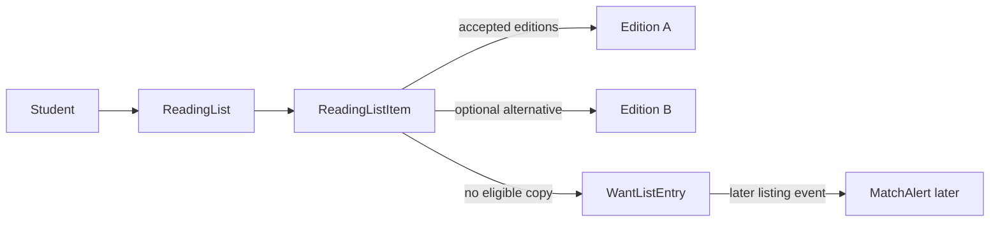

# ReadingList and WantListEntry models

A ReadingList belongs to one student and groups course or term context with ReadingListItems. Each item may accept a set of Edition IDs when an instructor says either revision is acceptable. If a syllabus specifies one ISBN, store only that Edition. Do not turn a vague title into every Work edition automatically. A student should be able to see why a proposed copy matched, including its Edition and ISBN.

Represent each item with a stable key, label shown to the student, accepted Edition IDs, minimum grade rank and optional maximum price in minor units. A WantListEntry can reference a ReadingListItem and carry the same constraints, status and alert preference. It is a standing request for a matching future Listing, not a cart reservation. When no eligible Listing exists, the item may create or update one active want entry. Avoid one want entry per refresh; use a unique key for the student and item or a stable client request identity.

Keep ReadingLists private. A bookshop may need aggregate demand later, but it does not need the student's schedule, name or complete course list to publish a copy. A student request to list another student's ReadingList must be denied at the API query. A MatchAlert later links a wanted item to a newly available Listing and uses a unique key to avoid sending the same student duplicate alerts for the same copy. The model needs IDs that can support that relationship even though the worker comes in Module 24.

Seed one demo list with a title that has two acceptable Editions, one exact-edition item, and one missing item. Set Good-or-better on one and a price ceiling on another. This combination will expose whether the matcher accidentally chooses a cheap Acceptable copy or an older edition. Do not use real student names or course enrollment records. The seed is a teaching fixture, not imported university data.

Test a ReadingList update where a student removes an accepted Edition and then requests matches. The result must use the new set, not a cached broad Work title. Test another student asking for the list by ID. Inspect raw JSON and database counts after denial. A want entry should not expose the student's contact data in a shop-facing listing event. Write these privacy boundaries into `docs/erd.md` before building the alert worker.

## Turn a syllabus line into explicit constraints

A student enters "College Algebra, print edition required" with the ISBN from a syllabus. The ReadingListItem stores the accepted Edition ID, not just a title string. Another course may allow either of two revisions; that item can store a set of accepted Edition IDs. Both items also carry a grade floor and optional price ceiling. The matcher will later filter Listings by those stored constraints, but Module 5 must make the student's intent durable and inspectable.

A WantListEntry is not a Cart line. The student has not chosen or reserved a physical copy. It is a standing rule: alert me when a Listing from an accepted Edition meets my grade and price limits. A page refresh must not create another identical standing request. Use a stable key tied to student and ReadingListItem or a unique index on the active entry. The later worker also needs a unique alert key per want entry and Listing so repeated jobs do not send duplicate notices.

## Test a near match that should fail

Seed an older Edition with a cheap Like New copy and the required Edition with an expensive Good copy. If the student accepts only the required ISBN and has a tight ceiling, neither may qualify. The older copy fails edition identity; the required copy fails price. A title-level search might suggest both as alternatives, clearly labelled, but it must not mark the reading-list item complete. This difference is important in a student marketplace where wrong textbooks cost time and money.

Add one Acceptable copy of the required Edition below the price ceiling. It still fails a Good floor. Now add a Good copy under the ceiling and confirm the want entry can be satisfied. These fixtures exercise edition, grade and price separately. If all seed Listings differ only by title, a matcher test can pass while ignoring two of the three rules. Document expected match reasons and rejection reasons beside the seed.

## Keep private demand private

A ReadingList belongs to a student. The Shop that lists an eligible book should not see the student's full class schedule, name or course list. The alert worker can receive IDs and constraints through a trusted internal path. A public Listing response should not populate WantListEntries that reference it. Test Student B requesting Student A's ReadingList by ID and inspect the raw JSON. A hidden page tab is insufficient; the server query must include authenticated student ID.

When a student changes an accepted Edition set or price ceiling, decide how the active WantListEntry updates. Keep a stable link to the ReadingListItem and derive or replace its current constraints, rather than leaving an old want entry that alerts for books no longer wanted. The model needs an item ID and a status or version to support that reconciliation. Module 18 builds matching, and Module 24 builds alerts; this lesson gives both a trustworthy input record.

## Update a reading-list item safely

A student initially accepts two Editions because a teacher says either revision works. The teacher later clarifies that only the newer revision is accepted. The student removes the older Edition ID. An existing WantListEntry should now use the narrower set; it should not keep alerting about the older edition. Model a stable ReadingListItem ID and either update the entry's accepted set under a version or derive it from the current item when matching. A detached copy of constraints can go stale without a reconciliation rule.

The same applies to a price ceiling. A student may raise it after finding no copies. The matcher should recompute against current available Listings and send at most one alert for a newly eligible copy. Repeated page loads must not create duplicate want entries or duplicate notifications. A unique key on student and item for the active want entry is a useful database guard, but the worker's alert history needs its own uniqueness rule later. Do not conflate "one standing request" with "one alert forever."

## Audit privacy through raw responses

Create two student accounts with different ReadingLists. Ask Student B to GET Student A's list by ID, to PATCH one item, and to query its WantListEntry. Each operation should be denied without returning course names or accepted Editions. A public Shop endpoint can reveal that a book is wanted in aggregate only if the product explicitly chooses such a feature; this module does not need it. Do not populate student Profile into a Listing event sent to sellers.

A reading-list item with no ISBN should be marked unresolved rather than linked to every Work with similar title. The UI can help the student search, but exact matching starts only after accepted Edition IDs are chosen. This separates a useful draft list from a confident eligibility claim. The model should retain original syllabus text for the student while recording resolved Edition IDs for the matcher, so the student can review the interpretation later.

A WantListEntry should have a clear lifecycle: active while the item lacks an eligible copy, paused if the student opts out of alerts, and resolved or archived when they purchase a matching Listing. Merely sending an alert should not mark the reading-list item purchased; the suggested copy might sell to someone else. Store state separately from MatchAlert history. This allows the worker to retry notifications without losing the standing demand and prevents a page refresh from opening another duplicate want entry.
