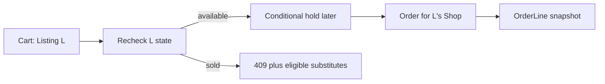

# Cart and Order models

Cart lines hold Listing IDs, not Edition IDs, because a student chooses a particular physical copy with a particular grade and price. Do not add a quantity selector for one used book. If the student clicks Add twice, keep one line or return a clear duplicate message. An Edition may have many offers, but one Listing can be sold only once. Re-read availability when checkout begins; an old cart is not a hold.

For a multi-shop cart, one payment can produce one Order per Shop. Each OrderLine references the Listing but embeds the title, ISBN, grade, defect summary, photo reference and agreed price in minor units. It also preserves the selected pickup or shipping promise. Later edits to shared Work or Edition metadata and current Listing price must not alter an earlier receipt. This historical snapshot is especially important when a seller regrades a book after finding damage.

A Cart may carry the ReadingListItem that led the student to the offer. Preserve that context for substitute suggestions if the Listing sells before checkout. The item still specifies acceptable Editions and grade floor; a substitute must satisfy those constraints, not merely share words in the title. A checkout should never silently replace the chosen Listing with another shop's copy at a different price. Show alternatives and ask for a new decision.

Test one student cart with two Shops, one stale Listing and one available Listing. The API should explain the stale line and avoid charging for it. Test a buyer requesting another student's Cart or Order by ID; the stored buyer ID decides access. Test Shop A requesting Shop B's Order. The split per Shop should make its query easy to scope, but the route still needs the predicate.

A fixture OrderLine can demonstrate snapshot immutability without claiming payment is implemented. Create a test order, change current Listing price and shared Edition title, and compare stored line fields. The next payment module must add verified provider state; Module 5 only ensures the records can represent the sale honestly.

## Start with the exact copy in the Cart

A student selects Shop B's Good copy, Listing L, after comparing offers under one Edition. The Cart stores L, not the Edition ID. If the Cart stored only the shared Edition, checkout would have to choose a seller, grade and price later without the student's consent. A one-copy Listing also has no quantity control. Adding the same L twice should keep one line or return a duplicate message, rather than imply the Shop has two identical copies.

A Cart may retain the ReadingListItem that led to L. If another student buys L before checkout, the substitute search can use accepted Editions, grade floor and price ceiling from that item. It should not silently replace L with another copy at a different price. Show alternatives and ask the student to choose again. A stale Cart is not a system failure; it is an expected consequence of one physical copy being viewed by multiple students.

## Freeze what was promised

OrderLine embeds title, ISBN, grade, defects, priceMinor, currency and the chosen condition photo or safe reference. It also keeps Listing ID and Shop ID links. An admin may later correct the Edition title; a Shop may revise an available Listing's price; the receipt must still explain what the student paid for. If a grade was materially misrepresented, a refund or dispute process should address it, not a silent rewrite of the old line. This is why historical snapshots live beside current records.

For a Cart with copies from two Shops, one Checkout coordinates payment but one Order per Shop keeps seller views isolated. The student can see both Orders. Shop A cannot query Shop B's buyer notes or pickup instructions by knowing the shared Checkout ID. Add ownership predicates to Order reads and write raw API tests with two Shop accounts. The data model's per-Shop Order ID makes this simpler, but only a route check actually enforces it.

## Model the race before payment

The later checkout route conditionally changes Listing.status from available to held and stores Checkout ID. Two students can read the same available page, but only one update should match. If the loser is sent to payment anyway, the marketplace may take money for a copy it cannot deliver. Record expected 409 behavior and a substitute suggestion. The model needs Listing status and hold identity, and Checkout needs a stable attempt ID; Module 5 establishes those fields without claiming the full payment flow exists.

Create an unpaid fixture OrderLine to test snapshot immutability. Change Listing price and Edition title, then re-read the fixture line. Its captured values stay as originally agreed. Label the fixture as a model test, not a verified sale. The next commerce modules add payment, webhook and fulfillment evidence.

## Preserve the student's choice at payment time

A Cart contains Shop A's Good copy for 2,300 minor units. Before checkout, Shop A reprices it to 2,700. The server should show the changed offer and require the student to accept the new amount; it cannot trust the old Cart display. Once a Checkout offer is frozen and payment begins, the OrderLine captures the agreed 2,700 and the selected Listing ID. If the Shop changes its current price again tomorrow, the receipt remains 2,700. Use integer minor units and store currency so provider reconciliation compares like with like.

If a multi-Shop Cart contains another copy, calculate one Checkout total from each validated current line plus delivery or pickup charges under the chosen policy. After verified payment, split one Order per Shop. A Shop must not see the other Shop's private order details just because both came from one provider payment. Scope seller queries by Shop ID and buyer queries by student ID. Write tests for both, including a direct request with a guessed Order ID.

## Name the retry record

A student may lose connection after clicking Pay. The Checkout needs a stable request or idempotency key and provider reference so a retry can find the same attempt rather than start another payment for the same Cart. The Order model needs a Checkout ID and per-Shop uniqueness key so a repeated webhook creates no duplicate seller Orders. These are future behavior tests, but Module 5 should draw the links and reserve fields. A `paid: true` boolean on Cart would not explain the payment attempt, split or replay.

The last-copy race also needs a clear loser response. A Listing hold may be claimed after the student reviewed it but before their payment begins. Return a conflict and eligible substitutes from the same accepted Edition set, never take money and hope another copy appears. Keep the Cart line as stale until the student chooses a replacement. This behavior follows from Cart intent, Listing current state and ReadingList constraints being separate records.

A student might add two Listings from the same Edition to compare them, then choose one before checkout. The Cart can permit multiple candidate lines only if the UI clearly treats them as separate purchases; the core path should discourage accidentally buying two copies of the same required textbook. A warning based on Edition ID can help, but it should not silently remove a line the student intentionally selected for someone else. The database still enforces each Listing's sell-once state, while product copy guides the choice.

When a Cart line becomes stale, preserve a clear reason: sold, held by another checkout, archived by the Shop, or grade changed below the student's floor. These cases may lead to different next actions. A sold or held copy can prompt another eligible Listing; an archived copy may require a new search; a grade change deserves visible explanation. The Cart's response can carry a reason code without exposing another buyer's identity or hold details.
