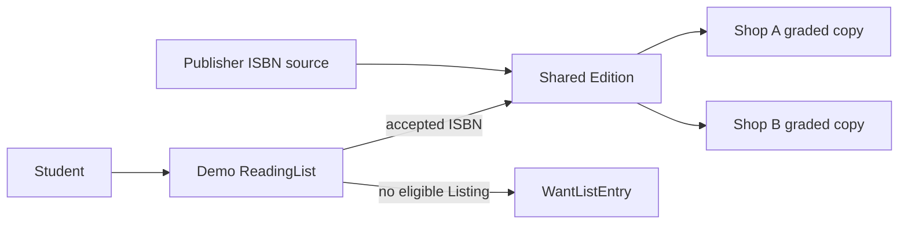

# Seed script

Create three fictional bookshops and two student accounts. Use real ISBNs only after checking the publisher or International ISBN Agency source; an ISBN that merely passes the check-digit formula can still refer to a different book. For teaching fixtures, OpenStax's older College Algebra print edition has ISBN-13 `9781938168383`, and Algebra and Trigonometry print has `9781938168376`, as shown in their published PDF front matter. Use bibliographic metadata only. Do not copy cover art or textbook content into the repository unless the current license explicitly permits that use.

Seed one Work with two Edition records so learners can see revision or format identity, plus other Works for broader browse. Create physical Listings from each Shop across all grade ranks, including two copies of the same Edition at different prices. Include one sold Listing, one draft Listing, and at least one available copy whose grade is below a student's floor. Add a ReadingList with an exact ISBN, an item accepting two Editions, and a missing item that becomes a WantListEntry. Each fixture should support a later test rather than merely fill a catalogue grid.

Make the seed idempotent through stable fixture keys and upserts. Running it twice must keep Shop, Work, Edition, Listing and ReadingList counts stable. Protect non-development databases from reset commands. An interrupted seed should be safe to run again after restoring connectivity. Print the target database name and final counts. If the count doubles, repair the filter before building matching or checkout on top of ambiguous data.

Inspect each chain in MongoDB: owner User to Shop to Listing, Listing to Edition to Work, student User to ReadingList to WantListEntry. Check the actual unique ISBN-13 and partial ISBN-10 indexes. Query one Edition and count offers from two Shops. Query one Shop and confirm it does not own a Work or Edition merely because it listed a copy. Query a different student's list and expect denial.

Save a short source note with the publisher URL and exact format for every seeded ISBN. A print ISBN should not be attached to an ebook Listing. If an old publisher page has changed, update the fixture after verifying another primary source; do not invent an identifier to make the seed pass. Keep shop names and students fictional and clearly label the seed as demonstration data.

## Source the ISBN before creating an Edition

Use a publisher source, not a guessed number. OpenStax's College Algebra PDF front matter lists print ISBN-13 `9781938168383` and print ISBN-10 `1938168380`. Its Algebra and Trigonometry PDF lists a different print ISBN. These are bibliographic identifiers; they do not grant permission to copy pages, cover art or instructor materials into a commercial seed. Use fictional Shop names and owned placeholder condition photos. Add the exact source URL and format next to each seeded Edition so a reviewer can verify the number.

The fixture should contain three Shops, at least two students, Works and Editions with verified identifiers, and copies across every grade. Include one sold Listing and one draft, so public browse and checkout can distinguish them. A demo ReadingList should request one exact Edition, accept two Editions for another item, and include one missing item. Give one item a Good floor and another a price ceiling. Without these cases, later matcher tests can pass while ignoring the product's hardest constraints.

## Make reruns repair rather than duplicate

Use stable fixture keys and upserts in a development-only script. Run the seed twice and compare collection counts and IDs. Simulate a stop after Works and Editions are written but before Listings finish; rerun and confirm it creates the missing copy rows without duplicating catalogue identities. Do not use a blanket delete on a shared database. A reset option should check an explicit development environment and print the target database name before making destructive changes.

A unique ISBN-13 index protects the shared Edition from concurrent duplicate inserts. A stable seed filter helps reruns but is not a replacement for that index. Inspect the actual index list in the database. For optional ISBN-10, confirm the partial unique index excludes Editions without that field. The seed can expose an index migration problem early, before multiple Shops start typing the same book into the UI.

## Inspect the relationships by hand

Choose one Edition and count its Listings from two Shops. Each Listing should have its own grade, price, defects and Shop ID. Follow one Shop's owner ID to its User. Follow a ReadingListItem to its accepted Editions and its WantListEntry when no eligible copy exists. Ask another student account for that list and confirm a raw denial. Change one Listing's price and confirm its shared Edition and another Shop's Listing stay unchanged.

A seeded sold Listing is not a proof of payment. Mark it as a fixture and keep verified webhook tests for the later module. Similarly, a WantListEntry fixture does not prove the background alert worker sends exactly once. The seed's job is to make model relationships and future test scenarios ready. Save a small evidence note with counts, verified ISBN source links, one wrong-Shop denial and one wrong-student denial, then commit the script and ERD draft.

## Repair a half-written seed

Stop the seed after Work and Edition rows are written, before Shop Listings are inserted. Run it again. The script should find the existing shared records by stable keys, verify their ISBNs and create only missing Listings. If it creates a second Edition with the same ISBN, the unique index should stop it; the script should then resolve the existing row rather than fail the whole fixture. Compare IDs across the interrupted and repaired runs. This exercise makes a weak-connection development environment less frustrating.

Now remove one Listing fixture from a disposable database and rerun. It should restore exactly that Listing while leaving the other Shop's copies unchanged. Do not identify fixtures only by title, because several copies intentionally share the Edition and may even share a price. Use stable seed keys that are not exposed in the public API. Record the expected counts for all collections and the sample IDs that prove each relationship.

## Check source and license separately

An ISBN source proves bibliographic identity; it does not necessarily license the cover image or textbook content for marketplace reuse. Use the publisher front matter to confirm the identifier and format. Use owned placeholders for seller condition photos. If a real OpenStax image or page is considered, inspect the current license and attribution requirements first. The seed does not need those assets to teach the database relationship, so a small original placeholder is safer and easier to maintain.

Ask another student to trace the seed's missing reading-list item. It should have an accepted Edition set and no qualifying available Listing under its grade and price rules. If it is "missing" only because no Listing exists but an ineligible older edition is counted as matching, the fixture does not test the right behavior. Write the expected rejection reason beside each nearby offer in the seed comments. This makes Module 18's matcher work concrete rather than a vague search exercise.

Make the seed's ISBN source note machine-checkable where practical: store the URL and the exact format label next to each fixture declaration, then assert the normalized ISBN key in a unit test. Do not fetch the publisher site on every local seed run; that would make development depend on network access. Verify sources during authoring and review, commit the chosen identifiers, and keep the seed deterministic offline. If a source later changes, update the fixture in a reviewed change rather than silently switching its Edition on a learner's laptop.
