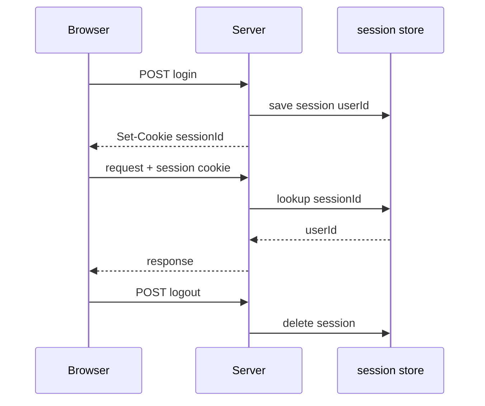
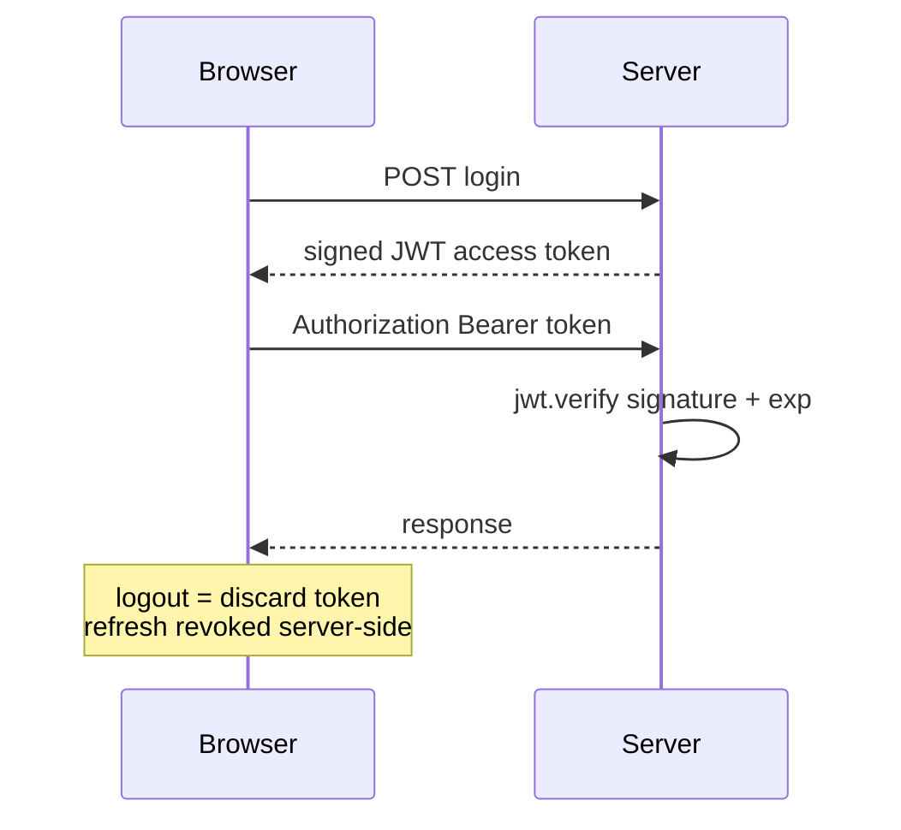

# 6.4 ,  Sessions vs JWT

> **[Learn]** · Chapter 06 ,  Authentication API · *Stateful vs stateless; pros/cons; **JWT for this course***

Every authenticated API must answer: **how does the server remember who sent this request?** Two dominant patterns ,  **server-side sessions** and **JWT (JSON Web Tokens)**. This course mandates JWT for Hamesh.

<BigWordAlert term="Stateless JWT" plainEnglish="A signed token the client sends on each request ,  server validates signature without storing session in memory." whyItMatters="Hamesh uses JWTs so the API scales without a central session store ,  good fit for a Node + React split." />

## Why this matters

These two options are not two names for one thing. Swapping one for the other moves **where the state lives**, rewrites what logout means, and changes how a browser app proves who it is on each call. Choose blind and you will eventually ask why logging out did not kill access immediately. Hamesh takes JWT with a hashed refresh token, and this chapter exists so you know exactly what that choice cost you compared with a Redis session store.

## Think of it like…

**Hand stamp vs driver's license at a festival.** Session: venue keeps a list at the door, you show a wristband number. JWT: you carry a signed pass with expiry printed on it ,  gate staff verify signature, not a lookup list (until refresh revocation).

<ComparePanel title="Sessions vs JWT">
  <CompareColumn label="Sessions">
    The server keeps the record in Redis or the database, and the browser carries only a session cookie. Logout removes the record and the next call finds nothing. Every server that might answer needs access to the same store.
  </CompareColumn>
  <CompareColumn label="JWT (this course)">
    The server signs the token and the client returns it as a Bearer header. Logout clears the stored refresh token. No lookup against a central store runs per request, so extra API processes do not need to share anything.
  </CompareColumn>
</ComparePanel>

## Common questions

**Q: Are JWTs encrypted?**  
A: Signing is not encryption, and the difference matters. Anybody holding the token can base64-decode it and read what is inside; drop one into jwt.io and the claims are plain. What they cannot do is alter those claims, because your signature only validates over the exact bytes you signed. Treat the payload as a public notice with a tamper seal on it. Passwords, secrets, personal data and server-only flags have no business there.

**Q: Why short access token if refresh exists?**  
A: Because a leak is a question of scope, not likelihood. The access token sits in browser memory and rides on every request, which makes it the easiest thing on the page for injected script to lift. Holding its life to fifteen minutes means a lifted copy stops working before it travels far. The refresh token is a different animal: it lives in an httpOnly cookie the browser will not hand to JavaScript, the server can strike it from the database, and that is precisely why it is allowed a long life.

**Q: Why not sessions with Express default memory store?**  
A: Two reasons, both specific to Hamesh. The Express default keeps session data in the memory of the one process, so a second instance shares nothing and a restart empties every login, which is fine for a demo and useless for anything hosted. The other reason is continuity: the rest of this course, and most MERN codebases you will meet, are built on the SPA plus Bearer token shape, so learning it here means Chapter 7 through Chapter 27 read as one story rather than two. Sessions remain a reasonable choice for a very small app; they are simply not the one this course builds.

## Where the state lives on each request

The whole comparison reduces to one question about a single request. When a student taps their reading list and that request reaches the API, does the server already know who they are, or does it have to look them up? With sessions it looks up: the cookie carries an opaque id and the meaning of that id lives in a store the server controls, which is exactly why deleting a session row revokes access instantly. With a JWT it does not look up: the token carries the identity claim plus a signature the server can check using a secret it already holds. Nothing has to be remembered between requests, so a second API process behind the same load balancer gives the same verdict as the first.

Everything practical in this chapter traces back to that one split. Revocation is instant because of the store: delete the row and the next request searches for something that is no longer there. Statelessness comes from the signature: a signature that checks out over claims that have not expired is the whole argument, and nothing else is consulted. Hold those two sentences and you no longer have to memorise logout behaviour, horizontal scaling or cookie handling; you derive them.

## Server-side sessions



```
Login → server stores session in Redis/DB → returns session ID cookie
Each request → server looks up session → loads user
Logout → delete session server-side
```

| Pros | Cons |
|---|---|
| Revoke instantly ,  drop the session row | Stateful ,  a store has to exist and stay up |
| Tiny cookie holding only an id | Every process behind the balancer needs that store |
| Server decides the lifetime, no client vote | Redis or a session table is extra infrastructure |

Classic choice for monolithic apps with server-rendered pages.

## JWT (stateless access token)



```
Login → server signs JWT with secret → client stores token
Each request → client sends Bearer token → server verifies signature + expiry
Logout → client discards token; server may revoke refresh only
```

| Pros | Cons |
|---|---|
| No store lookup while verifying access | An issued access token outlives a logout |
| Any number of services can verify alone | Claims are readable, only signed, never hidden |
| Comfortable for SPAs and mobile clients | Rotating the signing secret needs a plan |

**Hybrid used here:** Short-lived JWT access + long-lived refresh stored hashed in DB ,  revoke refresh kills renewal.

## Worked trace: one student, four requests

Follow a student called Hana through a session that outlives her access token. The trace is worth reading closely because only two of the four steps touch any server-side state at all: login writes the refresh hash, and refresh reads and replaces it. Everything in between is a signature check.

<TraceRequest title="Hana's session across a 15-minute access token">
  <TraceStep actor="Client" label="Hana logs in" detail="Password compared, access JWT signed for 15 minutes, refresh hash written to the User document" />
  <TraceStep actor="API" label="GET /api/me/reading-lists" detail="Bearer token verified with JWT_SECRET, no identity lookup against the database" />
  <TraceStep actor="API" label="Minute 16 arrives" detail="verify throws TokenExpiredError and the client receives a 401" />
  <TraceStep actor="Client" label="POST /api/auth/refresh" detail="Refresh token hashed and compared, new access token returned with a rotated refresh token" />
</TraceRequest>

That ratio is the reason the pattern scales: four requests, two touches of stored state. It is also the reason logout feels less absolute than a session logout, and the next section is about exactly that gap.

## The revocation gap you accept

Suppose Hana taps logout at minute 12. The server clears `refreshTokenHash` and the client forgets its access token, but any copy of that access token taken before logout still verifies until its `exp` claim passes. The gap is not a bug in your code; it is the width of the access lifetime, and it is the price of not looking anything up.

Two habits fall out of that. Keep the access lifetime in minutes instead of days, which is the reason fifteen keeps showing up on every page of this chapter rather than an hour. And treat refresh revocation as the switch that actually stops things: it cannot reach back and cancel a token someone already copied, but it does guarantee that no replacement can be issued, so the exposure has a hard end at the next `exp` instead of running on indefinitely.

A `tokenVersion` counter on the User document closes that window entirely. Bump it on logout or on a password change, compare it on every authenticated request, and stale tokens stop passing. It works, and it belongs in your vocabulary. What it costs is a database read on every request, which is the exact expense statelessness was introduced to avoid. Add it because you decided to, not because it looked thorough.

## Rotation races and how they look

Refresh rotation introduces a failure mode that looks like random logouts. A student opens Hamesh in two tabs, one on the browse page and one on a listing they were about to add to their want list. The refresh cookie is shared by the browser, so both tabs hold the same refresh token. At minute 16 both tabs fire `/api/auth/refresh` within a few hundred milliseconds. The first arrives, rotates the token, and writes a new hash. The second arrives with the old token, its hash no longer matches the stored one, and the API answers 401. One tab continues and the other throws the student to the login screen.

Your logs give it away: two refresh calls for one student, timestamps less than a second apart. Nothing is broken on the server in that pattern; the browser is competing with itself. The inexpensive answer is a single-flight refresh inside the API client, a shared promise that both callers wait on, and you build one in Chapter 7. Server-side, you can accept the previous hash for a brief grace window, or group rotated tokens into a family so that replaying an old one invalidates every descendant. Whichever route you choose, settle it before writing the interceptor, since bolting rotation onto a client that refreshes eagerly is far messier than designing for it.

## Debugging a rejected token

A 401 from `/api/me/reading-lists` while holding a token you believe is valid has four common causes, and they are worth checking in order because each one is cheaper than the next. Does the header actually say `Bearer ` with a space, and is the token present at all? Did the process that signed the token and the process verifying it read the same `JWT_SECRET` value, including the same trailing whitespace and the same `NODE_ENV` file? Is the token expired rather than malformed, which you can tell by catching `TokenExpiredError` separately from `JsonWebTokenError`? And is the machine clock sane, because `exp` is compared against the wall clock of whatever verifies it?

Record the error class and the claim timestamps, never the token. When a boot log shows `invalid signature`, the two sides are working from different secrets, and in practice that means one side was rotated and the other was not, or a `.env` file got loaded in one process and missed in its neighbour.

## Why JWT for this course

| Factor | Hamesh choice |
|---|---|
| MERN SPA client | Bearer token in memory fits React |
| Module monolith | No separate session Redis until Ch 21 cache |
| Learning goal | Industry-standard JWT + refresh pattern |
| Pair with Ch 7 | 401 refresh loop teaches real client auth |

Redis in Chapter 21 is for **catalogue cache**, not sessions.

## What goes in JWT payload

**Include:**

- `sub` or `userId` ,  MongoDB User _id
- `role` ,  vendor | customer  
- `iat`, `exp` ,  issued/expiry  

**Never include:**

- passwordHash  
- email (optional ,  prefer /me endpoint)  
- refresh token inside access token  

Keep access payload minimal ,  reduces leakage if token stolen.

## Refresh token pattern

The two tokens do very different jobs ,  one proves you're still logged in for minutes, the other proves you're still logged in for days:

| | Access JWT | Refresh token |
|---|---|---|
| Lifetime | Fifteen minutes | Seven days |
| Sent how | `Authorization` header | httpOnly cookie (Ch 7) or request body (Ch 6 curl) |
| Stored server | Nowhere | Hash in `User.refreshTokenHash` |
| Revoke | Let it expire | Clear the hash on logout or rotation |

**Rotation (recommended):** New refresh on each refresh call ,  invalidate old hash.

## Comparison table

Side by side, the practical differences that matter on a real codebase:

| Concern | Sessions | JWT access + refresh |
|---|---|---|
| Revoke every session for a user | Straightforward | Clear refresh hashes; access survives to expiry |
| Database round trip per request | Yes, to look up the session | None while verifying access |
| Script steals the credential | Cookie stays httpOnly | Memory-held access narrows XSS damage vs localStorage |
| CSRF exposure | Real, because cookies ride along | Lower, since the Bearer header is set explicitly |

## Decision record

Document in learning log:

*"Hamesh uses JWT access tokens verified with JWT_SECRET and refresh tokens hashed on User. Access is stateless; refresh revocation provides logout. Session store deferred."*

## ✅ Do / ❌ Don't

**✅ Do:** Keep access lifetime short ,  15m default.

**✅ Do:** Hash refresh token before DB storage ,  like passwords.

**❌ Don't:** Put JWT_SECRET in git or client.

**❌ Don't:** Store access token in localStorage if avoidable ,  Ch 7 uses memory.

## Reflect

What happens if user clicks logout but access JWT still unexpired? How does refresh revocation help?

## Next

**Sub-chapter 6.5:** Password hashing ,  bcrypt, salt, cost factor.

Architecture chosen ,  password storage mechanics next.
