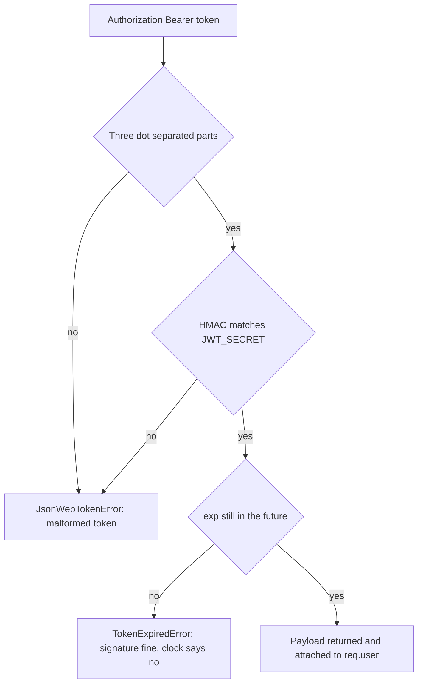

# 6.7 ,  Prime your thinking

> **[Learn]** · Chapter 06 ,  Authentication API · *Mandatory reads: bcrypt, JWT intro*

Before scaffolding auth routes, read how bcrypt and jsonwebtoken behave in Node ,  especially async APIs and error types. Thirty minutes prevents "invalid signature" loops.

<BigWordAlert term="Access vs refresh token" plainEnglish="Short-lived access token for API calls; longer refresh token to get new access tokens without re-login." whyItMatters="Hamesh access tokens expire in minutes; refresh tokens keep students logged in across tab sessions." />

```predict
prompt: "A student's access token expires while their refresh token is still valid. What should Hamesh do?"
options:
  - id: extend-expired
    label: "Keep accepting the expired access token until logout"
  - id: rotate-access
    label: "Use the refresh token to mint a new access token"
correctOptionId: rotate-access
explanation: "Short-lived access tokens limit exposure. A valid refresh token is the credential used to mint a replacement; an expired access token must not become valid again."
allowRetry: true
```

## Mandatory reads

Read these four in order. The first two are the tools you'll type into `server/src/` this chapter ,  read their official READMEs so you use the APIs the way the maintainers intend, not the way an old blog post remembers them.

| Resource | Focus |
|---|---|
| [bcrypt npm readme](https://www.npmjs.com/package/bcrypt) | hash + compare async API |
| [jsonwebtoken readme](https://www.npmjs.com/package/jsonwebtoken) | sign, verify, expiresIn |
| [JWT.io introduction](https://jwt.io/introduction) | structure recap |
| Express [Router mounting](https://expressjs.com/en/guide/routing.html) | `/api/auth` prefix |

Optional: [OWASP Authentication Cheat Sheet](https://cheatsheetseries.owasp.org/cheatsheets/Authentication_Cheat_Sheet.html) ,  password storage section.

## bcrypt API notes

```javascript
// hash ,  async preferred
const hash = await bcrypt.hash(password, 10)
// compare
const match = await bcrypt.compare(password, user.passwordHash)
```

Sync variants exist ,  use async in Express handlers to avoid blocking event loop.

## What bcrypt is doing with your password

The stored value is not an encrypted password, and that difference decides half the code you are about to write. When you call `bcrypt.hash(password, 10)`, bcrypt generates a fresh random salt, runs its key schedule many times over the salt and password together, and returns one string that carries everything needed to check the result later: the algorithm marker, the cost, the salt and the derived digest. Two students who both choose the same password end up with completely different stored strings, which is precisely why a leaked table of hashes cannot be attacked by comparing rows against each other.

Because the salt travels inside the hash, `compare` needs the stored hash rather than a separate salt column, and it re-derives the digest using the cost and salt it finds there. The consequence for Hamesh is concrete: there is no step anywhere that turns a hash back into a password, so no support flow can ever show a shop owner their old password, and a forgotten password can only be replaced. That is not a limitation to work around; it is the property you are paying for.

## Choosing a cost factor

Cost is the log of the number of rounds, so every increase of one doubles the work. Ten is the usual starting point and lands somewhere between fifty and a hundred and fifty milliseconds on a typical laptop, which is fast enough that a shop owner signing in does not notice. The trade-off is symmetric and worth stating plainly: a higher cost makes an offline guessing attack against a stolen dump slower, and it also makes every login on your own server slower while consuming event loop time that other requests need.

Your target is the heaviest cost your deploy target can carry while a bookshop signing in still finishes well inside a quarter second. Whatever number you settle on belongs in the learning log beside the machine you measured it on, so a later reader can tell a deliberate choice from a copied default. Raising that number afterwards costs you nothing in correctness, because each stored string already records the cost it was built with: old hashes keep verifying against their own setting, and you quietly rebuild them at the new one the next time that student types the right password.

## jsonwebtoken API notes

```javascript
const token = jwt.sign({ sub: userId, role }, secret, { expiresIn: '15m' })
const payload = jwt.verify(token, secret) // throws if invalid/expired
```

Error names to catch in middleware:

- `TokenExpiredError`
- `JsonWebTokenError`

Return 401 with `{ message: 'Unauthorized' }` ,  don't leak error details to client in production.

## How `verify` decides a token is good

Read any token your API hands out as three base64url runs of characters separated by two dots: a header naming the algorithm, a payload carrying the claims you chose to publish, and the signature itself. When `jwt.sign` runs it takes the first two runs exactly as they will appear on the wire, mixes them with your secret, and glues the output on as the third, so the signature is bound to those precise bytes. Verification walks the same road backwards: split on the dots, rebuild the signature from the first two pieces, compare it against the third, and only afterwards look at `exp` and `nbf`. A token can fail on the signature or on the clock, and the library raises a different error class for each rather than one generic shrug.

That sequence is not an implementation detail, it decides what your error handling is allowed to say. Editing a payload and re-encoding it changes the bytes the signature was computed over, so the comparison fails before any claim is believed, and nobody extends their own expiry that way. A token that was never touched but has simply run out of time clears the signature check and then trips the clock, which is exactly the case the refresh flow exists for. Flatten both outcomes into a bare 401 and you lose the ability to tell a lapsed session from a `JWT_SECRET` that differs between two processes.



The takeaway is that only one path reaches `req.user`, and the two failure paths are separate classes for a reason: one is routine and recoverable through refresh, while the other usually means two processes disagree about a secret.

## Worked trace: register, log in, guarded read

Trace a shop owner called Lina from registration through a guarded request, and watch which step needs which library. The interesting detail is that bcrypt appears twice and jsonwebtoken appears twice, but never in the same step, which is why the two sections above are worth reading separately.

<TraceRequest title="From registration to a guarded read">
  <TraceStep actor="Client" label="Lina POSTs /api/auth/register" detail="Password hashed at cost 10, User written with passwordHash and no plaintext copy" />
  <TraceStep actor="API" label="POST /api/auth/login" detail="compare re-derives with the stored salt, then a 15-minute access token is signed" />
  <TraceStep actor="API" label="GET /api/shops/mine" detail="requireAuth verifies the signature, attaches the payload to req.user, the route reads the role" />
  <TraceStep actor="Server" label="Same request after expiry" detail="verify throws TokenExpiredError and the handler answers 401 rather than 500" />
</TraceRequest>

Read the failure step again, because it is the one people get wrong: an unhandled `TokenExpiredError` that escapes the middleware becomes a 500 with a stack trace, and the client reads that as a server outage instead of as a signal to refresh.

## Failure modes that look like bugs

Five mistakes account for almost every hour lost in this chapter, and each one has a distinctive symptom once you know what to look for. Calling `compare` with `undefined` because the user lookup returned null throws "data and salt arguments required", so always answer 401 before comparing when no student or owner matched. Forgetting to `await` a bcrypt call returns a promise, which is truthy, so every password appears to be correct. An "invalid signature" on a token that was just issued means the signing and verifying processes read different secrets, usually a trailing space in the `.env` value or a variable loaded in one process and missed in another. Passing `expiresIn: 15` instead of `expiresIn: '15m'` gives a token that lives fifteen seconds, because a bare number is interpreted as seconds. And signing a payload without `sub` gives middleware that works but leaves `req.user.userId` undefined, so the shop ownership check quietly fails much later.

You will not spot any of those five by staring at the route file, and trying costs more than it saves. Spend ten minutes with the two libraries on their own instead, outside Express entirely: hash a string, compare it, then compare the wrong string; sign a token, verify it, then verify one whose `exp` has already passed and print the class you caught. That short session flushes out all five symptoms while the only thing broken is a scratch file.

## Express middleware order preview

```
app.use(express.json())
app.use('/api/auth', authRoutes)
// later: app.use('/api/shops', requireAuth, shopRoutes)
```

`requireAuth` applied per-route or router ,  not globally on health.

Two rules about placement are worth settling before you type. The health route must stay public, because a probe that needs a token reports the wrong thing during an outage, and a 401 from health looks like a dead process to the platform. And `requireAuth` must run before any handler that reads `req.user`, because a route that reads `req.user` without the middleware in front of it dereferences `undefined` and throws a 500 where the learner expects a 401. Mount the router under `/api/auth` so the prefix lives in one line, and keep the middleware out of `app.use` with no path, since that would guard login and register as well.

## HTTP validation pattern

`auth.schema.js` decides what each route is allowed to receive. Every field you list here is something a real marketplace API validates ,  garbage in, garbage out is how bad APIs start.

| Route | Body fields |
|---|---|
| register | email, password, role, displayName? |
| login | email, password |
| verify-otp | email, otp |
| refresh | refreshToken (if body mode) |

Return 400 with field errors before service layer.

## OTP implementation options (pick one)

Both options store the code on the User document; they differ in how much damage a leaked database does. Plain text is fine for a dev-only demo; hashed is what you'd ship.

| Option | Storage |
|---|---|
| Plain OTP + expiry | otpCode, otpExpiresAt on User ,  dev only OK with short TTL |
| Hashed OTP | otpHash like password |

Dev delivery: `console.log('OTP:', otp)` when NODE_ENV=development.

Treat the one-time code as a password whose whole life is five minutes, and the advice from the bcrypt sections above carries over with one addition. Six digits is a tiny search space, so guessing is cheap for anyone who can hit the endpoint again and again, and the attempt tally on the user document is the thing that makes repeating expensive. Keep the hash, the expiry and that small counter, and check the code with the very same `bcrypt.compare` call you already wrote for passwords. Plain text is only defensible while the delivery channel is `console.log` on your own laptop, because at that stage there is no real secret to protect.

The expiry check belongs on the server and it belongs before the comparison, since an expired code should fail without spending bcrypt rounds on it. Resending a code should replace the previous hash and reset the counter rather than adding a second valid code, otherwise every resend widens the window an attacker can guess inside. These are small decisions now, and they are the ones that turn an OTP screen from a demo into something you would put in front of a real student.

## Note-taking template

```
Register service steps:
1. validate
2. duplicate email check
3. hash password
4. create user + profile
5. generate OTP
6. return { message, ...(dev otp) }

requireAuth:
- header parse
- verify
- attach req.user
```

## Time box

| Activity | Minutes |
|---|---|
| bcrypt readme | 10 |
| jsonwebtoken readme | 15 |
| OWASP skim | 10 |
| Map routes to service functions | 15 |

## ✅ Do / ❌ Don't

**✅ Do:** Test jwt.verify with expired token manually.

**✅ Do:** Keep Postman/curl collection notes for 6.18.

**❌ Don't:** Implement handlers before env JWT_SECRET in config.

## Self-check before build cluster

- [ ] I can sign and verify a JWT in isolation
- [ ] I can hash and compare a password
- [ ] I know 401 vs 403 usage ,  unauthenticated vs verified/authorized

## Next

**Sub-chapter 6.8:** Authentication and token-safety knowledge check.

Reading done ,  build starts at 6.9.
