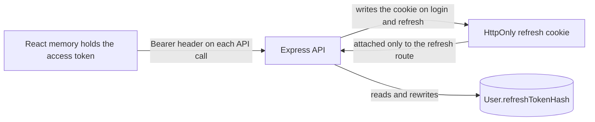

# 7.4 ,  Where tokens live

> **[Learn]** · Chapter 07 ,  Login & registration · *Access in memory; refresh in httpOnly cookie*

Concrete storage map for Hamesh client ,  implement in 7.10 and 7.14.

<BigWordAlert term="localStorage trade-off" plainEnglish="Browser storage that survives refresh but is readable by any JavaScript ,  vulnerable to XSS attacks." whyItMatters="Hamesh may use localStorage for access tokens in this course ,  understand the XSS risk you accept." />

## Why this matters

"Vague auth state" bugs dominate beginner SPAs ,  token in localStorage, refresh missing, reload logs everyone out, or refresh runs on login page causing loops. This page pins **exactly where each token lives** so implementation matches security intent from 7.2.

## Common questions

**Q: Why useRef instead of useState for the access token?**  
A: Either one works, so the real difference is what a change costs the renderer. Storing the token with `useState` repaints every component subscribed to that state on each write, so a silent rotation in the background can repaint a whole subtree while nothing visible changes. A `useRef` box holds the string and notifies nobody, which is why the rotation stays invisible. The price is that nothing re-runs when the ref changes, and that does not matter here because the API client is the reader and the UI never is. Both patterns pass the gate, so choose one, apply it everywhere, and record the decision in your learning log.

**Q: Can React read the refresh cookie to debug?**  
A: It cannot, and that is the whole point of the flag. `httpOnly` removes the cookie from every JavaScript surface, so `document.cookie` will not list it and scanning `localStorage` is wasted effort. Inspect it from outside the page instead: open the Network panel, pick the refresh request, and read the `Set-Cookie` header on the response, or walk to DevTools then Application then Cookies and read the entry directly. You can confirm the cookie is being written and sent without ever holding its value in code. An absent entry there means the server never set it, which sends you back to the Express side rather than the React side.

**Q: What is `credentials: 'include'`?**  
A: Cross-origin requests leave cookies behind unless you say otherwise, and in development your Vite server on 5173 and your Express API on 3000 count as different origins. Adding `credentials: 'include'` to the fetch options is the instruction that lets the browser carry the httpOnly refresh cookie along to `/api/auth/refresh`. Leave it out and every silent refresh answers 401, since the cookie never entered the request at all; the symptom is an endpoint that behaves in curl and refuses in the browser. It is a one-line change in the API client, not a server bug.

**Q: Why protect the refresh token more than the access token?**  
A: Because losing one is survivable and losing the other is not. An access token is dead in about fifteen minutes, so a thief who takes it gets a very short window to use it. The refresh token stays usable for days and can be traded for fresh access tokens the whole time, which is the difference between walking off with one day's takings and walking off with the key to the till. That imbalance is the entire reason the split exists: the cheap, short-lived credential sits in the convenient but flimsy place, and the durable one sits behind the strongest door the browser can close. Sort each token by what losing it would cost, then give it the home that matches.

**Q: Why does page reload wipe the access token from memory?**  
A: Nothing was stored, so nothing can be recovered. Memory is not a place in the browser you can go back to; it is the running page's scratch space, and a reload throws that page away along with every variable it held. The token vanishing is therefore the design working rather than a defect to patch: it cannot outlive the tab session and cannot be scooped up by something that runs later. What gets you back is the boot path, where the app posts to `/api/auth/refresh` as it mounts and trades the cookie for a new access token before it renders a route. `isLoading` exists so the router waits for that exchange to finish.

## Access token ,  memory only

A short-lived access token rides along with every authenticated call the API client makes, and in Hamesh it lives in a plain JavaScript variable held by the AuthProvider. That variable is deliberately the only home it gets: no localStorage entry, no sessionStorage entry, no cookie a script could read. The cost is that closing or reloading the tab empties it, so the session only returns through the silent refresh described in the boot sequence below. What that inconvenience buys is a theft window measured in minutes instead of days, whenever some injected script ends up running on a page a student has open while browsing listings.

**Location:** `useRef` or closure variable inside AuthProvider ,  **not** React state if you want to avoid re-renders on token rotation; plain state is fine if simpler.

**Set when:**

- Login success  
- Refresh success  
- App boot refresh success  

**Clear when:**

- Logout  
- Refresh failure  
- 401 after retry  

**Never:** localStorage, sessionStorage, document.cookie (JS-readable).

## Refresh token ,  httpOnly cookie

A refresh token that has to survive days of study deserves the most protected slot the browser offers, which is a cookie that script code cannot open. Express sends it in a `Set-Cookie` header at login and at each rotation, the browser files it away against the API origin, and no line of your React code ever touches the string. Any call to `/api/auth/refresh` marked with `credentials: 'include'` arrives with the cookie already attached, so there is no token plumbing to maintain in the client at all.

**Set by:** Server `Set-Cookie` on login and refresh responses.

**Read by:** Browser automatically on `fetch(..., { credentials: 'include' })` to `/api/auth/refresh`.

**Client JS:** Does not read refresh value ,  opaque to React.

## Server cookie spec (coordinate with Ch 6)

| Attribute | Dev | Production |
|---|---|---|
| HttpOnly | true | true |
| Secure | false (localhost) | true |
| SameSite | Lax | Lax |
| Path | /api/auth | /api/auth |
| Max-Age | 7d | 7d |

Cookie name: `refreshToken` ,  document constant on both sides.

## Three places, three lifetimes

The storage map gets easier once you separate three things people usually merge: where the browser keeps a value, where the server keeps a value, and how long each one is allowed to live. Hamesh keeps the access token in a JavaScript variable, the refresh token in a cookie the page cannot read, and nothing but a hash of the refresh token on the server. Those are three different homes with three different owners, and none of them can substitute for another.

The sketch below puts both credentials on one page along with the directions each one travels. Watch the arrow that carries the cookie, because it leaves the API, lands in the browser, and comes back to the API with React sitting entirely outside the loop. That detour is what keeps a long-lived refresh token out of reach of an injected script, and it is the one property from the drawing worth memorising.



The takeaway is an asymmetry you can act on: the value your code touches constantly is the cheap, short-lived one, and the value that can mint new sessions is the one your code never sees.

## Boot sequence

A fresh page load starts with no access token anywhere in memory, so the app has to attempt a rebuild before it renders a protected route. Without that step a signed-in student sees the login screen flicker for a moment, and may be pushed there for good, which reads as a spontaneous logout. Running the refresh first is what makes a reload feel like the session was never interrupted.

```
App mounts
  → AuthProvider calls refreshAccessToken()
  → POST /api/auth/refresh (cookie sent)
  → 200: set access in memory, set user from /me optional
  → 401: user stays logged out
  → set isLoading false
```

Prevents flash redirect on protected routes during boot.

## What the boot refresh looks like

Follow a student called Hana who reloads the page halfway through adding a copy to her reading list. The reload is the interesting event, because it destroys the only copy of the access token that existed. What survives is the cookie, and that is why the recovery path runs through the API rather than through any storage lookup on the client.

<TraceRequest title="Page reload on a protected route">
  <TraceStep actor="Client" label="Browser reloads the tab" detail="Fresh page and empty JavaScript memory, the old access token is gone" />
  <TraceStep actor="React" label="AuthProvider mounts and calls refresh" detail="POST /api/auth/refresh with credentials include while isLoading stays true" />
  <TraceStep actor="API" label="Server rotates the pair" detail="Cookie hash matches the stored hash, a new access token is returned and the hash is replaced" />
  <TraceStep actor="React" label="Router renders the protected route" detail="Token kept in the ref, isLoading false, the route renders signed in" />
</TraceRequest>

Skip the second step and the fourth step renders the login screen for a session that was never lost, which is the exact bug that makes learners blame the server.

## Logout sequence

Logging out is symmetric with logging in: the client drops what it holds in memory, and the server invalidates the refresh cookie so it cannot be replayed. Do both sides ,  clearing only the client leaves a usable refresh token behind.

```
Client: clear access memory
Client: POST /api/auth/logout (credentials include) ,  if implemented
Server: clear refresh cookie + refreshTokenHash
Redirect to /login
```

## When two tabs disagree

Memory and cookies have different scopes, and that mismatch creates a logout bug worth understanding before you meet it. Suppose a student has Hamesh open in one tab on the browse page and another on the Collection details for an order. Tapping logout in the first tab clears the cookie, which is shared by the whole browser, and clears that tab's in-memory token. The second tab still holds its own access token in a variable that no other tab can reach, so it keeps rendering and keeps calling the API successfully until its token expires.

The lag is bounded by the access lifetime, at most fifteen minutes, and it ends in a specific way: the next call gets a 401, the client tries to refresh, the cookie is gone, and the tab finally lands on login. That is correct behaviour in the sense that the session did end, but it is not instant, and users read the gap as a security flaw. If instant logout across tabs matters for a student reading on a laptop with several tabs open, listen for a storage event on a small marker key or broadcast the logout with `BroadcastChannel`, then clear memory in every tab that hears it. Recording the choice in the learning log is part of the design work, because the alternative is discovering it during a demo.

## Diagram

```
┌─────────────┐     Bearer access      ┌─────────────┐
│   React     │ ─────────────────────► │   Express   │
│   memory    │                        │   API       │
└─────────────┘                        └─────────────┘
       ▲                                      ▲
       │ refresh once                         │ Set-Cookie
       └──────── POST /refresh ──────────────┘
              (httpOnly cookie auto-sent)
```

## Dual mode during migration

It is likely that your client work begins while the Chapter 6 handlers still hand the refresh token back inside a JSON body. Use that as scaffolding if it unblocks you, but keep the label honest: writing the cookie from client JavaScript is a weaker arrangement, because the refresh value exists in a place page scripts can reach, if only for an instant. Treat it as a bridge you intend to remove, and remember that the gate asks for the server-set httpOnly cookie in the final submission.

- Ch 7 can set cookie from client ,  **less secure** ,  prefer server Set-Cookie  
- Gate requires httpOnly cookie pattern for final submission  

## Common beginner mistakes

Where token placement goes wrong, it usually fails in one of these ways:

1. **Access token in localStorage** ,  the token outlives a reload, but a single injected line of script lifts it straight out. This is the most common MERN auth mistake there is, and it is why this sub-chapter exists.
2. **Refresh token in a JS-readable cookie or localStorage** ,  the credential worth the most ends up with the weakest housing, so the thief walks away with days of access instead of fifteen minutes of it.
3. **No boot refresh** ,  memory comes back empty on every load, so students are logged out constantly. The `isLoading` state is there to hold the router until the boot refresh settles.
4. **Refresh loop on the login page** ,  the interceptor has to skip public auth routes, or a mistyped password fires a refresh attempt that also 401s, then a logout redirect ,  a cascade that is hard to read from a console.  

## ✅ Do / ❌ Don't

**✅ Do:** Use sameSite Lax for localhost dev.

**✅ Do:** Scope cookie Path to /api/auth minimum.

**❌ Don't:** Expose refresh to window object for debugging in committed code.

## Self-check

- [ ] I can name which token belongs in a cookie and which must never be stored there
- [ ] I can argue why a refresh token has no business in localStorage
- [ ] I can state the two cookie attributes a deployed Hamesh site depends on (`Secure`, `httpOnly`)

## Next

**Sub-chapter 7.5:** The 401 retry loop ,  refresh once, else logout.

Placement clear ,  interceptor algorithm next.
