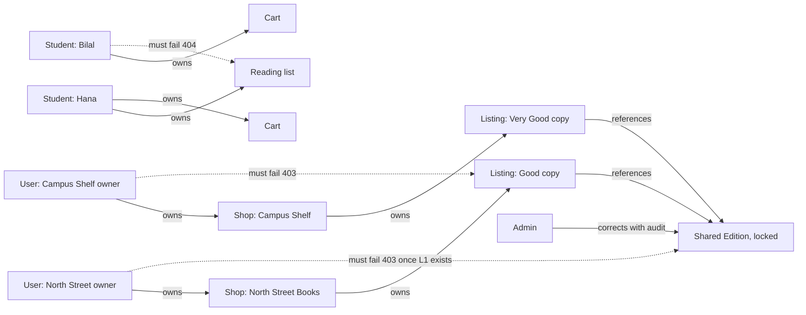

# Whose shop, whose copy?

At 08:40 on a Tuesday, three people are signed in to Hamesh. The owner of North Street Books is looking at her listings table, where one copy shows as held by a checkout. Hana is looking at her reading list and the two eligible copies under one required edition. A platform admin is looking at a correction report about a title with the wrong publisher. All three requests are authenticated. Each one may touch a different set of records, and one of them may touch a record the other two cannot.

Authentication answered who each caller is. It did not answer which records belong to that caller, and it certainly did not decide which fields inside a record are theirs to read. That second job is authorization, and in a marketplace built around a shared catalogue it fails in two specific ways. A shop changes an ID in a URL and edits another shop's copy. A shop edits the shared edition and changes what every other shop and every student sees.

## A token proves identity, and a role proves very little

When the owner of North Street Books signs in, the API returns an access token. The token resolves to a user ID and a role, and the role is `shop`. The same token resolves the same way for the owner of Campus Shelf and for the owner of Corner Books. A middleware that asks only whether the caller is a shop passes for all three, which is the bug this module exists to prevent.

The role is still useful, because it refuses whole categories of caller cheaply. A student token on a route that creates a listing should be refused before any record is loaded. An admin token on a route that changes a shared edition should be the only kind that gets through. But the role cannot answer the question a marketplace actually asks, which is whether this particular copy, in this particular shop, belongs to this particular person.

So every protected route answers two questions. What kind of caller is this, and does this specific record belong to them? The first is a role check and it runs before the handler. The second is an object check and it needs a path from the record to the person through a field you can name. If you cannot name the field, the check does not exist yet.

## Two ownership chains and one shared record

Hamesh has two ownership chains and they do not meet. The first runs from a user to a shop to a listing, and from the listing to its photos, its condition, its price and its sale state. The second runs from a student to a cart, a reading list and a set of want entries. A student owns those records the way a shop owns its copies: they are private, they are edited by one person, and nobody else has a reason to read them.

An order is the point where the chains touch without merging. Checkout splits one payment into one order per shop, so the student sees every order under the purchase while a shop sees only its own. The same order record is therefore read by two people for two reasons. Hana needs the grade and the collection code. North Street Books needs the copy, the condition notes and the pickup state. Neither needs the other's fields.

The edition belongs to neither chain. It is a shared catalogue record that exists because several shops sell copies of one published book. No shop owns it, and no student owns it. That absence is deliberate, and the next section says what it protects.

## The edition lock rule

Once any listing points at an edition, a shop may no longer change that edition's fields. The title, the ISBN, the authors, the format and the publisher are frozen for shop accounts from the moment the first copy exists, and only the admin role may correct them, through a route that writes an audit record.

There are two reasons, and both are about other people's data. The first is that an ISBN is the identity the matcher trusts. Change it, and every listing under that edition now claims to sell a different book, and every reading list that accepted the old ISBN either matches the wrong copies or stops matching at all. The second is that a title is what a shop's offer card shows. If North Street Books can rename a shared title, it can make Campus Shelf's copy look like a different book without touching Campus Shelf's record.

The lock is a rule about shared records, not a punishment for the shop that typed the ISBN first. A shop that spots a wrong publisher reports it from the edition page. The report carries the edition ID, the field, the value the shop believes is right and the evidence from the printed book. The admin reads it, decides, and the correction is logged. The gate for this module expects a 403 when a shop tries to change a locked edition, and a successful audited write when an admin makes the same change.

## Two failures a role check cannot stop

The first failure is the cross-shop edit. The owner of Campus Shelf learns a listing ID from a public offer page, or from a screenshot, or from a support thread. Listing IDs are not secrets; they appear in URLs that students share. She sends a price change to that ID with her own valid shop token. A route that checks the role and then updates by ID alone will accept it, and North Street Books' copy now costs whatever Campus Shelf typed.

The second failure is the shared rewrite. A shop patches the edition it created, changes the title and the edition label, and every other shop's offer card follows. Nothing looks broken in the database. The damage appears later, when a student's matched copy no longer corresponds to the ISBN on her syllabus, or when an admin cannot tell which shop typed the wrong title.

Both failures have the same shape, and it is worth saying plainly: the identifier came from the caller, and the server trusted it. The fix is not a hidden button and it is not an obfuscated ID. The fix is that the record is loaded through a condition the caller cannot supply, and the condition names an owner field.

## Need to know, field by field

The status code is the easy part of this module. The field list is the hard part, and it is where most teams leak. A record that a caller is allowed to read can still contain fields they have no reason to see.

For a shop, the useful fields on its own listing are the edition identity, the grade, the defects, the photos, the price, the status and the hold expiry. It does not need the student's name, course code, budget or the contents of the cart that claimed the copy. For a student, the useful fields are the shared edition facts, each copy's grade, defects, photos, price and shop name with its pickup area. The student does not need the shop's private account details, the internal defect log or another buyer's hold.

For an order, the split is narrower. The shop needs the copy snapshot, the condition notes it graded, the collection code state and the student's contact for the pickup. It does not need the other shop's order in the same checkout, the payment method or the platform fee. The student needs every order under the purchase, the grades she agreed to, the collection codes and the shop pickup notes.

Write those lists down before writing a serializer. A projection that names fields is a decision a reviewer can check. A projection that deletes two keys from a full document is a decision that will be wrong by the next module.

## 403 or 404, and why the choice matters

A wrong owner is not an unauthenticated caller, so 401 is the wrong answer. The token is valid, and a 401 sends the client into a refresh loop that hides the real problem from everyone. The real choice is between 403 and 404, and the deciding question is whether the caller is allowed to know that the record exists.

For a public record the answer is yes. A listing is on a public offer page, so returning 403 to a shop that tries to edit another shop's copy tells them nothing they could not already see. For a private record the answer is no. A reading list holds a student's course code and budget. A cart holds what a student is about to buy. Returning 404 with the same body as a genuinely missing record keeps that private.

The edition follows the public rule with a twist. An edition page is public, so a shop that tries to change a locked edition gets 403 with the code `EDITION_LOCKED` and no record fields in the body. The 403 does not reveal who created the edition or which shop holds the first copy, because the shop already knows the edition exists and has no right to more than that.

## Read the diagram as a set of tests

The diagram shows the two chains, the shared record above them, and the requests that must fail. Solid arrows are ownership or reference. Dotted arrows are the crossings you will write tests for.

Three things are worth noticing. The shops never point at the edition with an ownership arrow, so closing a shop leaves the edition intact. The admin arrow is the only write path into a locked edition, and it carries the audit obligation in its label. Every dotted arrow crosses exactly one boundary, so a failing test points at one check rather than at three.

## A valid request can still be the wrong request

Some bugs look authorized because every ID belongs to the caller. Hana's cart holds copies from two shops. A route that removes a cart line checks that the line is in her cart, which it is. If it then takes a shop ID from the request body and removes every line from that shop, the server does exactly what it was told and Hana loses a copy she wanted. The record that changes must be the record that was loaded and checked, and nothing in the body may choose the target after the check has passed.

The same shape appears on the listing editor. A shop's edit form sends the fields it shows, including a status. If the route accepts the whole body and updates by ID, a stale form can move a sold copy back to available, and the next student buys a book that is already on a shelf in another student's bag. Update the allowed fields by name, never a spread of the request body.

## What this module will build

The next lesson writes both guards: a role middleware and an ownership helper that follows a record to its owner, plus the edition lock as its own check. Lesson 8.3 turns them into `docs/AUTHORIZATION.md`, a matrix with two shops, two students and an admin, and the cross-shop and cross-student tests that prove the refusals.

Keep the 08:40 scene in mind while you build. The goal is not to make North Street's request work. The goal is to make Campus Shelf's identical request fail, in a way that looks exactly like a record that was never there.
