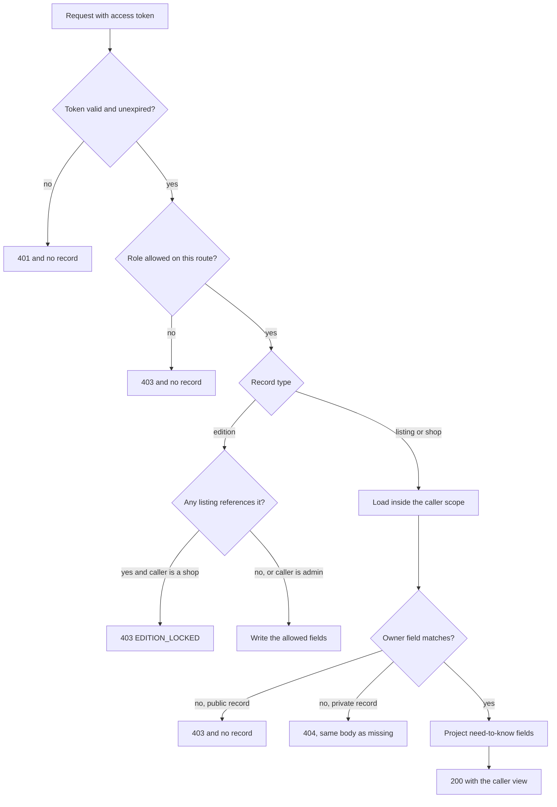

# Object checks on shops, copies and editions

Four routes carry almost all the risk in Hamesh. A shop edits one of its copies. A shop creates a new copy under a shared edition. A shop tries to correct that shared edition. A student reads a private record. Each route has a different path from the record to the person, and each one fails differently when the check is missing.

The recipe has two layers, and they do different work. A role guard runs before the handler and refuses whole categories of caller. An ownership helper runs inside the handler, loads the record, and decides whether this record belongs to this user. Neither alone is enough, and a route with only the first is the bug you will write a test for.

## Write the route contracts down first

Before the code, write the table. Each row names the route, the role that may reach it and the scope the helper must prove. A row whose scope cell cannot name a field has no check to write yet.

| Route | Role | Scope to prove |
|---|---|---|
| `POST /api/shops/:shopId/listings` | shop | the shop named in the path is owned by the caller |
| `PATCH /api/shops/:shopId/listings/:listingId` | shop | the listing belongs to that shop, and that shop belongs to the caller |
| `GET /api/shops/:shopId/listings` | shop | the list is filtered by the caller's shop, never by a client-supplied shop |
| `POST /api/editions` | shop | no ownership, because the record is shared; the ISBN is validated instead |
| `PATCH /api/editions/:editionId` | admin | role only, plus an audit record naming the changed fields |
| `GET /api/me/reading-lists/:listId` | student | the list owner is the caller |
| `GET /api/me/cart` | student | the cart owner is the caller |
| `DELETE /api/me/want-entries/:entryId` | student | the entry owner is the caller |

The edition route is the interesting row. Creating an edition has no owner to check, because the edition is shared. That absence is not a hole; it is the reason the update route is reserved for the admin role and guarded by the lock rule below.

## Where each check sits in the request

The diagram shows the order. The role guard is a filter at the edge. The ownership decision happens after a record is loaded inside a scope the caller cannot influence. The edition lock is a third check that only applies to shared records. Nothing after a refusal runs for a caller who failed, which is why a refusal cannot carry a field from the record.



The last two boxes are the part teams skip. A correct check with a wide projection still hands a shop the student's budget ceiling, and that is a leak even though the caller was allowed to read the record.

## The role guard is a filter, not a decision

The guard is deliberately small. It reads the authenticated user, compares the role with an allowed list, and either continues or ends the request. It must not load a record, because the route may need a different scope for a different record, and a guard that half checks is worse than one that does not check at all.

```js
// server/src/modules/auth/require-role.js
export function requireRole(...allowed) {
  return function roleGuard(req, res, next) {
    if (!req.user) return next(httpError(401, 'AUTH_REQUIRED'));
    if (!allowed.includes(req.user.role)) return next(httpError(403, 'ROLE_NOT_ALLOWED'));
    return next();
  };
}
```

Two details are worth copying. A missing user answers 401 and a wrong role answers 403, because those are different situations for the client. And the refusal carries a short code rather than a sentence about what the caller would need to be, because a helpful denial is still a disclosure.

## The ownership helper follows a stored field

The helper turns a record and a user into a decision. Its interface takes the scope, the record and the user, and either returns the record or throws a typed error. Keeping the error typed matters, because the route has to map it to 403 or 404 without guessing which record type it came from.

```js
// server/src/modules/auth/ownership.js
export const SCOPES = ['shop-owner', 'listing-in-shop', 'student-record'];

export async function assertOwned(scope, record, user, { Shop }) {
  if (scope === 'student-record' && record.studentId.equals(user.id)) return record;
  if (scope === 'listing-in-shop') {
    const shop = await Shop.findOne({ _id: record.shopId, ownerId: user.id }).lean();
    if (shop) return record;
  }
  throw ownershipError('NOT_OWNER', record, scope);
}

export async function assertShopOwner(shopId, user, { Shop }) {
  const shop = await Shop.findOne({ _id: shopId, ownerId: user.id }).lean();
  if (!shop) throw ownershipError('NOT_OWNER', { shopId }, 'shop-owner');
  return shop;
}
```

The three scopes map to the three paths in the table. A student record compares the student ID stored on the record. A shop compares the owner stored on the shop. A listing takes one hop, from the listing to its shop, and matches the owner in the same query. In every case the rule is the same: follow a stored field, never a field from the request.

## Prefer a scoped query where you can

There is a stronger pattern for simple cases, and it removes the chance that someone deletes the branch later. Put the ownership condition into the query. The database returns nothing when the condition fails, so the handler has no `if` to forget.

```js
const listing = await Listing
  .findOne({ _id: req.params.listingId, shopId: shop._id })
  .lean();
if (!listing) return next(httpError(404, 'LISTING_NOT_FOUND'));
```

The filter is the authorization. For a private record that is the whole answer, and the 404 comes out of the same code path whether the record is missing or owned by someone else, which is exactly what you want. For a public record the opposite is true: a listing exists on a public offer page, so a shop asking to edit another shop's copy should be told the action is refused rather than that the copy is missing. In practice the listing route loads the shop first, returns 404 only when the shop ID is not the caller's, and then loads the listing with both IDs in the filter. Both IDs come from the path, and the shop ID has already been proven.

## The edition lock is its own check

The lock is a rule about a shared record, and it needs a check that no ownership helper can express. The rule is simple: if any listing references the edition, a shop may not change the edition's fields. Only the admin may, and that write leaves an audit record.

```js
// server/src/modules/editions/assert-edition-unlocked.js
export async function assertEditionChangeAllowed(editionId, user, { Listing }) {
  if (user.role === 'admin') return;
  const copies = await Listing.countDocuments({ editionId });
  if (copies > 0) throw httpError(403, 'EDITION_LOCKED');
}
```

The count is the cheapest form of the rule, and it has one edge worth writing down. If the last listing under an edition is archived rather than deleted, the count still returns one and the lock still holds, which is what you want: an archived copy is still evidence of a sale or a withdrawal, and a title correction would still change what a student believed they were buying. Module 11 adds the admin correction route with the audit entry; this lesson only needs the refusal and its code.

Register the update route with the admin role and nothing else. A shop that sends the request reaches the role guard and is refused before the lock check runs, which means the shop receives `ROLE_NOT_ALLOWED` rather than `EDITION_LOCKED`. That ordering is fine and it is honest: the route is not a shop route at all. Add a second test that a shop cannot promote itself by sending `role: "admin"` in the body, because the role comes from the token and never from the payload.

## Where the check must not live

Three places feel like authorization and are not. The client is the first. Hiding the edit button on the listings table stops an honest mistake and does nothing to a caller with curl, because the token still works and the route still exists. The second is a middleware that checks only the role, which is the bug this lesson started with. The third is a Mongoose plugin that filters every read by a user ID set somewhere earlier in the request. It looks thorough, and it fails when a route forgets to set the value, because an unset filter usually becomes no filter rather than no results.

The rule to keep is dull and reliable. Every handler that reads or writes a private record loads that record through a condition the caller cannot supply, and the condition names an owner field. Every handler that writes a shared record proves the lock first. A helper can wrap the rule and a test can prove it, but a convention that depends on everyone remembering to call something will meet the route where someone forgot.

## Prove the gap with a failing test

Write the test before the fix. Two shops, one edition, one listing, one forbidden request. The assertion covers the status and the price: the price must still hold its old value after the request, because a handler can refuse after it has already written.

```js
// tests/authz/cross-shop-listing.test.js
import { describe, it, expect } from 'vitest';
import { api, seedTwoShops, loginAs } from './helpers.js';

describe('Campus Shelf cannot edit a North Street copy', () => {
  it('refuses the patch and leaves the price unchanged', async () => {
    const { northStreet, campusShelf, listing } = await seedTwoShops();
    const token = await loginAs(campusShelf.owner);
    const res = await api()
      .patch(`/api/shops/${campusShelf.shop.id}/listings/${listing.id}`)
      .set('Authorization', `Bearer ${token}`)
      .send({ priceMinor: 900 });
    expect([403, 404]).toContain(res.status);
    expect(res.body.priceMinor).toBeUndefined();
    const after = await api()
      .get(`/api/shops/${northStreet.shop.id}/listings`)
      .set('Authorization', `Bearer ${await loginAs(northStreet.owner)}`);
    expect(after.body[0].priceMinor).toBe(listing.priceMinor);
  });
});
```

Run it against the current route and read the failure. The interesting line is not the status. It is that the price reload comes back as 900, which means the request changed a copy it had no right to touch.

```text
FAIL  tests/authz/cross-shop-listing.test.js
AssertionError: expected 200 to be one of [ 403, 404 ]
```

## Wire the guard into the route

The diff below is the shape of the fix, not the finished handler. It registers the guard on the route and replaces the unscoped update with a scoped one. Error mapping stays in one place and is not repeated per route.

```diff
- router.patch('/shops/:shopId/listings/:listingId', updateListing);
+ router.patch(
+   '/shops/:shopId/listings/:listingId',
+   requireAuth,
+   requireRole('shop'),
+   updateListing
+ );
```

Inside the handler, the change is a filter rather than an `if`. Load the shop with the caller scoped in, return 404 when the shop is not theirs, then update the listing with a filter that carries both the listing ID and the proven shop ID. If the update matches zero documents, the handler has nothing to write and nothing to leak. Then add the edition test: create a copy under an edition, send a shop patch to that edition, expect `403 EDITION_LOCKED`, and confirm the stored title is unchanged.

## Keep the refusal quiet

Every refusal in this module returns a small body with a code and nothing else. No record fields, no owner ID, no list of the fields that would have been allowed, and no hint about which condition failed. The server log records the caller, the route and the target ID, because you will need that during an incident. The response does not.

One more field matters on the success path. A shop reading its own listings should receive the projection from lesson 8.1, not the whole document. A guard that stops the wrong person and then hands the right person too much has done half the work.

## Acceptance criteria

- [ ] `requireRole` answers 401 without a user and 403 for a wrong role.
- [ ] The listing update route loads the shop from the path, proves the caller owns it, and then updates with both IDs in the filter.
- [ ] Campus Shelf's request answers 403 and a reload shows the price unchanged.
- [ ] A shop patch to an edition that has at least one listing answers `403 EDITION_LOCKED`.
- [ ] A student request for another student's reading list answers 404 with the same body as a missing list.
- [ ] No route updates a document from a spread of the request body.
- [ ] Refusal bodies carry a code and no record fields.
- [ ] The listing list route filters by the caller's shop rather than by a shop ID in the query string.
