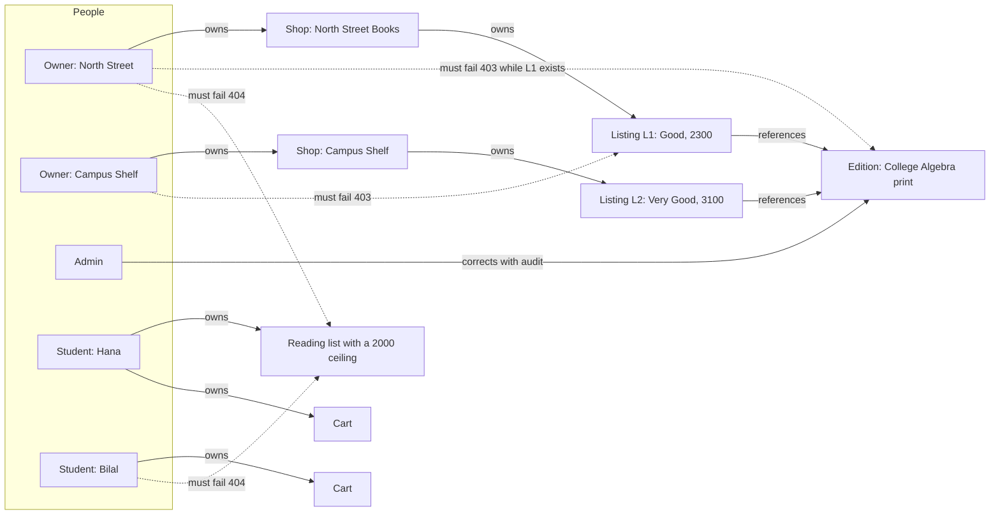

# The authorization matrix and cross-shop tests

A guard you wrote is not a permission model until a second person can read the model and disagree with it. The matrix is that readable form. Each row says who may do what to which record, which field proves it, and which test demonstrates it. The test suite is the evidence that the code agrees with the table rather than with the author's memory.

This lesson writes both. The fixture stays small on purpose: two shops, two students, one admin, two editions of one work and three copies. Small fixtures catch more, because every crossed request is easy to name and every state change is easy to check afterwards.

## Draw the fixture before the matrix

The diagram is the test topology. Solid arrows show ownership. Dotted arrows show the requests that must fail, and each one crosses exactly one boundary, so a red test points at one check.



Two shops cross the public boundary, two requests cross the shared-record boundary, and two requests cross the private one. The expected codes differ because the records differ: a listing and an edition are public, and a reading list is private.

## Fill the matrix

Put this table in `docs/AUTHORIZATION.md`. Keep one row per action rather than one row per route, because a route may read for one actor and write for another. The scope column names the field the check follows, and the last column names the test that proves it.

| Actor | Resource | Action | Scope field | Expected | Proof |
|---|---|---|---|---|---|
| Anonymous | any protected route | read or write | none | 401 | `auth-required` |
| Student A | own reading list | read, write | `readingList.studentId` | 200 | `own-list` |
| Student B | Student A reading list | read | `readingList.studentId` | 404, no fields | `cross-student-list` |
| Student B | Student A cart | write | `cart.studentId` | 404, no fields | `cross-student-cart` |
| Student B | Student A want entry | write | `wantEntry.studentId` | 404, no fields | `cross-student-want` |
| Shop A | own listing | write | `listing.shopId` to `shop.ownerId` | 200 | `own-listing-write` |
| Shop B | Shop A listing | write | same chain | 403, no fields | `cross-shop-listing` |
| Shop B | Shop A shop profile | write | `shop.ownerId` | 403, no fields | `cross-shop-profile` |
| Shop A | shared edition with copies | write | listing count for `editionId` | 403 `EDITION_LOCKED` | `locked-edition` |
| Admin | shared edition | write | role plus audit | 200, audit written | `admin-correction` |
| Shop A | a student reading list | read | no route exists | 404 | `shop-cannot-read-list` |
| Student A | shop listing route | write | role | 403 | `role-escalation` |
| Admin | any listing price | write | admin owns no shop | 403 | `admin-has-no-shop` |

Two rows look odd and both are deliberate. The shop reading a student's list answers 404 because there is no such route, and the test asserts that a request to one changes nothing. The admin row sits at the shared record and nowhere else: an admin corrects catalogue metadata, and an admin does not edit a shop's price, because the price belongs to the seller who owns the copy.

## Write four kinds of test

Every row belongs to one of four families, and each family asserts something different. Mixing them gives a suite that reports status codes and proves very little.

The first family is the owner's success. North Street's owner edits its own copy and the response carries the changed price. This catches a guard so strict that it refuses legitimate work, which happens when a scope compares the wrong pair of fields.

The second family is the crossed request. Campus Shelf sends the same shape of request against North Street's copy. The assertions are the status, the absence of record fields in the body, and the state of the database afterwards. The third assertion is the one that catches a handler that wrote before it refused.

The third family is the escalation attempt. A student sends a shop route with her own token, and a shop sends an admin route. The role guard handles both, and the test proves the guard is registered on the route rather than merely imported in the file.

The fourth family is the projection. The right person reads the right record and must still not see fields outside their need. North Street reads its own listing and must not see the cart or the student behind the current hold. Hana reads her own reading list and must not see another student's list, another shop's draft copies or the shop's private account email.

## Assert the absence as well as the status

A test that checks the status alone passes against an implementation that returns the whole record inside a 403 body, which is a real bug because clients log and display error bodies. Assert the shape as well.

```js
// tests/authz/cross-student-list.test.js
it('Bilal cannot read Hana reading list', async () => {
  const token = await loginAs(fixture.bilal);
  const res = await api()
    .get(`/api/me/reading-lists/${fixture.hanaList.id}`)
    .set('Authorization', `Bearer ${token}`);
  expect(res.status).toBe(404);
  expect(res.body).toEqual({ code: 'READING_LIST_NOT_FOUND' });
  expect(JSON.stringify(res.body)).not.toContain('BIO-101');
});
```

The last assertion looks crude and is worth keeping. It fails when a later error handler adds the requested record to the error context, which is the most common way a clean refusal starts leaking. Add the mirror tests for the cart and the want entries, and add the state check after every crossed write: reload the record as its owner and assert the price, the status and the note are unchanged.

## Test the lock the way an attacker would

The edition lock needs three tests, and they are not the same test repeated. The first sends a shop patch to a locked edition and expects 403 with the code and no edition fields. The second sends the same patch before any listing exists and expects 200, because the lock starts at the first copy and a shop typing a brand new ISBN has to be able to complete the record.

The third is the one that matters most. It sends a valid patch from the shop that originally created the edition, with no change except the title. That request looks harmless, because the caller typed the record in the first place. It must still answer 403 once another shop's copy points at the edition, because the second shop and every reading list depend on the title staying put.

Then sign in as the admin and send the same change. Expect 200, a stored change and one audit document naming the edition, the field, the old value, the new value, the actor and the time. Query the audit collection and assert the row exists, because an audited route that forgets to write the audit is an unaudited route with extra steps.

## Test the private records by body, not by page

The student records need the same treatment with a stricter assertion. Request Hana's reading list as Bilal, then request a reading list ID that was never created. The two responses must be identical in status, body and, as far as you can measure it, timing. If they differ, the API tells an attacker which list IDs exist.

Do the same for the cart and the want entries. Then check the other direction: Hana must not be able to read a shop's listing drafts, and the shop must not be able to read Hana's list through a guessed ID or through any query parameter. A test that only checks the page render will miss a route that returns the data and lets the client hide it.

Add one row and one test for the account that holds two roles. A person may own a shop and also study, and a scope check written as "if the user is a shop, use the shop path" will pick one identity and ignore the other. The matrix row says which check runs first for that account, and the test proves it.

## Keep the matrix alive

A matrix written once becomes fiction within two modules. Every lesson that adds a mutating route from here adds at least one row and one crossed test. Make that a habit now: the commit that adds a route also adds the row, and a reviewer can reject it for a missing row the same way they reject it for a missing test.

The cheapest way to keep this honest is to derive the route list from the router and compare it with the matrix headings. A short script that prints every registered route and fails when a route has no row takes twenty lines and catches the route someone added in a hurry. It will not tell you whether the check is right, but it will tell you where to look.

Do the same for the projections. Keep the allowed field list for each actor in one module next to the serializers, and let the tests import it. When someone adds a field to a listing or an order, the list forces a decision about who may see it, rather than leaking it by default through a spread of the whole document.

## Save the evidence

Run the authorization suite and capture the summary, not the whole log. Save it in `docs/EVIDENCE.md` with the date, the branch and one line per family: owner successes, crossed refusals, escalations, projections and lock tests.

```text
✓ tests/authz/own-listing-write.test.js (2)
✓ tests/authz/cross-shop-listing.test.js (3)
✓ tests/authz/cross-student-list.test.js (4)
✓ tests/authz/locked-edition.test.js (3)
✓ tests/authz/projection-fields.test.js (5)
Tests  17 passed
```

The two manual requests belong beside the summary, because a suite can pass against a different server than the one you are running. Paste the raw curl commands and their raw bodies for one cross-shop write and one cross-student read. A reviewer can re-run both in under a minute.

## What the matrix cannot cover

The matrix covers records a person owns or shares. It does not cover aggregate leaks: a public endpoint that returns how many copies an edition has, a search that reveals a draft listing, or an error that reports how many listings reference an edition. Those need their own review, and the honest place to write that limit is the bottom of `docs/AUTHORIZATION.md`.

It also cannot cover a refusal that leaks through timing. A 404 that runs a full aggregation before it answers tells an attacker more than a 404 that stops at the first filter. Keep the refusal path short and identical for both cases, and say in the file that timing was not measured, so a later reviewer knows what is proven and what is not.

## Acceptance criteria

- [ ] `docs/AUTHORIZATION.md` has one row per action, a scope field for every row and the name of the test that proves it.
- [ ] The fixture creates two shops, two students, one admin and one account that holds more than one role.
- [ ] Every crossed request asserts a status, the absence of record fields and the unchanged state of the target.
- [ ] Campus Shelf's attempt on a North Street copy answers 403 and leaves the price untouched.
- [ ] Bilal's attempt on Hana's list answers 404 with a body identical to a missing list.
- [ ] A shop patch to a locked edition answers `403 EDITION_LOCKED` once a copy references it, and 200 before that.
- [ ] The admin correction answers 200 and writes one audit document with old and new values.
- [ ] The projection tests prove a shop cannot read student budgets and a student cannot read listing drafts.
- [ ] `docs/EVIDENCE.md` records the run summary, the two manual requests and the branch.
