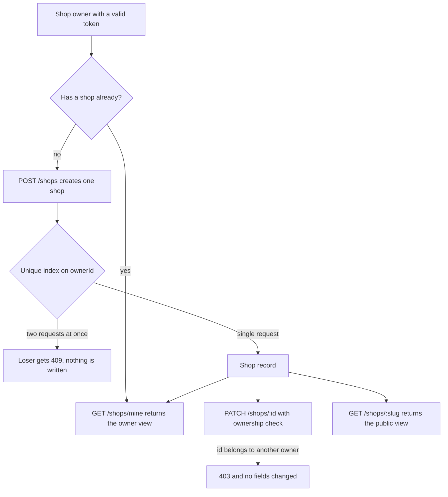

# A bookshop needs a page before it needs stock

Mariam has run North Street Books for eleven years. Last night she registered on Hamesh as a shop owner and confirmed her email. This morning she is standing behind the counter with a phone in one hand and a returned textbook in the other. She is signed in. The app knows her name, her email and her role. And there is nowhere for her to put the book.

That is not a database problem yet. It is a page problem. A copy belongs to a shop, and Mariam has no shop. Before Hamesh can accept a single listing from her, it needs a record that says where she trades, when she is open, where a student should stand to collect a book, and what address on the site a student can send to a friend. Once that record exists, everything else in the marketplace has something to attach to.

Module 5 created the Shop model and module 8 taught the ownership check that protects it. This module turns both into a working API: create a shop, read your own shop, change your own shop, and refuse everyone else. Module 10 then builds the screens that call those routes, which is why this module has no interface at all.

## Five facts a student needs before walking across town

A student deciding whether to buy a used copy is not only comparing titles and prices. She is asking how far she has to walk, whether the shop is open when she finishes lectures, and whether collecting the book is a two minute stop or a twenty minute search through a back room. Those answers belong to the shop, and there are only five of them worth storing in the first version.

The name is what she sees on every offer card and every order. The area is the neighbourhood, in the shop's own words, because Hamesh has no map provider and no reliable address system to fall back on. The opening hours are the weekly pattern, not today's status, because the pattern is what a student plans around and today's status changes every few hours. The pickup notes are free text from the owner: which entrance, which counter, what to bring, and anything unusual during exam weeks. And the slug is the short piece of text at the end of the shop page address, so the page can be linked and shared.

| Field | Type | Who reads it | Why it is stored |
|---|---|---|---|
| `name` | string, up to 80 characters | public | The label on every offer and order |
| `area` | string, up to 60 characters | public | How far the trip is |
| `openingHours` | seven day pattern | public | Whether the shop is open when she can come |
| `pickupNotes` | string, up to 500 characters | public | Where to stand and what to bring |
| `slug` | lowercase string, unique | public | A shareable shop page address |

Everything else on a shop record is either identity or account data, and the next section separates the two views. What matters first is that this list is short on purpose. Every field you add to a shop is a field that can go stale, and a stale field on this record sends a student to a locked door.

## The slug is a public promise

A slug is the readable part of a web address: `hamesh.app/shops/north-street-books` instead of `hamesh.app/shops/65f2c1a9e4b0a1d2c3f4e5a6`. The shop's page is public, so a student may share it in a message, and a shop may print it on a card next to the till. Both of those uses mean the slug has to be stable and readable, and it has to be unique, because two shops cannot share one address.

The slug comes from the name, lowercased, with spaces turned into hyphens and anything else removed. That gives `north-street-books` for Mariam. It gives `corner-books` for the first Corner Books, and a second shop with the same name needs a suffix, which the server adds as `corner-books-2`. The suffix is not pretty and it is honest: it tells everyone that an earlier shop already holds the plain form.

There is a choice hiding here, and it is worth making out loud. A slug that never changes is a promise that survives printing, and it means a shop that renames itself keeps an address that no longer matches its name. A slug that follows the name keeps matching the sign above the door and breaks every link already shared. The compromise used in this module is that the slug changes only while the shop has never held a copy, and the old slug is kept in a `slugHistory` list so an old link can still find the shop. A shop that has been open for a month and has sold three books is stuck with its address, which is the least surprising outcome for the students holding the link.

## One owner, one shop

Hamesh lets a shop owner own exactly one shop. That rule is a business decision, and it is worth defending because it costs something. A shop with two counters in two neighbourhoods cannot express both under one owner, and a chain cannot open a second branch without a second account.

The rule exists because the shop record is what a student uses to plan a trip. Two shops under one owner means two areas, two sets of hours and two pickup notes, and the owner would have to remember which one each copy belongs to. The model can express that with two shop documents under two owners, which is the same thing a chain would do, and it keeps every route in this module single valued: `GET /shops/mine` returns one shop or nothing, and a listing belongs to exactly one shop without ambiguity.

The rule is enforced in two places, and both are needed. The route checks whether the signed-in owner already has a shop before it inserts. The database holds a unique index on the owner field, so two requests that arrive at the same moment cannot both succeed. A route check alone loses a race, and an index alone gives the owner an ugly duplicate key error, so the route does both: the check answers the normal case with a readable message, and the index answers the race.

When the check fails, the answer is a conflict, not a success. The second create request gets no new document and no silent update of the existing one. That last part matters. A helpful implementation might notice the owner already has a shop and patch it with the submitted fields. That would let a stale form on a second device quietly move Mariam's shop to a different area, which is exactly the kind of "convenience" that later becomes a support ticket nobody can explain.

## Two views of one record

The shop record has a public face and a private one. The public view is what a student or a signed-out visitor reads: the name, the area, the weekly hours, the pickup notes, the slug, and a count of copies currently available. All of it is on a page anyone can open, so none of it may contain anything the shop would not put on a noticeboard.

```ts
// the shape the public shop page consumes
type PublicShop = {
  shopId: string;
  slug: string;
  name: string;
  area: string;
  openingHours: Array<{ day: number; closed: boolean; open: string | null; close: string | null }>;
  pickupNotes: string;
  availableCopyCount: number;
};
```

The private view is the owner's own copy of the same record. It carries everything public plus the fields that exist for the marketplace and the owner rather than for a buyer: the owner's user id, a contact phone number for collection problems, the account status, when the shop was created, and the slugs it used to answer to. The phone number is the clearest example of why the split matters. A student sometimes needs to call a shop about a collection, and every student on the internet does not, so the number is shown on an order page after a purchase and never in the public payload.

```ts
type OwnerShop = PublicShop & {
  ownerId: string;
  contactPhone: string | null;
  status: "active" | "suspended";
  createdAt: string;
  slugHistory: string[];
  draftCopyCount: number;
  soldCopyCount: number;
};
```

The two counts at the bottom are the only derived fields here, and they are the ones the owner's dashboard will show first. They cost one indexed count each and they save module 10 from loading a listings table just to display two numbers.

## The three routes, and who may reach them

Three routes carry the whole module, and each answers a different question. Creating answers "does this owner have a shop, and if not, here is one". Reading answers "which shop is mine", which the client needs on every page load. Updating answers "change this field on my shop", and it is the only route with a record id in the path.

```ts
// server/src/modules/shops/shop.routes.js (signatures only, mounted under /api)
router.post("/shops", requireAuth, requireRole("shop"), createShop);
router.get("/shops/mine", requireAuth, requireRole("shop"), getMyShop);
router.patch("/shops/:id", requireAuth, requireRole("shop"), updateShop);
router.get("/shops/:slug", getShopBySlug);          // public, no token
```

Notice that the create route takes no shop id, because the shop does not exist yet. The read route takes no id either, because a shop owner's shop is derived from the session every time. Only the update route has an id in the path, and that id is the reason this module needs module 8's ownership helper: the id comes from the caller, so the caller must not be trusted with it.

The public route is last and it is the one students use. It resolves a slug rather than an id, so a link stays readable, and it projects the public view only. A signed-in owner reading their own public page gets exactly what a stranger gets, which is a good habit: it keeps the public payload honest, because the person most likely to notice a missing field is the owner looking at it.



Read the diagram as three different levels of trust. The session decides who the caller is, the unique index decides how many shops one owner may have, and the ownership check decides whether the id in the path belongs to this caller. No level can substitute for another, and the arrows that leave the shop record show why the public read needs no token at all.

## What this module deliberately leaves out

The shop record is not a page builder, and it is not a business profile. There is no logo upload, no description paragraph, no social links, no delivery radius and no map pin. Each of those is a real feature in a real marketplace and none of them is needed to answer the three questions a student has before a pickup, which are where, when and how.

Opening hours are a pattern and not a schedule, so the record does not know about a public holiday or a week when the shop closes early for exams. The owner writes that into the pickup notes, in their own words, and the student reads a sentence a person wrote. Building a calendar of exceptions is a much larger feature, and a half built one is worse than a sentence, because a student trusts a computed status more than a note.

The same reasoning applies to the area. It is text, not a pair of coordinates. Hamesh cannot tell a student how long the walk is, and it should not pretend to. What it can do is show the area beside the shop name, which is enough for a student who already knows her own city.

## Bridge to the route work

The next lesson builds the three routes properly: the schema with its validators, the slug generator with its collision suffix and history list, the projection that separates the public view from the owner view, and the ownership check on the update. It also writes the two tests that fail against a naive implementation: a second shop accepted as a new document, and a cross-shop patch that succeeds because the route trusted the id in the path.

Keep Mariam at the counter while you read it. Every field, every refusal and every test in that lesson exists so that a woman with a phone in one hand can describe her shop once, correctly, and never explain it again to a student standing outside a locked door.
