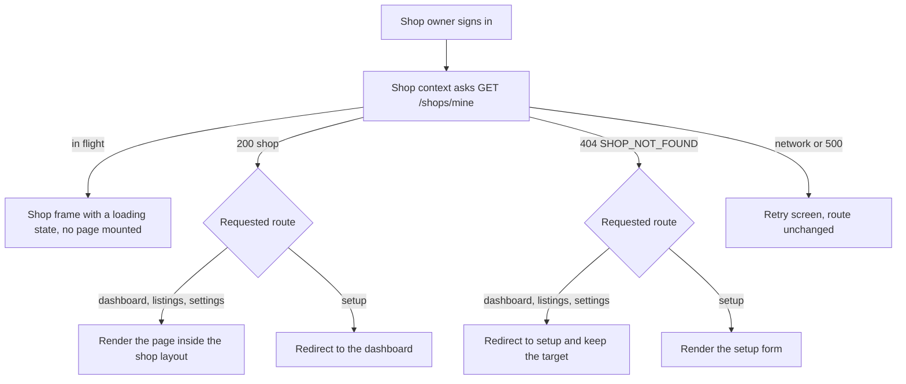

# The owner who has no shop yet

Mariam confirms her email on Tuesday night and signs in on Wednesday morning. She lands on the shop area of Hamesh, and for eight seconds she sees a page with a grey header, three empty boxes and a spinner in each one. Then the boxes empty out. The dashboard tried to load her copies, the listings table tried to load her page of results, and the settings page prefetched her hours. All three answered 404 `SHOP_NOT_FOUND`, because she has no shop, and all three had nothing sensible to say about it.

Nothing crashed. That is the problem worth understanding. The API did exactly what module 9 designed it to do, and the client had no plan for a signed-in shop owner whose first act is to describe her shop. A new owner is not an edge case; she is the first person every shop route will ever meet, and the whole experience depends on where the app sends her in the first two seconds.

## Three pages, one missing precondition

The shop area has three jobs. Setup collects the facts module 9 requires and creates the shop, once. Settings shows those facts and lets the owner change them. The dashboard and the listings pages assume a shop exists, because everything they show belongs to one: draft copies, published copies, prices, and the state of each sale.

Those assumptions are correct and should stay. A listings page that quietly renders an empty table for an owner with no shop teaches the owner that her copies are gone. The precondition is not the pages' problem; it is the routing layer's problem, and the routing layer is what module 10 adds. Before any of the three pages renders, the client answers one question: does the signed-in shop owner have a shop? If no, setup. If yes and she asks for setup again, the dashboard.

This is a gate in the plainest sense. It is one decision made in one place, and every page inside the shop area inherits it. The alternative is per-page tolerance: each page checks for a shop, each page renders its own version of "you have no shop yet", and five pages later there are five slightly different sentences and one new page where somebody forgot. Changes made in five places drift, and the drift is invisible until a mentor opens the exact page nobody tested.

## What the client actually knows, and when

The client has one source of truth about the shop: `GET /shops/mine`, the route from module 9 that returns one shop or a 404 with `SHOP_NOT_FOUND`. That response is the only thing the routing decision may depend on. A role in the token is not enough, because a shop owner with no shop and a shop owner with a shop carry identical tokens. A cached name in local storage is not enough either, because it was written by whoever used the phone last.

So the client makes that request once, as early as it can, and holds the answer in a shop context that the whole shop area reads. The context has four states and they are not the same thing, which is the point:

- `loading`, when the request is in flight and the answer is unknown.
- `ready`, with the shop, and everything normal.
- `none`, when the API answered 404 `SHOP_NOT_FOUND`, which is a fact about this owner.
- `error`, when the request failed for another reason such as a dropped connection or a 500.

The last two are easy to merge by accident. A `none` state means route the owner to setup. An `error` state means keep her where she is, show a retry, and do not send her to a form that will create a duplicate shop the moment the connection returns. A client that treats every failure as "no shop" will eventually create a second shop for somebody, or show a setup form to a shop owner who has been trading for a month, and both of those are worse than a spinner.

## The guard must run before the children

Here is the failure that a screenshot will not show you. A guard that renders its children and then redirects looks correct on a fast connection, because the redirect wins the race. On a phone on a weak network, the render arrives first. The listings table mounts, its data request fires, and it receives a 404. Then the redirect happens and the request is abandoned, or worse, surfaces as an error toast over the setup form Mariam is now reading.

The rule is simple to state and easy to break: while the shop answer is unknown, render neither the page nor its children. A spinner or a skeleton in the shop layout's own frame is enough, because the layout does not need a shop to draw a header. What must not exist is a mounted page that believes it has a shop.

The same rule decides where the layout sits. The shop layout is the frame around settings, dashboard and listings: the shop name, the navigation, and the account menu. It is also the natural place to put the guard, because every page that needs a shop lives inside it and nothing outside it ever does. Setup sits outside that layout, in its own minimal frame, because it is the page for the one person who has no shop to put in a header.

Two arrows in that diagram protect Mariam from two different mistakes. The arrow from `404` to the redirect stops a page from rendering without its precondition. The arrow from `200` to the setup redirect stops a shop that already exists from being created twice, which the API would refuse with a 409 anyway, but a form that ends in a refusal is a form that wasted two minutes of a bookseller's morning.

## Keep the destination, not just the redirect

A shop owner who taps a shared link to a listings page, or an old bookmark to her settings, has already told the app where she was going. If the guard throws that away, she creates her shop and lands on a dashboard she did not ask for, then navigates back to where she started. That is a small insult repeated every time, and it is easy to avoid: the redirect carries the original path as a query parameter, and the setup page navigates there once the shop exists.

The parameter has to be treated as untrusted, because it arrives from a URL that anybody can type. Accept only a path that starts with a single slash, reject anything that looks like a full address, and fall back to the dashboard. A guard that redirects to whatever it was given is an open redirect, which is a way to make your domain send a student to somebody else's login page with a convincing name in the address bar. The check is three lines and it belongs next to the redirect, not in a review note.

## Why not simply make the API tolerant

The tempting fix is server side: let `GET /listings` return an empty page for an owner with no shop, and let the dashboard return zeros. Then every page renders and nothing needs a guard. It is tempting because it removes an entire client component, and it is wrong for three reasons.

The first is that an empty listings page is a lie about a shop's data, so the owner cannot tell an empty shop from a missing one. The second is that the tolerance spreads: the next endpoint has to be equally tolerant, and the one after that, and each one is a small decision nobody signs off. The third is that the 404 is genuinely useful information, which module 9 built on purpose, and a client that hides it makes the module 9 gate unreachable in practice.

There is a real server side nicety nearby, and it is worth naming so you do not confuse it with tolerance. `GET /shops/mine` returns 404 rather than 204 precisely so the client can distinguish "there is no shop" from "there is a shop with nothing in it". A 200 with an empty body would be indistinguishable from a bug, and a client cannot route on a maybe.

## What this module owns, at 360 pixels

The screens have to work on the device Mariam actually holds while standing at a counter. That is a phone at 360 CSS pixels wide, in one hand, often in weak light, with a connection that may drop in the middle of a form. Two consequences run through the build lesson. Every control needs a tap target a thumb can hit, which means full width inputs and buttons with real height rather than small text links. And the form has to survive a lost connection without losing what she typed.

The hours editor is the hardest part of that, because seven days of open and close times is sixteen fields in the naive version. The build lesson turns each day into one row with a closed switch and two time inputs, and it keeps the row readable at 360 pixels by stacking the label above the controls when the width runs out. It also keeps every control reachable by keyboard, because a form that only works with a mouse is a form that some owners cannot finish at all.

## What the module does not do

There is no logo, no shop description, no photograph of the shopfront and no map. There is no way to change the account email from this screen, and no way to close the shop. Setup asks for the four facts from module 9 that a person types, plus the contact phone, and settings edits the same set. The slug is derived, so nobody types it. Every extra field is another validation message on a phone, and none of them changes whether a student can find the shop and collect a book.

There is also no separate onboarding wizard. Setup is one page with three labelled groups, saved once. The API creates a shop in a single request, so a wizard with three steps would either create three partial shops or hold everything in the browser until the last step, and the second option loses the whole form when the connection drops.

## Bridge to the build

The next lesson writes the shop context, the two guards, the setup page, the settings page and the layout, then breaks the guard on purpose to watch a listing request fire for an owner with no shop. The gate after that is a phone at 360 pixels with a brand new account, a typed URL, a double submit and a keyboard.

Keep Mariam's eight grey seconds in mind while you read it. The measure of that lesson is not whether the dashboard looks good with data. It is whether the first owner to arrive after signing up ever sees a page built for a shop she does not have yet.
