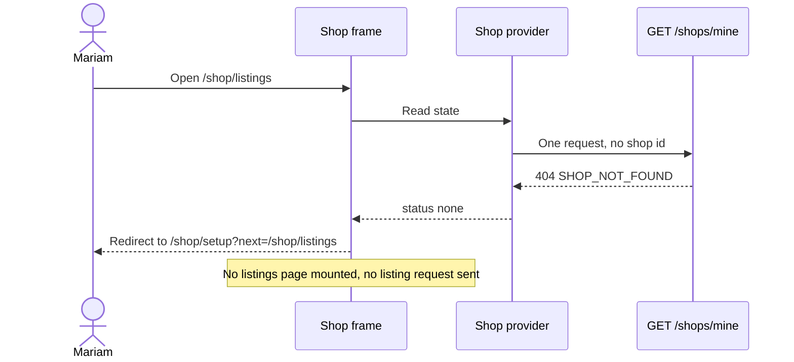

# Onboarding, settings and the routing gate

The client work splits into four pieces with one job each. A provider fetches the shop once and holds four states. Two guards read those states and decide whether a page may render. Two pages collect and edit the four facts the owner types, plus the contact phone. A layout draws the frame those pages sit inside, and it is the only thing in the shop area allowed to render while the answer is unknown.

Build them in that order, because each one is testable on its own and a mistake in the earlier piece hides in the later one. A guard built before the provider has no states to read, and a setup page built before the guard gets tested with a fake shop that never happens in production.

## The routes and what each one needs

| Route | Frame | Needs a shop | Purpose |
|---|---|---|---|
| `/shop/setup` | bare | no, and refuses one | Create the shop, once |
| `/shop` | shop layout | yes | Dashboard with counts |
| `/shop/listings` | shop layout | yes | The shop's copies |
| `/shop/settings` | shop layout | yes | Edit the shop |

The table is the whole routing argument in five lines. One route is for the owner without a shop, three need one, and the layout is shared by the three that need one because they share a header, navigation and the same precondition. Write this table into the client before the components, so the guards have an obvious shape: one guard for the three, one inverse guard for the single exception.

## The provider makes one request and remembers the answer

The provider is mounted once, above the router's shop branch. It calls `GET /shops/mine` on mount and maps the answer into four states. The mapping is where most of the bugs live, so it deserves to be explicit rather than clever.

```ts
// client/src/shop/ShopContext.tsx (the state shape, not the whole provider)
export type ShopState =
  | { status: "loading" }
  | { status: "ready"; shop: OwnerShop }
  | { status: "none" }
  | { status: "error"; message: string };
```

A 200 with a shop is `ready`. A 404 whose body carries `SHOP_NOT_FOUND` is `none`, and that is a settled fact, so it must not be retried on a timer or on window focus: the owner has no shop until she creates one. A 401 is not the provider's business at all; the refresh interceptor from module 7 handles it and retries the request, and the provider simply sees the eventual answer. A 500, a timeout or an offline browser produces `error`, which keeps the current route and offers a retry.

The provider also exposes a way to set the shop without a second request. When setup succeeds, the response body is already the owner view, so the provider can move to `ready` directly. Refetching after a 201 costs one more round trip on the worst possible connection and adds a state where the shop exists but the client still shows a spinner.



Read the note at the bottom. It is the whole point of the sequence: the listings page never mounts, so its request never fires, so there is no 404 to hide and no failed request in the console. A guard that redirects after mounting produces the same final screen and three requests the owner's data allowance paid for.

## Two guards, both boring

The guard is a component that returns either its children or a redirect. It has no data fetching of its own, and it does not decide what the destination should be beyond the first one.

```tsx
// client/src/shop/RequireShop.tsx (outline)
export function RequireShop({ children }: { children: React.ReactNode }) {
  const { state, refetch } = useShop();
  const location = useLocation();

  if (state.status === "loading") return <ShopFrameSkeleton />;
  if (state.status === "error") return <ShopRetry message={state.message} onRetry={refetch} />;
  if (state.status === "none") {
    const next = encodeURIComponent(location.pathname);
    return <Navigate to={`/shop/setup?next=${next}`} replace />;
  }
  return <>{children}</>;
}
```

Three details in that outline carry weight. The loading branch renders a frame rather than `null`, so the screen does not jump when the answer arrives. The redirect uses `replace`, so the browser's back button does not return to a page the owner is not allowed to see and bounce again. The error branch keeps the route and offers a retry, so a dropped connection never looks like a missing shop.

The inverse guard is shorter, and it exists for one reason: an owner who already has a shop should never see the create form. It reads the same state, sends `ready` to the dashboard, and renders the setup form only in `none`. A `loading` state renders the skeleton here too, which stops the form from appearing and disappearing in front of an owner with a shop.

## Setup: one page, three groups, one save

The setup page collects the four facts the owner types from module 9, plus the contact phone, in three labelled groups: the shop, the hours, the pickup. One save button at the bottom, one request, one result.

The form is uncontrolled enough to survive a dropped connection and controlled enough to render field errors. Keep the typed values in component state, submit once, and read the response envelope from module 9: a 400 carries `fields`, and each message goes beside the input that caused it. Focus moves to the first invalid field after a failed submit, because an owner on a phone with a field error three screens above the button will otherwise believe the form did nothing.

```tsx
<label htmlFor="name">Shop name</label>
<input
  id="name"
  name="name"
  value={values.name}
  aria-invalid={Boolean(errors.name)}
  aria-describedby={errors.name ? "name-error" : undefined}
  onChange={handleChange}
/>
{errors.name ? <p id="name-error" role="alert">{errors.name}</p> : null}
```

The hours editor is the part that needs care at 360 pixels. Seven rows, one per day, each with a label, a closed control and two time inputs. Use real `<input type="time">` elements so the phone's own picker appears and the keyboard is not asked to type a colon. Each control carries an id built from the day, such as `hours-3-open`, so the label points at it and a screen reader announces "Thursday opening time" rather than "time time time time".

Two submit states matter more than the layout. The button is disabled and labelled with progress while the request is in flight, which prevents a double tap from creating a shop and then receiving a 409 for the second attempt. And the save does not clear the form until the server has answered, so a failure leaves every typed value in place.

A 409 from the create route is not a normal failure and should not be rendered as a field error. It means this account already has a shop, which is knowable only from the server, so the correct handling is to refetch the shop, move the provider to `ready`, and navigate to the dashboard with a short message. That path also covers the owner who created her shop in another tab ten minutes ago and forgot.

## Settings: prefill, diff, save

Settings renders the same groups with the existing values and sends a PATCH with only the fields that changed. Sending the whole form is simpler and it is wrong in one specific way: an owner who opens settings on a slow connection, waits, and saves sends stale values for the fields she never touched, which silently reverts a change made on another device. The diff is six lines of comparison and it removes that class of bug.

The refusal table from module 9 maps onto the page. A 400 puts messages beside fields and focuses the first one. A 403 means the shop is not this owner's, which should be impossible from this screen and is worth a plain message and a sign out. A 409 `SLUG_LOCKED` appears beside the address field, and the field is disabled with an explanation rather than hidden, because an owner who wonders why the address cannot change deserves the one sentence that answers it.

The slug field is also the place to show the public address in full, with a copy button. That is a small feature with a real effect: a shop owner who can copy her page address will send it to a student, and the address is the only part of Hamesh she can hand to somebody who is not on the platform yet.

## The layout, and what it draws while nobody knows

The shop layout draws the shop name, a navigation list with three entries, and a save-independent account menu. It also renders the skip link that jumps past the navigation, because a keyboard user who has to tab three links before reaching the form on every visit will stop using the keyboard.

While the state is `loading`, the layout draws the frame with a skeleton name and disabled navigation, and it draws no page. That is a deliberate compromise: the owner sees the shape of the app immediately, and the app makes no request that needs a shop. When the answer is `none`, the layout is not rendered at all, because the redirect happens in the guard above it.

At 360 pixels the layout collapses to a single column, the navigation becomes a horizontal strip of three links, and the page content sits in a container with 16 pixel side padding. Nothing on the screen scrolls sideways, and the save button on both forms sits at the end of the content rather than floating over it, because a floating button covers the error text it just produced.

## Three tests, and the one that fails first

The guard test is the important one because it asserts the absence of a request, not just the presence of a heading.

```tsx
// client/src/shop/RequireShop.test.tsx
it("sends an owner with no shop to setup and mounts no listing page", async () => {
  server.use(mineHandler({ status: 404, json: { error: { code: "SHOP_NOT_FOUND" } } }));
  renderApp({ route: "/shop/listings" });

  expect(await screen.findByRole("heading", { name: /set up your bookshop/i })).toBeInTheDocument();
  expect(fetchCallsMatching(/\/listings/)).toHaveLength(0);   // no listing call of any shape
});
// currently: the listings page mounts first, fetches once, then the redirect lands
```

The second test covers the destination. Navigate to `/shop/settings` with no shop, create one, and assert that the app ends on settings rather than the dashboard. Then run the same flow with `?next=https://example.com` and assert the app falls back to the dashboard, which is the open redirect check written as a test instead of a habit.

```tsx
it("ignores an off-site next destination", async () => {
  server.use(mineHandler({ status: 404, json: { error: { code: "SHOP_NOT_FOUND" } } }));
  renderApp({ route: "/shop/setup?next=https://example.com/shop" });
  await createShopThroughForm();
  expect(screen.getByRole("heading", { name: /your shop/i })).toBeInTheDocument();
  expect(routerLocation()).toBe("/shop");   // read from the router, not from window
});
```

The third test is the double submit. Click save twice inside the same tick and assert one create request and one resulting shop. A form that sends two requests gets a 201 and a 409, and the second response, arriving after the first, can overwrite a success state with an error message that reads like a failure to create.

## Look at it on a phone before the gate

Open the built client in a browser, set the device width to 360 pixels, and walk the journey with one hand: sign in, land on setup, fill the hours for a shop that closes early on Friday, submit, reach the dashboard, open settings, change the pickup notes, save, reload. Then turn the network to slow and repeat the submit to watch the pending state. Then put the mouse away and do the whole journey with the keyboard, including the time inputs, and fix anything that needs a hover or a precise click.

Two failures show up in that pass almost every time. The first is a time input that overflows its row at 360 pixels, which usually means a fixed width on the input rather than a flexible one. The second is an error message that is invisible to a screen reader because it appears inside a container that is not announced; fixing it means the message sits in a live region or is referenced by `aria-describedby` from the input, and the input is marked invalid.

## Acceptance criteria

- [ ] A shop owner with no shop is redirected to `/shop/setup`, and no page inside the shop layout mounts.
- [ ] A shop owner with a shop is redirected away from `/shop/setup` and never sees the create form.
- [ ] The `next` parameter survives the round trip and an off-site value falls back to `/shop`.
- [ ] A dropped connection during the shop request shows a retry and keeps the current route.
- [ ] Setup sends one request per submit, the button is disabled while in flight, and a 400 places each message beside its field and focuses the first one.
- [ ] A 409 from create moves the provider to `ready` and navigates to the dashboard.
- [ ] Settings sends only changed fields, and a slug refusal appears beside a disabled address field with an explanation.
- [ ] The journey completes at 360 pixels without horizontal scrolling, and every control is reachable and operable with the keyboard.
- [ ] The three tests above run in the suite and the guard test fails before the guard is wired in.

## Bridge to the gate

The gate is a phone at 360 pixels and a brand new account with no shop. It walks the URL typist, the double tapper, the Friday-hours editor and the keyboard user through the same five screens, and it checks that the API's 404 turned into a setup page rather than an empty dashboard. Module 11 adds editions and listings to this frame, and it assumes the frame never renders without a shop.
