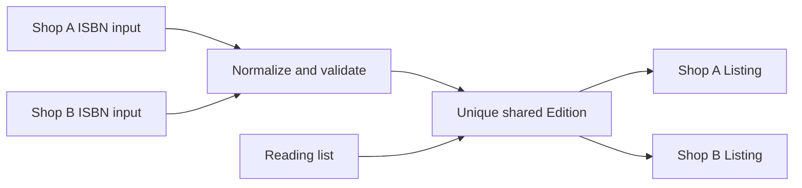

# Make one edition from two shop-counter requests

Two shops receive copies of the same textbook on the same morning. Shop A types an ISBN and sees no edition yet. Shop B types the same number, with hyphens, and also sees no edition. Both press Save. If the API does “find, then insert” without a unique index, it may create two shared editions. A student's reading list then matches only some of the available copies. Your task is to turn messy input into one edition record and still let both shops list their separate physical copies.

The shared edition is not Shop A's property because Shop A happened to submit it first. The shop owns its listing: its actual copy, condition, defects, photos and price. This distinction should appear in database relations and authorization checks. A shop can correct its own listing while available. It cannot rewrite shared edition metadata after other listings or reading lists depend on it. A platform admin can handle corrections through an auditable path introduced later.

## Normalize before you query

Create `server/src/modules/isbn/isbn.js` with a function that accepts a string and returns a normalized ISBN-13 or a typed validation error. Trim spaces and hyphens. Do not silently remove arbitrary letters: a mistaken `O` is not zero, and a final `X` is valid only as an ISBN-10 check digit. Accept ten or thirteen characters after normalization. For ISBN-10, multiply each digit by weights 10 down to 1, treating final `X` as 10, and require the sum to be divisible by 11. For a valid ISBN-10, prepend `978` to its first nine digits and compute a new ISBN-13 check digit. For ISBN-13, accept a `978` or `979` prefix and require the alternating 1-and-3 weighted sum, including the final digit, to be divisible by 10.

Do not convert a 979-prefixed ISBN-13 back to ISBN-10. It has no equivalent ten-digit form. Store the normalized ISBN-13 as the canonical lookup key. You may store the original string for display or debugging, but never use it as the unique catalogue identity. The International ISBN Agency describes the 13-digit format, check digit and 979 limitation; use those rules rather than copying a short regex from a forum. A check digit detects many typing errors but does not prove that the entered title or author is correct. The form still needs a human review of the edition metadata.

Write unit tests before the route. Cover a valid ISBN-10 and its 13-digit conversion, a valid 978 ISBN-13, a 979 ISBN-13 that remains 13 digits, bad check digits, `X` in the wrong position, spaces and hyphens, and wrong lengths. Use the ISBN Agency's published example only as a numeric test fixture; do not invent a book title for it. The route should return a field error that preserves the typed input and names the problem without dumping a stack trace.

## Create the shared edition safely

Create `server/src/modules/editions/edition.model.js` with `isbn13`, optional `isbn10`, work ID, title, edition label, authors, format and publication details. Add a unique index on `isbn13`; for optional `isbn10`, use a partial unique index so editions without that field do not collide on a missing value. Add tests that verify the indexes actually exist in the integration database. Index declarations in a source file are not proof that a deployed collection has built them.

Implement `GET /editions/lookup?isbn=`. Normalize and validate the input, then query by canonical `isbn13`. A found edition returns its public metadata. A missing edition returns 404 with the normalized ISBN so the form can invite manual entry. A bad ISBN returns 400 with a field-level explanation. The lookup must not reveal shop-private listing drafts or buyer data.

Implement `POST /editions` for a shop owner adding a new edition. Validate the ISBN and required metadata on the server. Try an insert protected by the unique index. If MongoDB returns duplicate-key error 11000 for `isbn13`, read the winning edition and return it; do not overwrite its title with the losing request's version. If the two submissions disagree on metadata, show the existing edition and provide a correction-report path for review. The API should tell the caller whether it created or reused an edition, because the shop UI can then explain why its typed title was not used. This insert-and-read path handles the race without pretending that the browser's earlier lookup reserved the ISBN.

MongoDB's documentation explains that concurrent upserts need a unique index to prevent duplicates, and that a losing operation may update the winning document or fail with a key collision depending on its predicate. Here, inserting and catching the collision makes the ownership decision clear: first valid insert establishes the shared row, later shops reuse it. Avoid an upsert that quietly changes shared metadata from the second shop's form. Whichever strategy you choose, test two concurrent calls against the real database.

## Create shop-owned listings

After the edition exists, `POST /shops/:shopId/listings` creates a separate Listing for this shop and one physical copy. Set `shopId` from an authorized shop lookup, not from a trusted browser field. The listing points to `editionId`, has a condition grade rank, separate defect flags, price in integer minor units, photos of the actual copy and `available` status. Check that the caller owns the shop. Another shop may create its own listing for the same edition but cannot edit this listing. A sale later changes one listing's status; it must not decrement a stock count on Edition.

Write a cross-shop test: Shop B's PATCH to Shop A's listing returns 403, while Shop B's POST for a new listing under the same Edition succeeds. Write a locked-edition test: after a listing points at the Edition, a shop owner's PATCH of the shared title is rejected. In the browser, create two copies in two grades and compare them on one edition page. A student should see one edition header and two offers, with each offer's grade, defects and shop visible. If the page shows two editions, inspect normalization and the database's unique index before adding a UI deduplication trick.

Finally, document the data boundary in `docs/erd.md`. Draw Work to Edition, Edition to Listing, and Shop to Listing. Annotate the unique ISBN-13 index and the fact that Listing is the sell-once object. This ERD is a testable claim: the next reading-list module queries Edition, while checkout claims one Listing. If the same ID is used for both, pause and correct the model now; later modules depend on this separation.

Keep title-based matching out of the create route. Two editions can have nearly identical titles and different contents, page counts or formats. A paperback and an ebook may also have different ISBNs. If a shop has a copy without a visible ISBN, the core path should ask for a manual review rather than invent a canonical number or merge it with a title match. Record the uncertain copy as a draft outside the shared edition lookup until a permitted admin process resolves it. This decision is inconvenient at the counter, but a wrong merge can send a student a book their course will not accept. The user interface should explain the next step, not silently choose a similar title.

The reverse error also matters. If two listings use the same Edition ID but one shop entered an incorrect condition or hid missing pages, the shared ISBN record does not make that individual copy safe to buy. The listing form must require an honest grade and defect flags, and the order later snapshots them. Ask a second person to inspect one seeded listing against its photo and description. If the description could fit any copy of the edition, add detail about the actual copy. Catalogue identity solves only the edition question; the shop-owned offer still needs evidence.
