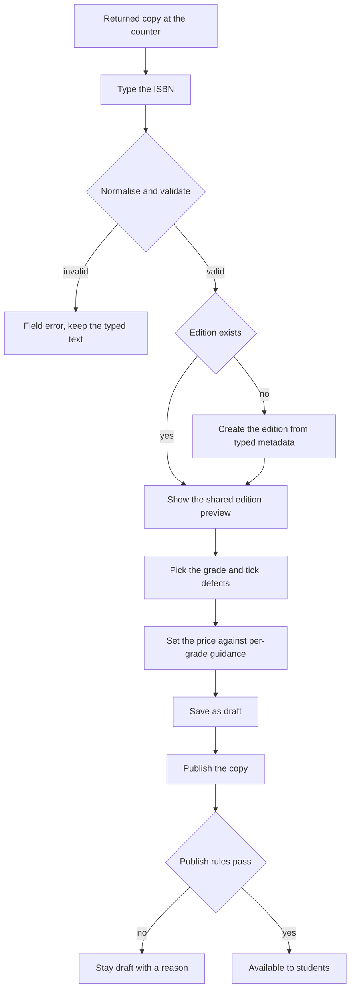

# The counter with a pile of returns

On the Thursday of the second week of term, the counter at North Street Books holds fourteen returned textbooks. Two students dropped the same course and brought back everything they had bought. Three copies are almost new. One has a coffee ring on the cover and water damage through the first forty pages. Two came back without the access code card that was inside the shrink wrap, and that code cannot be handed to a second student anyway, so the shop has to say so in writing before anyone pays.

The owner knows each copy by hand. The spine is stiff or it is not. The notes are in pencil or in ink. The corners are sharp or crushed. A student on a phone cannot know any of that, so everything the owner feels about this pile has to become recorded data: an ISBN, an edition, a grade, a set of named defects, a price, and from the next module, photographs of the actual copy.

Module 11 built the server side of the first part. Hamesh can normalise a typed ISBN, validate its check digit, find or create one shared edition, and create a listing that points at that edition. What the shop does not have is a back office. There is no screen that shows the pile, no form that walks from the number on the back cover to a saved copy, and no way to answer the question the owner actually asks: what are the other shops charging for this edition at this grade right now?

## What a back office has to be

The phrase hides a simple requirement. The owner stands at a counter with a book in one hand and a phone or an old laptop in the other. Every screen has to work in that posture: one hand, weak light, a queue of two students, and a connection that comes and goes. A form that needs twenty careful fields and a steady line will be abandoned, and the pile stays unsellable while the term moves on.

That constraint decides the order of the form. The first field is the number printed under the barcode, because that is what the owner can read off the object in front of them. The last fields are the ones that need judgment: the grade, the defects, the price. Those can wait for a second pass, which is why the save button writes a draft and not a promise.

The same constraint decides what the back office may not do. It may not let the owner publish a copy that a student cannot evaluate, it may not let one shop correct a shared record that other shops depend on, and it may not let a price be invented when the marketplace already knows what similar copies sold for.

## The counter moves in five steps

Before writing any code, walk the pile through the five moves the back office has to support. The diagram below is the shape of the module, and every later lesson fills in one arrow of it.

Two exits from the ISBN step matter. Invalid input returns a field error and keeps what the owner typed, because retyping thirteen digits after a rejected check digit wastes the one thing the counter does not have. A valid ISBN the catalogue has never seen asks for the bibliographic fields exactly once, and then every later shop reuses that edition.

The draft state at the bottom is not decoration either. It is what makes a partial save possible when the owner is interrupted mid copy, and it is where the validation can stay gentle. A draft may be incomplete. Publishing may not be. Module 13 adds the hardest publish rule, which refuses to release a copy graded Good or Acceptable until at least one photograph of that copy exists.

## Why the ISBN leads the form

A title typed at the counter is a memory, and two people remember the same textbook differently. One writes "College Algebra", the next writes "College Algebra 2nd ed", and a third writes the lecturer's name instead of the title. Three listings, one book, and a reading-list matcher that finds only one of them.

The number under the barcode does not have that problem, as long as the server treats it as one canonical identity rather than as free text. That is the whole reason module 11 exists. The form you build here should not re-implement the normalisation rules, should not trust a browser to send a clean value, and should not create a second edition because the typed string had hyphens in it.

The first shop to type an ISBN still owns nothing. It has typed metadata correctly, which is a favour to every shop that follows, and it can be wrong. So the form has to show the edition preview before the owner commits, and the server has to refuse to rewrite shared fields once copies point at them. If the preview shows a statistics guide while the owner is holding an algebra textbook, the mistake is visible in one second. If the preview is skipped and the listing saves, the mistake is visible to a student at checkout.

## Where a price comes from

An owner pricing a used textbook is guessing unless Hamesh shows what other shops are asking for the same edition at the same grade. The shop manager who has sold books for twenty years is good at this. The part-time student who covers the counter on Saturday is not, and the same edition can sit at 2,300 in one shop and 1,600 in another for no reason other than who typed the number.

The guidance is a view over live copies, not a rule that sets the price. It answers one question per grade: what is the lowest price on an available copy of this edition right now, and how many copies are at that grade. The shop reads it and decides. Nothing in the marketplace should quietly copy another shop's number into the form, because the copy in hand may be better or worse than the one that set the low price.

| Copy | Grade | Defects recorded | Price in minor units |
|---|---|---|---|
| 1 | Good | Highlighting on 20 pages | 2,300 |
| 2 | Very Good | Creased cover, clean interior | 3,100 |
| 3 | Acceptable | Water damage, first 40 pages | 1,600 |

The table also shows why one "market price" per edition is useless. The spread from 1,600 to 3,100 is condition, not haggling. A shop that sees only an average will price a damaged copy too high and leave it on the shelf until the term ends. A shop that sees the spread can decide to be the cheapest Acceptable copy on purpose, which is a real strategy for a book that a student needs this week.

One more detail belongs in the guidance panel: the count behind each low price. A grade with one available copy tells the shop something different from a grade with nine. If the panel hides the count, the owner cannot tell a market from a single optimistic seller.

## Draft first, because the counter is interrupted

Power cuts, a queue, a box of books left at the back door, a student asking whether the shop buys used copies. The owner will be interrupted between typing the ISBN and setting the price. If the form only saves at the end, every interruption costs the work, and after the third loss the owner stops using the form and goes back to a paper list.

A draft that holds the ISBN, grade and price is already useful. It shows up in the shop's listings table, it can be finished later, and it never appears in a student's search. The mapping is simple: a draft is the shop talking to itself, an available copy is the shop talking to students, and only the second one carries the marketplace's promises.

Treating draft as a real state also keeps the error messages honest. Missing bibliographic fields are a draft problem, not a failure. Missing evidence for a low grade is a publish problem, and the response should say which rule stopped it, in words the owner can act on, without throwing away the work.

## Three things the back office may not do

The first is cross-shop editing. A listing ID appears in URLs and in API responses, so it is public. Permission comes from the stored shop on the listing compared with the shop resolved from the signed-in user, checked on the server. A hidden Edit button in a table is a convenience, not a control. When the check fails, the answer is 403 with a short message, and the record does not change.

The second is rewriting shared edition metadata. A shop may report a wrong title through a notes field. It may not change the title that six other listings and a course reading list depend on, and a shop owner who tries should get the same kind of refusal as a cross-shop edit. Module 11 built the lock. This module has to surface it as a readable message instead of a stack trace.

The third is a promise the evidence does not support. At this stage the evidence is the grade, the named defects and the price. In module 13 it also becomes photographs of this copy. The server, not the form, decides when those are enough. A shop that can publish an Acceptable copy with no evidence is a shop that can pass its problem to a student.

## What this module asks you to build

Three lessons follow. The next one writes the ISBN-first listing route, the grade map and the per-grade price guidance, and it maps 400 and 403 to the right part of the screen. The lesson after that is the gate: three copies of one edition, in three grades, each with the guidance visible before the price was set.

The gate is deliberately small and deliberately boring. Nothing in it is impressive to look at. It is the smallest evidence that the back office works: the pile at the counter can become inventory that a student can find, compare and trust. A shop that cannot list three graded copies of one edition cannot run a used-book business on Hamesh, no matter how good its photographs are.

## The decision in front of you

The first design choice is one long page or a three-step wizard. A wizard hides fields and feels calmer, but it also hides the edition preview while the owner types the price, and it makes a back button a data-loss event on a phone. One page with three marked sections and a save at the bottom of each keeps the whole copy visible, and it survives interruption because every section can be saved on its own.

The cost of that choice is a long scroll and a form that must be disciplined about which section owns which error. The benefit is that the owner never wonders where the ISBN went. Most bookshops type a handful of copies a day, not hundreds, so the scroll is cheap and the certainty is not.

The second choice is whether the price guidance is advisory or prescriptive. Advisory wins here: the shop knows the physical copy and the marketplace does not. Prescriptive pricing would be faster to build and easier to defend in a report, and it would also let a shop undercut itself without understanding why, or push a damaged copy above the market and lose the sale silently.

## Bridge to the route

The next lesson turns this scene into a contract: one route that accepts a typed ISBN, a grade code, defect flags and a price in minor units, and returns a draft listing with the edition it points at. It also defines the two responses the form has to render well, which are a 400 that names the field and a 403 that names the reason. Keep the pile of fourteen returns in mind while you read it. Every rule in that route exists because one of those copies would otherwise reach a student with the wrong story attached.
