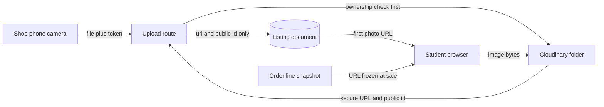

# A buyer cannot hold the book

Hana is standing in a corridor between two lectures with a phone in one hand. Two shops have a Good copy of the same edition at the same price. North Street Books says highlighting on about twenty pages. Campus Shelf says creased cover, clean interior. The grades are identical, the prices are identical, and she has about forty seconds before the next lecture starts. The only thing that will decide this purchase is whether she can see the actual copy.

That is the whole argument for this module. Everything else follows from it. A student buying a used textbook is not buying a description, a grade or an ISBN. She is buying one specific physical object that she will carry for a semester, and she cannot pick it up, open it or turn it over before she pays. The screen has to do the work her hands would do in the shop.

## What a photograph has to prove

A publisher cover image proves that the edition exists. It is a picture of the book as it left the printer, and it is the same picture for every copy of that ISBN in the world. That is useful for recognition: Hana can confirm she is looking at the right algebra textbook instead of a statistics guide. It is useless as evidence, because it shows a copy that has never been opened, let alone highlighted.

A condition photograph proves something else: this copy, today, in this shop. It shows the coffee ring, the bent corner, the pencil notes on page 44, the missing access code card. It is evidence about one Listing and cannot be reused for another copy of the same edition. Two shops with a Good copy of the same book should have two different sets of photographs, and if they do not, at least one of those shops is not photographing what it sells.

That distinction is the same one that runs through the whole data model. The edition is shared and the copy is owned. A shared catalogue image belongs on the edition if you ever add one, and the condition photographs belong on the listing, because they are local facts about a local object. Mixing them is how a marketplace ends up with nine identical thumbnails and a student who cannot tell which one has water damage.

## The evidence set, and why four is enough

A shop owner with a phone does not need a studio. Four photographs answer almost every question a buyer has, as long as they are the right four and they are in a sensible order.

| Position | What it shows | The question it answers |
|---|---|---|
| 1 | Front cover under normal light | Which copy is this, and is the thumbnail honest |
| 2 | The worst defect, close up | How bad is the damage the note describes |
| 3 | Spine and page edges | Is the binding sound, is the block stained |
| 4 | One inside page, often the worst marked one | Are the notes as extensive as the grade suggests |

The first photograph is the most important, because it is the only one most students will see on a results page. It should be the copy, not a catalogue image, and it should be taken in light that shows the wear rather than hiding it. A phone flash on a glossy cover turns a scratch into nothing, which helps the shop for one day and costs it a dispute later.

Four is enough for a used textbook and small enough to respect a shop's data and a student's attention. It is also small enough for the API to validate in one sentence: at most four, each under a stated size, each a real image type. If a shop has a genuinely complicated copy, the defect notes carry the rest of the story in words. Photographs and notes are two halves of one claim, and neither replaces the other.

## Why the rule is stricter below Very Good

Hamesh requires at least one photograph before an Acceptable or Good copy can be published. Very Good, Like New and New copies may be published without one. That looks backwards at first, because a Like New copy is the one a student is paying the most for. The logic is about where the risk sits.

A Very Good copy fails in small ways. Shelf wear, a creased cover, a name inside. The label plus the defect note describes almost everything a buyer would notice, and the price already reflects it. An Acceptable copy fails in ways that are hard to describe and easy to disagree about: how much water damage counts as water damage, whether the pages still turn, whether the access code really is unusable. That is the copy that needs a picture, because the picture is the only shared reference when a student arrives at the shop and disagrees with the grade.

The rule is also cheap to enforce and hard to argue with, which matters more than elegance. It sits in one server-side check on the publish step, it returns one error code, and it works the same way for every shop. A rule that said "photos required for anything with any damage" would be nicer in theory and impossible to test in practice, because damage is a free-text judgement.

What the rule does not do is guarantee honesty. A shop can photograph the good corner and leave the water damage out of frame. The marketplace can require evidence without becoming a referee, and it should say so plainly in the student-facing copy. What the requirement does change is the floor: there is now a picture in the record that a buyer can point at, and a shop that publishes without one is visibly outside the policy.

## Where the bytes live

A photograph is the largest thing in this feature and it does not belong in the database. Storing image bytes inside a Mongo document makes every listing read heavy, every backup larger, and every query slower, and it still does not give you a CDN. The pattern that works is old and boring: the bytes go to object storage, and the database stores a pointer to them.

Cloudinary is the storage service this course uses, and it is one of several credible choices. It handles the CDN, the HTTPS URL, resizing and the delete call. The same pattern works with S3 or a self-hosted MinIO, with different client code and the same database contract: a URL for display and a public identifier for lifecycle operations such as delete.

Read the diagram in two paths. The write path carries bytes from a phone to storage and stops there; only two short strings reach MongoDB. The read path never touches your API at all, because the student's browser fetches the image from the CDN. That second path is why browse pages stay light on a slow connection: image bytes are not queued behind a JSON response from your server.

The public identifier is the part beginners skip, and it is the part that makes deletion possible. A Cloudinary URL contains the identifier, but reconstructing it from a URL after any transformation or folder change is fragile. Store it beside the URL at upload time, and the delete call becomes a single argument instead of a guessing game.

## The buyer is not the only reader of a photograph

Six weeks after Hana buys the Good copy, she arrives at North Street Books to collect it. The shop has regraded the copy in the meantime, or replaced its photographs with cleaner ones, or deleted the old asset to tidy the account. If the old photograph is gone, the order page she opens at the counter shows a broken image, and the shop has lost the evidence it needs to answer her question about the water damage.

The order snapshot from module 19 solves half of this: it records the first photo URL at the moment of sale, so the receipt keeps pointing at the same image. The other half has to be a rule in this module. A copy that is held or sold has a frozen photo set. No replace, no delete, no reordering. A shop can add an internal note for a dispute, and the stretch lab about condition disputes can attach new evidence, but it may not destroy what the buyer relied on.

That rule changes the order of operations in the upload code, which is a lesson of its own. Upload the new image, write the new reference, then delete the old asset, and never the other way round. If the delete fails, log it and continue, because a stray file costs a fraction of a cent and a broken listing costs a sale.

## What this module asks you to build

Three lessons follow. The next one adds photo subdocuments to the Listing model, a server-mediated upload route, the four-photo limit, the ownership checks and the publish rule below Very Good. It also covers replace and delete, and it explains why the order snapshot forces a freeze on sold copies. The lesson after that is the gate: a Good copy that cannot publish without a photograph, a fifth upload rejected, a cross-shop upload refused, and a sold copy whose photograph still loads.

The gate is small on purpose. It does not ask for a beautiful uploader. It asks for four things you can check in a browser and in Compass: bytes in storage, a short pointer in the document, a publish refusal you can trigger on demand, and a paid order whose image still resolves.

## The decision in front of you

The first choice is where the upload starts. The browser could send the file straight to Cloudinary with a signed request, which is the faster and cheaper pattern at scale because the bytes never touch your server. It also needs a signature endpoint, a preset, and a second place where ownership is decided, and the file arrives at storage before your API has agreed that this shop may write to this listing.

The course takes the server-mediated route instead. The owner's request carries the file and the session token to your API, the route checks the shop and the listing, then streams the bytes to storage. It is slower for large files, it uses your server's bandwidth and memory, and it is much easier to reason about, because one route decides both permission and storage in one place. Move to direct upload when upload volume makes the server the bottleneck, and keep the same database contract when you do.

The second choice is whether photographs are required on create or on publish. Publish wins, because a draft with a missing photo is a normal state at a counter, and a create request that fails on a missing photo teaches the owner to stop using the draft feature.

## Bridge to the upload route

The next lesson turns this scene into routes, a schema change and a test that fails on purpose. Keep Hana in the corridor while you read it. Every rule in that lesson exists to make sure that when she has forty seconds on a phone, the picture she sees is the book she will collect.
