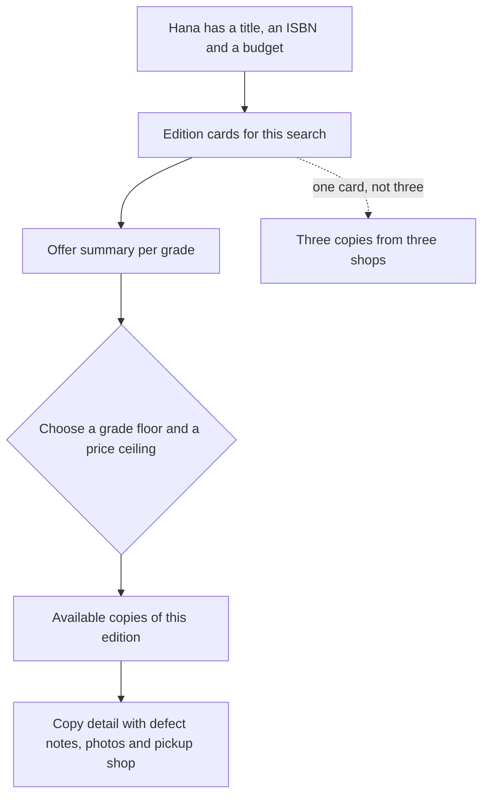

# Students search for a book, not a shop

Hana needs the algebra textbook her lecturer named. She does not know which of the three bookshops near her faculty has it, and she does not care. She has a title, an ISBN from the course outline, and a budget of about 3,000 minor units. What she wants is one screen that shows her the book, what condition she can get it in, and what each condition costs.

A shop-first marketplace answers a different question. It shows three bookshop pages, each with its own list, and Hana opens them one at a time to compare. After six screens she has seen the same edition three times, still cannot tell which shop has the best Good copy, and has spent more data than the difference in price is worth.

## Shop first hides the thing she is buying

The unit of Hana's decision is the edition, not the shop. She has to buy the edition her course requires, and only then does condition, price and pickup location enter. If the browse screen starts from shops, the edition is scattered across pages, and every comparison costs her a new request and a new mental list.

There is a marketplace reason as well. A shop page is a fine thing for a shop to have, and Hamesh will have them, but a shop page cannot show Hana that the cheapest acceptable copy of her edition is at a shop she has never heard of. Only a screen organised around the edition can do that, because only that screen has all the offers in one place.

The third reason is the reading list. Module 18 matches a whole course list against available copies, and it works from accepted edition ids. If the public browse screen is organised the same way, the student sees the same shape the matcher uses: an edition, then its offers. A shop-first browse would teach her a model that the rest of Hamesh does not share.

## One card per edition, one line per grade

The card for an edition carries the shared facts once: title, authors, edition label, ISBN and format. Under them it carries a summary of the offers, grouped by grade, with the lowest price at that grade and how many copies are behind it. A card that lists three copies as three separate results wastes the shared facts three times and buries the only interesting comparison.

Follow the arrows from the top. The edition is the entry point, the summary is what makes the card useful, and the choice of grade floor and ceiling narrows the copies. The dotted arrow is the mistake this design avoids: three cards for one book, one per shop, each with the same title and a different price.

What the summary should not do is hide the spread. A card that says "from 1,600" is technically true and practically misleading, because 1,600 is an Acceptable copy with water damage and the student's floor is Good. The summary needs one line per grade so a student can see that Good starts at 2,300 and Very Good at 3,100. Then the floor she sets is her decision, made with the real numbers in front of her.

## What a page of cards costs to build

Twenty cards on a page, two to three copies per edition, three shops. The obvious implementation loads the editions, then loads each edition's copies in a loop, then loads the shop for each copy. That is one query for the list, twenty for the copies and something like forty for the shops. On a laptop with a local database it feels instant. On a phone, over a slow connection, with three students browsing in the same minute, it is the endpoint that makes the whole site feel broken.

The cost is not the data, it is the round trips. Each query is a network trip from the API process to MongoDB, and each trip has a fixed cost that dwarfs the work of reading a few documents. Twenty-one trips for one page is a design choice, and it is the wrong one. The same page can be built in two or three trips if the grouping and the shop lookup happen inside the database.

That is the whole technical content of this module, and it is worth stating before the code: measure the number of queries, then reduce it, then measure again. A page that returns the right JSON in sixty round trips is not correct in any sense a student cares about.

## Two endpoints, two questions

The browse screen needs two reads, and they answer different questions. The first is the list: which editions match this search, and what does the offer summary look like for each. The second is the detail: for this one edition, which copies are available, from which shops, at which grade and price.

Keeping them apart is what makes the second one filterable. On the edition page Hana will set a floor of Good and a ceiling of 3,000 minor units, and the server should apply both to the copy query so the response carries only offers she can accept. Filtering in the browser would send her copies she has already rejected, and it would make the page slower exactly when it has the most to show.

Both endpoints also need pagination with values a reviewer can predict. A page size of twenty is comfortable on a phone and cheap to render, and the maximum has to be enforced by the server, because a crafted request for ten thousand editions is a denial of service with extra steps. Sorting has to be stable across pages or a student will see one card twice and miss another, so the sort key ends with a unique field.

## Derived, not stored

The offer summary is tempting to store on the Edition. One field, written whenever a copy changes, and the browse query becomes a simple read. It is also the fastest way to show a student a price for a copy that sold yesterday, because every write path in the system now has to remember to update it, and one of them will forget.

The summary is derived data. It is computed from the copies that are available at the moment of the request, and it should stay that way until module 22 adds a cache with an explicit invalidation rule. A cache is a copy with an expiry date; a stored summary is a copy with no owner. The difference shows up in the first week of real use, when a shop withdraws a copy and the card still advertises its price.

This decision has a cost you should be able to state. Computing the summary on every browse request spends database work on every page view, and at high traffic that is the thing you would optimise first. The course accepts that cost because correctness is worth more than speed on the page a student uses to decide where to spend money, and because the caching module later measures the same endpoint rather than guessing.

## What this module asks you to build

Three lessons follow. The next one writes both routes: the edition list with an offer summary per grade and shop names, and the copy list filtered by minimum grade and maximum price. It also measures the query count before and after the aggregation, and it adds the compound index that makes the grouping cheap.

The gate asks for the numbers. A page of editions with the query count written down before and after, an offer summary you can check against the fixtures by hand, and a filtered copy list that returns exactly the copies a floor and a ceiling allow. It is the first module in this variant where the person judging the work is a student rather than a mentor, so the evidence is a response, a timing note and a count, not a screenshot of a table.

## Bridge to the route

The next lesson turns this scene into two contracts and one measurement. Keep Hana's budget of 3,000 minor units in mind while you read it, because it makes one rule easy to test: with a Good floor and a 3,000 ceiling on the College Algebra edition, the 1,600 Acceptable copy and the 3,100 Very Good copy must both be absent from the response, and the Good copies at 2,300 and 2,600 must be the only two left.
