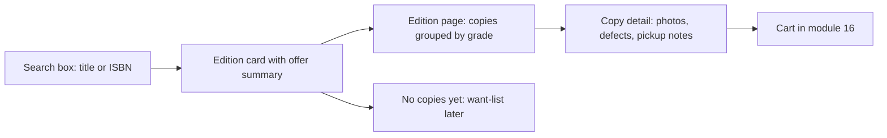

# A student with a phone and a course code

Hana is on the bus home at 22:40. She has 1.4 GB left on her data plan this month, a phone that is 360 CSS pixels wide, and a reading list for BIO-210 that she saved as a screenshot. The list gives a title, an author and an edition number. She needs the fourth edition, used, at a condition she can trust, from a bookshop she can walk to before Thursday's seminar. She is not browsing for a nice book. She is solving a deadline with a device that punishes every wasted megabyte.

Hamesh already holds what she needs. Module 5 modelled a shared Work and Edition, and a Listing for each physical copy with its condition grade, defect notes, photos, price in minor units and pickup notes. Module 11 turned a typed ISBN into one edition record. Module 12 let shops list graded copies, and module 14 built `GET /editions` with an offer summary per edition. None of that is visible to Hana. This module builds the student storefront on top of it, and the storefront is where the data model either earns its keep or does not.

## The unit of the page is a book, not a shop

Students arrive holding a course code and a title, not a shop name. A shop-first grid asks Hana to remember which of four bookshops on her route listed the fourth edition, and to open each one to compare a grade and a price. An edition-first page asks the opposite question: here is the book you asked for, here is every copy of it, and here is the shop, grade, price and walk time for each copy. The second shape costs one tap per comparison, and on a phone that difference decides whether she finishes on the bus or gives up.

Read the diagram as three levels of commitment. The card answers "is this my book, and is it affordable at all". The edition page answers "which copy, from which shop, at which grade". The copy detail answers "is the damage acceptable to me". Each level narrows a decision, and each level must be complete enough that Hana never has to go back a screen to remember what she was comparing.

A mentor reviewing this page should be able to point at any element and name the question it answers. If an element answers no question, it is decoration and it costs data. That test removes most of what a marketplace template puts on a phone screen: no carousels, no recommended rows, no hero images, no newsletter box. Hana has 40 minutes of bus and one decision.

## Four questions the storefront must answer

Every screen in this module exists to answer one of four questions. Which edition matches my reading list? Which shops have a copy of that edition right now? What condition is each copy in, and at what price? Can I collect it in time, and can I trust the shop's description? Write those four on paper before building, and put each one next to the element that answers it.

The first question is bibliographic, and it is harder than it looks. A search for a title returns editions that differ by year, publisher, cover and ISBN, and a course list usually names one of them. The card therefore shows the edition label, the publisher and year, and the ISBN, so Hana can compare against her screenshot. A card that shows only a title and a price invites the cheapest-wrong-edition purchase, which is the most common expensive mistake in a used textbook marketplace.

The second question is availability, and it changes while she looks. A copy that is available when the page loads can be held by another student a minute later. The storefront does not need to solve that here, but it must not pretend otherwise: a sold copy disappears from the list or shows as sold with a substitute, and the cart in module 16 rechecks the state before it accepts a line.

The third and fourth questions are about the physical object. Two Good copies of one edition are different objects: one has pencil notes, one has a creased spine; one is a ten minute walk, one is across the city. The copy detail page carries the photos, the defect notes and the shop's pickup notes, because that is the evidence Hana uses to accept a cheaper grade.

## Grade as text, rank and colour, in that order

A condition grade is a claim about a physical object, and "Good" on its own is a weak claim. Good is a word from a five point scale that Hana has to hold in her head, and different marketplaces use different words for the same idea. Hamesh stores a code, a label and a rank from 1 to 5, so the interface can show the label next to its position on the scale.

The first rule is that a badge never relies on colour alone. The Web Content Accessibility Guidelines call this use of colour, and the reason is practical rather than ceremonial: a red and a green dot are indistinguishable to a reader with red-green colour deficiency, invisible in a greyscale screenshot, and unreadable on a phone at noon in sunlight. The badge therefore carries text and rank, such as "Good, rank 2 of 5", with colour as reinforcement rather than information.

The second rule is that the badge must survive a screen reader and a text export. A badge whose meaning lives in a background colour and a tooltip has no accessible text at all, and a badge whose text is only "G" assumes the reader has memorised the scale. Write the label and the rank into the markup, not into a style class. Module 15.2 builds the exact component and a test that fails when the rank drops out of the accessible name.

## Build for 360 pixels and 1.4 GB

The layout target is a 360 CSS pixel viewport, which is the width of a common low cost Android phone with no zoom. At that width there is room for a thumbnail and two or three lines of text, so the edition card is a single column: a small cover or first photo on the left, title and edition label on the right, then one row with the lowest price, the best grade and the number of shops. Anything else moves to the edition page.

Three habits keep the page fast. Load a thumbnail variant rather than the full condition photo, and load the rest only when the student opens the copy detail. Use lazy loading below the first screen, because a list of twelve editions each with a cover is twelve image requests against a metered connection. And keep the first screen under roughly 400 KB, which is a target rather than a measurement you can skip: check it in the network panel with throttling on, not on your own fibre.

There is no hover state on a phone, so no information may live behind a mouse. A tooltip that explains the grade is invisible to Hana, and a "hover to see defects" pattern is unusable with a thumb. Tap targets need about 44 pixels of height, because the smallest reliable thumb target on a moving bus is larger than the text it selects.

## What goes wrong, and what the page says

Four failures are normal here and each one needs written copy, not a generic error. The edition exists but no shop has a copy, which is the want-list case that module 24 will serve. The edition has copies but all of them are below the grade floor Hana asked for, which is a different message with a different action. The search found nothing, which may mean a typo, a volume number or an ISBN that is not in the catalogue yet. And the request failed, which may be a weak connection rather than a fault.

Write those four messages in Hana's words before writing the component. "No copies of this edition are listed right now. Save it and we will tell you when a shop lists one." is a useful sentence. "No results found." is not, because it does not tell her whether to fix her typing, widen the grade or wait for a shop.

A fifth failure belongs to the data rather than the page. A copy can sell while the edition page is open, so the page must tolerate a stale row and the cart must reject it with a reason. Design the copy row as a link to a detail page that re-fetches the copy, rather than a purchase button that trusts the list.

## The decision this module makes

The real design decision is where the page's data comes from. One option is for the browser to fetch editions, then fetch copies for each edition, then fetch shop names for the copies, which is the N+1 problem from module 14 moved into the client. The other is for one server route to return a display-ready shape with the lowest price, the best grade and the shop count already computed.

We choose the server shape, and pay for it with a wider API contract. The route has to decide what "lowest price" means when the cheapest copy is Acceptable and the best grade is New, and it has to keep that meaning stable when module 22 adds a cache. In exchange, the phone makes one request per screen and the page can render without a client side join.

The consequence is that the response shape is now a product interface, not an internal detail. Name its fields for what the student sees, not for the collection they came from, and version it or extend it carefully, because the storefront and the future want-list alerts both read from the same idea of "a copy a student could buy".

## What this module does not build

Module 15 stops at the copy detail page. It does not add a cart, which is module 16, and it does not build the reading-list matcher or the search index. It also does not solve the availability race: a copy detail page can show an available copy a second before another student holds it, and that is acceptable because nothing has been promised until checkout claims the copy.

Keeping the boundary tight matters for a learner on a deadline. Each screen has one job, and each job has acceptance criteria you can check without finishing the next module. The next chapter builds the grade badge, the edition card, the edition page grouped by grade and shop, and the copy detail, then verifies the whole flow at 360 pixels with images throttled.
