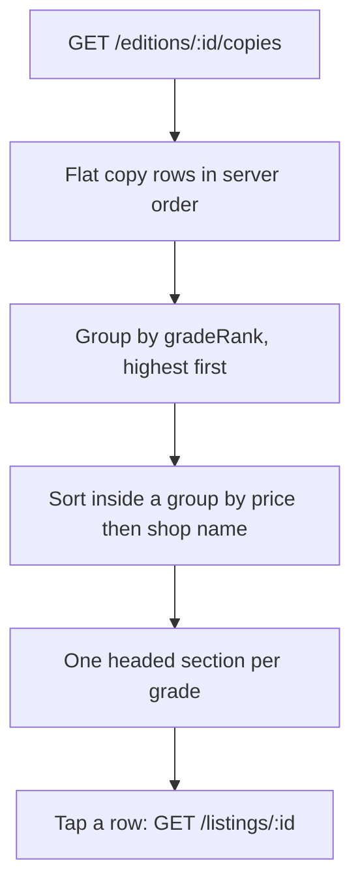

# Edition page, grade badges and copies across shops

This chapter builds the three screens from the last chapter: a search box with edition cards, an edition page where copies are grouped by grade and then by shop, and a copy detail page with the photographs, defect notes and pickup instructions for one physical object. Build them in that order, because each one depends on the data contract of the one before it, and a broken contract is easier to see on a card than on a detail page.

The API work is already done. Module 14 returns editions with an offer summary, and it returns the copies of one edition with optional grade and price filters. What is missing is the display layer, and the display layer carries two obligations the API cannot carry for it: a grade a person can read without relying on colour, and a page that works at 360 CSS pixels on a metered connection.

## Start with the badge, because everything repeats it

The grade badge appears on the card, on every copy row and at the top of the copy detail, so a wrong badge is wrong in three places. Write its contract first. The component takes the grade code, the label and the rank, and the rank comes from the same server module that validates grades on a Listing, so the interface cannot invent a scale.

```ts
export type GradeBadgeProps = {
  code: "new" | "like_new" | "very_good" | "good" | "acceptable";
  label: string;   // "Very Good", served by the API, not typed by the client
  rank: number;    // 1 Acceptable up to 5 New
  scaleMax: number; // 5, fixed by the grade map
};
```

The badge renders the label and the rank as text. A five step marker may sit beside the words as reinforcement, and colour may tint it, but the meaning lives in the text. The accessible name carries the same sentence a sighted reader gets, which is why the component sets it explicitly rather than letting the two words be announced next to an unlabelled decorative bar.

Here is the test that should fail before you build the component. It asserts what a learner with a screen reader receives, not what is painted on the screen.

```ts
it("announces the grade label and its position on the scale", () => {
  render(<GradeBadge code="good" label="Good" rank={2} scaleMax={5} />);
  // Expected: "Condition Good, rank 2 of 5"
  expect(screen.getByText(/rank 2 of 5/i)).toBeInTheDocument();
});
```

Run it and read the failure. A component that renders a coloured square with the word "Good" and a hidden scale bar fails on the rank. Fix it by writing the rank into the visible text and into `aria-label`, then check the same sentence survives greyscale and 200 percent zoom.

## The edition card and the search box

The card shows what Hana needs to decide whether this edition is hers. That is the title, the author, the edition label, the year, the ISBN, the lowest active price, the best grade available and the number of shops that have a copy. The shape comes from the module 14 route, and the client should not recompute any of it.

```ts
export type EditionCard = {
  editionId: string;
  title: string;
  authors: string[];
  editionLabel: string;   // "4th edition, Pearson, 2019"
  isbn13: string;
  bestGradeRank: number | null;
  lowestPriceMinor: number | null;
  currency: string;
  copyCount: number;
  shopCount: number;
};
```

Two fields look redundant and are not. `copyCount` tells Hana whether she has a choice of condition, and `shopCount` tells her how many trips the book implies. An edition with four copies at one shop and an edition with four copies at four shops are different purchases for someone who walks to collect.

The search box is one labelled input and a submit button. Use a real `<label>` rather than placeholder text, because a placeholder disappears as soon as Hana types and is not reliably announced. Debounce the request by about 300 milliseconds, cancel the previous request when a new one starts, and require at least two characters before asking the server. Write the query into the URL as `?q=`, so the phone's back button returns to the same results instead of an empty page.

If the input normalises to a valid ISBN, the storefront will eventually treat it as an exact lookup, which is module 22's job. Leave a named function for that decision and return `false` for now rather than guessing at the future shape. A typed ISBN that currently goes through the title search still works, because the title field is indexed and the ISBN is printed on the card.

## The edition page groups copies twice

The edition page is the decision surface, and its job is comparison. A flat list of nine copies from four shops makes Hana read every row to find the grade she wants. Grouping by grade first and shop second turns the page into a short menu: here is what is available at Very Good, here is what is available at Good, and here is who has each one.



Do the grouping on the client for this screen, because the server already returns the rows and the grouping is presentational. Write it as a pure function so it can be tested without a browser: it takes the rows and returns sections with a grade, a count and the rows. Keep the server's sort as a tie-breaker instead of replacing it, and never sort a group by rank again, because every row in the group already shares that rank.

Each section heading uses the same badge component plus the count, for example "Very Good, rank 3 of 5, two copies". Each row then shows the shop name, the shop's area, the price in the local currency, the first condition photo as a thumbnail, and the first line of the shop's pickup note. The row links to the copy detail. There is no Add button here: adding a copy to a cart belongs to module 16, and a button that only navigates is a promise the page cannot keep.

Keep the grade threshold filter from module 14 available as a small control, such as "Good or better". It is one server parameter, `minGradeRank`, and it lets a student with a floor skip a section rather than scroll past it. Do not build a price slider; the price ceiling belongs to the reading-list matcher, which has the student's own budget and can explain what it excluded.

## The copy detail is the evidence page

The copy detail answers one question: is this physical object acceptable to me. It therefore shows every photograph the shop uploaded for this copy, the defect notes in the shop's own words, the grade badge, the price, and the pickup information for that shop. It also shows which edition the copy belongs to, with a link back, so a student who arrived from a search result can confirm the edition without losing the page.

```ts
export type ListingDetail = {
  listingId: string;
  edition: { editionId: string; title: string; editionLabel: string; isbn13: string };
  shop: { shopId: string; name: string; area: string; pickupNotes: string };
  grade: { code: string; label: string; rank: number };
  defectNotes: string;
  priceMinor: number;
  currency: string;
  photos: { url: string; alt: string }[];
  status: "available" | "held" | "sold" | "archived";
};
```

The photo gallery needs alt text that describes the object rather than the file: "Front cover of the Good copy of Campbell Biology at North Street Books, showing a creased corner". Write the alt text from the copy's own facts at render time, and do not reuse the publisher's cover description. A student comparing two Good copies is looking for differences between them, and identical alt text erases exactly the evidence she needs.

The pickup note is the most underrated field on this page. Shop A closes at 15:00 on Fridays, Shop B is inside a campus building that needs a student card, Shop C holds collections for three days and then returns the book to the shelf. Hana is planning a walk, not a download, so put the pickup note next to the price rather than at the bottom of the page.

Guard the response too. The shop's private notes, its internal condition review and any other student's hold details must not appear in this payload. Ask a reviewer to read the raw JSON, not the page, because a field that is fetched but not rendered still leaves the server.

## Make it work at 360 pixels

Set the browser to 360 by 640 and keep it there while you build. The edition page becomes a single column: one heading, then rows where the thumbnail is about 64 pixels square and the text takes the rest of the width. A price and a badge sit on one line, and a long title wraps to two lines and then clamps with an ellipsis. Nothing may scroll sideways.

```ts
it("fits a 360 pixel phone without sideways scroll", async () => {
  await page.setViewportSize({ width: 360, height: 640 });
  await page.goto(`/editions/${seededEditionId}`);
  const overflows = await page.evaluate(
    () => document.documentElement.scrollWidth > 360
  );
  expect(overflows).toBe(false);
});
```

That test catches the usual culprit, which is a fixed width image plus a fixed width price column plus padding that adds up to 372. It also catches a long shop name or a long defect note that refuses to wrap. Run it after every layout change, because the page will fit until the day a seeded value is longer than the fixture you designed against.

Two performance rules belong in the same pass. Load the thumbnail for each row and the full photograph only on the copy detail, and mark images below the first screen as lazy so a long grade list does not fetch twelve full size images before Hana has scrolled. Check the first screen with network throttling on and write the transferred size in your learning log, because the number on your desk is not the number on her bus.

## Where the page can be wrong

Three defects are worth writing a test for. A copy can change state between the list and the detail, so the detail must render a sold copy as sold, with its facts intact and no path to purchase, rather than as a 404. A shop can have no pickup note, in which case the page says collection details are confirmed by the shop and does not invent hours. And an edition can have copies that are all archived, in which case the page shows the empty state from the last chapter rather than a blank section.

A fourth defect is a display bug rather than a data bug: rendering the grade label from a client side map instead of the label the server sent. It looks harmless until a label is reworded or translated, and then the badge and the filter disagree. Read the label from the response, and treat the client map as presentation only for ordering sections.

## Check yourself before the gate

You should now be able to load an edition with copies from three shops, see them grouped by grade, open one copy and read its photos, defects and pickup note without leaving the page, and do all of it at 360 pixels with images throttled. If any part of that is missing, the gate in the next lesson will find it, and it will be cheaper to fix now.

```quiz
type: mcq
id: books-storefront-q1
question: Which badge implementation meets the storefront rule for condition grades?
options:
  - "A coloured dot at the end of the copy row"
  - "A hover tooltip that explains the grade scale"
  - "Label plus rank, as text and in the accessible name"
  - "A coloured dot whose meaning is explained by a legend at the top of the page"
correct: 2
explanations:
  - "Colour alone is lost in greyscale, in sunlight and for red-green colour deficiency."
  - "A tooltip cannot be reached with a thumb and is not reliably announced."
  - "The words carry the meaning, so the badge survives colour loss, zoom and a screen reader."
  - "A legend is still colour-only at the row, and it forces the reader to look in two places."
```

The next lesson is the gate. It asks for a seeded edition with copies in three grades at three shops, the grouped page at 360 pixels, and one copy detail a partner can read without help.
