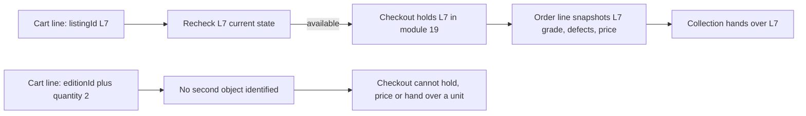

# A cart of copies, not quantities

Hana has decided on three books for the semester, and she has picked one copy of each: a Good College Algebra at North Street Books, a Very Good statistics guide at Campus Shelf, and an Acceptable literature reader at Corner Books because it was the only copy left and the defects were listed honestly. Three decisions, three physical objects, three shops. Now she wants to carry those three decisions to a checkout and pay.

The obvious model for that is a cart with lines and quantities, because that is what most carts look like. It is the wrong model here, and this chapter explains why in enough detail that you can defend the alternative in a review. Every line in a Hamesh cart names one Listing, and a Listing is one copy on one shop's shelf. There is no unit behind it to count.

## A cart line promises an object

A quantity is a promise about interchangeable units. When a cart says "two of item 4471", it means the shop has at least two, the buyer does not care which two, and any two will do. None of those three statements is true for a used textbook. North Street has one Good copy of that edition with pencil notes on forty pages, and if it sells, the shop does not have "one left". It has a different object, with a different grade and a different price, which may arrive next week.

So a Hamesh cart line is not a row with a number in it. It is a reference to a specific document: `listingId`. The line says "Hana wants this copy, the one with the creased cover and the photographs she looked at". Everything downstream depends on that identity. Checkout holds that document, the order line snapshots its condition and price, and collection hands that object over the counter.

The moment you add a quantity field, you have to answer a question the data cannot answer: which other copy is the second unit? If a shop has two copies of the same edition, they exist as two Listings with two IDs, two grades and two prices. The cart should hold both IDs, or one, and never a 2.



The diagram makes the failure of the quantity shape look like what it is: a dead end rather than a design preference. The left branch has an object at every step. The right branch has an intention with nothing to collect.

## What a quantity would actually do at checkout

Imagine the tempting shortcut. A student adds an edition with quantity 2, and checkout later picks two listings of that edition. Two problems appear immediately, and both of them are about consent. The student chose a grade and a price by looking at one specific copy. The second copy the server picks may be Acceptable when the first was Very Good, and it may cost more, and the student never saw it.

The third problem is the race. Two students can each intend to buy a copy of the same edition when only one copy exists, and a quantity model lets both carts say 1 right up to checkout. Then one student is told at payment time that the book does not exist, after they have committed. A per-copy cart makes the conflict earlier and smaller: the copy is either addable or it is not, and the answer is about a specific object rather than an abstract demand.

There is also a data problem. A quantity line would need a counter on the edition or on the shop's offer, and a counter has to be decremented atomically, reconciled after a failed payment, and repaired after a crash. That is real engineering for a fiction, because a specific used copy is either there or it is not. Keep the count out of the model and the race stays a single conditional update on one document, which module 19 already does.

## The cart document

Store one cart per student, with lines that reference Listings. Derive everything else from the Listing at read time, and never store a shop ID or a price that the client sent. The shape below is deliberately small; it is an interface, not an implementation.

```ts
export interface CartLine {
  listingId: Types.ObjectId;   // one physical copy
  addedAt: Date;
  priceWhenAddedMinor: number; // for "price changed" messaging only
}

export interface Cart {
  studentId: Types.ObjectId;
  lines: CartLine[];
  updatedAt: Date;
}
```

Two indexes make the cart behave. A unique index on `studentId` gives each student exactly one cart, so a second add cannot create a parallel cart that the checkout page never reads. A unique compound index on the cart and `listingId` makes duplicates impossible at the database level rather than in a route that might be called twice at once.

`priceWhenAddedMinor` is a display aid, not an authority. It exists so the cart page can say "this copy was 1,800 when you added it and is 1,650 now" instead of silently changing the number under the student's thumb. The charge is still computed from the current stored price at checkout, and module 27 returns to that boundary. Storing the added price does not let the client argue for it later.

Some teams also store a `shopId` on the line, copied from the Listing, to avoid a lookup when grouping. That is a cache with no invalidation plan. If a Listing could ever change shop, which it should not, the copied value would be wrong; if it cannot, the copy buys you one projection and costs you a class of bug where the group and the copy disagree. Derive the shop from the Listing in the aggregation.

## One cart, many shops

Hana's cart spans three shops, and that is normal. The cart does not split; the checkout does. Module 19 groups the lines by the shop that owns each Listing, creates one order per shop, and one payment across all of them. The cart's job is to hold the student's selection intact until checkout can validate it.

This is why the cart groups by shop when it renders, but does not enforce one shop per cart. A student buying three books for a course will often buy from the cheapest sensible shop for each title, and forcing one shop per cart would either raise her cost or send her through checkout three times for one reading list.

The grouping is also where a subtotal per shop appears. Compute that subtotal on the server from current Listing prices, not on the client from a cached response, because the cart page is one of the places where a stale number becomes an argument about the price at the counter.

## Rejections are the feature

Most of the cart's logic is refusal, and each refusal needs a distinct reason. A copy can be sold, which means another student's payment completed. It can be held, which means another student is paying right now and may still fail. It can be archived, which means the shop withdrew it. It can be missing, which usually means it was deleted in error or the ID was never real. And it can already be in the cart, which is a duplicate rather than an error in the student's intent.

Each of those deserves a different message and a different next action. A sold copy invites a substitute from the same edition. A held copy invites a wait or a substitute, and should say so honestly rather than pretending the copy is gone forever. An archived copy means the shop withdrew it, which is a different sentence from sold. A duplicate needs no alarm at all: the line is already there, and the page should say so and leave the cart alone.

The status codes carry the same distinction. A sold or archived copy is a conflict with the current state of the resource, which is a 409, and a malformed body or a missing field is a 400. Do not collapse every refusal into a 400, because the client cannot then tell a retryable race from a bug in its own request, and the student cannot be told anything useful.

## Warn, do not block, on two copies of one edition

Two lines in one cart can point at two different copies of the same edition. Sometimes that is intentional: Hana is buying one for herself and one for her cousin, or she wants to compare a Good and a Very Good copy in her hand before deciding. Sometimes it is an accident: she tapped Add on two rows that looked identical because both were from the same shop.

The cart should warn and not block. Blocking would make the intentional case impossible and would also be wrong for a marketplace where a student may legitimately want two copies of a set text. The warning belongs in the cart response as a flag the page can render, with the edition and the two lines named, so the student can remove one without hunting for it.

A warning is also cheaper to build correctly than a rule. A rule that says "one copy per edition" has to decide what happens when a student's reading list genuinely needs two copies, and it has to be enforced somewhere that cannot be bypassed. A flag on the response is honest about being advice.

## Persist the cart on the server

The alternative to a server cart is a cart in local storage, which is simpler and needs no session. It also cannot be read by the checkout route, which needs the student's selection under the student's identity before it can hold copies, compute a total and create a payment. A local cart would be re-uploaded at checkout, which means the checkout route accepts a list of Listing IDs from the browser and trusts it, and that is the same trust boundary module 27 warns about.

Server side persistence costs a write on every add and remove, and it makes the cart unavailable when the API is down. For this product, both costs are acceptable: the writes are small, and a student who cannot reach the API cannot check out anyway. It buys one cart that follows the student between a phone and a shared laptop, and a checkout route that reads the student's own record rather than a browser submission.

The cart also needs a clear owner rule for reads. `GET /cart` returns the signed-in student's cart and ignores any student ID in the query. Module 16.2 will make you prove that with two accounts, because a cart is small and personal and the temptation to accept an ID "for testing" is high.

## What this module leaves for later

Module 16 builds the API only: add, list, remove, and the rejections. Module 17 draws the cart page grouped by shop and wires the Add button on the copy detail. Module 19 turns the cart into orders and holds the copies, and module 20 takes the payment. Nothing in this module may mark a copy sold or reserve it, because a cart is an intention and not a claim.

That boundary is worth saying out loud to a reviewer, because a cart that quietly reserves copies looks like good service and is actually a way to lock a bookshop's shelf for every student who ever added a book and walked away. The next chapter builds the routes, the reason codes, the duplicate rule, the same-edition warning and the two-account test that proves the cart belongs to one student.
