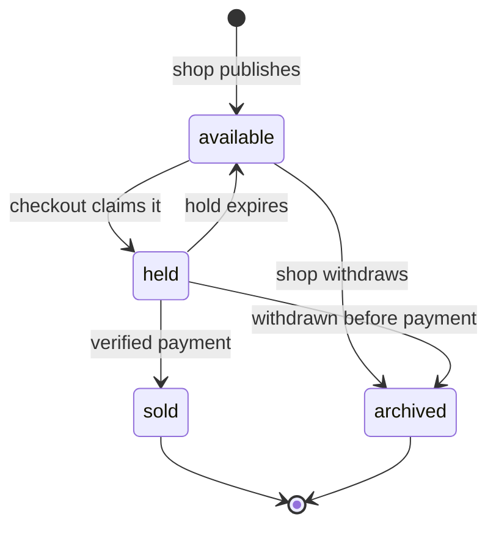

# Add, remove and reject sold, withdrawn or duplicate copies

Three routes carry this chapter. `POST /cart/items` adds one copy, `GET /cart` returns the student's cart, and `DELETE /cart/items/:listingId` removes one. The interesting work is not the shape of the routes, it is the decisions inside them: what to do when the copy is no longer for sale, what to do when it is already in the cart, and how a page learns that a line it rendered a minute ago has died.

```ts
router.post("/cart/items", requireAuth, requireRole("student"), addCopy);
router.get("/cart", requireAuth, requireRole("student"), getCart);
router.delete("/cart/items/:listingId", requireAuth, requireRole("student"), removeCopy);
```

Every route derives the student from the session. None of them accepts a student ID, a cart ID or a price in the body. The only input is a `listingId`, and it is validated as an object id before it reaches the database, because an invalid id should be a 400 with a field error rather than a mongoose cast failure in the log.

## Adding a copy is a check, not a claim

The add route reads the Listing, checks that it is available and belongs to a shop that is still open for business, then writes a line. Reading and writing in two steps is safe here, and it is worth understanding why it is safe when module 19 will insist on a single conditional update for the same collection.

It is safe because a cart line promises nothing. If the copy sells between the read and the write, Hana has a line that names a sold copy, and the next read of the cart will say so. Nothing was oversold, no money moved, and the shop's copy was never locked. The atomic claim in module 19 exists because checkout does promise something: it holds the copy long enough for a payment, and two holds on one copy would be two promises.

So the add route is a guard against obvious mistakes, not a reservation. It refuses a copy that is already sold, already held by somebody's checkout, archived or missing, and it accepts an available copy. That is the whole rule. If you find yourself adding a `hold` or a `reservedUntil` to the cart here, you have moved a module 19 problem into module 16 and you will have to take it out again.

## Name every refusal

Each refusal needs a stable code, because the page has to say something specific and the test has to assert something specific. A prose message alone forces the client to match on English, which breaks the day someone edits the wording.

```ts
type AddResult =
  | { added: true; cart: CartView }
  | { added: false; code: "copy_sold" | "copy_held" | "copy_withdrawn"
                      | "copy_not_found" | "already_in_cart"; message: string };
```

The mapping is straightforward once you decide it. A sold copy is `409 copy_sold`, and the message says the copy has been bought and offers to show other copies of the same edition. A held copy is `409 copy_held`, and the message says another student is paying for it right now, which is honest about the possibility that the hold will expire. An archived copy is `409 copy_withdrawn`, because the shop took it off sale, which is a different fact from a sale. A missing id is `404 copy_not_found`, and an id that is not an object id at all is `400 invalid_listing_id` with a field error.

A duplicate is the interesting one. Return `409 already_in_cart` with the same cart body the page already renders, and make the page treat that code as a calm confirmation rather than an alarm. The alternative, silently returning 200 and doing nothing, looks friendlier but hides a real double tap on a slow connection: the student wanted feedback, and "it is already there" is feedback. The third option, adding a second identical line, is the one this design forbids, and the unique index is what actually forbids it.

## Make the duplicate impossible, not just unlikely

Two taps on a bus with a slow connection can cause two requests that both read an empty cart and both write a line. The route cannot serialise them, because they are separate HTTP requests and the read happens before either write. The database can, with a unique compound index on the cart and the listing.

```ts
cartSchema.index({ studentId: 1 }, { unique: true });
cartSchema.index({ studentId: 1, "lines.listingId": 1 }, { unique: true, sparse: true });
```

Create the index in the schema and create it in the database before the first request. Then catch the duplicate key error, which is error code 11000, and translate it into `409 already_in_cart` rather than letting it become a 500. Module 11 already taught this pattern for ISBN find-or-create, and the shape is the same: attempt the write, treat the duplicate as an expected answer, and return the state the caller wanted.

Write the failing test before the fix. Send the same `listingId` twice with a short gap and assert one line in the stored cart, one 201 and one 409. Then send both requests through a barrier so they overlap, and assert the same result. The first version of your route will fail the second test with two lines or a 500, and that failure is the reason the index exists.

## Two copies of one edition is a warning

The add route also computes a warning when the new line would sit beside another copy of the same edition. It does not refuse, and it does not remove anything. It returns the cart with a `warnings` array naming the edition and the two listing ids, and the cart page renders a short sentence next to those rows.

```ts
type CartWarning = {
  code: "same_edition_twice";
  editionId: string;
  listingIds: string[];
};
```

The warning has to survive a page reload, so compute it on every read rather than only on the write that created it. That means `GET /cart` returns warnings too, and the rule lives in one function that both routes call. A warning computed only at add time disappears the next time the student opens the cart on a shared laptop, which is exactly when she is most likely to have forgotten.

Do not turn this into a rule. There are legitimate reasons to buy two copies of one edition: a student buying for a sibling, or a student who wants to compare a Good and a Very Good copy in her hand. What you can fairly do is say what the cart contains, in words a person can act on, and let her decide.

## Reading the cart revalidates every line

`GET /cart` is not a stored document returned as it was written. It joins each line to its current Listing and returns the state at read time. That is what makes a stale cart safe: the page always describes the world as it is, not as it was when the line was added.

```ts
type CartLineView = {
  listingId: string;
  state: "ok" | "sold" | "held" | "withdrawn" | "missing";
  title: string;
  editionLabel: string;
  grade: { label: string; rank: number };
  priceMinor: number;
  currency: string;
  shopId: string;
  shopName: string;
  photoUrl: string | null;
};
```

Build this view in one aggregation rather than a loop over lines. Look up the Listings with `$in` on the line ids, look up the shops they belong to, and project only the fields the page renders. The loop version looks simpler and turns twelve copies into twenty-four queries, which is the same N+1 mistake as module 14 in a smaller place.

Decide what the totals mean and write it down. A reasonable rule is that the subtotal counts only lines in state `ok`, and the response also carries `attentionCount`, the number of lines the student has to deal with. Then the page can say "four copies, 6,500 total, one needs your attention" instead of a total that quietly includes a sold book.

Do not delete stale lines automatically. A cart that silently drops a sold copy leaves the student wondering whether she removed it or the app did, and it hides the fact that a shop's copy went to somebody else, which matters if she is now short a book. Keep the line, mark it, and let the page offer a Remove button beside it.



The diagram is the copy's life, not the cart's. Every state on the left of `sold` is still a copy a shop owns, and every transition is written by a route outside the cart. The cart only reads this state, which is why it can be honest without holding anything.

## Session identity is the whole permission rule

Every cart route scopes the query by `req.user.id`. The cart is found by student, not by an id from the client, and a line can only be removed from the student's own cart. There is no route that takes a cart id, so there is no route to protect against a guessed cart id.

That is a design choice with a cost: support cannot fix a cart on a student's behalf without impersonating the student. For this product the trade is right, because the cart is short lived and the checkout recreates a coherent state from scratch. Write it in your authorisation document next to the shop ownership rules, so the next person does not add a `cartId` parameter for convenience.

The role check matters too. A shop owner is not a student, and a shop owner's token must not reach `POST /cart/items`. `requireRole("student")` in front of all three routes is enough, and it is worth a test because a role check that lives only in the client is not a check.

## Verify before the gate

You should be able to add an available copy, add it again and receive the duplicate code, add a second copy of the same edition and receive the warning, sell a copy in the database and see the line return `state: "sold"`, and get a 409 with the right code for a held and an archived copy. Then sign in as a second student and confirm the first student's cart is not reachable in any response.

```quiz
type: mcq
id: books-cart-q1
question: Another student is paying for the copy Hana taps Add on. What should the route return?
options:
  - "A 201 with the copy added, because the hold may expire soon anyway"
  - "A 500 and a log line, because the state is an unexpected one"
  - "409 with a reason code the page can render"
  - "A 201 with the copy added, plus a warning flag that the copy is currently held by another checkout"
correct: 2
explanations:
  - "The copy cannot be promised to two students, even briefly."
  - "A hold is an ordinary state, not an internal error."
  - "The code and message tell the page to offer a wait or a substitute."
  - "Adding a line for a held copy invites a checkout failure later."
```

The gate in the next lesson adds the part that cannot be checked in one browser: two accounts, one database, and proof that a cart belongs to exactly one student.
