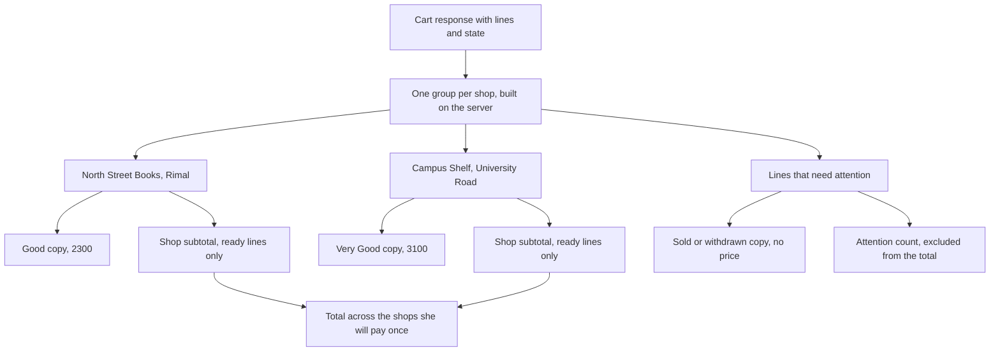

# A cart of copies, grouped by shop

Hana is on the bus home with three books in her cart. A Good College Algebra from North Street Books at 2,300. A Very Good statistics guide from Campus Shelf at 3,100. An Acceptable literature reader from Corner Books at 1,600, which she chose because it was the only copy left and the defects were listed honestly. Three decisions, three shops, three counters she has to visit before the first seminar.

Module 16 built the API that holds those three lines. This module builds the screen that has to make sense of them, and the screen has a harder job than it looks. It has to show Hana what she chose as three separate objects, tell her where each one is, show what she will pay at each counter, and let her take one back without disturbing the other two. All of it at 360 pixels wide, on a phone, on a bus.

## The line is the object, so the page shows objects

Every line in a Hamesh cart names one Listing, and a Listing is one physical copy on one shop's shelf. That is why the page has no quantity control anywhere: there is no number to raise. Two copies of the same book are two rows, each with its own grade, its own defects and its own price, because they are two different objects that a shop happens to hold.

A quantity stepper is the first thing most cart designs reach for, and it would be a lie on this screen in three specific ways. It would suggest the shop has interchangeable units behind the row, which it does not. It would let Hana ask for two when the second copy is Acceptable and the first is Very Good, which changes what she consented to. And it would create a number the server has no route to accept, because module 16 deliberately has no `PATCH` that takes a `quantity` body, so the browser would have to fake the behaviour by adding and removing lines while pretending to be a counter.

The row itself answers four questions in the order Hana asks them. What is this book, which is the title and the edition label, because a course accepts one edition and not another. What condition is this copy, which is the grade and the named defects, because that is what she looked at before adding it. What does it cost, which is the price of this copy. And where is it, which is the shop name and area.

## Grouping is the split, shown early

The cart groups its rows by shop, and grouping is not decoration. Checkout will split one payment into one order per shop, because a shop can only fulfil what that shop owns. Grouping the cart is the first place that split becomes visible, and showing it here means Hana learns about three pickups while she can still change her mind, rather than on a confirmation screen after she has paid.

The grouping also matches the physical reality of the week after. A collection code belongs to an order, an order belongs to a shop, and a counter only hands over the copies in its own order. A flat list of six books makes a student believe there is one pickup; a grouped list makes the number of trips obvious at a glance, which is genuinely useful information for someone deciding whether a 300 minor unit saving is worth a second bus fare.

So the page has a heading per shop, the shop's area, the rows that shop owns, and one subtotal. The heading is the anchor for everything inside it, and it is why the copy row does not need to repeat the shop name on every line on a narrow screen: on a phone the group heading sits directly above its two or three rows, and repeating the shop name three times costs the vertical space the grade and price need.

Two arrows in that diagram carry the arguable decisions. The attention group is separate from the shop groups, so a dead line never sits inside a subtotal and quietly changes a number Hana is about to pay. And the total at the bottom is fed by the shop subtotals rather than by the raw rows, which is what stops a sold line from being counted twice or forgotten once.

## What a subtotal means when one payment covers three counters

Each shop group shows a subtotal: the sum of that shop's ready lines. The page also shows one total for the whole cart, and the two numbers mean different things, so the labels have to say so. The shop subtotal is what Hana pays that shop, and it is the number that becomes an order. The cart total is one payment across all of them, which module 20 will take in a single Stripe Payment Intent.

The distinction is not pedantry. A student looking at a 7,000 total who expects one counter is going to be surprised at the first pickup, and a student who sees three subtotals understands the trips before she pays. Write both labels in plain words: "Pay at North Street Books" for the shop number and "One payment, three collections" for the total once the checkout exists. Until then, "Total for 3 copies" and a line naming the shops is enough.

There is a second reason the subtotal is computed on the server. The cart response already carries integer prices in minor units, and a client that sums them can disagree with the server by a unit after a currency format, a rounding rule or a stale response. The number Hana is charged is decided on the server, so the number she reads should come from the same place. The client formats for display and does no arithmetic.

## Lines that need attention

A cart is not a snapshot of the world. A copy can sell while it sits in the cart, a shop can withdraw it, and a student can be paying for it at the moment Hana opens the page. Module 16 returns a state per line for exactly this reason: `ok`, `sold`, `held`, `withdrawn` or `missing`.

The page keeps those lines visible, marks them, and puts them in their own group above the shops. Hiding them would be friendlier for a second and worse afterwards, because Hana would have to work out whether she removed the book or the app did, and she may now be short a title she needs this week. The marked line carries the state in words, the copy's facts, and a remove button, and it carries no price in any subtotal.

An attention count belongs beside the cart heading, for the same reason. "3 copies, one needs your attention" tells Hana where to look before she reads a single row, and it is the only sentence on the page that changes when a copy sells behind her back.

## The badge in the header

Most screens in Hamesh are not the cart, and Hana needs to know how many copies are in it while she is browsing. That is what the header badge is for: a count of copies, not of editions and not of shops. Three copies from two shops is three, because the number describes what will be collected, and a badge that counts shops would be a different number than the cart page shows under the same word.

The badge is loaded once with the cart and updated after every add and remove, so it never disagrees with the page it summarizes. It is also the smallest surface in this module with an accessibility requirement: a number floating beside a basket icon means nothing to a screen reader unless it is labelled, so the control is announced as "Cart, 3 copies" and the change is announced politely when it happens.

## Reload is the whole persistence test

The cart lives on the server, keyed by the student. That means the page can be reloaded, opened on a second device, and closed for an hour and reopened, and it will describe the same three decisions. It also means the page has no local cart to merge, no storage to migrate and no offline edit to reconcile, which is a large class of bugs that this design simply does not have.

The cost is that every read costs a request, and a student on a weak connection waits for it. The honest answer is a loading state in the shape of the page, and no cleverness about caching a cart that is about to be checked out. A stale cart on this screen is not a performance win, it is a wrong price on the way to a payment.

## The constraints the build has to respect

Three constraints run through the next lesson. The first is 360 pixels: a row that holds a title, an edition label, a grade, a price and a remove control has to stack its content instead of shrinking it, and the remove control has to stay reachable with a thumb rather than hiding behind a hover.

The second is the keyboard. Removing a copy is the only destructive action in the module, and it has to be a real button with a name that says which copy it removes. "Remove", repeated five times in a list, tells a screen reader user nothing, so the accessible name includes the title and the shop. After a removal, focus has to land somewhere sensible instead of falling back to the top of the document.

The third is that nothing on this page may claim more than the API said. If the cart says a line is held, the page does not offer a checkout promise. If a copy was 1,800 when it was added and is 1,650 now, the page shows the current price and mentions the change rather than showing the old number. The page is a view of one response, and the response is the truth.

## What this module leaves to later

Module 18 fills a cart from a reading list, module 19 turns the grouped cart into one order per shop and holds the copies, and module 20 takes the payment. Nothing in this module reserves a copy or starts a checkout, because a cart page that quietly holds a book for everyone who opens it would lock a shop's shelf for the length of a bus ride.

Module 21 adds collection codes per order, which is the first screen where the grouping on this page pays off, because the codes arrive in the same groups the student already saw here. If the cart page shows three shops today, the order pages will show the same three shapes tomorrow, and Hana will not have to learn a second layout for the same three books.

## Bridge to the build

The next lesson builds the view builder that turns cart rows into shop groups, the copy row, the shop section with its subtotal, the removal path and the add-to-cart button on the edition page that feeds the badge. It writes the builder's test first, because that function is pure and its edge cases are cheap to prove, and it writes the removal test second, because a destructive action that loses the rest of the cart is the failure Hana will remember.
