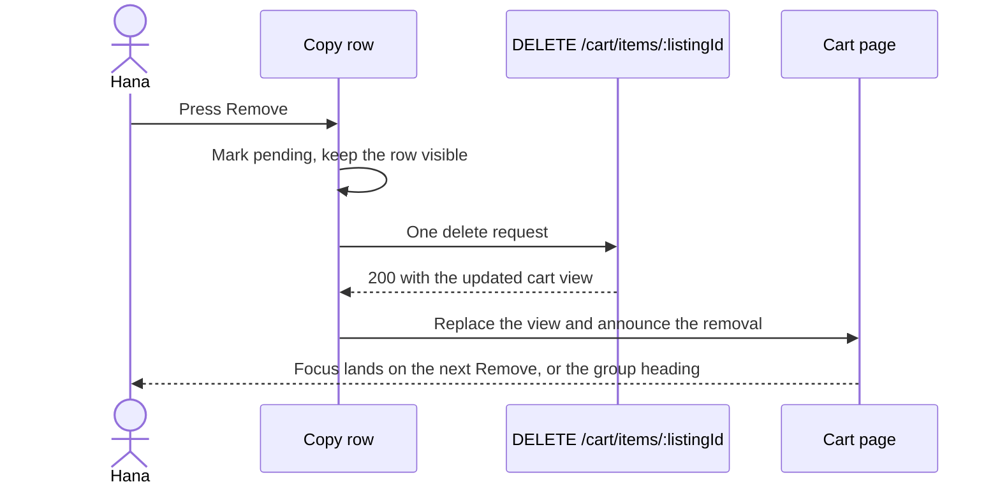

# Copy rows, shop subtotals and removal

Four pieces of work, and each one is testable before the next exists. A server function turns the flat rows of a cart into shop groups with subtotals. A page renders those groups as sections, each with its own heading and subtotal. A row renders one copy with its edition, grade and price, and carries the only destructive control in the module. An add button on the edition page feeds the cart from the other direction and keeps the header badge honest.

The reason to build the view on the server is the same reason module 16 revalidates on every read. A cart is a claim about the world at the moment of reading, and the grouping and the subtotals are part of that claim. A client that groups what it was given can only be as correct as the response, so the response should already be grouped.

## One function turns rows into a view

The route reads the listings named by the student's cart, joins the shop for each one, and hands the rows to a pure function. The function is where every rule about the page lives, and it is pure so those rules can be tested without a database.

Module 16 returned a flat list of lines with one payable subtotal and one attention count. This lesson keeps the same line fields, the same state names and the same exclusion rule, and changes the projection: the response now carries shop groups with a subtotal each, plus an attention list that belongs to no group. Client code that read the old flat list is updated in the same commit.

```ts
// server/src/modules/cart/cart-view.js (the shape the client receives)
type CartView = {
  groups: Array<{
    shopId: string;
    shopName: string;
    shopArea: string;
    lines: CartLine[];
    subtotalMinor: number;      // ready lines only
  }>;
  attention: CartLine[];        // sold, held, withdrawn, missing
  attentionCount: number;
  copyCount: number;            // ready lines only
  totalMinor: number;           // sum of the group subtotals
  currency: string;
};
```

The function walks the rows once, and the branch inside the loop is the whole module in four lines. A row whose copy is not available goes to `attention` and stops there: no group, no subtotal, no count. Every other row joins a group keyed by its shop, and its integer price is added to that group's running subtotal.

```js
// server/src/modules/cart/cart-view.js (the grouping loop)
export function buildCartView(rows, currency) {
  const groups = new Map();
  const attention = [];

  for (const row of rows) {
    if (row.state !== "ok") { attention.push(row); continue; }
    const key = String(row.shopId);
    const group = groups.get(key) ?? {
      shopId: key, shopName: row.shopName, shopArea: row.shopArea, lines: [], subtotalMinor: 0,
    };
    group.lines.push(row);
    group.subtotalMinor += row.priceMinor;
    groups.set(key, group);
  }
  // ... totals and counts are derived from groups after the loop
}
```

Two properties come out of that order. Sorting the groups by shop name happens after the loop, so the loop itself stays simple. And the subtotal is an integer sum of integer prices, with no formatting and no division anywhere near it, because the moment a currency amount becomes a float it becomes a rounding argument.

Write the three tests before the route. A sold row must not change any subtotal. Two shops must produce two groups with two correct subtotals. An empty cart must produce no groups, a zero total and a zero count, which is the state module 16 already returns when a student has never added anything.

```js
// server/tests/cart-view.test.js
test("a sold line never reaches a subtotal", () => {
  const view = buildCartView([
    { listingId: "L1", state: "ok", shopId: "S1", shopName: "North Street Books", priceMinor: 2300 },
    { listingId: "L2", state: "sold", shopId: "S1", shopName: "North Street Books", priceMinor: 3100 },
  ], "ILS");

  expect(view.groups[0].subtotalMinor).toBe(2300);
  expect(view.attention).toHaveLength(1);
  expect(view.totalMinor).toBe(2300);
});
// currently 5400, because the price is added before the state is checked
```

## The page: sections, headings, subtotals

The page renders one section per group, in the order the server sent them. Each section is named by a heading that contains the shop name, and the heading is the accessible name of the section, so a screen reader user can jump between shops instead of tabbing through every row.

```tsx
<section aria-labelledby={`shop-${group.shopId}`}>
  <h2 id={`shop-${group.shopId}`}>{group.shopName}</h2>
  <p>{group.shopArea}</p>
  <ul>
    {group.lines.map((line) => (
      <CopyRow key={line.listingId} line={line} onRemove={remove} pendingId={pendingId} />
    ))}
  </ul>
  <p>{`Pay at ${group.shopName}: ${formatMoney(group.subtotalMinor, currency)}`}</p>
</section>
```

The subtotal is printed from `group.subtotalMinor` and never recomputed in the browser. That is a discipline worth writing into a comment, because the temptation to sum `group.lines` is strong and it produces a number that disagrees with the server's after any change the client has not seen yet.

Money formatting goes through one function, used by the row, the subtotal and the total, so a formatting change never lands in two places out of three.

```ts
// client/src/cart/money.ts
export function formatMoney(minor: number, currency: string): string {
  return new Intl.NumberFormat(undefined, { style: "currency", currency }).format(minor / 100);
}
```

The division by 100 carries an assumption that every currency in the course has two decimal places. That is true for the one currency the shop chooses in config and false for a currency whose smallest unit is the unit itself. Write the assumption down next to the function so the next person knows where to look if the platform ever offers a second currency.

## The row says four things and one action

A row carries the title, the edition label, the grade with its named defects, and the price. It carries one action: remove this copy. There is no count control and no route behind one, so the row has no number to edit anywhere.

The remove control is a real button with a name that identifies the copy. In a list of five rows, "Remove" five times tells a screen reader user nothing about which one they are about to delete, and the same applies to anyone using voice control. Build the accessible name from the row's own data: the grade label, the title and the shop. The visible text stays short, because the accessible name is not on screen for a reason.

```tsx
<button
  type="button"
  onClick={() => onRemove(line.listingId)}
  disabled={pendingId === line.listingId}
  aria-label={`Remove ${line.grade.label} copy of ${line.title} from ${line.shopName}`}
>
  {pendingId === line.listingId ? "Removing" : "Remove"}
</button>
```

The grade uses the badge from module 15, which renders the label and the rank as text. Reusing it here means a student learns one badge and reads it in three places, and it guarantees that the grade on the cart is the same grade the edition page showed.

Defects appear as short labels rather than as free text, taken from the same enum the shop ticked. A row that says "highlighting, handwriting" is more useful than a row that says "good condition", because it tells Hana what to expect before she pays and it is what the order snapshot will preserve later in module 19.

## Removal, with focus that survives it

Removal is one request and one view replacement. The row is marked pending immediately, the delete goes out with no body, and the response is the updated cart view, which replaces the current one. Nothing is removed from the screen before the server confirms, because a row that vanishes and reappears on a failed delete is worse than a row that says "Removing" for an extra second.



The focus move is the part that teams skip and the part that keyboard users feel. When the focused button disappears with its row, the browser drops focus to the document body, and the next Tab starts at the top of the page. On a cart of eight copies that is the difference between removing three books in twenty seconds and removing them in two minutes.

Decide the destination before the request, not after. Note the id of the next row's remove button at the moment of the click, with the group heading as the fallback when the removed row was the last one in its group, and the empty cart heading when the whole cart is now empty. Then in an effect after the view updates, focus that id if it still exists.

```ts
// client/src/cart/focus.ts
export function nextFocusTarget(groupLines: CartLine[], removedId: string, groupId: string): string {
  const index = groupLines.findIndex((line) => line.listingId === removedId);
  const next = groupLines[index + 1];
  return next ? `remove-${next.listingId}` : `shop-${groupId}`;
}
```

The removal is also announced in a polite live region, in a sentence: "Removed Good College Algebra from North Street Books, two copies left". A polite announcement waits for the current utterance to finish, which is what you want for a reversible action, and it means the student who cannot see the row disappear learns what happened without having to re-read the page.

## Adding a copy from the edition page

The add button sits on the copy detail page from module 15, beside the grade, the price and the shop. It sends `POST /cart/items` with the listing id and nothing else, and it does not navigate to the cart, because a student adding three books should not be pulled away after the first.

The button has three states and they map to the refusal codes module 16 defined. Idle says "Add to cart". Pending is disabled and says "Adding", which prevents the double tap that the duplicate rule would otherwise answer with a conflict. After success it says "Added" for a few seconds and the badge count goes up, and the row on the edition page stays where it is so the student can add a second copy of a different grade if she wants one.

A refusal renders beside the button and never as a browser alert. `copy_sold` says the copy has just been bought and offers a link to the other copies of the same edition. `copy_held` says another student is paying for it right now. `copy_withdrawn` says the shop took it off sale, which is a different fact from a sale. `already_in_cart` is the calm one: a short line saying the copy is already in the cart, with a link to it, because a double tap on a slow connection is not an error in the student's intent.

## The badge counts copies

The header badge reads `copyCount` from the cart view and updates whenever the view is replaced, which happens after every add and every remove. It is fetched once when the app shell mounts and once after login, and it is not polled: a cart does not change by itself while a student reads a page.

Two details make it usable. At zero it renders nothing at all, because a badge showing zero is a small piece of noise on every page. And its accessible name is a sentence rather than a number: the cart link is announced as "Cart, 3 copies", and the change after an add is announced politely. A number floating next to a basket icon is invisible to a screen reader and ambiguous to everybody else.

## The constraints, one more time

At 360 pixels the section heading, the area, the rows and the subtotal stack in one column. A row puts the title first, the edition label under it, then the grade and defects, then a footer line holding the price and the remove button at opposite ends. The remove button keeps a 44 pixel height and its own space, because the destructive control is the last thing that should be squeezed.

Every action on the page is reachable by keyboard in the visual order, and the cart link in the header is in the tab order before the page content, which is where a keyboard user expects it. There is no gesture and no hover on this page at all.

## Acceptance criteria

- [ ] `buildCartView` puts a non available row in `attention`, excludes it from every subtotal, from `copyCount` and from `totalMinor`.
- [ ] Two shops produce two sections, each with the shop name, the area, its rows and its own subtotal.
- [ ] The client renders subtotals from the response and contains no sum over line prices.
- [ ] Every row shows the title, the edition label, the grade with its rank, the defect labels and the price.
- [ ] The remove control names the grade, the title and the shop, and is disabled while its request is in flight.
- [ ] A successful remove replaces the view and announces a sentence naming the copy and the remaining count.
- [ ] After a remove, focus lands on the next remove control, or the group heading when the group is empty.
- [ ] A failed remove keeps the row, clears the pending state and shows a message.
- [ ] The add button on the edition page sends one request per click, never navigates, and maps all four refusal codes to distinct messages.
- [ ] The badge shows the number of ready copies, hides at zero, and is announced as a sentence.
- [ ] The page works at 360 pixels with no horizontal scrolling, and every control is at least 44 pixels tall.

## Bridge to the gate

The gate is a reload, a phone width, a keyboard and one copy that sells while the page is open. It checks that the cart survives a reload without a local copy, that the badge matches the page, that a sold line sits outside every subtotal, and that removal can be done without touching a mouse. Module 18 then fills this same page from a reading list, and it will add dozens of rows at once to a layout that has to survive that too.
