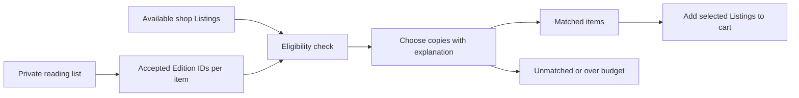

# Match a whole reading list to real copies

A student has five books to find before classes begin. Searching one title at a time on a phone is slow, and a title match can hide the wrong edition. The student also needs to compare condition and price, and may prefer fewer pickup shops when two combinations cost the same. This module turns a reading list into a repeatable match result. It does not promise that a copy is held; the cart and checkout modules later claim individual listings.

The arrow from reading-list item to Edition is exact. A book title alone is too weak. A lecturer may require one edition or explicitly allow several. Store that acceptable set on the item. The arrow from Edition to Listing is where actual condition, defects, price and pickup shop enter. A result must say which rule excluded a copy and why the chosen one won. A student should be able to reject a match after reading the explanation rather than trusting a mysterious score.

## Keep the student's list private

Create `server/src/modules/reading-lists/reading-list.model.js` with owner student ID, course code, optional title and items. Each item has an ID, requested work, `acceptedEditionIds`, minimum grade rank, excluded defects, optional price ceiling in minor units and order. Cap the number of items in the core path so a single request cannot trigger an unbounded candidate search. A shop may publish a template for a course code, but a student copies it into their own private list before editing preferences. The shop should not see which named student copied its template.

Implement `POST /me/reading-lists`, `PATCH /me/reading-lists/:id` and a copy-template action. Every query includes authenticated student ID. Validate that each accepted Edition ID exists and that a private list cannot claim another student's owner ID from the request body. Keep list item IDs stable while a student changes their grade floor; a want-list entry may later refer to that item. When a lecturer approves a substitute edition, add its ID to the acceptable set through a reviewed template update or explicit student choice. Do not infer substitutes merely because two titles sound similar.

## Write the matcher as a pure decision

In `server/src/modules/matching/match-reading-list.js`, accept list items and candidate Listings as values and return matches with reasons. The database layer fetches available Listings for all accepted Edition IDs in one or a few bounded queries. The pure function excludes a Listing if its Edition is not accepted for that item, its grade rank is below the floor, one of its defect flags is excluded, its price exceeds the item's ceiling, or its status is not available. These checks happen before ranking. A cheap first edition cannot beat a required second edition by price.

For each item, choose the lowest price among eligible listings. On an equal price, prefer a combination that visits fewer distinct shops for the whole list. Use a deterministic tie-break such as higher grade, then Listing ID when shop count remains equal. Document the bounded search used for ties. One simple core implementation limits a list to ten items and keeps the three cheapest eligible candidates per item; a small branch-and-bound search can compare tied-price combinations without scanning every catalogue copy. If you use a heuristic instead, name that limit in the UI and test it on a case where order of items could change the shop choice. Do not claim a global optimum unless the code actually computes one.

One physical Listing cannot satisfy two list items at the same time. If a student adds the same edition twice, track already-chosen Listing IDs and require a second copy for the second item. If there is only one, leave one item unmatched. This is separate from stock quantity: each Listing represents a single used copy, and the matcher must not invent a second unit. The output for an unmatched item should distinguish “no accepted edition listed,” “copies exist but below grade,” “copies exist but over budget” and “eligible copy already used by another item.” Those reasons tell the student what preference to adjust or what to put on a want-list.

Test the pure function with a first-year biology list of three items. For one item, offer a cheap wrong edition and an eligible exact edition. For another, offer Good and Very Good copies with a Very Good floor. For the third, offer two equal-price copies in different shops, one sharing a shop with an earlier selection. Assert the exact IDs, total price, shop count and explanation. Then repeat with the item order changed. If your tie-break is meant to be global, the chosen shop combination should remain equivalent. Tests should also cover two items competing for one Listing and an over-budget item.

## Return a result the student can act on

Implement `POST /reading-lists/:id/match` after loading the list under the student's ID. The service returns one entry per list item, with chosen Listing or a reason, current price, grade, defects and shop. It does not create an order or a hold. In `client/src/pages/ReadingListPage.jsx`, show matched items, unmatched items and a total for the current selections. Explain why each choice won in plain language: “exact edition, Very Good, within your ceiling, same pickup shop as another book.” Let the student inspect an individual offer and adjust a floor or ceiling before trying again.

“Add all matches to cart” sends the chosen Listing IDs to the server. The cart API rechecks that they remain available and reports any stale one. It must not accept a price total from the browser. When the student reaches checkout later, the server makes the sell-once holds and price snapshots. A match can become stale between the list page and checkout; the UI should keep the list and show which item needs a new match, not erase the whole plan.

Measure the query shape on a seeded list. A naive implementation that loads each item's Listings in a loop may make one query per item. Batch by accepted Edition IDs and log the query count before and after. Use an index on Edition ID and Listing status, then inspect `explain()` for the fetch. The pure matcher can be thoroughly unit tested without MongoDB; the route test verifies ownership, batching and real data. If the match output is surprising, print the rejection reason for each candidate in a development-only trace. That trace is more useful than changing weights until the UI looks right.

This module ends with a student saving a private list, matching it against real seeded copies, and adding selected Listing IDs to cart. Missing titles become want-list entries in Module 24. The checkout module must still decide who gets each physical copy. Keep that boundary visible in the learning log: a match is advice from the current catalogue, while a hold is an inventory decision made later under concurrency.

Use one short review with a real person before you call the explanations finished. Give them only the reading list and the result screen. Ask them to point to the exact edition, condition floor, excluded defects, price ceiling and pickup shop for one choice. If they cannot, the result is too opaque even if the algorithm selected the right ID. Ask what they would do with an unmatched item. The page should offer a sensible next step: adjust a preference, inspect current offers, or add a standing want entry. A numerical score with no reasons is not enough for a student buying a required book on a budget.

Keep the public course template separate from the student's private preferences in the database and UI. A shop may update a template for a later cohort, but that must not rewrite a student's saved list during checkout. When a student copies a template, record its source and copy the accepted edition choices into the student's own list. A later template correction can be offered as an update for review, not silently imposed. This is the same snapshot principle used in orders, applied earlier to a student's plan.
