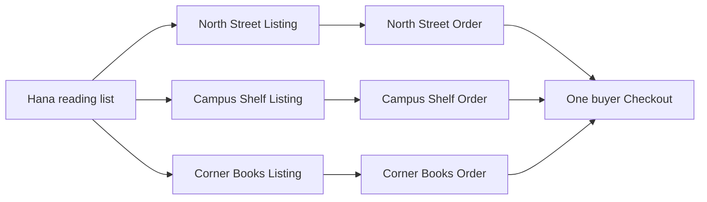

# One list, three shops

Hana needs three texts for the semester. Her saved reading list matches a College Algebra copy at North Street Books, a literature reader at Campus Shelf, and a statistics guide at Corner Books. The matcher has selected specific Listing IDs, each representing one physical copy with its own edition, grade, defects, photographs and price. Hana sees one convenient list, but the purchase will involve three shops, three pickup or shipping arrangements, and three shop Orders under one Checkout. The list is a planning tool; it does not reserve any copy.

The most important word in this module is `Listing`, not `Book`. A Work is the intellectual work, an Edition identifies a particular published form, and a Listing is one shop's physical copy. Two Listings can share the same ISBN yet differ in condition and price. If Hana buys the Good copy with a creased cover, another student can still buy a Very Good copy of the same Edition from a different shop. A stock quantity on the Edition would erase the distinction that the buyer used to choose. The order must name the exact Listing and retain the condition promise she saw.

## Read the match as a proposal

The reading-list matcher might have chosen North Street's College Algebra copy because it met Hana's edition acceptance, grade floor and budget. That result was computed at a moment in time. Another student can claim the copy a second later. North Street can correct a grade while the copy is still available. A shop can pause pickup or shipping. The checkout route must re-read current facts and either reserve all selected Listings under one attempt or tell Hana exactly which matches changed. It cannot treat the matcher output as a purchase authorization.

Imagine Hana opens her reading list at 14:00 and leaves the tab while attending class. At 15:00 the College Algebra copy sells. At 15:05 she clicks checkout. A route that trusts the 14:00 match might create an Order for a copy that no longer exists. A better route returns a conflict for that Listing and can invite Hana to rerun matching for the same accepted Edition. It must not silently substitute a different condition grade, price or edition. A replacement may be useful, but Hana needs to see and accept the new terms.

The split across shops creates a second constraint. Hana did not agree to a checkout that includes only the literature reader and statistics guide if the required algebra book is gone. The route should fail as a whole or ask her to make a new explicit choice. If it begins by holding the Campus Shelf Listing before discovering the North Street loss, it must release its own hold or retain a durable recovery state that makes the incomplete attempt non-payable. Each shop Order should exist as a normal pending Order only when the full set of chosen Listings has been secured.

## Follow money and pickup without pretending payment happened

For the core build, the Checkout has one total and one currency. Each shop Order contains only that shop's lines and any shop-specific collection or delivery information. Hana sees all three Orders beneath her Checkout. North Street sees only its Order, not Campus Shelf's customer notes or revenue. The shop Order is pending while the payment module has not verified a provider event. A held Listing is temporarily unavailable to other students, but it is not sold. The next module will decide how verified payment turns the hold into a sale and how to recover when a payment succeeds too late.

If the product offers collection at shops, Hana may receive one collection instruction per shop. A single checkout confirmation page should not imply one pickup location. At this stage the instructions can say `pending payment` and show the shop names; a collection code belongs after payment in the later collection module. This distinction matters to a student who might otherwise travel to a shop for an unpaid or expired attempt. It also matters to sellers, who should not hand over a copy because a pending Order appeared in a dashboard.

## Trace the three roles

Hana is the buyer and can see the aggregate Checkout and her own split Orders. A shop owner can see Orders for their Shop, including the snapshot of the exact copy and the later collection state. A credited author or publisher from Work metadata does not acquire access to a Shop Order. The platform may have an administrator role, but these learner routes should not rely on an admin query and then filter the result in memory. The session identity and stored Shop ownership form the query boundary.

Consider the price and condition surfaces separately. The Edition's title and ISBN may be shared across shops. North Street's Listing has a grade, defects, first condition photo and price. Those copy-specific terms must be frozen on the OrderLine so a later regrade cannot rewrite what Hana agreed to buy. The OrderLine can retain Work and Edition IDs for navigation and support, but it should render the historical agreement from snapshot fields even if the public Listing is archived.

A shop may regrade an available Listing after noticing a missing page. Before checkout, the matcher should stop recommending it to a student whose minimum grade it no longer meets. During checkout, a changed grade should produce a conflict and renewed choice. After a successful pending Checkout, changing the live Listing should not mutate the OrderLine. The platform may need a separate remedy process if the shop discovers a defect after purchase; quietly changing the old receipt is not that process. The next chapter isolates this condition snapshot trap.

## Make the learner decision visible

Draw Hana's three selected Listing IDs and their Shop IDs, then write the expected Order count: three if all three Shops differ. Add a second Listing from North Street and recalculate: still three shop Orders, with two lines in North Street's Order. Now remove the Campus Shelf Listing before checkout. The result should be no payable Checkout, not two successful shop Orders. This simple exercise exposes why counting Cart lines is different from counting Orders.

Write down what the matcher promised and what it did not. It promised a recommendation under the available data and declared tie-break policy. It did not promise stock, preserve a price, guarantee collection hours or charge a card. Checkout must validate and temporarily claim the exact Listings. The payment and collection modules will complete later transitions. This distinction keeps the reading-list feature useful without making it an accidental source of false sales.

At the end of this module, a reviewer should be able to inspect a pending Checkout and answer four questions: which Listings were selected, which Shop owns each copy, what terms Hana accepted, and which attempt currently holds them. A reviewer should also be able to identify the losing response when another student reaches the same one-off copy first. Those answers guide the schema, route and tests in the following chapters.

## Count copies, then count shops

Take the three-copy example and add a fourth Listing from Campus Shelf that shares a Work with North Street's copy but has a different Edition and condition grade. The Cart now has four physical objects, three Shop Orders and one Checkout. The extra Listing does not become a quantity increment on the Work or Edition. Write each Listing ID in the planned Order group before coding; this makes it easier to spot a serializer that accidentally collapses two copies with the same title into one line.
