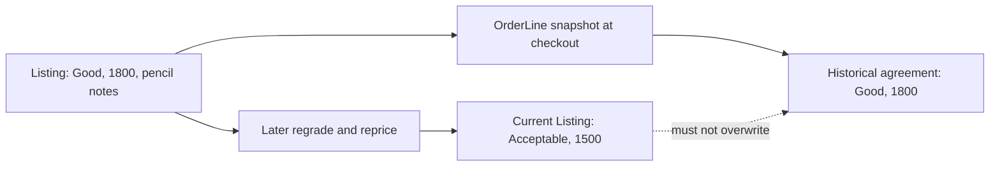

# The condition snapshot trap

Hana accepts a Good College Algebra copy at 1,800 minor units. North Street disclosed a creased cover and pencil notes in its Listing, with photos that showed both. Hana's pending Order should preserve that condition promise. Later a shop employee looks again and changes the public Listing to Acceptable, adds a torn-page note, replaces its first photo and reduces the public price. If the order page reads the live Listing on every visit, Hana's receipt appears to say she chose an Acceptable copy at the new price. That is a false history even if the shop's correction is honest.

The trap has two time boundaries. A correction before Hana confirms checkout changes the offer. The route should return a conflict or revised offer and ask her to accept it. A correction after the snapshot should leave the historical OrderLine unchanged. A system that always copies the old Cart's fields fails the first boundary; a system that always reads the current Listing fails the second. The build must test both.

## The grade is not decoration

Hana's reading list required Good or better. An Acceptable copy may not meet her course or personal threshold. Changing a grade after she selected the Listing affects more than the receipt's wording. It may mean the matcher would not have chosen that copy at all. A checkout route that notices only price changes but not grade changes can take money for an item that violates her stated condition floor. Revalidate the selected Listing's current grade and Edition acceptance before claiming it, and preserve the agreed grade code and rank in the snapshot.

Defect notes and condition photos are not optional footnotes to a structured grade. Two Good copies can differ: one has highlighted pages, another has a creased spine. Hana may choose one over the other despite equal rank. Freeze the disclosed defect text and first photo reference shown at checkout, with a durable media policy so the historical image does not vanish when the listing is archived. Do not replace a missing photo with the current photo of another copy sharing the ISBN. That would make the Order appear more trustworthy while describing the wrong physical object.

## Compare a harmful implementation

A tempting `GET /orders/my` implementation loads each OrderLine's `listingId`, populates the current Listing, and renders `listing.grade`, `listing.priceMinor` and `listing.photos[0]`. It seems economical because the data is already modeled. But it makes a seller edit retroactive. An even worse serializer uses current Edition title and live Listing grade without indicating which values are historical. If Edition metadata is corrected, support may need both the corrected current record and the title shown at sale. Keeping a snapshot does not forbid correction; it gives the old agreement a stable reference point.

Write two response examples. Immediately after checkout, Hana sees Good, 1,800 and the creased-cover photo. After the shop changes the Listing, her Order still shows Good, 1,800 and the prior photo reference, while the public Listing may show Acceptable, 1,500 and the new photo. The two pages can legitimately differ. A support note can explain the later correction or initiate a remedy, but the OrderLine should not silently change to erase the discrepancy.

## Notice the privacy edge

A Shop Order can contain buyer collection notes or address details that a public Listing cannot. If the order serializer populates broad Shop and Listing documents, it may leak fields that were never intended for the buyer or another Shop. Freeze only agreement fields on the OrderLine and build role-specific projections for the routes. North Street should see its own Order and the information necessary to fulfil it after payment, not the other Shops' Orders merely because all belong to Hana's Checkout.

The same principle applies to internal condition review notes. A shop may have a private moderation note about a possible counterfeit copy. That note is not part of the buyer-visible snapshot, though a safety workflow may need to stop sale and notify the buyer. A snapshot is not a copy of every database field. It is a deliberate record of the terms and disclosures that mattered to the purchase, with IDs for authorized support investigation.

## A regrade after payment needs a remedy

Suppose payment later succeeds and North Street finds the torn page while preparing collection. The shop cannot just change the OrderLine from Good to Acceptable and hand over the worse copy. The platform needs a customer-facing remedy: cancellation, refund, or the buyer's explicit acceptance of revised terms under a future policy. This module does not implement that policy, but it must leave the original condition promise intact so the remedy has a clear baseline. The later payment module must also avoid marking a Listing sold when the corresponding hold has been lost.

A regrade while a Listing is held is especially sensitive. For this core build, choose a rule that the shop cannot edit grade, price or disclosed defects on a held Listing through its normal catalog route. A correction can flag the Checkout for staff review or cancellation, but it should not mutate the buyer's pending agreement. Test that the seller PATCH route denies or routes such an edit while status is held. If the actual project chooses a more flexible process, the test must still prove explicit buyer re-consent before payment.

## Try the prediction exercise

Take a fixture with Work `College Algebra`, a print Edition with its ISBN, and two physical Listings. Listing A is Good with pencil notes at 1,800; Listing B is Very Good at 2,400. Hana selected A because it met her Good floor and budget. Before checkout, North Street regrades A to Acceptable. Predict the route result: it should refuse A and allow Hana to rerun matching, potentially choosing B only after she sees its higher price. It should not switch to B automatically simply because the ISBN matches.

Run the second timeline after a pending OrderLine for A has been created. Regrade the live Listing A in a controlled test fixture, then inspect stored OrderLine and HTTP response. The historical grade, defects, price and first photo reference stay as captured. If the seller route correctly forbids editing a held Listing, make the test exercise an administrative correction or a post-sale change so the serializer's immutability is still proven. Note why the route blocked or allowed the catalog edit in the learning log.

Finally, archive Listing A and fetch Hana's Order. The order page should still render without depending on a public Listing query. A receipt that disappears when a seller archives the copy is another version of the same trap. The next chapter defines exactly which fields cross into the snapshot and which remain current workflow state.

## Inspect the misleading receipt

In a small mock response, put the historical OrderLine and current Listing side by side. If the UI selects `listing.grade` because it is present, the old purchase appears to have changed. Remove the populated Listing from the response and see whether the receipt can still display all accepted terms. If it cannot, the snapshot is missing a field. This exercise helps choose the data contract before the route is built, rather than discovering a missing ISBN or photo after an archive.

Ask a peer what Hana can prove from the receipt if she disputes a torn page. The receipt should identify the exact Listing, accepted Edition and grade, disclosed defect text, amount, and retained image reference. It need not claim the Shop's later correction is false. It should preserve what was shown when Hana made her decision, allowing support to compare the later finding with the original promise and choose a remedy.
