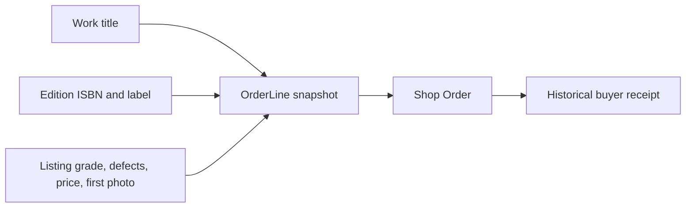

# What to snapshot

An OrderLine is evidence of the offer Hana accepted. Its job is different from Work, Edition and Listing. Work identifies the intellectual work, Edition distinguishes the publication or format, and Listing describes one shop's physical copy today. The OrderLine freezes enough of those facts to explain a particular transaction later. It still stores the IDs, but it must be able to render the agreed title, Edition label, ISBN, grade, defects, price and first photo reference when the Listing has changed or disappeared from public search.

Use the accepted Edition's ISBN, not a string the browser typed. A physical copy's Listing should reference the Edition selected by Hana's reading-list rule. If a course accepts several Editions, freeze the actual Edition label and ISBN that this particular Listing belongs to. A 10-digit ISBN and a 13-digit ISBN may represent the same print Edition under conversion rules, but do not invent a 10-digit equivalent for a 979 prefix. The earlier Edition module established canonical identifiers and format boundaries; checkout records the one actually sold rather than running a fresh fuzzy search at receipt time.

## Copy-specific disclosures

The Listing contributes grade code and rank, concise defects, condition photo reference, shop ID, price in integer minor units and currency. A Grade label alone is not enough because Hana may have chosen a Good copy with pencil notes rather than another Good copy with water marks. Freeze the disclosed notes and the first photo shown in the offer. If the platform stores a gallery, decide whether the receipt needs all condition images; the approved roadmap requires the first photo, and a product policy can retain more if support needs them. Do not add a transient signed URL that will expire overnight without a durable reference behind it.

The snapshot also needs the shop name shown to Hana, or at least a stable Shop ID plus a historical name field if names can change. Collection or shipping terms belong on the Shop Order: method, destination summary, amount, currency and promised range. If Hana collects from three shops, there may be three different addresses and hours. A single Checkout-level `pickupLocation` would be wrong. Keep the buyer's private contact data separate from public book information and expose it only to the relevant shop at the appropriate fulfilment stage.

## Reconcile the arithmetic

For one North Street copy at 1,800 minor units and one Campus Shelf copy at 2,300, if both are collection with zero fee, the Checkout total is 4,100. If Campus Shelf charges 400 for delivery and North Street remains collection, the shop Orders are 1,800 and 2,700, and the Checkout total is 4,500. Write these values in tests and compare the sum. Do not let the browser submit `total: 4100` as authoritative after Campus Shelf changed its delivery fee. Show Hana the revised 4,500 and ask for confirmation before creating a payable attempt.

Choose one currency for the core cohort. Adding integer minor units from different currencies is invalid even if both amounts are numbers. A later cross-currency feature needs a declared exchange-rate and settlement policy; this module does not hide one in a helper function. Record `currency` on Checkout and shop Orders, and assert every line and fee uses it. The value used for a later PaymentIntent must come from the frozen Checkout total, not from a fresh scan of current Listings.

## Separate identity from display history

Keep `listingId`, `editionId`, `workId` and `shopId` as references in the OrderLine or related Order. They support support investigations and authorized navigation. Freeze a display title and edition label because those records may be corrected later. A bibliographic correction does not mean Hana purchased a different physical object; she purchased the Listing with a specific ID and disclosed condition. If an Edition ISBN was entered incorrectly before sale, support may correct the canonical Edition while preserving the original OrderLine snapshot and recording the correction. Silent mutation of the old snapshot makes the audit trail harder to understand.

Do not copy every field from the Listing. Internal moderation notes, unpublished seller drafts, search ranking, cached match scores and private Shop settings are not purchase terms. Raw media storage credentials also must not enter an OrderLine. Choose fields by asking whether a buyer, shop or support reviewer needs them to explain the accepted offer. This keeps the snapshot useful and reduces accidental exposure in the buyer route.

## Freeze once, transition status later

The line's title, ISBN, grade, defects, price and photo reference should not change when payment succeeds or when the shop marks the order ready for collection. Status fields are different: pending payment can become paid, ready and collected under the later modules' rules. Keep mutable workflow state on Order or Checkout and historical terms on OrderLine. A broad object replacement in a payment webhook could accidentally overwrite snapshots with current Listing data, so add a test that compares these fields before and after a status transition.

A held Listing can expire before payment. In that case the OrderLine remains as a record of the attempted offer, but it must not be shown as a completed sale or expose a collection code. The payment module will reconcile late provider success against current hold ownership. Do not delete all attempt history to hide the conflict, and do not mark a replacement copy sold under the old line. The exact Listing ID and frozen terms make the late-event decision possible.

## Practice choosing fields

Create a table in the learning log with three columns: source model, snapshot field, and reason. Include Work title, Edition label and ISBN, Listing grade, defect notes, agreed price, currency and first photo reference. Add Shop Order shipping or collection terms separately. Then list three fields deliberately excluded, such as internal moderation note, current search rank and a temporary signed upload URL. For each excluded field, explain where authorized staff can still find it if needed.

Seed two physical Listings of the same Edition with different grades and photos. Checkout one Listing. Edit the other and confirm the OrderLine does not change; this catches a mistaken Edition-level condition field. Then regrade the purchased Listing through a controlled fixture and compare its current fields to the old OrderLine. The next chapter establishes the conditional claim that makes sure only one student can hold that exact Listing before snapshots are made payable.

<TraceRequest title="From listing to order evidence">
  <TraceStep actor="Hana" label="Choose Good copy" detail="Listing L7, print Edition, disclosed pencil notes" />
  <TraceStep actor="Checkout" label="Validate and hold L7" detail="Current offer matches Hana's confirmed terms" />
  <TraceStep actor="OrderLine" label="Freeze agreement" detail="ISBN, edition, grade, defects, 1800 minor units, first photo" />
</TraceRequest>

## Protect the snapshot from later writes

Make the model's write API narrow. A checkout service creates snapshot fields once; a payment or collection service may update status but should not accept title, ISBN, grade, defects or price in its update input. This is stronger than relying on UI discipline. Add a unit test that attempts to pass a changed `priceMinor` through the status transition and verifies it is rejected or ignored. Then inspect the database after the transition. The old agreement remains visible even if a developer accidentally adds a live Listing population to a new page.

A corrected ISBN is a special support case. If the Edition was misidentified at sale, do not quietly rewrite the OrderLine and pretend Hana selected the corrected Edition. Preserve the purchase-time text, link a correction record or support note, and let the current Edition catalog show the corrected value. The snapshot's IDs can still point to the canonical records for investigation. This distinction is especially important for reading lists because a different edition may fail a course requirement even when the Work title is the same.
