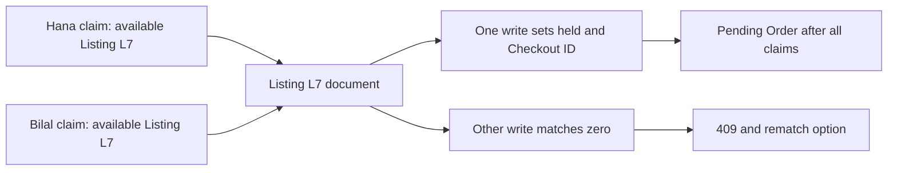

# Claiming a single copy atomically

One used-book Listing represents one physical copy. Hana and Bilal can both see the same College Algebra copy on an offer page, and both can add its Listing ID to a reading list or Cart. Neither page view reserves it. At checkout, a conditional database update must choose one current holder. The filter names the Listing ID and an eligible state; the update changes status to held, records the Checkout ID and sets an expiry together. A second concurrent update that expected available status no longer matches.

MongoDB's single-document atomicity makes the state predicate meaningful when the write executes. It does not make a whole multi-Listing Cart atomic; that is a later chapter. A preliminary `findOne` can gather display fields and check edition acceptance, but it cannot be the final guard. If the code reads `status: available`, waits, and later writes `status: held` using only `_id`, both callers can report success. The final document may show only Bilal's Checkout ID while Hana already has an Order. Inspect responses and Orders, not only the final Listing.

## Choose held before sold

The approved roadmap describes an available-to-sold change in this chapter, but payment is taught in the next module. For the safe learner build, this chapter uses `available -> held` with a deadline. A verified payment event in M20 will conditionally move the same currently owned Listing from held to sold. A failed card or abandoned attempt must release its own hold, not leave the physical copy falsely sold. This refinement preserves the roadmap's one-winner outcome while keeping the sale claim aligned with payment. Record it for instructor reconfirmation before release.

Store the Checkout ID as the hold owner, not only Hana's buyer ID. Hana can start a later attempt with a new request key after an old attempt expires. A release from the old attempt must not clear the new one, even when both attempts belong to Hana. Match `hold.checkoutId` when extending or releasing a hold. Keep the expiry as a UTC instant and compare it using one server-side clock policy. The client can show a countdown, but browser time does not authorize takeover.

## Write an eligible-state predicate

A simple first branch matches `{_id: listingId, status: 'available'}`. If the product permits expired-hold takeover without waiting for a sweeper, include an explicit second branch for `{status: 'held', hold.expiresAt: {$lte: now}}`. Set `status: 'held'`, new Checkout ID and new expiry in that same update. Do not match a sold or archived Listing merely because its old expiry field exists. Tests should cover available, active held, expired held, sold and archived states. A no-match is a normal product conflict, not an internal server failure.

Use the database API's post-update return mode or matched count correctly. Some `findOneAndUpdate` wrappers can return the prior document by default. If the route treats a pre-update `available` document as proof it owns the hold, it may snapshot stale fields or misstate the response. Verify the returned Checkout ID equals the current hold owner before creating pending Orders. The exact return option depends on the driver or ODM, so inspect its documentation and add a test for the shape used in this project.

## Keep Edition checks in the path

The atomic claim guards stock, but Hana also cares which book she gets. Her reading list may accept a particular print Edition or several allowed Editions, with a Good grade floor. Revalidate Edition ID and grade against her confirmed choice before claiming. If grade or price can change between validation and claim, include a version or expected fields in the conditional update or use a transaction strategy that gives a consistent view. Otherwise the claim can succeed on a Listing whose terms changed after Hana agreed. On mismatch, release any own claims and ask for renewed confirmation.

The server must derive Shop ID from the stored Listing. A client-sent `shopId` can be stale or forged. Grouping by a forged Shop ID could misroute an Order or expose private details. After the claim, use the returned stored Listing and its Shop relationship for snapshots. A Listing's Work and Edition links also come from stored data. A browser can identify the selected Listing and accepted offer version, but it does not create bibliographic truth.

## Release with the same care

When Hana cancels or a multi-Shop attempt fails, release only if the Listing is still held for her Checkout ID. If the hold expired and Bilal took over, Hana's delayed cleanup must match zero and leave Bilal's hold intact. Do not use `updateOne({_id: listingId}, {$set: {status: 'available'}})`. That broad update can reopen a sold or newly held copy. Add a stale-release fixture: Hana holds until 10:00, Bilal takes over at 10:01, Hana's worker runs at 10:02, and the final Listing still names Bilal.

A background expiry worker can tidy abandoned holds, but correctness should not depend on its timing. The claim predicate itself can recognize an expired hold under the chosen policy. The sweeper must also include the old Checkout ID in its release filter, or it could clear a new holder after takeover. State the boundary comparison explicitly, such as `expiresAt <= now`, and test before, at and after the expiry instant with an injected clock. Do not rely on a real sleep in a test suite.

## Prove one winner

Create a fresh available Listing and two authenticated sessions with distinct Checkouts. Start two claim requests through a barrier. Exactly one receives a successful held document; the other receives no match or a route-level 409. The winner may change between runs, so assert counts rather than a fixed person's name. Inspect the final Listing's hold owner, both Checkout states and the number of pending payable OrderLines. At most one OrderLine may be tied to the active claim. A route that inserts Orders before checking the claim can violate that second invariant even when the Listing update itself is atomic.

Then test a sold Listing, a draft Listing and an archived Listing. None may be claimed. Test another physical Listing of the same Edition and show it can still be claimed by Bilal; the conflict belongs to one Listing ID, not to all copies sharing an ISBN. This is the practical difference between the Work/Edition/Listing model and a shelf-style quantity counter. The next chapter checks whether the learner can predict the safe result before building the multi-Shop route.

<TraceRequest title="One copy, two students">
  <TraceStep actor="Hana" label="Claim Listing L7" detail="Conditional available-to-held update matches" />
  <TraceStep actor="Bilal" label="Claim Listing L7" detail="Status is no longer eligible" status={409} />
  <TraceStep actor="Shop" label="Inspect pending state" detail="One Checkout owns L7; no sale yet" />
</TraceRequest>

## Check the old-owner cleanup

Create a release function that accepts a Checkout ID, not only a Listing ID. Its update filter includes both and requires held status. Log matched count without exposing the buyer in public responses. If matched count is zero, distinguish already released, expired and taken over through an authorized diagnostic query; do not retry with a looser filter. Run a fixture where Hana's cleanup is delayed until after Bilal's takeover. A release by `_id` alone will fail the test by clearing Bilal's hold.

The successful claim should also record the offer version that Hana accepted. If North Street regrades a Listing at the same moment Hana claims it, an eligible-state predicate alone protects stock but not consent. Add expected grade, price or a monotonic Listing version to the predicate, and update that version when the shop changes purchase terms. A no-match then triggers a changed-offer response. Test one concurrent seller edit and student checkout, allowing either operation to win but never allowing a pending Order with unapproved terms.

Record the failed claim too.
