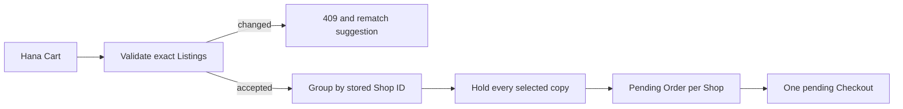

# Checkout route split by Shop

Build `POST /checkouts` for Hana's selected reading-list matches. The request identifies exact Listing IDs and an idempotency key. The server authenticates Hana, reloads each Listing with its Work, Edition and Shop relationships, checks her accepted Edition and grade constraints, and calculates current prices and collection or delivery terms. It groups the valid plan by Shop, claims the copies in the later build step, then creates one pending Order per Shop. No provider call or `paid` status belongs in this route yet.

## Authenticate before looking up a plan

Take `buyerId` from the session, not from a request field. If the route accepts a reading-list ID, verify that Hana owns or is allowed to use that list; a public Shop list copied into her account may need different access semantics. The actual purchase request should contain unique Listing IDs, not merely ISBNs. Two shops can list the same Edition, and even one Shop can have two copies at different grades. Reject duplicate Listing IDs. An ISBN-only Cart would let the server silently choose a different physical copy than Hana inspected.

Use a request key scoped to the buyer and protected by a unique database index. A double click should find the same Checkout attempt, not create two sets of shop Orders. If the first attempt is assembling or recovering, return a truthful state rather than inventing a fresh success. A new request key after an old attempt expires must revalidate all current Listings. Do not use an in-memory map as the only idempotency mechanism; server restarts and multiple instances would defeat it.

## Validate the current offer

For each Listing, load its current status, grade, defects, first condition photo, price, currency, Shop and Edition. Confirm that the Edition is accepted for the reading-list item, the grade meets Hana's floor, and the price is within the agreed offer or triggers a revised confirmation. Confirm that the Shop is active and its chosen collection or delivery method is available. A Shop may pause collection or change hours; the server's current policy controls checkout. If any line fails, return a conflict naming the affected reading-list item and Listing ID before taking holds or creating payable Orders.

Do not automatically swap in a different Listing after a conflict. The matcher can offer alternatives with the same accepted Edition, but a different grade, defects, photo, Shop or price is a new buyer choice. The 409 body can include safe reasons such as `copy_unavailable`, `grade_changed`, `edition_not_accepted`, `price_changed` or `collection_paused`. It should not expose another student's Checkout ID or private buyer details. A hidden draft may need a generic unavailable response rather than its title.

## Group by actual Shop ownership

Build an in-memory normalized plan from stored relationships. A Cart with two North Street copies and one Campus Shelf copy makes two Shop groups, not three. Each group's lines carry the exact Listing IDs and agreed snapshots. Store Shop ID and a display name for the later Order, along with collection or delivery terms. A client-provided `shopId` must not override the Listing's stored Shop ID, because it could send an Order to the wrong seller or manipulate a fee.

Calculate amounts in integer minor units and require one currency for this core build. Sum Listing prices and any Shop-specific delivery fee inside each group, then sum group totals to the Checkout total. If one Shop offers pickup for free and another charges delivery, show both terms. Do not assign one combined pickup location to the whole Checkout. Write an arithmetic fixture: North Street has 1,800 in books and zero collection fee; Campus Shelf has 2,300 in books and 400 delivery, making Orders of 1,800 and 2,700 and a Checkout total of 4,500. A client total of 4,100 must not override the server amount.

## Treat preflight as a preview

A validated Listing can be claimed by Bilal immediately after the preflight read. The route's final claim step must use a conditional update on each Listing's current eligible status and expected offer version or fields. If one update reports no match, the route unwinds its own earlier holds and returns a conflict. A successful preflight is not a guarantee. Conversely, if the claim succeeds but a field differs from the buyer-approved terms, the route must release its own claim and request new confirmation. The precise multi-Listing recovery procedure is built in chapter 19.8.

Create a durable Checkout attempt in an `assembling` state before the first hold, with a stable ID that owns every claim. Store the buyer and request key. After all claims succeed and snapshot Orders are written consistently, transition to `pending_payment`. Do not transition after the first Shop Order. A crash between Shop Orders must leave a recoverable non-payable state. An alternative transaction design can bundle local writes if the database supports transactions, but the course build needs one selected strategy and tests for its failure windows.

## Return a useful pending response

The successful response includes one Checkout ID, total, currency, hold deadline and one pending Order summary per Shop. Hana can see each Shop name and collection or delivery choice. A seller does not receive all Shop Orders from this response. The client should label the result as pending payment, not a confirmed sale. It should not show a collection code before the later payment and fulfilment modules. A 409 response should preserve the reading-list context so Hana can rematch only the lost item rather than reconstructing her entire list.

If a store failure occurs after any claim, record `rollback_pending` and start or schedule owner-scoped cleanup. Do not return a normal pending Checkout while one Shop group is uncertain. A retry with the same key should find the attempt and either complete an allowed recovery action or report it. The response contract needs status names that match the database, or the UI may mistake a half-built attempt for a payable Order.

## Exercise the split

Seed three Shops with one distinct Listing each, all meeting Hana's reading-list Edition and condition filters. Submit checkout and inspect one Checkout with three pending Orders, three held Listings owned by the same Checkout, and a total equal to the Order sums. Add another Listing from North Street and confirm the Order count remains three while its line count becomes two. Try an ISBN-only request and a forged Shop ID; the server must reject or ignore them according to the contract.

Pause Campus Shelf collection, then submit with a fresh request key. Expect a conflict with no new holds or Orders. Change one Listing grade below Hana's floor; expect a grade conflict and an invitation to rerun matching. Change a price after Hana saw the Cart; expect renewed confirmation. Finally, double-submit with the same request key and compare Checkout and Order IDs. These fixtures make the reading-list context and split-order invariants visible before payment code exists.

## Record the route boundary

Document that this endpoint reserves exact physical copies for a limited time and writes pending Order snapshots. It does not mark the copies sold, charge a card or authorize collection. The later payment module must use the frozen Checkout total and check current hold ownership before sale. This boundary may differ from a casual reading of the roadmap's available-to-sold wording, so put it in the learning log and instructor review note. The next chapter constructs the OrderLine snapshots whose fields cannot be replaced by later catalog edits.

Check that a seller can never choose the buyer's request key.
