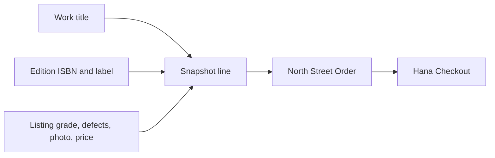

# Snapshot OrderLines

Build the OrderLine writer for a successful held Listing. Hana chose North Street's Good College Algebra copy with pencil notes, a creased cover photo and a price of 1,800 minor units. The OrderLine should retain that exact offer even after North Street regrades the public Listing or updates Edition metadata. It also keeps IDs linking back to the Listing, Edition, Work and Shop for authorized investigation. The snapshot is the evidence used by buyer and seller views; live Listing data can supplement navigation but must not replace agreed fields.

## Write the field map

Define a typed snapshot shape: `listingId`, `workId`, `editionId`, `shopId`, title, Edition label, canonical ISBN, grade code and rank, disclosed defect notes, first photo reference, priceMinor and currency. If the UI showed a subtitle or format that changes the buyer's Edition decision, include it as a deliberate field. The Shop Order stores the Shop name shown at checkout, selected collection or delivery method, fee, destination summary and promised range. Do not copy an entire Listing document into a loose object; doing so can carry private moderation fields, temporary signed media URLs and mutable caches into a buyer response.

Take values from the validated, currently held Listing and its stored references. The browser's Cart may contain old display text, and a malicious request can alter it. The server should compare the selected offer with Hana's accepted version or expected values, then freeze the server-verified data. A mismatch returns a changed-offer conflict and releases this attempt's own holds. That way a snapshot cannot silently become a price or grade that Hana never approved. Document the version check in the route contract, because a preflight read can be stale before the final claim.

## Keep condition with the copy

Two physical copies can share one ISBN but have different grade, defects and photos. Do not put those fields on Edition and then snapshot a shared value. Seed North Street Listing A as Good with pencil notes and Campus Shelf Listing B as Very Good with a clean interior. Checkout A and inspect its line. Changing B must not change A's Order. The test catches a mistaken join or an accidental `findOne({editionId})` when the code should use the exact Listing ID.

For grade, store the code the buyer saw and a rank only if the rank is part of a stable defined scale. A later change to the grade rubric should not make an old receipt claim a new grade silently. Defect notes should be the disclosed text, not an internal reviewer comment. Retain the first photo through a media policy that supports order history. A raw time-limited signed URL may expire, so store a durable media reference or a retained order copy and generate access at read time. If the project cannot retain the image, use a documented placeholder while preserving the text and ID; do not substitute a different current Listing's photo.

## Make the Shop grouping add up

Hana's reading list might include two North Street copies and one Campus Shelf copy. Create two Shop Orders: North Street has two OrderLines and one collection or shipping group, Campus Shelf has one line and its own terms. Calculate each Order total as line sum plus its fee, then calculate Checkout total as the sum of Order totals in integer minor units. Assert all currencies match. If a delivery fee is at Shop level, adding it to each line would double charge a two-copy North Street Order. A fixture with two lines in one Shop reveals this bug more clearly than a one-line-per-Shop fixture.

Use `(checkoutId, shopId)` as a unique Order identity or another stable lookup to avoid duplicate Shop Orders on retry. The OrderLine identities should likewise avoid duplicate Listing IDs within one active Checkout. If the process stops after writing the first Shop Order, the Checkout remains assembling or rollback pending; the presence of one line does not make it payable. Recovery must finish the exact plan safely or unwind holds and partial Orders. The next chapter implements that all-or-nothing behavior.

## Distinguish attempt history from a sale

A pending OrderLine is a frozen proposed agreement under a time-limited hold. It is useful even if the attempt later fails, because it explains what happened during support or recovery. But the buyer account must not label it a paid purchase, and the Shop must not prepare collection. Keep workflow status on Checkout and Order. Payment in M20 must verify its webhook and current hold ownership before changing Listing to sold. The line's historical terms stay fixed during that transition.

If the hold expires and another student buys the copy, do not reuse Hana's OrderLine for the new buyer simply because the Listing ID matches. Bilal gets a separate Checkout and snapshot based on his accepted offer at his time. Hana's failed attempt remains tied to her own request and must be hidden from ordinary completed-order lists or labeled clearly as expired. This distinction is necessary for refund and support investigation if a late payment event arrives.

## Test before and after edits

Create the pending Order for Listing A, read the stored line and buyer route response, then edit the live Listing title, grade, defect note, first photo and price through a controlled fixture. Read again. The snapshot fields must be byte-for-byte or value-for-value stable. Change the Edition display label and confirm the historical label remains. Archive the Listing and ensure the Order page still renders. If the seller API forbids edits while held, use a test-only direct update or a later post-sale change to verify the read path without weakening the real API rule.

Next, change the Listing before checkout. Hana's Cart still says Good at 1,800, but the current Listing is Acceptable at 1,500. The route should return a conflict and no payable Order; it must not snapshot either the stale Cart or an unapproved new offer. After Hana reviews and accepts a new suitable Listing, the new OrderLine freezes that choice. These two tests cover both consent and immutability. Include actual JSON field comparisons in the learning log rather than only screenshots.

## Inspect what each role receives

The buyer serializer can show the full agreed item description and Shop terms for Hana's Orders. The Shop serializer should show only that Shop's lines and the collection details it needs at the permitted stage. Neither should expose raw media credentials, internal condition review notes, another Shop's revenue or idempotency keys. An administrator may need an audit view, but it is a different authorization path. Build explicit projections so a future schema field is not automatically leaked by returning a raw database document.

Commit the snapshot schema, writer, grouping arithmetic and before/after edit tests. Show one North Street line and one Campus Shelf line to demonstrate that the same Work/Edition model can feed different physical-copy snapshots. The next chapter deliberately fails a multi-Shop claim and proves no partial payable Order survives.

## Compare three representation layers

Inspect the stored OrderLine, the JSON returned by `GET /orders/my`, and the rendered account page after the edit test. A stable database row with a changing JSON response points to a serializer that reads live fields; stable JSON with a changing page points to frontend merging or cache reuse. Recording all three layers gives a reviewer a precise place to debug. It also prevents a local fix that only hides a changed grade in one view while leaving the seller view incorrect.

Retain the original Shop association.
