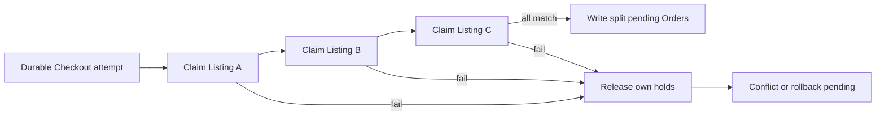

# Hold copies, all or nothing

Hana selected three distinct physical copies from three Shops. Her checkout may claim the first two before learning that Bilal took the third. If the route returns a conflict but leaves two held Listings, it has blocked other students without giving Hana a complete purchase. If it creates two normal pending Orders, Shop owners may believe those copies are sold even though Hana never approved the reduced Cart. Build a claim-and-compensate path that yields one complete pending plan or a recoverable failure with no payable partial Orders.

## Keep one owner token throughout

Create a stable Checkout ID before the first claim. Every successful Listing update writes that ID into its hold field. The attempt also stores Hana's buyer ID and a request key under a unique constraint. A retry with the same key finds the attempt rather than trying to create a second set of Orders. Sort Listing IDs before claiming to make test traces consistent. Sorting is not atomicity; it only makes the sequence easier to inspect and may reduce avoidable contention.

Each conditional claim must check current eligible state and any accepted offer version or fields. A Listing that has become sold, archived, regraded below Hana's floor or repriced without her consent is a conflict. If it is an expired hold and takeover is allowed, the update changes owner and expiry together. Ask for the post-update document or inspect matched count. Record the claimed Listing IDs in durable attempt state, and be able to discover holds by Checkout ID if a process stops after the Listing write but before updating a progress array.

## Unwind a lost copy precisely

If Listing C returns no match, mark the Checkout `rollback_pending` before returning a terminal conflict. Release A and B only where `status: held` and `hold.checkoutId` equal Hana's Checkout ID. Do not issue an ID-only update. If A expired and another student took it before cleanup, the release must match zero and leave the new holder untouched. Query remaining own holds and repeat until none remain or a store outage requires a worker retry. A response can name C as the lost Listing without revealing Bilal's Checkout ID.

The normal UI should not show an assembling or rollback-pending attempt as a purchase. If cleanup cannot finish immediately, return a truthful retryable state and block payment for that attempt. A background worker can resume using the durable Checkout ID. Run it twice in a fixture to demonstrate idempotence. Its second run should find no own holds and should not create a new Order or clear a later holder's claim.

## Cover Order insertion failure

All claims can succeed and the first Shop Order can be inserted before the second insert fails. That is still not a complete plan. Keep the Checkout in assembling state until all Shop Orders exist, totals add up, and every Listing is held by this Checkout. If an insert fails, cancel or remove partial pending Orders under a documented recovery rule, release own holds and mark the attempt failed. A unique `(checkoutId, shopId)` key prevents duplicate Orders when a lost HTTP response triggers a retry, but the unique key alone does not repair a missing Shop Order.

You can choose MongoDB transactions as an alternative if the local training deployment runs as a replica set and every relevant Piece or Listing, Checkout and Order operation uses the same session. A transaction can commit or abort the local multi-document plan together. It still cannot include Stripe or another external provider in the database commit. This learner path uses explicit compensation so crash recovery remains visible. Do not write that several independent single-document updates are collectively atomic; they are not.

## Delay sold until payment

The roadmap chapter title uses “mark copies sold,” but a card has not been charged and verified in M19. Set each claimed Listing to held, and create pending Orders only when the complete set is held. M20 will verify payment and conditionally change held Listings owned by this Checkout to sold. A failed card or expired Checkout releases its own holds. If payment succeeds after a hold was lost, M20 must prevent a second sale and handle the charge through refund or an approved recovery policy. Record this refinement as an instructor review item.

A shop's dashboard should not display an actionable collection Order for a held-only Listing. If the UI uses `sold` as shorthand for unavailable, it will mislead both shop and student. Use explicit pending language and show the hold deadline. A seller can see that a pending Order exists only if the product wants that visibility, but it should not invite preparation or collection until the paid transition. The route and tests should use the same status names.

## Test each failure window

First, pre-hold Listing C for Bilal. Hana's route claims A and B, fails on C, releases A and B, and returns a conflict. Query all three Listings and all Checkout and Order records. A and B are available, C remains held for Bilal, and Hana has no payable Shop Orders. If partial attempt records remain, they are marked failed or recovering, not pending payment.

Second, inject a stop after A is claimed but before progress is recorded. Run recovery by Checkout ID. It should find and release A. Third, inject a stop after the first Shop Order insert. Recovery removes or cancels that Order and releases all own holds. Fourth, let A's old hold expire, allow Bilal to take it, and then run Hana's delayed rollback. Bilal's hold remains. These tests expose different gaps; passing only the easy unavailable-C scenario is not enough.

Run the successful path with two Listings from North Street and one from Campus Shelf. Assert all three held documents name the same Checkout ID, exactly two Shop Orders exist, North Street has two lines, Campus Shelf has one, and the Order totals sum to Checkout total. No Listing is sold yet. Send a duplicate request key and verify IDs and counts remain stable. A new request key after expiry must revalidate current stock and terms instead of reusing a stale amount.

## Produce a trace for review

Log the Checkout ID, ordered Listing IDs, claim match results, cleanup match results and final state. Keep buyer private information out of logs. Present the trace in the learning log next to a table of expected and actual statuses. A reviewer should see why the winner of each physical copy is unambiguous and why a partial Cart cannot become payable. The following chapter exposes those Orders through role-scoped routes; it must preserve this state distinction in every response.

## Keep recovery observable

The worker should record why a Checkout entered `rollback_pending`, which Listing claim failed, how many own holds it found, and how many conditional releases matched. Avoid logging Hana's full address or condition photos. A support operator can then distinguish a harmless already-released Listing from a persistent store failure. If cleanup cannot finish, keep the attempt non-payable and retry with bounded backoff. Do not claim a clean failure in the API response merely because a cleanup task was queued; its state should tell the truth until the last own hold is gone.

Add a test in which the cleanup worker loses its lease or restarts halfway through three releases. The next run should safely finish the remaining owner-scoped releases. A second run after completion should match none and not change the final state back to assembling. This tests idempotence as a property of the database predicates and state transition, not as an assumption that the worker runs exactly once.
