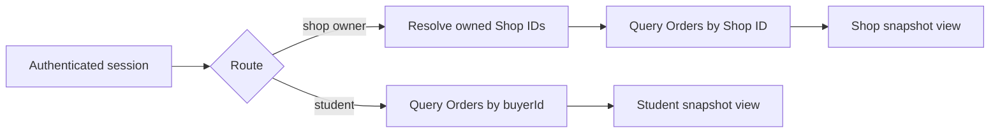

# Shop and student order routes

Build `GET /orders/my` for Hana and `GET /shop/orders` for each Shop owner. Hana can see all Shop Orders linked to her Checkout: North Street, Campus Shelf and Corner Books. Each owner sees only the Order assigned to their Shop. The routes render frozen OrderLine fields, including Edition and condition facts, rather than recalculating from current Listings. They also show an accurate pending state; no shop should hand over a book because an unpaid Order exists.

## Scope the student query

Read Hana's identity from her session. Query Checkouts or Orders where `buyerId` equals that identity, with a bounded page size and stable sort. A detail route that takes an Order ID must combine that ID with buyer ID in the database query. Do not load an arbitrary Order and check ownership only after serializing or logging it. A guessed ID is not a secret, and a copied URL must not grant access. Test with another student account that knows Hana's valid Checkout and Order IDs.

The student response groups Shop Orders beneath one Checkout. It shows Shop name, frozen book title, Edition label, ISBN, grade, defects, agreed price, collection or delivery method and per-Shop status. The Checkout total equals the sum of those Shop Orders. A pending or rollback-pending attempt needs careful presentation: partial Orders from an assembling attempt should not appear as normal purchases. The route can show an explicit recovering attempt state in a separate view, but it must not tell Hana a book is ready to collect.

A past failed Checkout may remain for support and audit. Decide whether the normal order list excludes it or labels it clearly; do not delete its records merely to simplify rendering. If a new attempt succeeds after the old one expires, the two Checkouts have distinct IDs and snapshots. The student's page should not merge them by reading-list ID or ISBN. The same Work can appear in several attempts without implying two sales.

## Scope the Shop query through ownership

Authenticate the seller, then resolve Shop IDs where `ownerId` equals the session user or where an explicit staff role grants access. Query Orders by those stored Shop IDs. Do not accept `shopId` from a query string as proof that the seller owns it. A North Street employee must not see Campus Shelf's Order simply because both came from Hana's Checkout. If a user owns two Shops, show both with clear labels; if the course's role model permits only one Shop, encode and test that assumption.

The Shop detail route combines `orderId` and an authorized Shop ID in its query. Give Campus Shelf's Order a known ID, sign in as North Street, and request it. Expect a safe denial. Then search the whole North Street JSON for Campus Shelf's title, fee and buyer note. A route that returns only one top-level Order can still leak nested `checkout.orders` if it populates the aggregate indiscriminately. Use an explicit projection rather than returning a raw model.

A Shop may need a student's contact or pickup detail after payment. While status is pending, return only what the product permits for that stage. For a collection order, a shop can know the title and copy condition but should not see a collection code until the later module issues one. For delivery, release address fields according to the paid fulfilment rule; another Shop never receives them. The snapshot can store private details safely while serializers decide who may view them and when.

## Render agreement fields from the snapshot

North Street regrades Hana's purchased copy after an administrative correction. Hana's order view should still show the Good grade and disclosed pencil notes captured at checkout. North Street's seller Order view should show the same historical agreement even if its catalog management page now shows Acceptable. This apparent difference is intentional and useful in resolving a dispute. A serializer that calls `populate('listing')` and overwrites `grade` with the live Listing defeats the snapshot.

Test archive and missing-reference cases. If the public Listing is archived, both authorized Order routes still show the frozen title, Edition, ISBN, grade, defects, price and photo reference under the retention policy. If a Work title is corrected, the current catalog page can show the correction while the Order retains its purchase-time display title. Keep original IDs for support; avoid making the historical page depend on successful public catalog lookup.

## Show status without promising collection

The Chapter 19 Checkout owns time-limited holds and pending Shop Orders. The route should say `pending_payment` or the project's exact equivalent. It should not call them sold, paid, ready or collected. A student may see a hold deadline and a prompt to finish payment. A shop may see the pending state if the product wants early visibility, but it should not receive a Prepare or Hand Over action. A failed or expired attempt must leave the normal fulfilment queue. These interface labels are part of the same state machine enforced by the backend.

When M20 later verifies a payment webhook, it can move all Shop Orders to paid only after confirming current Listing ownership and sale transitions. The route will then show paid status from stored Order state while still rendering the original snapshot fields. A status update should not regenerate line items from live Listings. Write a test that changes an Order status through the intended service and compares all snapshot fields before and after.

## Test with distinct people and copies

Seed Hana and Bilal as students and three Shop owners. Give each Shop a distinct Listing and distinctive buyer note; include two Listings in North Street's Order. Create Hana's pending Checkout. `GET /orders/my` as Hana returns all three Shop Orders and correct arithmetic. The same route as Bilal returns none. Request Hana's detail ID as Bilal and expect denial. Each Shop owner sees exactly the lines for that Shop and no other Shop's note, fee or address details. A credited author from Work metadata gets no seller access.

Now change one live Listing's grade, defect note, first photo and price in a controlled fixture. Call both student and Shop routes and compare the historical snapshot. Archive the Listing and repeat. Inspect full JSON for unexpected raw database fields such as hold owner, idempotency key, provider reference and internal moderation note. A 200 status and correct Order count are insufficient if private fields leak or historical terms drift.

## Keep pagination and totals stable

Bound list page size and sort deterministically by creation time and ID. A Shop can eventually have many Orders, so an unbounded query is a performance and privacy risk. A cursor can preserve stable paging as new Orders arrive; for a small training build, an offset may be acceptable if its sort is deterministic and the limitation is documented. The detail route can load full lines after the scoped ID query. Do not calculate the Shop's total by reading all Orders in a buyer Checkout; use the Shop Order's own frozen amount.

Capture safe sample responses and the cross-Shop denial in the learning log. Point to the database predicates that enforce buyer and Shop scope, and point to the serializer fields that come from snapshots. The final gate will combine these access checks with the two-student claim and post-checkout regrade tests.

## Check the aggregate leak

Give Campus Shelf a distinctive private delivery note and a fee different from North Street's. Sign in as North Street and inspect the complete response body, including nested Checkout fields. Neither the note nor Campus Shelf's Order ID should appear. The Shop's own Order total is enough for its pending dashboard; exposing Hana's whole Checkout total can reveal another Shop's sales. Add this negative assertion to the route test instead of relying on a code review of the serializer.
