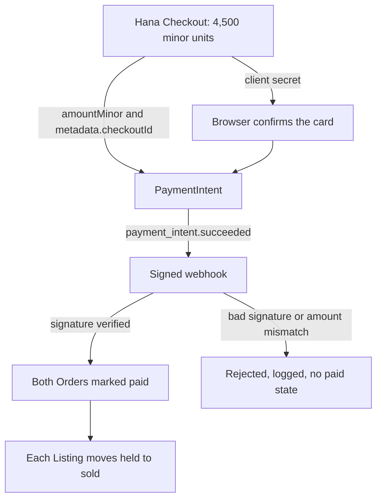

# One payment, several bookshop orders

Hana has two books in her cart at 21:00 on a Tuesday. A College Algebra copy at North Street Books is 1,800 minor units, and a statistics guide at Campus Shelf is 2,300 plus a 400 collection fee. Module 19 already turned that cart into two pending Orders, one per bookshop, each holding its copy and its condition snapshot. Hana has one card and one budget of about 4,500. From her side this is one purchase. From Hamesh's side there are two sellers, two pickup points and two records that must end up paid together or not paid at all.

This chapter explains the payment object that sits above those Orders, how its amount is decided on the server, and the one failure that makes a bookshop different from a shop with a shelf of identical units. A copy is sold once, so a paid Order must never be overwritten by a later duplicate event or by a second payment attempt for the same copy.

## One attempt to collect one amount

A Stripe PaymentIntent is a record of one attempt to collect a specific amount in a specific currency. It has an id such as `pi_3Qabc123`, a status such as `requires_payment_method`, `processing` or `succeeded`, and a client secret that the browser uses to confirm the card. The client secret proves the browser may confirm this one intent. It cannot decide that Hamesh's Orders are paid, because only the server holds the records and only the server can change them.

Hamesh stores the intent id in two places. The Checkout keeps it as `paymentIntentId`, and every Order keeps the same id next to its own `paidAt` field. That shared id is what makes support possible later. When a shop owner asks about order H-1041, the answer starts from the payment that paid it. When a student asks about a card charge, the answer lists the Orders it covered. Without the stored id you would be matching payments to purchases by amount and date, which works until two students buy two books for the same total on the same afternoon.

The intent is created after checkout has held the copies and written its snapshots, and it is created once. If Hana taps Pay twice, the second request must return the same intent rather than start a second collection. That rule looks small. It is the whole difference between one careful payment and two charges for one reading list.

## The amount comes from OrderLines, not from a request body

Hamesh computes the amount from the OrderLine snapshots written in module 19. Each line carries `priceMinor`, `currency`, `gradeCode`, `gradeRank`, `defectNotes`, `editionLabel` and `isbn13`. An Order total is its line prices plus that shop's collection fee. The Checkout total is the sum of the Order totals, and the PaymentIntent amount is the Checkout total, in integer minor units.

Reading snapshots rather than live Listings matters because a Listing can change between the Cart page and the card form. North Street might regrade Hana's copy from Good to Acceptable at 22:00 and drop the price to 1,400. Hana agreed to 1,800 for a Good copy with a creased cover and pencil notes. An intent that reads the live Listing can charge less than she approved or more than she approved, and either way the receipt describes a purchase that did not happen. The snapshot is the offer she accepted.

The browser sends a Checkout id and a request key. It does not send a total. A learner who accepts `amountMinor` from the request body has built a page where anyone can pay one unit for a textbook. Module 27 returns to this as the pricing gate: the server amount must equal the intent amount, and neither may come from the client.

## Test mode keeps the work honest

Stripe test mode is a separate environment with its own keys. A test publishable key starts with `pk_test_` and a test secret key starts with `sk_test_`. Test mode moves no money and cannot be paid out, so a mistake costs a confusing dashboard entry rather than a real student's savings. Stripe publishes test card numbers for a successful payment, a decline, insufficient funds and a step where the bank asks the cardholder to authenticate. Take those numbers from the documentation and record the date you checked them rather than trusting a number you remember.

Two configuration habits belong here. The secret key lives only in the server environment, loaded through the config module from module 4, never in a React file and never in a Git commit. The publishable key is the only key the browser receives, and it arrives from the server or from a build-time variable that cannot sign anything. The server also refuses to start if `STRIPE_SECRET_KEY` does not begin with `sk_test_`. A three line guard is cheaper than discovering that a live key reached a shared laptop.

## Where the two paths separate

The diagram below shows the shape rather than the code. The Checkout has two outgoing paths. One carries a client secret to Hana's browser, and that path can only confirm card details. The other carries a signed event to Hamesh's server, and that path changes records.



Notice that the browser arrow never touches the Orders. That is the decision this chapter argues for. The browser is allowed to start a payment, and only the server is allowed to conclude one.

## What a bookshop adds to the usual payment problem

In a shop that sells many identical units, a duplicate payment means one customer was charged twice for the same cart. It is annoying, and a refund settles it. In Hamesh the physical copy needs protecting as well, because North Street has exactly one Good copy of that edition with pencil notes and a creased cover. If Hana's second payment succeeds after Bilal has bought that copy, there is no second copy to hand her. The money moved and the object did not exist.

Three rules follow from that. A Checkout creates at most one PaymentIntent. The move to paid is conditional on the Order still being unpaid, so a repeated event changes nothing. And an OrderLine never changes the `listingId` it was created with, so a later payment attempt for a different copy cannot reuse the paid line. If a late success arrives for a copy that is now sold to another student, the honest state is a flagged attempt for review and a refund, not a quiet exchange of the Listing behind the buyer's back.

The core build does not include the refund path. It is stretch lab S5. What the core does include is the honest state: the attempt is marked `needs_review`, Bilal's paid Order keeps every field it had, and Hana sees that her payment is being resolved instead of a false confirmation.

A paid Order is also what unlocks the collection code Hana shows at the counter. Each shop Order gets its own short code, generated on the server, and the code is only meaningful once that Order is paid. A pending Order may show the shop name, the pickup window and the condition snapshot, and it must not show a code, because a shop that accepts one has handed over a book for money that never arrived. This is the same trust boundary in a different place: the database decides, and the screen reports.

## The success page is a reader, not a writer

Stripe can send Hana back to a return page after she confirms the card. That redirect is a hint. Her phone can lose signal between the confirmation and the redirect, she can close the tab, or she can reload a bookmarked URL the next morning. The webhook still arrives on the server, because Stripe retries it until a route accepts it.

A success page therefore reads `GET /checkouts/:checkoutId` and shows what the database holds: `pending_payment`, `paid` or `needs_review`. It never marks anything paid. A page that marks Orders paid as it loads also lets anyone who guesses the URL mark their own Orders paid, which is a security hole dressed as a convenience.

The trace below follows one awkward but ordinary case. Hana confirms, the signal drops, and the return page never loads. Her Orders still end up paid, because the webhook does not depend on her browser.

<TraceRequest title="Hana pays while the signal drops">
  <TraceStep actor="Hana" label="Confirm the card" detail="The browser confirms pi_3Qabc123 with the client secret" />
  <TraceStep actor="Browser" label="Lose the connection" detail="The return page never loads and no status request reaches Hamesh" />
  <TraceStep actor="Stripe" label="Send the event" detail="payment_intent.succeeded posted to the webhook route" />
  <TraceStep actor="Hamesh" label="Mark paid once" detail="Both Orders move from pending_payment to paid in one verified pass" />
  <TraceStep actor="Hana" label="Refresh the order page" detail="The page reads paid from the database and writes nothing" />
</TraceRequest>

## The choice and its alternatives

The choice is one PaymentIntent per Checkout, created on the server from frozen snapshots and concluded by a verified webhook. It fits now because module 19 already stores pending Orders with prices and holds, so the amount needs no guessing, and the payment stays inside Hamesh instead of handing the student to another site.

What it buys is one amount, one confirmation, one id shared with every Order, and control over what Hana sees between her reading list and the card form. What it costs is ownership of raw body handling, signature checks, an event log, idempotency rules and every failure state around them. That is more code than a hosted page, and each bug in it touches money.

The credible alternative is a Stripe Checkout Session, where Stripe hosts the payment page and redirects back. It is faster to build, it handles wallets and receipts, and it removes card fields from your own code. It also gives up control of the moment before payment, makes the two shop Orders harder to show in context, and still needs the webhook. A team with no frontend capacity should take it, and several real marketplaces do.

A second alternative a colleague may raise is manual capture: authorize when Hana pays and capture when she collects the book at North Street. That suits pickup, because a shop can fail to find a copy on the shelf. It costs an expiry window on the authorization, a second API call and another state for the gate to test. This course stays with immediate capture and states the trade-off rather than hiding it.

```quiz
type: mcq
id: books-payment-q1
question: Hana pays and her browser closes before the return page loads. What makes her two shop Orders paid?
options:
  - "The success page finishing its loading state in Hana's browser tab"
  - "The client secret that the intent route returned to the browser page"
  - "A verified webhook event checked against the stored attempt"
  - "The Stripe dashboard showing the payment as succeeded just now"
correct: 2
explanations:
  - "A page can load late, fail to load or be reloaded by anyone holding the URL."
  - "The secret only lets the browser confirm the intent; it carries no order state."
  - "The server compares the signed event with the stored intent before it writes paid."
  - "A dashboard is a human view, not an authorisation for Hamesh to change records."
```

## What the next chapter builds

The next chapter writes the route. It takes a Checkout id, checks that Hana owns it and that it is still payable, recomputes 4,500 from the stored snapshots, creates or recovers exactly one intent, saves the id on the Checkout, and returns the client secret to Hana's page and to nobody else. The chapter after that receives Stripe's event, verifies its signature on the raw body, and performs the paid transition once.
