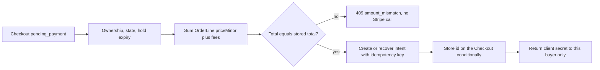

# Price the intent on the server

Hana's Checkout is holding two copies and carries two pending Orders: 1,800 to North Street Books for a Good College Algebra copy with pencil notes, and 2,700 to Campus Shelf for a statistics guide at 2,300 plus a 400 collection fee. She is signed in, the holds expire in twelve minutes, and she wants to pay. This chapter builds the route that turns those stored numbers into one Stripe PaymentIntent and hands her browser a client secret. It does not mark anything paid, and it does not accept a price from the page.

The route is small on purpose. Most of the work is deciding what it refuses: a Checkout that is already paid, a hold that has expired, an amount that does not add up, a request that carries its own total, or a key that belongs to live mode. A payment route that only handles the happy path will still pass a casual demo, then fail on the first slow network or the first double tap.

## The route and the shape it stores

The signature below is the contract the client codes against. It takes the Checkout id from the path, derives the buyer from the session, and returns only what the browser needs to confirm the card.

```js
// server/src/modules/payments/payment.routes.js (partial, error handling omitted)
router.post(
  "/checkouts/:checkoutId/payment-intent",
  requireRole("student"),
  createOrRecoverIntent
);
// 201 { paymentIntentId, clientSecret, amountMinor, currency, attempt }
// 409 { reason: "checkout_not_payable" | "hold_expired" | "amount_mismatch" | "already_paid" }
```

The attempt record is stored on the Checkout rather than in a separate collection, because there is at most one live attempt per Checkout in this build. A second copy of the same intent id in two places invites the two records to disagree.

```js
// Checkout: the payment attempt fields added in this chapter
payment: {
  paymentIntentId,   // "pi_3Qabc123"
  amountMinor,       // 4500, frozen at creation
  currency,          // from config, for example "usd"
  status,            // "created" | "succeeded" | "failed" | "needs_review"
  attempt: 1,
  createdAt,
}
```

Keep `amountMinor` and `currency` on the attempt even though the intent itself holds them. The webhook chapter compares the event against this stored attempt, and a local copy is what lets the server detect a changed amount without trusting the browser or a dashboard.

## Read the orders, then add them up

The amount is built from the OrderLine snapshots, not from Listings and not from the Cart. For each Order under the Checkout, sum `priceMinor` across its lines and add the Order's own collection fee. Check that every line has the same currency as the Order, and every Order the same currency as the Checkout. Then sum the Order totals.

The worked arithmetic for Hana is worth writing into a test, because a two line Shop exposes a fee bug that one line per Shop hides. North Street has one line at 1,800 and a zero collection fee, so its Order total is 1,800. Campus Shelf has one line at 2,300 and a 400 collection fee, so its total is 2,700. The Checkout total is 4,500. If North Street later has two lines, 1,800 and 1,600, the fee is still charged once, giving 3,400 and a Checkout total of 6,100. A route that adds the fee to each line charges the student twice for one pickup.

Never convert to a decimal along the way. Adding 18.00 and 27.00 as floating point numbers produces values that are almost right, and a payment provider that expects an integer will either reject the request or round it in a direction nobody predicted. Every stored price is an integer in minor units, every sum is an integer, and the only place a decimal appears is a display formatter on the client.

## Create once, recover after a crash

Between the call to Stripe and the write to MongoDB there is a window where the intent exists and Hamesh has not recorded it. A learner testing on a slow connection will hit that window eventually, and a retried request must not create a second intent for the same Checkout.

Two mechanisms close the window. The first is Stripe's idempotency key, derived from facts the server already knows: the Checkout id and the attempt number. Sending the same key inside Stripe's retention window returns the original intent with its original id instead of creating a new one.

```js
const intent = await stripe.paymentIntents.create(
  { amount, currency, metadata: { checkoutId, buyerId } },
  { idempotencyKey: `checkout-${checkoutId}-attempt-${attempt}` }
);
```

The second is a conditional write. Store the returned id with an update that only matches while the Checkout has no intent id yet, and treat a zero match as "someone else stored one first". Then read the Checkout again and return the stored intent. Both callers end up with the same id, which is the property the double submit test in the gate checks.

Add a unique index on the payment intent id if the attempt ever moves to its own collection. Duplicate protection at the database level survives a bug in the route, a retry from a queue and two app instances behind a load balancer.

## Refuse the states that cannot pay

A route that creates an intent for any Checkout id is a route that can charge for an expired hold. Check the following before the Stripe call, and return 409 with a reason rather than a 500:

- The Checkout belongs to the signed in buyer, checked against the session and not against a body field.
- `checkout.status` is `pending_payment`, not `paid`, `assembling`, `expired` or `needs_review`.
- Every Order under the Checkout is still `pending_payment`.
- Every held Listing still names this Checkout as its hold owner and its expiry is in the future, compared against the server clock.
- The recomputed total equals `checkout.totalMinor`, and the currencies match. A difference here means a previous write was wrong, so fail closed and log both numbers.

The hold check is the one learners skip. Module 19 holds copies for a limited time, and a Checkout can outlive its hold if Hana leaves the tab open. Creating an intent for an expired hold collects money for a copy that another student may already own. The route must read the expiry, not assume the earlier success still stands.

## Keys, config and the test mode guard

Four values arrive through the config module: `STRIPE_SECRET_KEY`, `STRIPE_PUBLISHABLE_KEY`, `STRIPE_WEBHOOK_SECRET` and `CURRENCY`. The `.env.example` file lists the names with empty values and a one line comment about where each comes from, so a new learner knows what to fill without reading the source. The real `.env` never enters Git, and `git log -- .env` should print nothing.

Add the guard in the config module so every entry point, including the test runner, fails in the same place:

```js
if (!process.env.STRIPE_SECRET_KEY?.startsWith("sk_test_")) {
  throw new Error("STRIPE_SECRET_KEY must be a test mode key in this course");
}
```

This is not paranoia for its own sake. A live key on a learner laptop can charge a real card from a test script, and the failure would be silent until a stranger's bank statement arrived. Test mode also means the gate evidence can be a dashboard screenshot and a webhook log rather than a conversation with a payment provider.

## Do not reprice the intent afterwards

Once the intent exists at 4,500, that number is fixed until the attempt is cancelled and a new Checkout is built. If North Street changes its collection fee from 0 to 300 while the card form is open, the intent stays at 4,500 and the student pays what she saw. If the fee change happened before the intent was created, the recomputed total differs from the stored Checkout total and the route returns `amount_mismatch`.

The cost of that decision is a stale intent to clean up. Hamesh needs a cancel path for an attempt whose Checkout expired, so the Stripe dashboard does not fill with payable intents that can never be confirmed by the server. The benefit is that consent is easy to explain: the amount on the card form is the amount on the OrderLines, and neither moves after the student confirms.

The alternative is to compute the amount at webhook time from whatever the Listings say then. It removes the need to freeze anything, and it charges a student an amount she never approved. A second alternative is to create the intent before the holds, which shortens the hold window, and it allows a payment to succeed for a copy that is already gone. The course creates the intent after the holds and before any card entry, which keeps both promises.



The diagram shows why the amount check sits before the Stripe call rather than after. A mismatch is a Hamesh data problem, and involving the payment provider in a data problem only adds a payable object that has to be cancelled.

## Write the failing test first

Two tests are worth writing before the route works, because both describe behaviour that is easy to lose in a refactor. The first asserts that a client supplied total is ignored or rejected, and the second asserts that a stored total which disagrees with its lines blocks the attempt.

```js
it("does not let a client price the intent", async () => {
  const res = await agent
    .post(`/checkouts/${checkoutId}/payment-intent`)
    .set("Authorization", hanaToken)
    .send({ amountMinor: 100 });

  expect(res.status).toBe(400);
  expect(await intentCountFor(checkoutId)).toBe(0);
});

it("refuses an attempt when the stored total disagrees with its lines", async () => {
  await Checkout.updateOne({ _id: checkoutId }, { $set: { totalMinor: 4100 } });
  const res = await agent.post(`/checkouts/${checkoutId}/payment-intent`).set("Authorization", hanaToken);

  expect(res.status).toBe(409);
  expect(res.body.reason).toBe("amount_mismatch");
});
```

The first test also catches a route that quietly strips an unknown field and continues. Stripping is defensible, but only if the stored amount still comes from the snapshots, so assert both the status and the resulting attempt amount. The second test needs a deliberate corrupt write, which is why it belongs in the test file rather than in the seed script.

## Check the boundary with the next chapter

This route collects nothing and concludes nothing. It creates or recovers one intent, stores its id and its frozen amount, and returns a client secret to the buyer who owns the Checkout. Stripe's status is not Hamesh's status, and a Checkout in `pending_payment` with an intent in `processing` is a normal state that lasts a few seconds.

The webhook chapter takes the event Stripe sends, verifies its signature against the raw request body, compares the event with the stored attempt, and performs the paid transition once. If this chapter stored the wrong amount or the wrong intent id, that comparison is where the mistake surfaces, which is the right place for it: before a shop packs a book, and with the event id available for the investigation.
