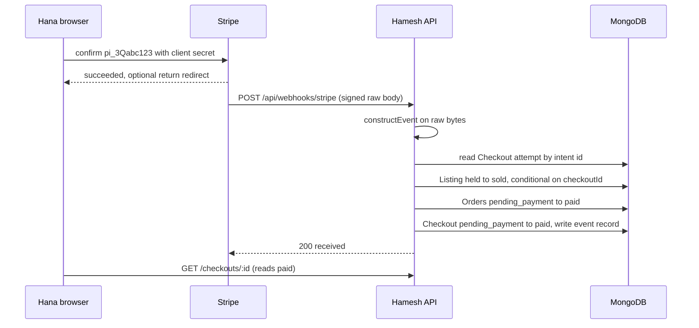

# Verify the webhook and mark orders paid

Hana has confirmed her card. Stripe holds a payment of 4,500 minor units with `metadata.checkoutId` pointing at her Checkout, and her browser may or may not come back. Hamesh still has one Checkout in `pending_payment`, two Orders in `pending_payment` and two Listings held by that Checkout. Something on the server has to receive Stripe's event, decide whether it is genuine, and move those records once.

That something is a webhook route with three jobs. It proves the request came from Stripe by checking a signature over the raw bytes. It compares the event against the attempt Hamesh stored, so a succeeded intent for a different amount or a different Checkout changes nothing. Then it performs the paid transition under conditions that make a second delivery harmless. The chapter that follows tests all three against double submits, replays and mismatches.

## The signature is computed over the raw body

Stripe signs the exact bytes it sends. If any middleware parses the JSON first and the route later re-serialises the object, the bytes differ by key order or whitespace, the signature no longer matches, and every event is rejected with a message like `No signatures found matching the expected signature for payload`. Learners lose an afternoon to that error, and the fix is route order rather than cryptography.

```js
// server/src/app.js (order matters; other routes omitted)
app.post(
  "/api/webhooks/stripe",
  express.raw({ type: "application/json" }),
  stripeWebhookHandler
);
app.use(express.json()); // registered after the webhook route, not before it
```

The handler builds the event from the raw buffer, the `stripe-signature` header and the signing secret:

```js
const signature = req.headers["stripe-signature"];
let event;
try {
  event = stripe.webhooks.constructEvent(
    req.body,                    // raw Buffer, not a parsed object
    signature,
    config.stripe.webhookSecret  // whsec_..., from the CLI or the dashboard
  );
} catch (err) {
  return res.status(400).send(`Signature check failed: ${err.message}`);
}
```

A failed signature returns 400 and writes nothing. Returning 200 would tell Stripe the event was handled, and it would stop retrying an event Hamesh never processed. Returning 500 for a bad signature invites a retry storm for a request that can never succeed, because the body or the secret is wrong.

## Get the signing secret from the CLI

In development, run the Stripe CLI next to the API. It opens a tunnel, prints a signing secret and forwards events to the local route:

```bash
stripe listen --forward-to localhost:4000/api/webhooks/stripe
# Ready! Your webhook signing secret is whsec_... (test mode)
```

Copy that value into `STRIPE_WEBHOOK_SECRET` in `.env`, restart the API, then pay with a test card in the browser. The CLI prints each delivered event with its type and id, which is the log you want open during the gate. Record `stripe --version` in the learning log, because command names and output formatting change between CLI releases.

The CLI can also generate events without a browser:

```bash
stripe trigger payment_intent.succeeded
stripe events resend evt_1Qabc123
```

The trigger creates its own PaymentIntent with no Hamesh metadata, so a correct handler will reject or flag it rather than pay an Order. That is a useful negative test: it proves the route refuses an event it cannot tie to a stored attempt. The resend command is how you replay a real event for the duplicate test without writing a second payment.

## Compare the event with the attempt, not with the browser

After the signature check, read the object in the event and find the Checkout through the stored attempt. Match on the intent id Hamesh saved in the previous chapter, and treat `metadata.checkoutId` as a cross check rather than as the only lookup. An event that names a Checkout but carries a different intent id is not the payment this checkout is waiting for.

Four comparisons decide whether the event may change records:

- The intent id equals `checkout.payment.paymentIntentId`.
- The event amount equals `checkout.payment.amountMinor`.
- The event currency equals `checkout.payment.currency`.
- The Checkout is still in a state that can become paid.

If the id does not match, log the event id and ignore it. If the amount or currency differs, mark the attempt `needs_review`, log both numbers with the event id, and return 200 so Stripe stops retrying. A mismatch is a Hamesh bug or a tampered record, and no number of retries will repair it. The refund that may follow is stretch lab S5, not part of this build.

## Record the event so a replay is cheap

Duplicate delivery is normal. Stripe retries when a response is slow or lost, and the CLI can resend an event on purpose. Keep a record of processed events with a unique index on the Stripe event id, so the second delivery can be recognised before it touches anything.

```js
// server/src/modules/payments/webhook-event.model.js (fields only)
{ stripeEventId, type, paymentIntentId, checkoutId, receivedAt, outcome }
// webhookEventSchema.index({ stripeEventId: 1 }, { unique: true });
```

Two orderings are possible, and both have a failure. Write the record first and a crash loses the event, because the id exists and no effects do. Write the effects first and a crash repeats them, which is safe only if the effects are themselves conditional. This build takes the second ordering and makes the effects conditional, then writes the event record at the end as evidence. The unique index on the event id still catches the common case, and the paid transition is the real guard.

Return 200 for a duplicate. A handler that returns 409 or 500 on a repeat tells Stripe to keep delivering an event that is already finished, and the retries bury the log you need for the next problem.

## Make the paid transition conditional

The move to paid is a conditional update, not a read followed by a write. A read tells you the status a moment ago. A condition tells the database to apply the change only if the document still matches, which is the only statement that survives two concurrent deliveries.

```js
const paid = await Order.updateMany(
  { checkoutId, status: "pending_payment" },
  { $set: { status: "paid", paidAt: now, paymentIntentId: intentId } }
);
```

A matched count of zero means the Orders were already paid or are no longer payable. That is information, not an error. Compare the matched count with the number of Orders expected under the Checkout, and log both. A total of two expected and one matched is a partial state that must be investigated rather than reported as success.

Order the writes so the worst crash is recoverable. Move each Listing from held to sold first, then the Orders, then the Checkout. A crash after a Listing is sold but before the Orders are paid is repaired by replaying the same event, because the Listing update is conditional on the same Checkout and a second attempt matches zero while the rest of the work continues. A crash after the Orders are paid but before the Listings are sold leaves a shop preparing a book that the database still thinks is held by a student who paid, which is the more confusing failure to untangle.

## A copy is sold once, so name the winner

The Listing is the object that decides which student owns a physical copy. The transition from held to sold must therefore carry the Checkout id, not just the Listing id:

```js
const sold = await Listing.updateOne(
  { _id: line.listingId, status: "held", "hold.checkoutId": checkoutId },
  { $set: { status: "sold", soldAt: now, soldCheckoutId: checkoutId, soldOrderId: order._id } }
);
```

Three fields are written once and never replaced: `soldAt`, `soldCheckoutId` and `soldOrderId`. They are the record of the winning sale. A matched count of zero means this Checkout no longer holds the copy, which happens when the hold expired and another student claimed it, or when a duplicate event arrives after the first pass already sold it. Neither case may fall through to a write that overwrites the other buyer's claim.

This is the failure that a bookshop adds to the usual payment problem. In a shop with many identical units, a late second payment is a refund. In Hamesh, a late second payment for a copy that Bilal now owns has nothing to refund against, because the book is not a unit count. When the conditional sold update matches zero for a line, stop the paid transition for the whole Checkout, set `needs_review` with the reason `copy_no_longer_held`, and leave the other student's sale untouched. A student may see a review state for an hour. She must never see a confirmation for a book that is on someone else's shelf.

The same rule covers the duplicate payment attempt. The attempt route in the previous chapter refuses to create a second intent once `checkout.payment.status` is `succeeded`. If a stale intent from an earlier attempt somehow succeeds, its id does not equal `checkout.payment.paymentIntentId` and the handler ignores it, then flags it for refund review. What must never happen is an Order whose `paymentIntentId` is rewritten to the newer intent, because that erases the link between the first charge and the delivered books.

If you store paid OrderLines in their own collection instead of embedding them, add a unique partial index on the Listing id so the database rejects a second paid line for one copy. This build keeps the snapshots embedded and uses the listing fields above, and either approach must be able to answer one question: which Checkout owns this copy now.

## Watch the path end to end

The sequence below is the path a successful payment takes. The browser appears once and then leaves; the rest is between Stripe and the API.



Read the diagram from the bottom. The student's page learns the outcome last, from the database. Every earlier arrow is a server decision with a stored record behind it.

## The success page reads, and the gate proves it

The payment status route returns the stored state and nothing more. It is scoped to the buyer, so Bilal cannot read Hana's status by guessing a Checkout id, and it never writes. The client shows `pending_payment` with a note that confirmation can take a few seconds, `paid` with the two shop Orders, or `needs_review` with a plain sentence about a payment that is being checked.

Write these three tests before the route is finished. The first two prove the properties the gate asks for; the third proves that a replay is harmless.

```js
it("marks the checkout paid once when the same event arrives twice", async () => {
  const first = await postSignedWebhook(fixtureEvent);
  const second = await postSignedWebhook(fixtureEvent);

  expect(first.status).toBe(200);
  expect(second.status).toBe(200);
  expect(await paidOrderIdsFor(checkoutId)).toEqual([northStreetOrder, campusShelfOrder]);
  expect(ordersAfterSecond[0].paidAt).toEqual(ordersAfterFirst[0].paidAt);
});

it("rejects an unsigned body without changing records", async () => {
  const res = await postWebhookWithBadSignature(fixtureEvent);
  expect(res.status).toBe(400);
  expect(await paidOrderIdsFor(checkoutId)).toEqual([]);
});

it("flags an amount mismatch instead of paying the orders", async () => {
  const event = fixtureEventWithAmount(4100);
  const res = await postSignedWebhook(event);
  expect(res.status).toBe(200);
  expect(await checkoutState(checkoutId)).toBe("needs_review");
  expect(await paidOrderIdsFor(checkoutId)).toEqual([]);
});
```

The assertions compare stored values, not response text. A handler can return a convincing 200 while writing nothing, and it can write twice while returning one body. The next chapter turns these three tests into gate evidence and adds the double submit and the second buyer race on top.

## Where this leaves the build

After this chapter a paid Checkout has two paid Orders with snapshots intact, two Listings that name the winning Checkout, an intent id shared by all three records, and an event record with the Stripe event id. An unpaid Checkout still has its hold deadline and a route that refuses to create a second payment. A mismatched or late event lands in `needs_review` with the event id in the log, which is enough for a mentor to trace what happened without re-reading the code.

The paid state is also the gate that lets each shop Order show its collection code. Until the transition happens, the student page can show the shop name, the pickup window and the frozen grade, and it must leave the code blank. Once both Orders are paid, module 21 renders one short code per Order, checked at the counter by the shop owner. A code shown on a pending Order would invite a shop to release a book for a payment that never arrived, which is the same mistake as marking an Order paid from the success page.
