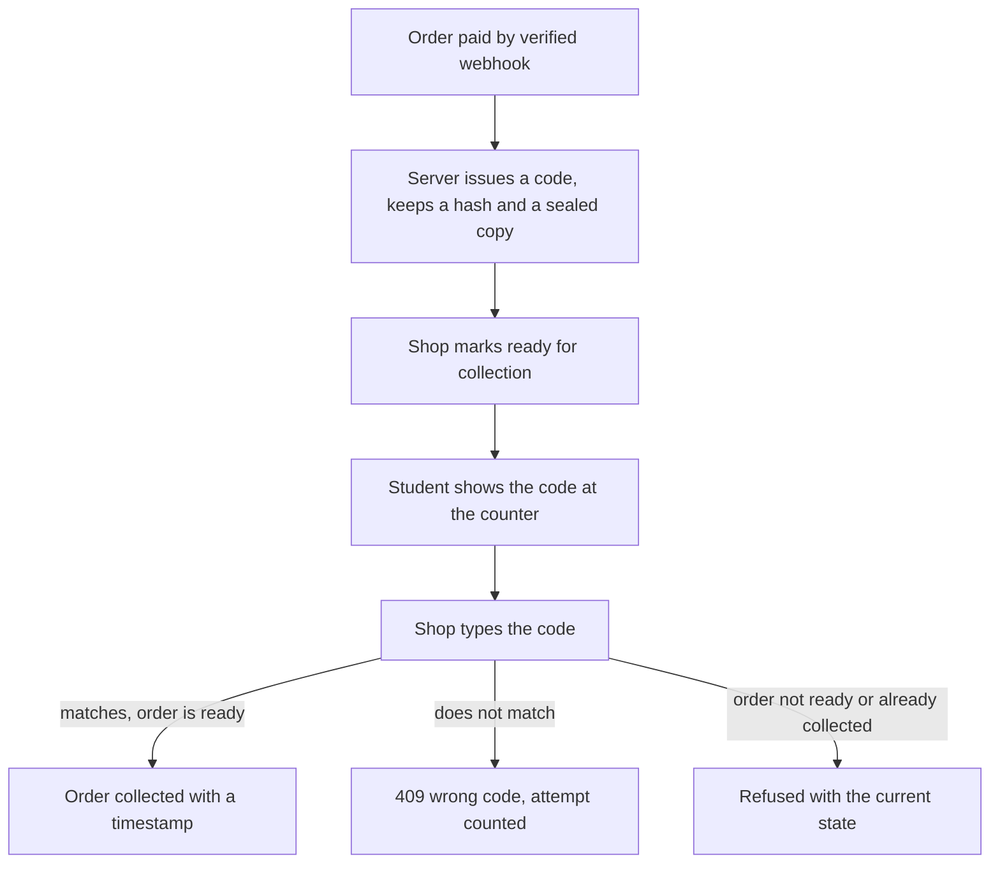

# Collecting a book from a shop

Hana paid for four books on Tuesday night, in three orders, from three shops. By Thursday she has two of them and needs the third before her seminar at 10:00. The third is a Good copy of the statistics guide waiting behind the counter at Campus Shelf, in a building where her phone loses signal at the door. The payment is finished. The book has not moved. Between those two facts sits the only screen in this course where software meets a physical handover, and it is the screen this module builds.

The question at the counter is short. This person is holding a phone with an order on it, and there is a book with that order's name on it. Is this the right person, and is this the right book? Everything in the module exists to answer that question in under a minute, with a part time member of shop staff who has never seen the app before.

## Paid is not ready

A paid order means the money arrived and the copy is sold. It does not mean the book is on the collection shelf. A shop receives a paid order, finds the copy, checks that the condition still matches what was promised, puts it in a bag, and only then can it be handed over. Between payment and that moment there is real work, and sometimes there is a problem: the copy is not where it should be, or a page is torn, or the shop is closed for two days.

If the student's page says "ready to collect" at the moment payment completes, the student travels to a shop where nobody has looked for the book. So the order has two states after payment, and the shop owns the second one. `paid` becomes `ready_for_collection` when the shop says the copy is on the shelf, and `collected` when the copy has changed hands. The student's page reports whichever state the database holds, and it does not guess.

The reverse mistake is just as common. A shop that treats a paid order as collected has no record of the handover, so a student who never came leaves a book in limbo and a shop that cannot decide whether to return it to the shelf. The collected transition has to be a deliberate act with a timestamp and, ideally, the person who performed it.

## Why a code, and why on the server

The naive handover is a name. The student says a name, the staff member finds a bag with that name, and the book goes over the counter. That fails in a predictable way at a university bookshop in the first week of term: two students with the same name, a student collecting for a friend, and a student who has an old order for the same title and assumes this is the one. A name is not an identifier and it is not secret.

A short collection code fixes the first problem and most of the second. Hamesh generates a code per order after payment, shows it to the student on the order page, and asks the shop to type it before it marks the order collected. The code is short because someone reads it aloud at a counter, and it is checked on the server because a code checked in the browser proves nothing: anyone can change what the browser says.

The important word is "after payment". A code shown on a pending order is a code that a shop could accept for money that never arrived, and a shop that hands over a book against an unpaid order has given away a book it cannot recover. Issue the code only from the verified payment path in module 20, and treat a missing code on a paid order as a bug to fix rather than a case to work around.

Notice what the diagram does not contain. There is no step where the student's phone tells the server that a book was collected. The phone shows a code; the shop's authenticated action is what changes the record. That asymmetry is the point.

## What the student sees

The student's order page is a receipt that keeps updating. It shows the books with the condition snapshot from module 19, the shop, its area and pickup notes, the amount paid, the order state, and, once the order is ready, the collection code and the shop's opening hours. It also says what to bring and what happens if she cannot come this week.

Two details matter more than they look. The first is that the code must be readable without a network request at the counter, so render it from the last successful response and do not refetch on every glance. The second is that the page must not imply a single trip when the order spans shops: three orders from three shops are three separate collections, each with its own code and its own hours.

A student who has lost the page can sign in again and read the same code, which is why the code is stored against the order and sealed with a server key, rather than generated in the browser. That also means the code is not a password: it authorises one handover of one order that has already been paid for, and the worst outcome of a guess is a book that goes to the wrong person. That is bad enough to need attempt limits, which module 21.2 builds.

## What the shop sees

The shop's order list is a queue of paid work. Each row shows the order, the student's first name, the copies with their snapshot grades and defects, and the state. The shop opens one, finds the copy on the shelf, checks it against the snapshot, and marks it ready. Later, when the student arrives, the shop types the code into the same page and the order becomes collected.

The shop must never see the code in its list. If the shop could read the code, the check would be theatre: the staff member would compare a value they already have with a value they already have. The code exists to be known by the student and verified by the server, and the shop's job is to ask for it and type what it hears.

The shop's screen also needs the buyer's contact details and nothing else from the buyer's account. A shop that can read the student's other orders, budget or reading list has been given data it does not need for a handover, and the authorisation matrix from module 8 already says so.

## The awkward cases

The counter throws up awkward cases faster than the happy path. A student arrives before the shop has marked the order ready, because a notification arrived early or because she assumed payment meant ready. The shop should be able to mark it ready on the spot if the book is there, which is one button, and the student should see the state change on her own page.

A student arrives with no battery and no code. The shop cannot verify anything, and the honest answer is that the order stays ready and the student comes back, or signs in on the shop's own device. A policy that lets staff skip the code silently turns the code into decoration; if the project allows an override, it should be an owner-level action with a reason recorded, and it should be rare enough to be visible in a report.

A student sent the wrong order's code, or a code from last term, gets a mismatch. The response should say the code does not match this order and leave the order in its current state. It should not say "invalid", because "invalid" hides the difference between the wrong code and the wrong order, which is exactly the difference the staff member needs to resolve it.

The last case is the one that costs money. The shop marks an order collected, and the student says she never received it. Without a timestamp, the staff member's name and the order state history, the shop has no evidence either way. The collected transition therefore writes who did it and when, and the history is append only rather than a status field that gets overwritten.

## Why pickup, and what it costs

This module stays with collection at the shop and leaves delivery out, which is a product decision worth defending. Pickup removes an address book, a courier integration, a delivery fee model and a set of disputes about parcels left in the wrong place. For a student buying a used textbook from a shop she can walk to, the trip is also part of the value: she can look at the copy before she takes it.

The cost is that the trip is a real constraint. Shops close early, some are inside buildings that need a student card, and a student with a job may only be able to come on Saturday. The pickup notes field on the shop exists for those facts, and the collection page has to show them next to the code rather than on another screen.

It also means the marketplace's promise is not "you will get the book tomorrow". It is "the book is waiting at this shop, and here is what you need to collect it". That is a smaller promise, and a marketplace that keeps a smaller promise is worth more than one that makes a larger promise it cannot check.

## What the build covers

Module 21 builds the checkout page with the Payment Element, the student order pages, the shop order pages, the code, and the two transitions that follow payment. It finishes with the Week 3 demo: a reading list, matched across shops, paid with a test card, split into orders, marked ready at one shop and collected with a code.

The next chapter builds those screens and the server rules behind them, including the hash, the sealed copy, the attempt limit and the failing test that proves the code is checked where it counts.
