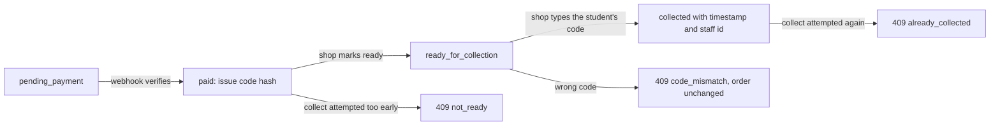

# Order pages, collection code and ready-for-collection

Three screens and one server rule make up this chapter. The checkout page turns a held set of copies into a paid payment. The student order page reports what happened and, once the shop is ready, shows the collection code. The shop order page is a queue with two buttons on it, and the server rule is that the code is compared on the server against a stored hash, never in the browser.

Build them in the order the student meets them, because each screen reads state the previous one wrote. A checkout page tested against a hand written order will pass while the payment path is broken, and a collection code tested against a hand issued value will pass while the paid transition never issues one.

## The checkout page owns no truth

The Payment Element is Stripe's card form, mounted inside your page with a client secret the server already created in module 20. The page collects details and confirms the intent. It does not decide that anything was paid, and it does not write an order status.

```ts
// client/src/pages/Checkout.tsx (partial)
const intent = await api.post(`/checkouts/${checkoutId}/payment-intent`);
const elements = stripe.elements({ clientSecret: intent.clientSecret });

async function pay() {
  // The server already fixed the amount from order-line snapshots.
  const result = await stripe.confirmPayment({
    elements,
    confirmParams: { return_url: `${location.origin}/checkouts/${checkoutId}/return` },
  });
  // On error the intent stays unpaid; on success the webhook marks paid.
}
```

Two rules follow from that comment. Never send an amount from the page, and never render a "paid" state from the confirmation result alone. The return page calls `GET /checkouts/:checkoutId` and shows `pending_payment`, `paid` or `needs_review`, which is the same reader only rule module 20 established.

Put the mounted element inside the same 360 pixel column as the rest of the storefront, above a short summary of the orders it covers. The student is approving a total for copies from two or three shops, so the summary groups the lines by shop and shows the collection fee per shop. A card form with no context is the last place to discover that one of the four books comes from a shop across the city.

## The student order pages

The student needs two reads: a list of their orders and one order in detail. Both are scoped by the session, and neither accepts a student id.

```ts
router.get("/orders/my", requireAuth, requireRole("student"), listMyOrders);
router.get("/orders/:orderId", requireAuth, requireRole("student"), getMyOrder);
```

The detail response is where the module 19 snapshot pays for itself. It returns the condition and price the student agreed to, not the copy's current state, and it adds the collection facts once they exist.

```ts
type StudentOrderView = {
  orderId: string;
  shop: { name: string; area: string; pickupNotes: string };
  status: "pending_payment" | "paid" | "ready_for_collection" | "collected";
  placedAt: string;
  lines: {
    listingId: string;
    title: string;
    isbn13: string;
    editionLabel: string;
    grade: { code: string; label: string; rank: number };
    defectNotes: string;
    priceMinor: number;
    photoUrl: string | null;
  }[];
  total: { subtotalMinor: number; feeMinor: number; totalMinor: number; currency: string };
  collection: {
    code: string | null;      // decrypted for this student only, when ready or collected
    readyAt: string | null;
    collectedAt: string | null;
  };
};
```

The `code: string | null` field is the whole security rule in one line. It is null until the order is ready, and the route builds it by unsealing the stored value for the student who owns the order. It never appears in a list response, because a list is scrolled in public and a code in a list is a code on a stranger's screen.

Render the code as large text with letter spacing, and also as words a person can read aloud: "K seven, M four, T two". Someone reading a phone screen to a staff member in a noisy shop benefits from that second form, and it costs one line of code.

## The shop order pages

The shop needs a queue and two actions. The queue is filtered by state so that the staff member sees paid work first, and the two actions are the only writes in this module.

```ts
router.get("/shop/orders", requireAuth, requireRole("shop"), listShopOrders);
router.patch("/shop/orders/:orderId/ready", requireAuth, requireRole("shop"), markReady);
router.post("/shop/orders/:orderId/collect", requireAuth, requireRole("shop"), collect);
```

Each route resolves the caller's shop from stored ownership, exactly as module 9 did for the shop profile, and then queries with that shop id in the filter. The order id in the path is a lookup key, not a permission. A shop that guesses another shop's order id gets a not found response, because the query never matched.

The queue row shows the order, the student's first name, the copies with their snapshot grade and defects, and the amount. It does not show the collection code, and it does not show the code hash. Give the shop what it needs to find the book on the shelf and nothing that lets it skip the check.

## Issue the code from the paid transition

The code is generated in the server path that marks orders paid, which is the verified webhook from module 20. Generating it there means a pending order cannot have a code, and a `needs_review` order cannot have one either, because that path never reaches the paid write.

```ts
// six characters from an alphabet without 0, O, 1, I, so it can be read aloud
const ALPHABET = "23456789ABCDEFGHJKLMNPQRSTUVWXYZ";

export function issueCollectionCode() {
  const code = randomCode(ALPHABET, 6);        // 32^6 possibilities
  return {
    codeHash: hmacSha256(code, config.collectionCodePepper), // verification
    codeSealed: seal(code, config.collectionCodeKey),        // re-display only
  };
}
```

The plain code is never stored. Two derived values are. The hash exists so the server can check what a staff member types without ever holding a value an attacker could use. The sealed value exists because the student has to be able to read the code again: she will lose the tab, change phones, or open the page at the counter two days later, and a code shown once and gone forever is a code that turns into a support call.

A sealed value is the plain code encrypted with a key that lives only in the server environment. Decrypt it on the student's own order read, and nowhere else. The shop routes never project either field, which is why the queue cannot leak what it must not know. If your project prefers to store only the hash and reissue on demand, that is a defensible alternative: it costs a support action every time a student loses the page, and it removes one field from the database.

The owner reset rotates both values, records the reason and the account, and invalidates the old code immediately. Treat it as a rare action with a visible trail rather than a convenience button, because it is the only path that hands a book over without the original code.

The arithmetic is worth doing once so you can defend the length. A 32 character alphabet with six positions gives about 1.07 billion codes. With five attempts allowed per order, the chance of guessing one order's code is roughly five in a billion, and per order attempt limits make a bulk attack across many orders slower than a person reading codes aloud at a counter. Check the arithmetic yourself and write it in the learning log; the numbers are illustrative of the design, not a security proof.

```diff
 export interface OrderDoc {
   status: "pending_payment" | "paid" | "ready_for_collection" | "collected";
   paidAt?: Date;
+  collection?: {
+    codeHash: string;              // verification only, never reversible
+    codeSealed: string;            // ciphertext, decrypted for the owner only
+    issuedAt: Date;
+    attempts: number;              // wrong codes seen at the counter
+    readyAt?: Date;
+    collectedAt?: Date;
+    collectedByUserId?: Types.ObjectId;
+  };
 }
```

## Compare on the server, and compare carefully

The collect route takes the code from the request body, hashes it with the same pepper, and compares the two hashes. Hashing both sides keeps the comparison at a fixed length, which lets you use a constant time comparison instead of `===`. Node exposes `crypto.timingSafeEqual` for exactly this, and it throws if the buffers differ in length, which is why the hash first step matters.

```ts
const submitted = hmacSha256(String(req.body.code ?? "").trim().toUpperCase(), pepper);
const stored = Buffer.from(order.collection.codeHash, "hex");
const matches = submitted.length === stored.length && crypto.timingSafeEqual(submitted, stored);
```

A plain string comparison leaks timing, which for a six character code at five attempts is not the attack that will find you, but the habit is cheap and the reviewer will ask. Trim and uppercase the input before hashing, because a staff member typing on a phone keyboard will type lowercase and a stray space, and a code rejected for capitalisation teaches the shop that the check is unreliable.

Write the failing test before the route exists. It asserts the thing that matters: a wrong code changes nothing.

```ts
it("refuses a wrong code and leaves the order ready", async () => {
  const res = await request(app)
    .post(`/shop/orders/${orderId}/collect`)
    .set("Authorization", shopToken)
    .send({ code: "ZZZZZZ" });
  expect(res.status).toBe(409);
  expect(res.body.code).toBe("code_mismatch");
  const order = await Order.findById(orderId);
  expect(order!.status).toBe("ready_for_collection");
  expect(order!.collection!.attempts).toBe(1);
});
```

Then the passing case, which must write a timestamp and the staff account, and the second attempt at collecting the same order, which must return `already_collected` rather than overwrite the first timestamp. Both outcomes are ordinary HTTP conflicts, not server errors.

## Two transitions, each with a predicate

Every state change in this chapter is a conditional update whose filter includes the state it is allowed to leave. Marking ready moves `paid` to `ready_for_collection` and writes `readyAt`. Collecting moves `ready_for_collection` to `collected` and writes the timestamp and the staff id. Neither uses an unconditional `updateOne({ _id })`.

That predicate is what makes a double tap safe. Two staff members can press Collect at the same moment on two devices; one update matches the ready state, the other matches nothing, and the second response says the order is already collected. If the update were unconditional, both would succeed, the second timestamp would replace the first, and the record of who handed the book over would be whoever pressed last.



Note that the wrong code path does not change the state at all apart from the attempt counter. An order that reverts to `paid` because somebody typoed at the counter would send the student back to the beginning of a journey she had already completed.

## Limits, locks and the awkward afternoon

Count failed attempts in the same conditional update that checks the code, and refuse once the count passes five. The refusal should be a distinct code, `collection_locked`, with a message that tells the staff member to ask the shop owner, rather than another `code_mismatch`. Without a limit, a code is guessable by a patient person with a phone and an order page. With a limit and a lock, the same person needs an owner to intervene, and the owner's reset is logged.

The shop owner needs one more screen action for the cases the code cannot serve. A student with no battery, a code that was never delivered, an order marked ready for a copy that turned out to be damaged: each of those wants a documented path. Keep the core build to a single owner level rotation of the stored code values with a reason field, and record that the other cases are handled by cancellation and refund, which module 20 left as stretch work.

## Check the pages on a phone

The checkout form is the riskiest screen on a phone, because it is the one where an interrupted connection costs the student a second attempt. Test it at 360 pixels, with the keyboard open, and with a slow connection. Then test the return page after closing the tab and reopening it: it must show the state the database holds, which after a successful payment is `paid`, and after a late success on a lost copy is `needs_review`.

Read the student order page with a screen reader. The collection code must be announced as characters, not as an unpronounceable word, and the state must be a word in the text rather than a coloured bar. Read the shop queue at 360 pixels as well, because plenty of shops run the counter on a phone.

```quiz
type: mcq
id: books-collection-q1
question: Where is a collection code compared with the one on the order?
options:
  - "In the shop page, against the code in the order response"
  - "On the server, against the stored hash"
  - "In the student page, which sends a collected flag after the tap"
  - "In the payment intent metadata, which Stripe compares at confirmation"
correct: 1
explanations:
  - "A code the shop can read is a code the shop can skip."
  - "Only the server holds the hash and can refuse a wrong code."
  - "A browser flag proves nothing about who is holding the book."
  - "Stripe has no knowledge of a bookshop's shelf or a handover."
```

The next lesson is the gate. It runs the Week 3 demo end to end and asks you to show the states, the code, the refusals and the timestamps rather than a green screen.
