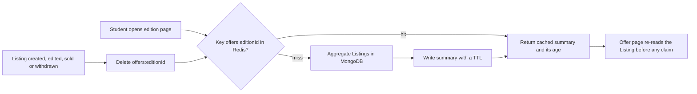

# A sold copy in a stale offer summary

Bilal has 300 MB of data left on his phone and twenty minutes before his statistics lecture. He opens the page for a statistics guide that his reading list accepts. Hamesh answers quickly and shows three copies: a Very Good copy at North Street Books for 2,600 minor units, a Good copy at Campus Shelf for 1,900, and an Acceptable copy at Corner Books for 1,400. He taps the 1,900 copy. The offer page opens with a grey badge that says sold.

A student called Rana bought that copy 21 minutes earlier. Nothing in the interface lied on purpose. The list Bilal read came from a cached offer summary, and no write path cleared that summary when the copy sold. He now believes the cheapest copy is gone for good, he does not know that a Good copy from another shop may appear tomorrow, and he has spent four minutes and some of his data on a dead end.

This chapter is about that gap. It is also about the second read path in this module, the search box, because both problems have the same shape: a student asks a question that Hamesh already knows how to answer, and the answer is computed from scratch under time pressure. The shape is familiar, and the fix for each is not.

## The offer summary is a view, not a record

Module 14 built `GET /editions/:id`. It returns the shared Edition fields (title, authors, ISBN, publisher) and an offer summary: for each condition grade, how many copies are available, the lowest price in minor units, and which shops hold them. That response is computed from Listing documents every time it is requested. The Listing is the record. The summary is a view.

The aggregation behind the view does three things. It matches Listings by `editionId` and an available status, it groups by `gradeRank` to get a count and a minimum price, and it looks up the shop name so a student knows where to collect the book. With the seed data of three shops and about forty copies, the whole thing finishes in single digit milliseconds on a laptop.

A view is a good thing to cache precisely because it is not the truth. If the cache is lost, nothing is lost. The database can rebuild it. That is different from caching a price a student was charged or a grade a shop promised on a sold copy, which are records and must never be regenerated from a guess.

The reason to cache is traffic, not elegance. A student with a reading list of eight titles loads eight edition pages. A browse page of twenty four editions runs the aggregation twenty four times, plus a count for pagination. A reading list page that shows offers next to each item runs it again for every row. The same ten editions are read hundreds of times a day, and they change a few times a day.

## The read pattern that makes a cache worth considering

Count the writes and the reads for one popular edition. North Street lists one copy, regrades it once when the shop notices a bent corner, and sells it once. That is three writes. In the same week the edition page is opened about 400 times by students on the course. Two of those 400 readers are deciding to buy; the rest are checking a price they saw earlier, comparing a grade, or scrolling on the bus.

Nothing in those 400 requests changes between them. The aggregation output is identical until one of the three writes happens. A cache turns 400 database aggregations into a few hundred memory lookups and three rebuilds. That is the whole argument. If the summary changed on every request, a cache would add a second copy of the truth and buy nothing.

The cost is a second place where the answer lives, and therefore a second place that can be wrong. Everything else in this chapter follows from that cost, including the trap Bilal walked into.

Read the diagram from the request side first. A hit returns a stored summary and skips the database entirely. A miss pays for the aggregation once and stores the result with an expiry, so a forgotten key cannot live forever. Then read the write side, the arrow along the bottom. A Listing change deletes the key for its edition. The deletion is the arrow that makes the cache usable for a shop that regrades a copy at noon.

Notice what the diagram does not show. There is no path from the cached summary to a sale. The last box says the offer page re-reads the Listing before any claim, and that matters more than the cache does. A cached summary may be a few seconds old. A claim on a physical copy may not be.

## The stale window and the four writes that close it

Redis stores a string value under a key, and the `SET` command takes an expiry in seconds through its `EX` option. A key like `offers:66f1c2a4b7d3e8a91c0d4f22` with a value of a few kilobytes and `EX 120` is the entire data model. When the key is gone, the next reader rebuilds it. When the key is present, readers share one answer.

A time to live alone is not enough, and the arithmetic shows why. Bilal tapped a copy that sold 21 minutes ago. A 120 second TTL would have cleared that summary 19 minutes before he opened the page. So a TTL by itself does not explain his experience. Either the summary had no invalidation and a much longer TTL, or the sold write happened in a code path that never touched the cache. Both are ordinary bugs, and both produce the same symptom: a summary that outlives the facts it summarises.

Four writes change what a summary should say, and each one needs to delete the key for the affected edition:

- A shop publishes a new copy, which adds a row and may lower the minimum price for a grade.
- A shop edits a copy, changing its price, its grade, its photos or its defect notes.
- A copy sells, which removes it from availability for everyone else.
- A shop withdraws a copy from sale, which also removes it from availability.

The fourth is the one learners forget, because a withdrawal feels like a private action. It is not. A student reading the summary sees an offer that the shop has decided not to honour, and the shop is the only party who knows. A withdrawal that leaves the summary in place pushes that student toward a pickup that cannot happen.

There is a fifth write, easy to miss because it is not a shop action: a hold. When a checkout holds a copy for fifteen minutes, the copy is not available to another student, and a summary that still counts it will send two students to the same single copy. Whether holds appear in the offer summary is a product decision. If they do, the hold write invalidates the key as well. If they do not, the summary must say that a copy may be held by another student at checkout.

## What a cached summary may and may not promise

The cached summary may promise a price and a count as of a moment a few seconds ago. It may not promise that a copy is still available at the instant a student taps it. Two rules keep that boundary honest, and both are cheap to implement.

The first rule is that the checkout path never reads the cached summary. It reads Listings, with predicates, as module 19 taught. The cache is for reading, never for deciding. A route that builds a cart from a cached offer can add a copy that sold two minutes ago and will fail later, after the student has chosen a pickup point and typed a card.

The second rule is that the offer page re-reads the Listing before it offers a claim. When Bilal taps the 1,900 copy, the route loads the Listing and finds `status: sold`, and it can say so in one sentence: this copy sold, here are two other copies of the same edition. That response is better than a stale list because it ends the search honestly and gives him the next step.

The choice is therefore a cache plus invalidation plus a short TTL, not a cache alone. The TTL is a safety net for a missed deletion, not the main mechanism. A missed deletion costs at most the TTL, which is why the TTL should be short enough to bound the damage and long enough to be worth having. Two minutes is a reasonable starting point for a course project; thirty seconds is defensible and costs more database reads. Write the number down in a comment next to the constant, with the reason.

What does this cost? Every write path grows a call to the cache module, and a mistake in one path is invisible until a student reports a ghost copy. What does it buy? The most requested page in Hamesh stops doing the same aggregation hundreds of times a day. When would the decision change? If offers changed every few seconds, for example in a live auction, a short TTL cache would mostly add staleness and you would move to server-sent events and a different read model.

## A number and a word need different tools

Search enters this module because the search box has the same underlying problem, not because it shares a solution. A student types something into one input. Sometimes it is an ISBN copied from a course outline, with hyphens and spaces. Sometimes it is a title half remembered from a lecture, or an author's surname.

An ISBN is an exact identifier. It has a normalised form, and after module 11 it is stored as `isbn13` with a unique index and as `isbn10` where one exists. A lookup by ISBN is a single indexed read that returns one edition or nothing. It does not want a text index, a relevance score or a ranked list. A search that runs `$text` on a valid ISBN string usually returns nothing, because the indexed fields are title and authors, not the identifier.

A title or an author is a word search, and the tool for it is a MongoDB text index with a `$text` query. The index is built once over the fields that describe the book, and the query matches stemmed words: a search for "statistic" can match a title that says "Statistics". The server can sort by a text score so the closest title appears first. Word search is fuzzy by design, and that fuzziness is what makes it useful for a half remembered title and useless for an identifier.

One search box can do both if the server decides which one to run, and the decision is testable: normalise the input with the module 11 rules, and if the result is a valid ISBN, run the exact lookup; otherwise run the text query. The input decides, not a dropdown labelled "search by". A student on a phone will not change a mode selector, and a student in a hurry will paste a number into whichever box is in front of them.

There is a trap in the text index worth stating now. A text index can be built over several fields but a collection can have only one, so the choice of indexed fields is a design decision rather than a detail. If the index covers title and authors but not the publisher, a search for a publisher name will fail, and adding a second text index is not an option. Plan the fields before the build.

## What the next lesson builds

The next lesson builds both paths against the running project. It creates one Redis module with a narrow interface, connects the edition read to a cached summary, and calls an invalidation function from the four write paths plus the hold path if holds are counted. Then it adds the text index, the ISBN normalisation branch and the search route.

The gate after that asks for evidence rather than a description: two timings for a hit and a miss, a sold copy that disappears from the summary immediately, an `explain()` output that shows the index scan, and a page that still renders with Redis stopped. Those four pieces of evidence are what separate a cache that works from a cache that happens to be running.
