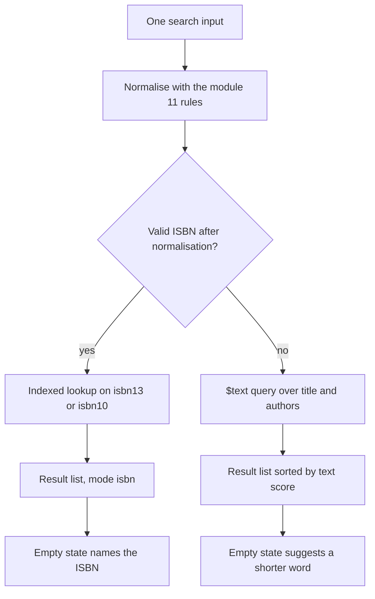

# Cache offers, invalidate on change, search ISBN and text

Bilal's ghost copy is the requirement for this build. When a copy sells, the next student who opens the edition page must not see it. When a shop regrades a copy, the next page load must show the new grade and price. When Redis is not running, the edition page must still load, more slowly and without a cache, instead of returning a 500 error that looks like a database outage to a student on a bus.

The build has two halves that share a folder and nothing else. The cache half is a small module with three functions and a set of call sites that must not be forgotten. The search half is one route that reads the shape of its input and chooses between an exact identifier lookup and a word query. Keep them in separate files, because the cache half will be reviewed by reading its call sites and the search half will be reviewed by reading its query plan.

## The interface before the implementation

Write the cache module as an interface first, because the interface is what the rest of the server is allowed to know. It exposes one TTL constant, one key builder, one read function that can fall back, and one invalidation function that never throws into a write path.

```js
// server/src/modules/cache/offer-cache.js: the exported surface
// OFFER_TTL_SECONDS = 120
// offersKey(editionId)                    -> "offers:<editionId>"
// readOfferSummary(editionId, loadFromDb) -> { summary, source }; body below
// invalidateOffers(editionId)             -> void; body in the call site section
```

The read function is the only place that talks to Redis for offers. Routes call `readOfferSummary`, never the client. That single door matters for the gate: if a learner wants to prove that a sale clears the summary, they can grep one call site and one module instead of guessing which route forgot.

The key includes the edition id and a prefix, not the student, the grade filter or the page number. The summary is the same for every reader of the edition, and a key that varies by reader multiplies the cache without dividing the work. Grade filters and price ceilings are applied after the summary is read, in memory, on a small array. That is cheap and it keeps one key per edition.

Name the TTL in one place and write the reason next to it. A comment such as `// 2 minutes bounds a missed invalidation; lower it if ghost copies are reported` is the kind of note a reviewer can act on. A bare `120` with no reason is a number that will be changed by the next person without knowing what it protects.

## The read path and the Redis-down fallback

A cache call can fail in more ways than a database call: Redis is not running, the socket hangs, the key holds a value from an older code version, or the server is up but refuses commands because it is low on memory. Each of those must end in an answer, not an exception that bubbles into the route.

```js
// read path inside readOfferSummary (partial)
let cached = null;
try {
  cached = await redis.get(offersKey(editionId));
} catch (err) {
  cacheFailureCount += 1;
  logger.warn("offer cache read failed", { editionId, code: err.code });
}
if (cached) return { summary: JSON.parse(cached), source: "cache" };

const fresh = await loadFromDb(editionId);          // the aggregation from module 14
try {
  await redis.set(offersKey(editionId), JSON.stringify(fresh), "EX", OFFER_TTL_SECONDS);
} catch (err) {
  cacheFailureCount += 1;                            // a failed write is not a failed request
}
return { summary: fresh, source: "database" };
```

Three properties are worth checking in review. The failure is logged, not thrown. The database path runs whether or not the cache write succeeds. And the response carries a `source` field so the gate can show a hit and a miss without reading Redis from the outside.

Set a short command timeout on the Redis client as well. A closed port fails fast, but a half open connection can hang a request for as long as the default timeout allows, and a page that hangs for thirty seconds is worse for a student than a page that renders from MongoDB in forty milliseconds. With ioredis, `commandTimeout` and `connectTimeout` in the client options are the two settings to read before you choose a number.

Negative caching is a separate decision, and the course leaves it out. Caching "this edition has no offers" saves the aggregation for a book nobody has listed, and it also caches a moment when a shop is about to publish the first copy. The want-list feature makes that moment common, so a negative entry is more likely to hide a new copy than to save work. If you add it later, give it a shorter TTL than the positive entry and say so in the code.

## Four call sites, and one of them is a hold

The invalidation call goes after the write that changed the Listing, and it takes the edition id from the stored Listing rather than from the request body. A request body can carry an edition id that the shop does not own, and a client that sends the wrong id would clear someone else's cache while leaving its own entry stale.

```js
// the sell transition, after the conditional update reports a match
const sold = await Listing.findOneAndUpdate(
  { _id: listingId, status: "held", "hold.checkoutId": checkoutId },
  { $set: { status: "sold", soldAt: new Date() }, $unset: { hold: "" } },
  { new: true }
);
if (sold) await invalidateOffers(sold.editionId);
```

The four required call sites are the four writes from the previous chapter: create, edit, sell and withdraw. Each is a different route, and each has a different failure mode when the call is missing. A missing invalidation on create hides a new copy until the TTL ends, which delays a want-list student by two minutes. A missing invalidation on edit shows a price that no longer exists, which is the version of the bug that produces a complaint. A missing invalidation on sell produces Bilal's ghost copy. A missing invalidation on withdraw sends a student to a shop for a copy the shop has pulled.

If your build counts held copies as unavailable, add the hold write as a fifth site. Then decide what the summary says about a held copy and use the same words on the page. A summary that counts a held copy as available while checkout refuses it teaches the student that Hamesh is unreliable, even though the hold is working exactly as designed.

The invalidation function must swallow its own errors. A shop pressing Save should not see a 500 because Redis restarted between the write and the delete. Log the failure, let the short TTL repair the summary, and keep the write committed. This is the one place where an ignored error is correct, and it is worth a comment that says why.

```js
// server/src/modules/cache/offer-cache.js
export async function invalidateOffers(editionId) {
  try {
    await redis.del(offersKey(editionId));
  } catch (err) {
    // The Listing write already committed. A stale summary for one TTL is
    // better than a failed shop action, so log and let expiry repair it.
    logger.warn("offer cache delete failed", { editionId, code: err.code });
  }
}
```

## Write first, then delete, and what that still leaves

The order is write then delete, never delete then write. If you delete first, every reader between the delete and the database write rebuilds the summary from the old Listing and stores it again. Deleting after the write means the only readers who can store an old value are the ones who read the database before the write and reached Redis after the delete.

That window is small and real. Picture three steps. A reader misses the key and runs the aggregation at 12:00:00.100, getting the old price of 2,400. A shop saves the new price of 1,900 at 12:00:00.150 and the delete lands at 12:00:00.160. The reader writes its old summary at 12:00:00.170, and now the stale price has a fresh 120 second life.

Three remedies exist, and the course expects you to choose one and defend it. The simplest is the TTL you already set: the wrong price lives at most two minutes, and no extra code is needed. A second is a delayed second delete, scheduled a second after the write, which catches most read-repair writes without a guarantee. A third is a version stamp, where the Listing write increments a per-edition version and the cache stores it, so a write with an older version is refused. The third is the most correct and the most code.

Take the TTL bound for the core build and write the limitation in `docs/EVIDENCE.md`. A two minute stale price on a used book is a minor harm, and a version stamp is a lesson in distributed state that this project does not need yet. State the choice in one sentence so a reviewer does not read it as an oversight.

The alternatives are worth knowing because a colleague will raise one. An HTTP cache with `Cache-Control: max-age=60` and an ETag offloads the read to the browser and any proxy, which is genuinely cheaper than Redis. It also cannot be invalidated on a phone that already holds the response, and the student who most needs the fresh price is the one who loaded the page a minute ago. For offers on single copies, a server side key with a delete is easier to reason about.

## One search box, two query shapes

The search route takes one string and returns a list of editions. The list may contain one item when the input was an ISBN, which keeps the client simple: one result shape, one rendering path, one empty state.

```js
// GET /search?q=<string>&limit=20
router.get("/search", searchEditions);

// server/src/modules/search/search.routes.js (branch only)
const normalised = normaliseIsbn(req.query.q ?? "");
if (normalised.ok) {
  const edition = await Edition.findOne({ isbn13: normalised.isbn13 }).lean();
  return res.json({ mode: "isbn", items: edition ? [edition] : [] });
}
// otherwise a word search over title and authors
```

The `mode` field is not decoration. It lets the client say "no edition with that ISBN" instead of "no results", which are different messages to a student holding a course outline. It also gives the gate a way to prove which branch ran without reading logs.

Normalisation comes from module 11 and must be the same function the listing form uses. A second copy of the check digit rule in the search module will drift, and the drift will appear as an ISBN that can be listed but not searched. Import the function; do not reimplement it.

The text branch is a `$text` query with a score projection, so the closest title sorts first:

```js
const items = await Edition.find(
  { $text: { $search: req.query.q } },
  { score: { $meta: "textScore" }, title: 1, authors: 1, isbn13: 1, workId: 1 }
)
  .sort({ score: { $meta: "textScore" } })
  .limit(20)
  .lean();
```

A `$text` query matches whole stemmed words, not prefixes. A student who types "statis" gets nothing, and a student who types "statistics" gets the statistics guide. That is a real limitation of the mechanism, and the honest response is to say so in the empty state rather than to bolt a regular expression onto the query, which would abandon the index and scan the collection.

The index itself is declared once on the schema, and the field list is the design decision:

```js
editionSchema.index(
  { title: "text", authors: "text" },
  { weights: { title: 6, authors: 3 }, name: "edition_text" }
);
```

Weights make a title match worth more than an author match, which is the right default when a student types a book name. `authors` is an array in the Edition model, and a text index handles an array field. A collection can hold only one text index, so if you later want to search publishers, you add the field to this index rather than creating a second one.



The diagram is the decision, not the data flow. Notice that the input is classified before any query runs, and that both branches end in the same result shape with a different empty state. A learner who builds the dropdown version of this feature has moved the decision to the student, who cannot know whether the string on their course outline counts as a number.

## Prove the index is used

The gate asks for `explain()` output, so run it before you believe the query is fast. In `mongosh`, explain the text query with execution statistics and read two fields: the winning plan stage and `totalDocsExamined`. A text query reports a text stage, and the documents examined should be close to the number of matches rather than the size of the collection. The ISBN branch should report an `IXSCAN` on the `isbn13` index with one document examined.

Then explain the query you were tempted to write. A `find({ title: /statistics/i })` scans every edition, and the explain output says so. Keeping that output next to the indexed output is the clearest evidence a reviewer can read, and it takes one minute to capture.

The failing test comes first, and it is the same test the gate asks for:

```js
it("drops a sold copy from the offer summary", async () => {
  const before = await agent.get(`/editions/${editionId}`);
  expect(countFor(before.body, 2)).toBe(1);       // one Good copy

  await markSold(listingId, checkoutId);

  const after = await agent.get(`/editions/${editionId}`);
  expect(countFor(after.body, 2)).toBe(0);
});
```

It fails while the invalidation call is missing and passes when the call site is wired. Add a second test that stops Redis, requests the same page and expects a 200 with `source: "database"`. Those two tests cover the two ways this build usually breaks: a forgotten delete, and a cache treated as a hard dependency.

```quiz
type: mcq
id: books-cache-q1
question: "A shop lowers a price at 12:00. The write saves, then deletes the key. A reader loads the old summary in that gap and stores it again. What limits how long the wrong price survives?"
options:
  - "The TTL on the key, which expires the stale value"
  - "A second delete queued behind the write transaction"
  - "The next write to the same Listing clearing the key"
  - "A Redis check that rejects values older than the delete"
correct: 0
explanations:
  - "The reader wrote the old summary after the delete, so only expiry ends it."
  - "The write deletes once and returns; no second delete is scheduled by default."
  - "The next write may be hours away, which is exactly the exposure here."
  - "Redis stores whatever it is given and keeps no record of the delete time."
```

## Acceptance criteria

- The edition route returns `source: "cache"` on the second request within the TTL and `source: "database"` on the first.
- A sold, regraded, repriced or withdrawn Listing disappears from the summary on the next request, with no TTL wait.
- `GET /search?q=` with a hyphenated ISBN returns one edition and `mode: "isbn"`; with a title word it returns matches and `mode: "text"`.
- The text query explain output shows a text stage, and the ISBN lookup shows an index scan with one document examined.
- With Redis stopped, the edition page and the search route both return 200 and the server log records the cache failure once per request, not once per retry.
- `invalidateOffers` never throws into a write path, and its failures are logged with the edition id.

The last piece of this module is the gate, and it is evidence driven. Two timings, one invalidation run, one explain output, one stopped Redis, one ghost copy that does not appear. Bring those five artefacts and the module is done. The next module moves work that does not belong in a request at all onto a worker, and it will reuse the Redis connection you have just proved you can live without.
