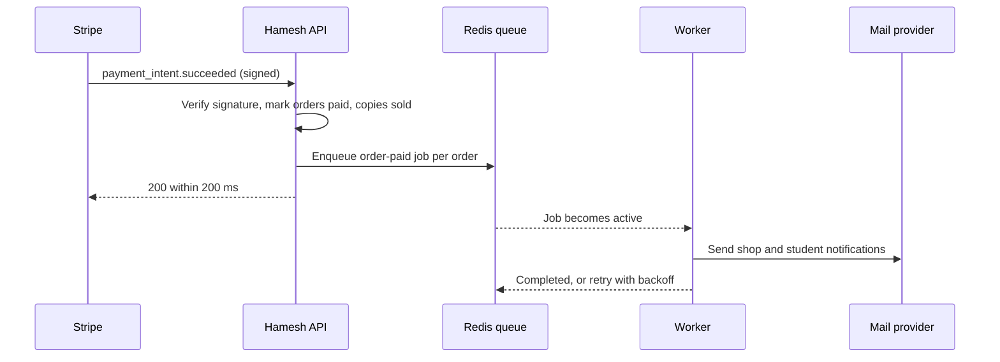

# What should not happen inside a request

Hana pays for two books at 22:41 on a Tuesday. Her phone shows the spinner for eleven seconds and then an error. She taps Pay again. By 22:43 she has one paid order, one duplicate confirmation email to North Street Books, and a support message that says she was charged twice. She was not charged twice. Hamesh charged her once and then failed to answer her browser, because the request that handled the payment result was also sending email and running a want-list match.

That request did four jobs: it recorded the paid state, it told two shops, it notified three students whose want entries matched the copies, and it wrote an audit row. Only the first job belongs to the answer Hana was waiting for. The other three are consequences of the payment, and a consequence does not have to finish before the student is told that the payment worked.

This chapter draws the boundary. It gives you three questions that decide which side of it a piece of work belongs on, and it shows the two failures that come from putting work on the wrong side: latency that the student pays for, and coupling that turns an unrelated outage into a failed payment.

## What a request owes its caller

A request owes the caller one thing: a durable change plus an accurate statement about it. When Hana's payment event arrives, the server must record that the orders are paid and the copies are sold, and then say so. Everything after that is derived work. A shop notification is derived. A want-list alert is derived. A search index update, a receipt PDF, a markdown schedule and a nightly report are all derived.

Derived work has three properties that make it unsuitable for a request. It can be slow, because it talks to services outside Hamesh. It can fail for reasons Hamesh does not control, such as a mail provider rate limit or a student's inbox rejecting a message. And it can be repeated, because the reason it failed is often temporary.

A request has none of those freedoms. It holds a socket, a student is watching a spinner, and the caller decides whether to retry. Every second of derived work inside the request is a second added to a number the student can see. Every derived outage becomes an error the student reads as "my payment failed".

Read the diagram for two things. The API answers Stripe before the worker has done anything, so the response time does not depend on the mail provider. And the queue sits between the two processes, so a worker that is stopped, restarting or slow delays the email without touching the payment. The arrow from API to Stripe is the promise. The arrows after it are consequences.

The order of operations in that diagram is not negotiable. Enqueue after the database write, never before. A job enqueued before the write can be picked up by a fast worker and read an order that is still pending, and then decide there is nothing to send. A job enqueued after the write may be lost if the process dies in the microseconds between the two, which is a rare and acceptable gap for an email and would not be acceptable for the paid state itself. The paid state is the record; the email is a consequence.

## Three questions that decide placement

Ask these in order for each new piece of work. The first answer usually settles it.

**Does the response depend on the result?** If the student must see the output to continue, the work stays in the request. Sending the payment confirmation page is part of the response. Sending the email is not, because the page already tells her the payment worked. Creating the order line snapshot is part of the response, because the next screen reads it.

**Can the work be done twice without harm?** A job that sends an email twice is annoying. A job that marks an order paid twice is harmless only if the write is conditional, and a job that charges a card twice is a bug. Work that cannot be made idempotent should stay in the request until it can be, or it should carry a durable key that makes the second run a no-op.

**Who retries when it fails?** A request is retried by a browser, a phone, or a payment provider, at times you do not choose and with duplicate sends. A job is retried by the queue with a policy you write down. If the work needs a considered retry policy, it belongs on the queue.

A fourth question is useful when the first three are close: how long can the work wait? An email that arrives four seconds late is fine. A shop notification that arrives an hour late is confusing but survivable. A price that a student sees is not allowed to be late at all, which is why prices are computed in the request from stored records.

## The shape of the boundary in Hamesh

The table below is the working list for this project. It is not a general rule about queues, and a different product would fill it differently.

| Work | Where it runs | Why |
|---|---|---|
| Verify a webhook signature and mark orders paid | Request | The caller needs the durable result, and Stripe retries the request |
| Write order line snapshots and claim copies | Request | The next screen reads them, and a partial write is a wrong sale |
| Send shop and student notifications | Worker | Slow, flaky, and not needed for the response |
| Match a new Listing against want entries | Worker | Grows with the number of waiting students, not with the request |
| Send the want-list alert | Worker | Same provider risk as any other message |
| Recompute an offer summary | Request, on a cache miss | Cheap with an index, and the student is waiting for it |
| Apply a scheduled markdown | Worker | Runs on a clock, not on a student action |
| Generate a monthly report | Worker | Minutes of work, nobody waiting |

The rows that stay in the request share one property: the caller's next action depends on them. The rows that move to the worker share another: nobody is waiting, and a retry is the natural response to failure. Sorting your own features with those two columns is the exercise this chapter wants, because the answer is not always obvious and the argument is the point.

## The cost of the boundary

A worker is a second process. It needs a start command, a way to run under a process manager so it restarts after a reboot, its own log, and its own deployment step. On a small server it competes with the API for memory, and on a free hosting tier it may not fit at all. Those are real costs and they are the reason some teams keep work in the request for longer than this course does.

The alternative that learners reach for first is a timer inside the API process: call `setTimeout` after the response and forget about it. It is three lines and it works in a demo. It also loses every pending job when the process restarts, gives no retry, no visibility and no way to see how many jobs failed. A deploy during a payment loses the notification, and nobody finds out until a shop asks why an order never arrived.

A second alternative is a cron job that sweeps the database every minute for work that has not been done: orders paid without a notification row, Listings published without a match run. That survives restarts and needs no queue library. It also adds up to a minute of latency, puts a repeating scan on the database, and becomes a place where the same row is picked up by two overlapping runs. It is a credible design for a low traffic product, and several real systems use it. This course uses a queue because the want-list feature needs a job per Listing with a stable identity, and a queue gives that identity for free.

The honest position is that the queue buys reliability and visibility, and it costs an extra process plus the discipline to make every job idempotent. If you cannot run a second process on your deployment, say so in the viva and describe the cron alternative rather than pretending the worker exists.

## The event the hero feature needs

Module 24 answers a standing question: a student wants a title that nobody has listed, and the answer must arrive when a shop lists a copy. The trigger is a fact about a Listing: it became available to buy, at a price and grade that a student might accept. That fact deserves a name, and the name is `listing.published`.

An event is not a message with a pretty name. It carries the identity of the thing that changed, and it is emitted at the moment the change is committed. For `listing.published` the payload is small: the Listing id and a revision number that increases each time the shop changes terms. The worker reads the current Listing by id rather than trusting fields in the payload, because the payload is a notification and the database is the record.

Two rules make the event usable later. It must be emitted from every path that makes a copy buyable, including a republish after an edit and a price drop that brings a copy under a student's ceiling. And it must have a stable identity, so that two emissions from one action or one retried emission do not turn into two alerts. That identity is the subject of the build lesson.

## What the next lesson builds

The next lesson creates the queue module, the worker process and the two job families: one for a paid order and one for a published Listing. It sets retries and backoff, writes down the job id rules, and proves that the API answers before the worker logs anything. It also demonstrates recovery: stop the worker, publish a copy, start the worker, and watch the job run once.

The gate after that asks for timestamps, not assurances: the API response time with the worker stopped, the worker log line with its timestamp, the job id for a republish, and a forced failure that shows two attempts spaced by the backoff you configured. Those readings are what separate a queue that is wired from a queue that is understood.
