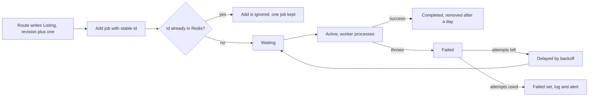

# Worker, order jobs and the listing.published event

Hana's payment result arrives at 22:41:07. The route has two jobs to do and one of them is not its own: record that two orders are paid, and then tell the world. The first is a database write with a conditional filter. The second is a notification that will take a mail provider somewhere between 200 ms and 8 seconds, and it must not decide whether Stripe receives a 200.

This lesson builds the second process and the two job families. It also builds the part that learners skip: the identity of a job. A job without a stable id is a job that runs twice when a shop republishes a copy, and a second run in module 24 means a second alert to a student who has already been told.

## Two processes, one Redis

The API and the worker are separate Node processes that share MongoDB, Redis and the source tree. The API listens on a port. The worker does not. Both import the models and the queue module, and neither imports the other's entry file.

```js
// server/src/queues/index.js
import { Queue } from "bullmq";
import { redisForQueues } from "../modules/cache/redis.js";

export const ordersQueue = new Queue("orders", { connection: redisForQueues });
export const listingsQueue = new Queue("listings", { connection: redisForQueues });

export const ORDER_JOB = "order-paid";
export const LISTING_JOB = "listing-published";

export const jobId = {
  orderPaid: (orderId) => `order-paid-${orderId}`,
  listingPublished: (listingId, revision) => `listing-published-${listingId}-${revision}`,
};
```

The id builders are exported so a test can assert the exact string and a reviewer can see the rule in one place. BullMQ uses the id as part of a Redis key, which is why the separator is a hyphen. Two characters are refused, and both refusals are worth knowing before they cost an hour of debugging: a colon is the separator BullMQ itself uses inside keys, and a string of only digits collides with the auto generated id counter.

The worker has its own entry point and its own connection options:

```js
// server/src/workers/index.js (partial)
import { Worker } from "bullmq";
import { handleOrderPaid } from "./order-paid.js";
import { handleListingPublished } from "./listing-published.js";

const connection = { ...redisWorkerOptions };   // maxRetriesPerRequest: null

new Worker("orders", handleOrderPaid, { connection, concurrency: 4 });
new Worker("listings", handleListingPublished, { connection, concurrency: 4 });
```

A worker connection blocks while it waits for a job, so it needs `maxRetriesPerRequest: null`. A connection tuned for request and response work will disconnect under a long block, and the worker will log connection errors that look like a Redis outage. Give the worker its own client options rather than reusing the API's client, and say why in a comment.

Add the script to `package.json` as `"worker": "node src/workers/index.js"` and run it in a second terminal. If your deployment runs one process, this is the moment to notice the mismatch, because the worker must also run there. A production build that starts only the API will accept payments and never send a notification, and the failure is silent.

The worker must log three things on every job: the job name, the job id, and the attempt number. Without the attempt number a retry looks like a duplicate to whoever reads the log, and the first question in a review is always whether the job ran twice or ran once and logged twice.

## Order jobs after the paid transition

The order job is enqueued inside the webhook route, after the paid write has committed. One job per order, not one per checkout, because each shop sends its own message and a failure for one shop should not delay the other.

```js
// inside the paid transition, after the conditional updates report success
for (const order of paidOrders) {
  await ordersQueue.add(
    ORDER_JOB,
    { orderId: order._id.toString() },
    {
      jobId: jobId.orderPaid(order._id.toString()),
      attempts: 5,
      backoff: { type: "exponential", delay: 2000, jitter: 0.5 },
      removeOnComplete: { age: 86400, count: 1000 },
      removeOnFail: false,
    }
  );
}
res.json({ received: true });
```

The payload holds an id and nothing else. A payload that carries the student's email, the book title and the price is a snapshot that goes stale in the queue and leaks personal data into a Redis key that a support engineer can read. The worker loads the order, its lines and the shop, and uses the current values.

The enqueue happens after the write, so a crash between the two loses the notification. There is a clean recovery for that: let the enqueue failure escape the route, so the webhook returns a 500 and Stripe retries the event. The retry re-reads the orders, finds them already paid, and enqueues again. That relies on the paid transition being conditional and idempotent, which module 20 already built and tested. Do not return 200 while swallowing an enqueue error, because Stripe will never send the event again.

The processor is deliberately boring:

```js
// server/src/workers/order-paid.js (partial)
export async function handleOrderPaid(job) {
  const order = await Order.findById(job.data.orderId).lean();
  if (!order) return;                        // order removed: nothing to send
  if (order.status !== "paid") return;        // not paid yet: a later event covers it
  await notifyShopOfPaidOrder(order);
  await notifyStudentOfPaidOrder(order);
}
```

Returning early is not an error. A job that reads a pending order is a job that arrived before the write it depends on, and throwing would retry it five times against the same state. A job that reads a withdrawn Listing is in the same category. Reserve exceptions for real failures such as a provider timeout, where a retry has a chance of a different result.

## The listing.published event and its stable id

Publishing a copy is an edit to one Listing. A shop creates it, or republishes it after correcting a grade, or drops the price below a student's ceiling. Each of those makes the copy buyable and each should emit `listing.published`, because the student who is waiting does not care which route made the copy available.

```js
// server/src/modules/listings/listing.service.js (partial)
await Listing.updateOne({ _id: listingId, "shopId": shopId }, { $set: patch, $inc: { revision: 1 } });

const saved = await Listing.findById(listingId).lean();
if (saved.status === "available") {
  await listingsQueue.add(
    LISTING_JOB,
    { listingId: saved._id.toString(), revision: saved.revision },
    {
      jobId: jobId.listingPublished(saved._id.toString(), saved.revision),
      attempts: 5,
      backoff: { type: "exponential", delay: 2000, jitter: 0.5 },
      removeOnComplete: { age: 86400, count: 1000 },
      removeOnFail: false,
    }
  );
}
await invalidateOffers(saved.editionId);
```

The revision number is incremented by the same update that changes the terms, so the id changes exactly when the facts change. A correction that only touches the shop's private notes does not need a new revision, and a price change does. Sit down with a pencil and decide which fields count, then enforce it in one function rather than in each route.

Two emissions of the same action converge on one job id. A double tap on Publish, a retried HTTP request, or two tabs submitting the same form all produce `listing-published-66f1...-3`, and BullMQ keeps one job. That is the property module 24 will lean on when it promises one alert per student per copy.

The dedup is not permanent, and the documentation is explicit about why. BullMQ ignores a new job whose id already exists, but a job that has been removed from the queue is no longer a duplicate. With `removeOnComplete` set to a day, a republish within a day is deduplicated and a republish next week is not. That is why the durable record of what a student was told belongs in MongoDB as a unique index, and why the job id is the cheap first line of defence rather than the guarantee.



The diagram shows why the retry path re-enters the queue as a delayed job rather than spinning immediately. It also shows the branch that decides everything: an id already in Redis means one job, and no amount of double tapping produces two. Notice that the failed set is a place where a job stops, not a place where it disappears. A failed job that nobody looks at is the same as a job that was never created, with the added cost that everyone believes the notification was sent.

## Retries, backoff and the failures that should not retry

Use one retry policy per queue and write it in `docs/JOBS.md`: the queue name, the job names, the id rule, the attempts, the backoff, the removal policy, and what a permanent failure means for that job. A reviewer who reads that document can answer the viva question about duplicate alerts without reading the worker.

Five attempts with exponential backoff starting at two seconds gives retries at roughly 2, 4, 8 and 16 seconds with jitter, which covers a provider hiccup and gives up inside half a minute. That is the right shape for a notification. It is the wrong shape for a job that calls a slow external API with a 30 second timeout, because five attempts at 30 seconds each outlive the student's patience and the provider's rate limit. Set the numbers against the actual timeout of the call inside the job.

Distinguish permanent from temporary failures inside the processor. A Listing that was withdrawn between the enqueue and the run is permanent for that job: return, do not throw. A shop record that is missing because of a data bug is ambiguous: throwing retries it five times and then parks it in the failed set, which is the right place for a human to look. A `TypeError` from your own code is permanent until you deploy a fix, and retrying it five times only fills the log.

Attach a listener so the failed set is not silent:

```js
worker.on("failed", (job, err) => {
  logger.error("job failed", { name: job?.name, id: job?.id, attempts: job?.attemptsMade, message: err.message });
});
```

The attempt count in that line is what tells you whether this is the first failure or the last one. A job that fails once and succeeds on the second attempt is a healthy queue with a flaky dependency. A job that reaches five attempts is a defect or an outage, and the difference is visible in one field.

```quiz
type: mcq
id: books-queue-q1
question: "A shop republishes the same copy twice in one minute with an unchanged revision number. What does BullMQ do with the second add?"
options:
  - "Runs it again once the first job has completed"
  - "Ignores it while a job with that id exists"
  - "Merges both payloads into one active job run"
  - "Rejects the add with a validation error"
correct: 1
explanations:
  - "That happens only after a completed job has been removed from Redis."
  - "A custom id that already exists is not added to the queue at all."
  - "There is no merge; the duplicate add is dropped, not combined."
  - "The caller sees no error; the add resolves without a new job."
```

## Prove the boundary with a stopped worker

Write the test before the worker exists in your test harness. It stops the worker, sends a publish request, and asserts three things: the HTTP response arrived, no notification was sent, and one job is waiting in Redis.

```js
it("answers before the worker does anything", async () => {
  await worker.close();
  const res = await agent
    .post(`/listings/${listingId}/publish`)
    .set("Authorization", shopOwnerToken);

  expect(res.status).toBe(200);
  expect(sentMessages).toHaveLength(0);
  expect(await listingsQueue.getWaitingCount()).toBe(1);
});
```

The same test then starts the worker, waits for the queue to drain, and asserts one message. A second publish with the same revision must leave the sent count at one, which is the dedup reading the gate asks for. Keep both halves in one file so the contrast is visible: before the worker, a waiting job and no message; after the worker, one message.

Finally, test the retry path with a processor that throws on the first attempt and succeeds on the second. Assert that the first attempt is logged, that the job is in the delayed set, and that the second attempt completes. A sleep in a test is a smell, so read the job state from the queue rather than waiting for the backoff to pass. The gate wants to see the delayed state, not a fixed delay in the suite.

## Acceptance criteria

- `npm run worker` starts a process that logs one line per job with the name, the id and the attempt number, and does not listen on a port.
- A paid checkout enqueues one `order-paid` job per order, with the id `order-paid-<orderId>` and a payload holding only the order id.
- Publishing, republishing and repricing a Listing enqueue `listing-published-<listingId>-<revision>`, and the revision changes only when the purchase terms change.
- Two publishes from the same action leave one waiting job.
- A processor that throws retries with the configured exponential backoff, and the attempt count appears in the log.
- With the worker stopped, the API still answers, the job waits in Redis, and starting the worker processes it once.
- `docs/JOBS.md` lists the queue names, job names, id rules, attempt counts, backoff, removal policy and the meaning of a permanent failure.

The next module is the reason the `listing.published` id rule exists. It will take one published copy, find every want entry that accepts its edition and grade, and write exactly one alert per student, using a unique index as the permanent claim and the job id as the cheap guard in front of it. If the id rule is loose here, that gate will fail there, and the failure will look like a duplicate alert rather than a queue problem.
