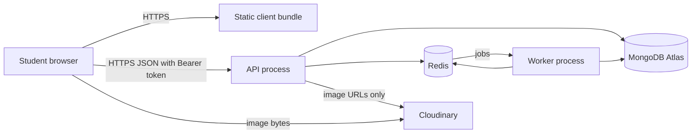

# 23.15 ,  Recap and what's next

> **[Wrap]** · Chapter 23 ,  Deploy · *Recap ,  what you built and what comes next*

Chapter 23 moved Hamesh from **localhost to HTTPS** ,  production env, client build, API deploy, **worker deploy**, smoke tests, restart survival.

## What you achieved

**Production URLs** ,  client and API on HTTPS; paste in your portfolio and Chapter 23 learning log on the platform.

**Secrets discipline** ,  host env only; `.env.example` documents every key teammates need.

**Three deployed components** ,  API, long-running worker, and static client. The API and worker are separate supervised processes; the client is a versioned static artifact.

**CORS + TLS** ,  browser talks to API securely; `VITE_API_URL` points at HTTPS API at build time.

**Smoke tests** ,  health, login, browse, checkout on **live** URL ,  not localhost replay.

**Operational evidence** ,  correlated smoke results, a known rollback target, measured API recovery, and a queued job that survived worker downtime.

## Deployment milestone ,  complete

| Target | Status |
|---|---|
| Cached catalogue + search | ✓ Ch 21 |
| Async jobs after checkout | ✓ Ch 22 |
| Live HTTPS | ✓ **this chapter** |
| API + worker survive restart | ✓ |

This completes the deployment milestone, not the full Week 4 core. Finish Chapters 24 and 25 to prove the live marketplace protects inventory and prices promotions on the server.

## What the deploy actually changed

Nothing in your source tree was rewritten for this chapter, and that is the first thing worth noticing. The same Express app that answered on `http://localhost:4000` now answers on an HTTPS host, the same React bundle that Vite served in development is now a folder of static files behind a web server, and the same worker loop that printed job names in a second terminal is now a supervised process that has to come back after a reboot. Four things did change, and each one is a value rather than a line of logic: the database URI points at the managed cluster, `JWT_SECRET` comes from the host environment, `VITE_API_URL` is baked into the client at build time, and the CORS origin list names the deployed client instead of port 5173.

That last pair is where most first deploys fail. `VITE_API_URL` is not read at runtime; Vite substitutes it while bundling, so a client built with the wrong value keeps calling localhost forever no matter what you change on the host afterwards. CORS works in the opposite direction: the API decides at request time whether to answer a browser from an origin it does not recognise, so a missing entry produces a console error in the student's browser rather than a 500 in your API log.

The consequence is that "it works locally" tells you almost nothing about the deployed pair, because local development hides both problems at once: the client and the API share one machine, and the production build step never runs.

## The topology you actually run

Three processes are involved and only one of them accepts a request from a student. The API listens on a port behind TLS, the worker listens to Redis for jobs and has no public address at all, and the client is a set of static files that a web server hands out without asking the API anything. MongoDB, Redis and the image host are reachable by the two server processes and by nothing else.



Redraw that graph from memory before the viva, because two edges carry the whole argument. The client never reaches MongoDB, which is why the API stays the only place that enforces bookshop ownership, condition grade and price. And the worker is fed by Redis rather than by the API, which is why a job enqueued just before a deploy still runs once the worker is back.

## Worked trace: one live request after a restart

Trace a student called Hana opening a bookshop page after the host has restarted the API process. The restart is the interesting part: nothing in that process survived it, so every step that still works afterwards works because the value was read from the environment or rebuilt from the database at boot.

<TraceRequest title="Hana's browse request after a restart">
  <TraceStep actor="Client" label="Hana opens a bookshop page" detail="The static bundle loads over HTTPS and uses the API base URL baked in at build time" />
  <TraceStep actor="API" label="GET /api/editions with a Bearer token" detail="The restarted process reconnected to MongoDB at boot and verifies the signature with the secret from the host environment" />
  <TraceStep actor="DB" label="Edition and Listing documents read" detail="The pool was rebuilt during startup, so the query returns the same documents it did before the restart" />
  <TraceStep actor="Worker" label="listing.published handled" detail="The job waited in Redis through the outage and runs once the worker reconnects" />
</TraceRequest>

Each of those four lines is a claim you can test rather than assume, and 23.14 asks for exactly that: restart the process, repeat the smoke test, and record what happened to the queued job.

## The failure modes of a first deploy

Almost every first deploy failure falls into four groups, and the visible symptom tells you which one you are in. A blank page with a console error about a blocked request is CORS: the API answered, but the browser refused to hand the response to your client because the origin was not listed. A page that loads with empty lists everywhere usually means `VITE_API_URL` was wrong when the bundle was built, so the client is calling a host that no longer exists. A `502` or a refused connection means the proxy is up and the process behind it is not, which is a crash at boot and nearly always a missing environment variable that `config.js` refused to invent. A login that works and then silently signs out on reload means the refresh cookie was written without `Secure` on an HTTPS host, or with a `Path` that does not cover `/api/auth`.

The first two are browser problems and only appear in the browser console. The last two are server problems and only appear in the host log. Checking the wrong one costs the most time in this chapter, so decide first where the failure is visible before you change any code.

## Reading your first production error

The platform log is the only place that tells the truth about a boot failure, and it is ordered: a config error appears before the listener starts, a database error appears before the first route is mounted, and a crash loop repeats the same line at a steady interval. Read the last line of one cycle rather than the first, because the first is usually a stack frame from a dependency.

Then compare that against what you can see from outside. A health response of 200 with a connection state of 0 is a process that is up and cannot serve, which is exactly the misleading state the boot order in Chapter 4 was designed to prevent. Logging the error name and the missing variable name while never logging the value keeps the log useful and safe to paste into a review thread.

## The evidence to keep

Four artefacts from this chapter are worth more than a screenshot of the home page, because each one answers a question someone will ask you in a review. The live URLs prove the deploy exists. A `curl` of the health route with its connection state proves the process is talking to the database rather than merely running. The measured recovery time from 23.14 proves you restarted the API on purpose and watched how long it took to answer again, which is the number an operator needs before choosing a host tier. And the queued job that ran after worker downtime proves the queue is durable rather than an in-memory list that a restart would erase.

Keep the smoke results next to a known rollback target: the previous client build and the commit the API was running before the last change. A rollback is only available if you recorded what you would roll back to, and that record has to exist before the deploy that needs it.

## Cost and trade-offs of what you chose

The trade-off in this chapter is not "which host is best", it is how much operational work you are buying back. A single small server running all three processes is the cheapest option and the one that teaches the most, because you install Node, a reverse proxy and a process supervisor yourself and you see every piece of the stack. A managed platform does that part for you and charges per process, which becomes the deciding factor the moment the worker runs as a second always-on service.

Both choices share one consequence worth stating plainly: a restart is normal, not an incident. Restart the API, the worker and the client deployment on purpose at least once and watch what a student sees. If a queued job disappears, the worker never had durable storage. If the session dies on reload, the refresh cookie was not written with the flags you documented. If a Listing page 404s while the browse page works, one process came back with an older build than the other.

## Architecture you can draw in a viva

```
Browser → HTTPS → Express API → MongoDB
                    ↓ enqueue
                  Redis (cache + BullMQ)
                    ↓ poll
                  Worker → [NOTIFY] logs / cache bust
Cloudinary ← image URLs in MongoDB only
```

## Continue Week 4 ,  inventory and promotions

Your first HTTPS deploy is the midpoint of the final course week. A production-ready book marketplace also needs:

- **Chapter 24 ,  Inventory reservations:** ATP, checkout holds, webhook confirm, expiry worker (no overselling).
- **Chapter 25 ,  Promotions & pricing:** Server-side coupons, multi-vendor discount allocation, Stripe-aligned totals.

After the required Week 4 gates, continue to **Chapter 99: Closing** ,  ship it, document it, and prepare the demo video, case study, and viva.

→ Complete **23.16**, then continue to **Inventory reservations** (Chapter 24). Chapters 24 and 25 are required Week 4 work.

## Continue to gate

**Sub-chapter 23.16:** Checklist + learning log with **live URL**.

Your app is on the internet. Next, harden checkout so concurrent buyers cannot claim the same stock and the server remains the source of truth for every discount.
