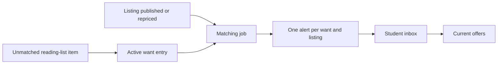

# Alert a student when an eligible copy appears

A student searches for an edition on their reading list and finds no copy that meets their price and condition rules. They should not have to repeat the search every morning. A want-list entry stores the question. When a shop later publishes an eligible copy, a background worker answers it with an alert. That alert is useful even if the student is offline at the moment. It does not reserve the copy. Another buyer may reach checkout first, so the alert page must show current availability and substitutes honestly.

The job runs when the supply changes, not when the student asks again. That reverses the direction of the earlier one-time matcher. Instead of walking every listing for one student, it takes one changed listing and finds want entries that accept its edition. A multikey index on the accepted edition IDs helps this lookup. A unique index on `(wantEntryId, listingId)` prevents duplicate alerts when the job is retried, started twice or enqueued again after a price edit.

## Store the standing question

Create `server/src/modules/wants/want-entry.model.js` with `studentId`, a source reading-list item ID, `acceptedEditionIds`, minimum grade rank, maximum price in minor units, state and timestamps. The student's threshold is a number the server validates. A grade rank of 4 means Like New or better if the course's five-grade scale uses 5 for New, 4 for Like New, 3 for Very Good, 2 for Good and 1 for Acceptable. Keep defect exclusions separate from grade: a student may accept a Good copy but reject one missing an access code. The price ceiling uses the course currency; do not compare bare numbers across currencies.

Store only editions that the student's reading-list rule accepts. An exact-edition course requirement usually has one ID. A teacher-approved alternative may have several IDs. Add an index on `acceptedEditionIds` for reverse matching; MongoDB automatically treats an index over an array as multikey. Add another index for a student's active entries so “My want-list” stays scoped and quick. The API must filter by authenticated student ID. A shop should not be able to read the names and budgets of students waiting for its stock.

`POST /me/wants` accepts the reading-list item and thresholds, then derives accepted edition IDs from that item on the server. Do not trust an arbitrary edition array from a browser, because a user could use the endpoint to subscribe to unrelated catalogue changes or produce a huge matching workload. `GET /me/wants` returns the student's own entries. `PATCH /me/wants/:id/pause` makes one inactive; `DELETE /me/wants/:id` removes it from future matching while preserving already-sent alert history according to the course's data-retention rule. A student can re-activate an entry after changing a price ceiling; that action should enqueue a catch-up match against current offers.

## Enqueue a change, then match in reverse

After a shop publishes a Listing, enqueue a job carrying its ID and revision. Enqueue another when a markdown or condition correction changes eligibility. The job body holds no student data. In the processor, load the current Listing by ID. If it has been withdrawn or sold, stop. Query active want entries whose `acceptedEditionIds` includes its Edition ID. Filter those candidates by grade, defects, price and any allowed pickup area. This two-stage process keeps the indexable edition match narrow and the product-specific rules explicit.

For each eligible want entry, insert an `Alert` with `wantEntryId`, `listingId`, `studentId`, `createdAt` and read state. Put a unique index on `wantEntryId, listingId`. If two processors try the same pair, one insert wins; treat the duplicate-key result as already alerted. Do not rely only on the queue's job ID. A completed job may be removed, a later markdown may enqueue a new revision, and the worker may retry after a crash. The database alert key is the durable claim about what a student has already been told. A second price drop on the same listing does not make a second “new copy” alert under this core rule.

Work one example by hand. Student A accepts Edition E at grade rank 3 or higher and at most 2,000 minor units. Student B accepts E only at rank 4 or higher and at most 2,500. A new copy has rank 3 and price 1,900, with no excluded defect. It matches A and misses B because of the grade, even though B's ceiling is higher. If the shop later raises the grade to 4 after correcting a data-entry mistake, the revision job may now create B's first alert. A already has an alert for that physical copy and gets no second one. If the listing sold between enqueue and processing, the worker reloads its current status and sends no new alert. This is why a job carries an ID and revision, while the worker reads current state before deciding.

Keep the matching criteria on the server. A shop form may show a suggested grade or sale price, but only the saved Listing fields are authoritative. A student may update their want entry after an alert was sent. That change does not rewrite the earlier alert; it affects future matches. The alert can snapshot the price and grade that made it eligible, while the linked offer page shows the current price and status. Label those values so a student can understand a later change rather than seeing two unexplained prices. If the shop changes a price, the server's price history and the job revision should make the change traceable.

The alert text should say an eligible copy is available at the time of matching and link to its current offer page. It must not promise that the copy is held. By the time the student opens it, another buyer may have claimed it. On the offer page, reload the Listing status. If unavailable, show another copy of the same accepted Edition where possible or leave the want entry active. The checkout module's sell-once hold remains the authority for purchase. An alert is a notification, never inventory.

## Build an inbox that is private and repeatable

Create `GET /me/alerts` and `PATCH /me/alerts/:id/read`. Both queries include the authenticated student ID. The list returns a small page sorted newest first and an unread count. Join only the public Listing summary needed for a link; do not expose other students' want entries or private reading lists. In `client/src/pages/AlertsPage.jsx`, show edition title, shop, grade, price at alert time and current availability. Marking one alert read should not alter the want entry or reserve a copy.

Test a fresh Listing that matches two students but not a third whose grade floor is too high. The worker creates two alerts. Run the same job twice and assert the alert IDs and count do not change. Stop the worker, publish another matching copy, and restart it. The queued job should produce alerts once. Reduce a Listing's price from above to below a student's ceiling and verify it becomes eligible. Mark the alert read, replay the job, and confirm it remains read rather than being recreated as unread. Try to fetch the alert as another student; the API must deny it.

If a job appears to run but no alert is created, inspect the Listing's current Edition ID, the want entry's accepted IDs, active state, grade rank, defect exclusions and price ceiling in that order. Use MongoDB `explain()` to confirm the reverse query uses the intended multikey index at the expected scale. If duplicate alerts appear, inspect the actual database index and the exact pair key. A UI deduplication filter cannot repair duplicate notification rows or repeated emails. Save a worker-down and replay transcript in `docs/EVIDENCE.md`; that is the evidence the capstone reviewer will ask for.

When a student pauses a want entry, the worker must exclude it even if a job was enqueued before the pause. When the student resumes it, enqueue a catch-up match against currently available listings; otherwise an eligible copy that appeared during the pause would never be seen. Make that catch-up bounded and paginated so resuming one entry cannot scan the entire catalogue in one web request. The user sees “checking current offers” and can continue using the app while the worker runs. An alert still gives information, not priority to buy. Keep those words consistent in the inbox, email and final demonstration.
