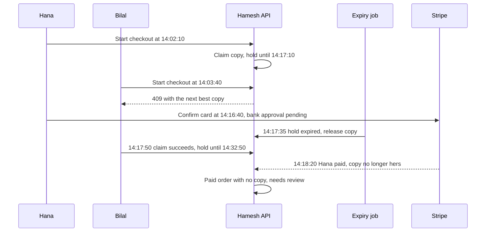

# Two students, one last copy

North Street Books has one Good copy of the statistics guide, listed at 1,900 minor units with a creased cover and pencil notes. Hana is on the bus and Bilal is in the library. Both have the edition page open, both see the same copy, and both tap checkout within ninety seconds of each other.

Module 19 already decided that one of them wins the claim: a conditional update changes the Listing from available to held and names the winning checkout. That decision is sound and it is not enough. The holder can lose the copy again after winning it, because a hold has an expiry and a payment can take longer than the hold. When that happens, the copy can be sold twice to two students who both paid, and Hamesh has one book to hand over.

## The race that survives a correct claim

Here is the timeline from a build that passed the module 19 gate. Hana starts checkout at 14:02:10, and her hold is set to expire at 14:17:10. Bilal starts at 14:03:40 and receives a 409, because the copy is held. Nothing is wrong yet.

Hana confirms her card at 14:16:40 and her bank asks her to approve the payment in its own app, which takes four minutes on a weak connection. At 14:17:10 the hold reaches its expiry. At 14:17:35 a sweep releases the Listing, because the sweep only asks whether the hold has passed. At 14:17:50 Bilal reloads the page, sees the copy available, claims it, and pays at 14:18:05. Hana finishes the approval at 14:18:20. Two payments, one copy, two paid orders.

Every step in that sequence was locally reasonable. The claim was atomic. The expiry honoured its deadline. Bilal was told the truth when he was refused and told the truth again when the copy returned. The defect is that two decisions were made from different facts at different times, and nobody asked whether a payment was in flight for the copy before returning it to the shelf.

Read the two horizontal arrows in the lower half. The release happens between Hana's card confirmation and Stripe's success event, and the webhook arrives after Bilal owns the copy. The diagram is not showing a bug in any single write. It is showing a gap in time that no single write can see, which is why the fix has to be a rule about ordering and about which predicates may win.

## One copy removes arithmetic and removes forgiveness

In a shop that sells many identical units, a conflict is partial. Two shoppers want three units and there are three, so both can be served, or one is served two and the other one. A stale count causes a sale that the shop cannot honour, which can be corrected with an apology and a small loss. Single copies remove that forgiveness, and they also remove a whole category of arithmetic, which is why holds here are both simpler and harsher than a counting product.

A Listing is one physical book. There is no number to divide and no partial fulfilment to negotiate. The state of the copy is one of a small set: available, held by one checkout, sold, or withdrawn by the shop. Two students cannot each get forty percent of it. Every conflict is total, and every wrong decision produces a student who paid for an object that another student owns.

That changes the shape of the code in a way that is easy to miss. There is no arithmetic to test, so there is no bug that a wrong number reveals. The failures are all identity failures: two checkouts believing they hold the same Listing, or a Listing believed sold by one record and available by another. Tests that check counts and owners catch those; tests that check that nothing threw do not.

It also changes what a refusal should contain. A 409 that says only "this copy is unavailable" sends a student back to a search page, on a phone, with limited data, to repeat work Hamesh could have done in the same request. The refusal is where the substitute belongs.

## Four rules this module adds

The first rule is that the hold starts when checkout starts, not when the payment form is submitted. The payment step is exactly when a student is slowest: typing a card, waiting for a bank app, losing signal in a lift. A hold that begins after payment begins protects the copy during the easy part of the journey and abandons it during the hard part.

The second rule is that a losing claim returns a 409 with the next best copy as a substitute, chosen from the same edition or the editions the reading list accepts, at the same grade or better, within the student's price ceiling. The substitute is a suggestion with a price and a shop name, not a hold. Bilal still has to claim it.

The third rule is that payment confirms the hold. The webhook that marks an order paid also moves the Listing from held to sold, under a predicate that requires the Listing to be held by this checkout. A payment that no longer has a copy produces a review record and a refund path, never a quiet re-pointing of the order to another book.

The fourth rule is that expiry releases a hold only if the copy is still held by the same checkout and no payment for it is in flight. A hold that has expired while its card is being authenticated gets a short extension, not a release. That rule is what closes the timeline above.

## Why not simply let the fastest payer win

The alternative design removes holds entirely and lets the first successful payment claim the copy. It is simpler to reason about in one way: there is one moment of truth, the webhook, and one conditional update from available to sold at that moment. A student who loses gets a refund.

The cost is what a refund means to a student in Gaza paying with a card that may be a family member's. A refund takes days to appear, and during those days the student has no book and less money. The copy also stays available for someone else during the whole payment attempt, so the same copy can be charged to three students in four minutes, each awaiting a refund. Holds exist to keep the number of payment attempts per copy close to one.

The opposite design is a long hold, twenty minutes or thirty, which reduces failed checkouts and freezes the copy for everyone else. On a marketplace with twelve copies of one textbook it does not matter. On the last copy three days before an exam it matters a great deal, because the student who is waiting for a hold to lapse is the student who needs the book most.

Fifteen minutes is the number this course uses, and it is a choice rather than a law. A student on a strong connection finishes in ninety seconds. A student on a weak connection with a bank app in the middle may need five minutes. Fifteen leaves room for the bank and does not leave the copy frozen for an hour. Write the number in config, not in a route, and write down why.

## Fairness is a product rule, not a queue rule

Module 24 alerts a student when an eligible copy appears. It does not hold the copy for the alerted student, and this module keeps that decision. An alert gives information and a head start measured in seconds, not a reservation. The first student to reach checkout gets the hold, and the second gets a 409 with a substitute.

That will feel unfair to the student who waited three weeks for the alert and lost the copy in two minutes. The alternative, holding a copy for every alerted student for an hour, would freeze the catalogue for anyone who happens to have a want entry, and the shop would lose sales to students who never come back. The course chooses the simpler rule and states it in the interface: an alert says a copy is available now, not that it is reserved.

Fairness also shows up in the substitute. A substitute that is a worse grade or a higher price is not a substitute; it is a different purchase. The refusal must offer a copy that the student could have accepted if it had been the one they tapped, or offer nothing and say that no other copy is available.

## Where this module sits in the build

Module 19 holds copies during checkout and unwinds a multi shop attempt. Module 20 marks orders paid and moves a held copy to sold. Module 22 caches summaries and invalidates on every Listing change. This module tightens the join between those three: the hold becomes a first class record with an owner and a deadline, the conflict carries a substitute, the paid transition checks ownership, and expiry becomes a job with a predicate rather than a sweep with a timestamp.

The order of work matters. Read the existing claim predicate in the checkout route before writing anything, because the module 26 version is a small extension of it rather than a second mechanism. Two claim paths in one codebase will disagree, and the disagreement will appear as a copy that is held by one checkout and sold by another.

## What the next lesson builds

The next lesson writes the four rules as code: a claim that takes over an expired hold atomically, a 409 body with a substitute chosen by grade and price, a paid transition that requires the copy to still be held by this checkout, and an expiry job whose release can never overwrite a sale and whose extension covers an in flight payment.

The gate after that is a two tab race in a browser, with two students and one copy, plus a clock you control. One tab pays. The other receives a 409 with a substitute the student could plausibly accept. If both tabs can reach a paid state, the gate fails, and no amount of prose in the learning log changes that.
