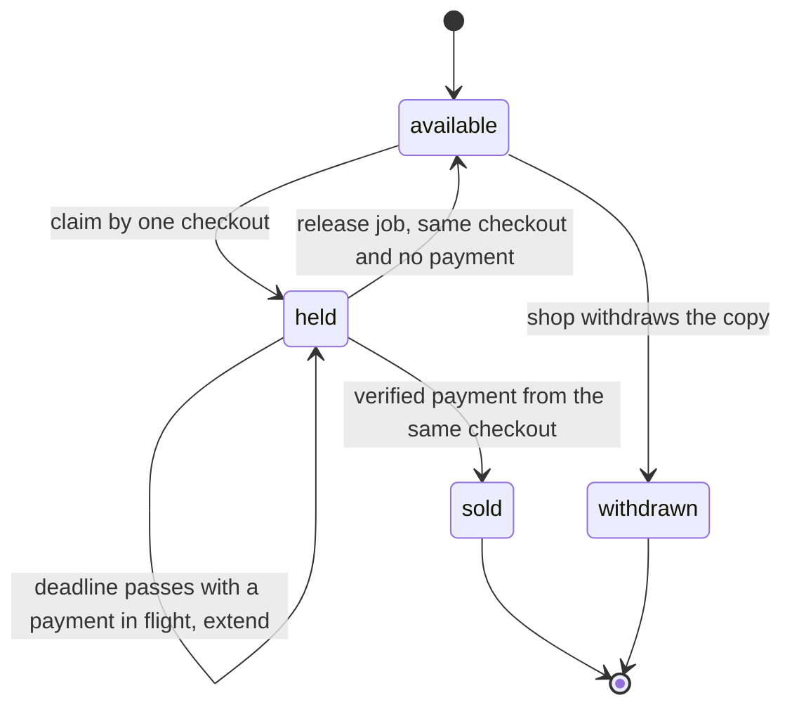

# Hold on checkout, confirm on payment, release on expiry

Hana and Bilal are about to race for the last Good copy of a statistics guide. This lesson writes the four rules from the previous chapter as code, and it spends most of its words on the two transitions that are easy to get wrong: the release that runs after the copy was paid for, and the payment that lands after the copy was released.

The build is small. One claim predicate, one conflict response with a substitute, one confirm predicate inside the existing webhook, and one expiry job with a release predicate and an extension rule. If you find yourself writing a second holding mechanism next to the one module 19 built, stop and extend the first one instead. Two claim paths in one codebase will disagree.

## The fields a hold needs

The Listing already carries a status from module 19. Add a hold object with two fields and a counter for extensions. Nothing else is needed, and every extra field is a field that can disagree with the rest.

```js
// Listing: hold related fields added in this module
status: "available" | "held" | "sold" | "withdrawn",
revision: Number,               // incremented when purchase terms change
hold: {
  checkoutId: ObjectId,         // the checkout that owns this copy
  expiresAt: Date,              // UTC instant, compared on the server
  extensions: Number,           // 0, 1 or 2 in this build
},
```

Store the checkout id, not the student id. Hana can open a second tab, abandon it, and start again, and the second attempt has a different checkout. A release from the first checkout must not clear the second one, even though both belong to Hana. The checkout id is the owner token, and every later predicate matches on it.

Index the fields you will query: `status` with `hold.expiresAt` for the sweep, and `editionId` with `status` and `gradeRank` for substitutes. Do not index `hold.checkoutId` unless you find yourself looking holds up by it, which is a diagnostic query rather than a hot path. Every index on a collection that takes writes has a cost, and the writes here are shop actions on single documents.

## Claim at checkout start

The claim happens on the first request of the checkout, before the payment intent exists. The route takes the Listing ids the student selected and returns either a checkout with its holds or a conflict that names what changed.

```js
// POST /checkouts   { listingIds: [...] }
// 201 { checkoutId, holds: [{ listingId, expiresAt }], totalMinor }
// 409 { reason: "copy_unavailable", listingId, substitute }
router.post("/checkouts", requireRole("student"), startCheckout);

// server/src/modules/checkouts/hold.service.js (partial)
export async function claimCopy(listingId, checkoutId, now, ttlMs) {
  const expiresAt = new Date(now.getTime() + ttlMs);
  return Listing.findOneAndUpdate(
    {
      _id: listingId,
      $or: [
        { status: "available" },
        { status: "held", "hold.expiresAt": { $lte: now } },
      ],
    },
    { $set: { status: "held", hold: { checkoutId, expiresAt, extensions: 0 } } },
    { new: true }
  );
}
```

The filter is the whole guarantee. The second branch allows a hold to be taken over after its deadline without waiting for the expiry job, so a stopped worker delays a release but never blocks a sale. Both branches are evaluated inside one document update, so two students racing on the same Listing cannot both match. MongoDB gives atomicity per document, which is exactly the granularity a single physical copy needs.

Do not compare the deadline in JavaScript after reading the document. A read, a comparison and a later write is the pattern module 19 already replaced, and it fails under concurrency for the same reason it did there. The comparison belongs in the filter, where it is evaluated against the stored value at the moment of the write.

Pass a fixed `now` into the service from the route and from tests. An injected clock is what makes the expiry gate repeatable, and it costs one parameter. A test that sleeps for fifteen minutes is not a test anybody runs.

## The 409 carries a substitute

A conflict returns a body the client can render without another search. The substitute is chosen on the server from the same edition or from the editions the reading list accepts, and it must be acceptable: same grade or better, and no more expensive than what the student agreed to pay.

```json
{
  "reason": "copy_unavailable",
  "listingId": "66f1c2a4b7d3e8a91c0d4f22",
  "substitute": {
    "listingId": "66f2a7b19c4d5e6f70819234",
    "editionId": "66e0d3c2b1a09f8e7d6c5b4a",
    "shopName": "Campus Shelf",
    "gradeCode": "very_good",
    "gradeRank": 3,
    "priceMinor": 2400,
    "firstPhotoUrl": "https://res.cloudinary.com/hamesh/image/upload/v1/copies/66f2a7.jpg"
  }
}
```

The ordering rule is the part worth arguing about. The closest match to what was lost is a copy at the same grade, and within that grade the cheapest. A better grade is the second choice, because a student who picked a Good copy at 1,900 may not want a New copy at 4,500 even though the grade is higher. A cheaper copy at a lower grade is not a substitute at all, because the student's grade floor excluded it.

```js
// server/src/modules/listings/substitute.service.js (partial)
const base = {
  _id: { $ne: lost._id },
  editionId: { $in: acceptedEditionIds },
  status: "available",
  priceMinor: { $lte: ceilingMinor },
};

const sameGrade = await Listing.findOne({ ...base, gradeRank: lost.gradeRank })
  .sort({ priceMinor: 1 })
  .lean();

const betterGrade = sameGrade
  ? null
  : await Listing.findOne({ ...base, gradeRank: { $gt: lost.gradeRank } })
      .sort({ gradeRank: 1, priceMinor: 1 })
      .lean();

const substitute = sameGrade ?? betterGrade ?? null;
```

The ceiling is the student's reading list ceiling when the item has one, and the lost copy's price when it does not. That second rule stops Hamesh from offering a replacement that costs more than the purchase the student had already decided on, which is a small kindness that removes a class of complaints.

The substitute is a suggestion and it is not held. The response says so in the client copy: this copy is gone, here is another one, tap to claim it. A substitute that was silently held would freeze a second copy for a student who may never return, and the shop would lose a second sale. Passing the substitute id to the claim route is a normal claim, with the same predicates and the same possibility of losing again.

When no acceptable copy exists, return `substitute: null` and let the client offer the want-list path from module 24. An empty substitute is a useful answer: it says the search is over for now and here is how to be told when it is not.

## Confirm on payment

The paid transition already exists from module 20. This module adds the condition that ties a sale to the hold that reserved it, and it adds the branch for a payment that no longer has a copy.

```js
// inside the verified webhook, after the order is known to be unpaid
const sold = await Listing.updateOne(
  { _id: line.listingId, status: "held", "hold.checkoutId": checkoutId },
  { $set: { status: "sold", soldAt: now }, $unset: { hold: "" } }
);

if (sold.matchedCount === 0) {
  await flagForReview(order._id, "copy_not_held_at_payment");
}
```

A zero match is not a server error. It means the copy was released, taken over or withdrawn between the hold and the payment, and the money has already moved. The honest response is to record that fact on the order, keep the other order in the same checkout untouched, and route the case to a human. The course does not build refunds in the core path. It builds the state that a refund decision needs, which is an order marked for review with the reason and the timestamps.

Never re-point the order line at a different Listing when the confirm fails. The order line carries a snapshot of the book the student paid for: the ISBN, the edition label, the grade and the price. Silently swapping the Listing behind that snapshot is how a receipt becomes a lie, and module 19 wrote that snapshot precisely to prevent it.

The confirm predicate also settles the race with the release, and it does so without a lock. Both writes require `status: "held"` and the same checkout id, so exactly one of them can match a given state. If the confirm lands first, the release matches zero. If the release lands first, the confirm matches zero and the order goes to review. Neither can overwrite the other, and no transaction is required to get that property.

## Release on expiry without racing a paid order

The obvious implementation is a TTL index on `hold.expiresAt`, and it is wrong in a way that destroys data. A MongoDB TTL index deletes the document when the indexed date passes. On this collection that means deleting the Listing, which is the shop's physical copy with its condition photos, defect notes and price. The shop would lose the record of a book it still owns because a student abandoned a checkout.

The TTL monitor is also not a scheduler. It checks indexes in a background pass that runs about once a minute, and the deletion can happen later still under load. A business deadline of fifteen minutes that fires at some point in the next minute is acceptable for a session record and not acceptable as the only release mechanism for a copy that another student is watching.

Use a delayed job per hold, plus a sweep as a backstop. The job id includes the deadline so that a re-hold produces a new job rather than being deduplicated into the old one.

```js
// server/src/queues/index.js
export const holdExpiryId = (listingId, checkoutId, expiresAt) =>
  `hold-expiry-${listingId}-${checkoutId}-${Math.floor(expiresAt.getTime() / 1000)}`;

// at claim time
await holdsQueue.add(
  HOLD_EXPIRY_JOB,
  { listingId, checkoutId, expiresAt },
  { jobId: holdExpiryId(listingId, checkoutId, expiresAt), delay: ttlMs, attempts: 5 }
);
```

The processor has one job: decide whether the deadline has passed in a way that still matters, and release only if it does.

```js
// server/src/workers/hold-expiry.js (partial)
export async function handleHoldExpiry(job) {
  const { listingId, checkoutId, expiresAt } = job.data;
  const now = clock.now();
  if (new Date(expiresAt) > now) return;            // a newer hold replaced this job

  const checkout = await Checkout.findById(checkoutId).lean();
  if (!checkout || checkout.status === "paid") return;

  const attempt = checkout.payment;
  const inFlight = attempt && (attempt.status === "processing" || attempt.status === "succeeded");
  const listing = await Listing.findById(listingId).lean();
  if (inFlight && listing?.hold?.checkoutId?.equals(checkoutId) && listing.hold.extensions < 2) {
    return extendHold(listingId, checkoutId, now, 120_000);   // re-enqueue with a new deadline
  }

  await Listing.updateOne(
    { _id: listingId, status: "held", "hold.checkoutId": checkoutId, "hold.expiresAt": { $lte: now } },
    { $set: { status: "available" }, $unset: { hold: "" } }
  );
}
```

The extension is the rule that closes the timeline from the previous chapter. A card waiting on a bank app is a payment in flight, and releasing a copy while its payment is being approved is what produced two paid orders for one book. The extension is bounded at two, which adds four minutes in total. A student who never completes the payment loses the copy after that, and the bounded counter stops a stuck payment attempt from freezing a copy indefinitely.

The sweep is a repeating job, every minute, that finds held Listings whose deadline has passed and enqueues the normal expiry job for each with the same deterministic id. It catches the case where the delayed job was lost with a Redis flush or a deploy that dropped the queue. Because the claim predicate can already take over an expired hold, the sweep is about tidiness and about telling the shop that a copy is free again, not about correctness of the sale.



The diagram is the argument for the predicates. Every arrow out of held names the condition that must hold, and the two arrows that leave held compete for the same state. The one that runs second matches zero, which is why neither a release nor a confirm can overwrite the other. Notice also that there is no arrow from sold back to available. A paid copy never returns to the shelf by itself, and a dispute is a separate process with a human in it.

## Test the two transitions against each other

Write both directions before the code is finished, because one of them will be missing and the missing one is the defect that reaches a student.

```js
it("does not release a copy that a paid order owns", async () => {
  await claimCopy(listingId, checkoutId, now, TTL_MS);
  await markCheckoutPaid(checkoutId);                       // verified webhook path
  await handleHoldExpiry({ data: { listingId, checkoutId, expiresAt: past } });

  const listing = await Listing.findById(listingId);
  expect(listing.status).toBe("sold");
  expect(listing.hold).toBeUndefined();
});

it("flags an order when the copy was released before payment", async () => {
  await claimCopy(listingId, checkoutId, now, TTL_MS);
  await releaseExpiredHold(listingId, checkoutId, future);   // injected clock
  await markCheckoutPaid(checkoutId);

  const order = await Order.findOne({ checkoutId });
  expect(order.reviewReason).toBe("copy_not_held_at_payment");
  expect(await listingHoldOwner(listingId)).not.toBe(checkoutId);
});
```

The second test asserts a sad outcome rather than a happy one, and it is the test most learners skip. A build where the first test passes and the second has no coverage will look correct until a payment lands late in front of a reviewer.

Add a third test for the extension rule: claim, set the payment attempt to `processing`, run the expiry job with the clock past the deadline, and assert that the copy is still held and the new deadline is two minutes later. Then run it twice more and assert that the third run releases, because the extension bound is two. Three runs with an injected clock take milliseconds.

```quiz
type: mcq
id: books-holds-q1
question: "A hold expires at 14:10 while its card is being approved. At 14:09:58 the webhook marks the order paid and at 14:10:02 the expiry job runs. What should the expiry job do?"
options:
  - "Release the copy, because the deadline has passed"
  - "Match nothing, because the copy is sold now"
  - "Refund the payment and put the copy back on sale"
  - "Extend the hold and wait for a second event"
correct: 1
explanations:
  - "The status is no longer held, so the release filter cannot match."
  - "The paid transition already cleared the hold and set the copy to sold."
  - "Hamesh records the case for review; it does not refund automatically."
  - "There is nothing left to extend once the paid write has run."
```

## Acceptance criteria

- `POST /checkouts` claims every selected copy or returns a 409 that names the lost copy and a substitute the student could accept.
- A second claim on a held copy returns 409 within the same second, and a claim on an expired hold succeeds without waiting for the expiry job.
- The substitute is at the same grade or better, within the ceiling, from an accepted edition, and it is not held by the response.
- A verified payment moves every held copy owned by its checkout to sold, and a payment whose copy was released records `copy_not_held_at_payment` on that order.
- The expiry job releases only a copy that is still held by the same checkout, and extends instead when a payment is in flight, at most twice.
- A TTL index on `hold.expiresAt` does not exist in the Listing collection, and the sweep is documented as a backstop rather than the deadline.
- Both transition tests pass with an injected clock, and the third run of an extended hold releases the copy.

The next lesson is the gate, and it is run in two browser tabs rather than in a test file. One tab pays, the other receives a conflict with a substitute, and the database is inspected afterwards for exactly one owner and one paid order. The tests in this lesson are the reason that demonstration can succeed, but they are not a substitute for it: a two tab race exercises the routes, the session handling and the client's rendering of the 409 in a way that no service level test does.
