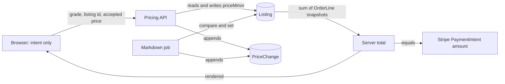

# The server owns every price

North Street Books has a Good copy of a statistics guide. Mariam, who runs the shop, types 1,600 into the price box and presses publish. Hana sees the copy three days later, adds it to a cart beside a College Algebra copy, and taps pay. The number 1,600 travelled through a React form, an Express route, a MongoDB document, a checkout total, a Stripe PaymentIntent and a receipt. Six programs held that number, and any one of them could have changed it.

Only one of them is allowed to decide it. That is the whole subject of this module. Everything else, the grade shares, the markdown schedule, the audit rows and the re-match job, exists to make that one decision cheap to take, easy to explain and impossible to hide.

Read the arrows by their labels. The browser sends intent and accepts what the server returns. The two writers of `priceMinor` are the shop route and the markdown job, and both leave a row in the audit collection. The total is a sum the server performs, and the amount handed to Stripe is that same sum, not a number from the page.

## A used copy has no list price

In a shop that sells new goods, the publisher sets a price and the shop discounts it. Hamesh does not work that way. An Edition is a shared bibliographic record: one ISBN, one title, one format. It carries no price, and it should not. A copy of that edition sitting on North Street's shelf might be New and worth full price, or Acceptable with water damage and worth a third of it. The Edition is the same record in both cases.

So the price belongs to the Listing, the single physical copy. That is already true from Module 5, where `priceMinor` lives on the Listing and nowhere else. What Module 27 adds is the answer to a question the shop owner asks every time she prices something: what number should I type? Mariam has no publisher price to start from. She has a used copy of a book that other shops also hold, in other conditions, at other prices, and she has to pick a figure that sells the copy before the semester ends without giving it away.

A written rule answers that question. Mariam tells Hamesh once how she values condition: a Like New copy is worth 85 percent of the going rate for the edition, a Good copy 58 percent, an Acceptable copy 45 percent. The rule also says how long a copy may sit before its price drops and where the dropping stops. After that, the shop does not negotiate with itself on every listing. The rule decides the first number and the schedule decides the later ones, and the shop can still override any single copy when it has a reason.

The rule is also the reason this module needs an audit. Once software changes prices on a schedule, nobody remembers the old number. Mariam will ask in week three why her Very Good copy of a biology text is at 1,300 when she set it at 1,900. Without a record, the honest answer is a shrug. With a record, the answer is a row that names the rule, the step, the job and the instant.

## Four places a price goes wrong

The fraud surface is wider than a form field. There are four distinct places where a price can become wrong, and each one needs a different defence.

The first is the request body. A shop's own listing form sends a price, and a determined seller can send any price at all with curl. That is not fraud against Hamesh, because the shop owns the copy and may price it at one minor unit if it wants to. It becomes fraud when the same route lets a different shop send that price for a copy it does not own. Module 8 answered that with an ownership predicate in the query, and the pricing routes reuse it unchanged.

The second is the browser's arithmetic. A cart page in React can add two prices and show 4,500 while the server's stored lines add to 4,700. If the checkout route forwards the browser's number to Stripe, the student pays a total that no stored record supports. This is not a hypothetical attacker either; a stale tab, a markdown that ran at 03:00, and a shopper who left the page open since yesterday will cause the same divergence by accident. The server must compute the amount from stored lines every time and compare it with what the student last saw.

The third is the unlogged write. A background job that lowers 400 prices at 03:00 is not malicious, but if it writes only `priceMinor` and nothing else, then a wrong markdown is indistinguishable from a correct one. A shop that complains has no evidence, and you have no way to reverse the change, because you do not know which listings moved or by how much.

The fourth is the floor. A shop that says "never sell this below 1,100" has made a promise to itself about cash flow. If the markdown schedule has no lower bound, a slow copy keeps dropping every fortnight until it is worth less than the envelope it ships in. The shop loses money on a sale that looked successful in the dashboard. The floor is not a nicety; it is the constraint that makes an automatic markdown safe to switch on.

## Follow one forged total

Put numbers on the second failure, because it is the one learners hit first. Hana's cart holds the statistics guide at 1,600 from North Street and a College Algebra copy at 1,800 from Campus Shelf. Her browser shows 3,400. She opens the network tab, changes the request body to include `totalMinor: 100`, and taps pay.

A checkout route that reads `totalMinor` from the body creates a PaymentIntent for 100 minor units, and Stripe charges the card 100. Everything downstream is consistent: the intent matches the charge, the webhook matches the intent, and the orders are marked paid. The only wrong number is the one that came from the browser, and no later check will catch it, because every later check compares the intent with itself.

The same shape appears on the shop side. Mariam's form sends `{ priceMinor: 1600 }` for her own Listing, which is fine. She then sends `{ priceMinor: 1 }` for a Listing owned by Corner Books, using an ID she read from a public offer page. If the update filters on the Listing ID alone, the cheapest copy of that edition in Gaza is suddenly one minor unit and the first student to notice buys it. The fix is the same predicate Module 8 established: resolve the session user, resolve the shop that user owns, and filter the update by both the Listing ID and that shop. A hidden field in the form is not a control; the query is.

## A preview is not a promise

Students see prices before they pay. The cart, the reading-list matcher and the edition page all render numbers that came from the server at some earlier moment. Between that moment and the tap on pay, the markdown job may run, the shop may correct a price, or the copy may sell and a substitute may be suggested at a different price. The browser's figure ages from seconds to days.

Hamesh keeps the preview honest without turning it into a contract. The pricing service returns a total with the inputs it used, so the client can display it. At checkout the server recomputes from the frozen OrderLine snapshots created in Module 19 and compares. When the two agree, the PaymentIntent is created for the server amount. When they disagree, the route stops before Stripe and returns a conflict with both numbers, and the student decides whether to accept the new total. Charging the new total silently is the failure this rule prevents, and so is honouring a stale total that would sell a copy below the amount the shop agreed to.

This is the same conditional shape as the hold in Module 26. There is a fact the user saw, a fact the database holds, and one point where they must be reconciled before money moves. The reconciliation point is the server, because the server is the only participant that cannot be edited by the person making the request.

## Money is an integer

Every price in Hamesh is an integer in minor units, and the currency comes from configuration once. There is no float anywhere in the path from Listing to Stripe. This matters more in this module than earlier, because markdowns multiply. A share of 0.58 applied to 2,999 and then reduced by 10 percent twice gives long decimals, and three programs that round them differently will disagree by a minor unit at the end.

The rule to write down is that rounding happens once, in one function, at the moment a price is computed, and the rounded integer is what gets stored. The audit row keeps that integer. The total is a sum of integers. Stripe receives an integer. A display formatter on the client is the only place a decimal point exists, and it never travels back to the server.

## The floor is a promise to the shop

A price floor is a per-shop number that a markdown may not cross. Express it as a share of the reference price so it follows the market, and optionally as an absolute amount so the shop has a hard limit in its own currency. When both exist, the higher one applies. Mariam may configure a floor share of 35 percent and an absolute floor of 1,100; for a 3,000 reference the share gives 1,050 and the absolute gives 1,100, so 1,100 wins.

The floor binds the job, not the shop. Mariam may still price a copy at 900 by hand if she wants to clear it, and the audit row records that a person did it. What the floor prevents is software doing it. That distinction matters when you write the tests, because a test that only checks "no price below the floor exists" will fail on a legitimate manual sale, and a test that only checks the job's arithmetic will pass while a retry drives the price below the floor.

There is a second, quieter promise inside the same number. A markdown must never raise a price. If the shop already priced a copy below what the schedule computes, the job leaves the copy alone rather than dragging it up to the schedule. Software that raises prices overnight is the kind of surprise that ends a pilot.

## Every change leaves a record

The audit collection is small and append only. Each row names the Listing, the owning shop, the Edition, the currency, the price before, the price after, the source of the change, the rule and job that caused it, an optional actor, a short reason code, and the instant. There is no update path and no delete path in the module.

Three questions make the collection worth its storage. The first is the shop's: what happened to my price? A query on the shop and the Listing returns the sequence. The second is yours: what did the 03:00 job change last night, and did any row land on a floor? That query groups by reason code. The third is the student's, indirectly: the copy I was alerted about cost 1,900 at the time of the alert, and my receipt says 1,900, so what is this 1,500 on the page? The answer is a later markdown, and the copy is now cheaper than it was. Without the audit, that conversation has no evidence on either side.

The record also protects the receipt. Module 19 froze condition, defects and price on the OrderLine, so a later change to the live Listing cannot rewrite a past sale. The audit does not replace that snapshot; it explains the present. One answers "what did Hana agree to", the other answers "why is the shelf price different now". Keeping them separate stops the audit from being used as a receipt and stops the receipt from being used as a price history.

## What this module builds

The next lesson builds the rule, the suggestion endpoint, the repeatable markdown job with its floor, the audit writer and the re-match trigger. The suggestion endpoint is advisory: it returns a reference price, the shop's share for the grade, the floor, and the resulting number, and the shop may accept or override. The markdown job runs on a schedule behind BullMQ, computes each copy's target from the rule and the elapsed steps rather than from yesterday's price, clamps at the floor, and writes a conditional update so a manual edit made a second earlier is not overwritten.

The re-match trigger is the part that connects this module to the hero feature. A price drop can make a copy eligible for a student whose ceiling it previously exceeded. Module 24's matcher already runs when a copy is published or repriced, and its unique index on the want entry and the Listing means a student who was already alerted gets nothing new. A student who was over budget gets their first alert on that copy, which is exactly the outcome the want list exists for.

The gate then asks for evidence rather than a demonstration: the PaymentIntent amount equals the server total, the audit explains every change the job made, the floor held under a deliberate test, a re-match fired, and the ISBN lookup and want-list creation routes refused a burst of requests with a clear retry delay. After that, the copy that Mariam priced in the first paragraph has a history, and the number Hana pays is the number the server can defend.
