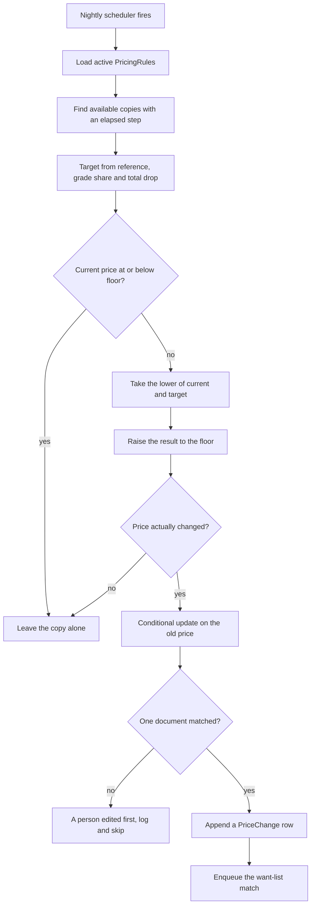

# Grade pricing, markdown schedules and a price floor

Mariam runs North Street Books from a counter with three shelves behind it. She does not want to open a spreadsheet every time a returned textbook arrives. She wants to type the ISBN, pick a grade, see a number that matches how she prices that grade, and press publish. Two months later she wants the copies that never sold to cost less than the ones that just arrived, without her touching them, and she wants to be able to ask what happened to any single copy.

This lesson builds the three pieces that answer her: a `PricingRule` per shop, a suggestion route that applies the rule to one grade, and a repeatable job that walks aged copies on a schedule. Two smaller pieces make the result trustworthy. Every write to a price leaves an append-only `PriceChange` row, and every successful drop enqueues the want-list match from Module 24, so a student who was over budget hears about a copy that has just become affordable.

## The rule belongs to the shop, not to the copy

A `PricingRule` is one document per shop. It is not per listing, and it is not per edition. Mariam prices Good books at 58 percent of the going rate no matter which title they are, and the rule holds that decision once. Duplicating it onto every Listing would mean that changing her mind about Acceptable copies requires editing hundreds of documents that already disagree with each other.

```js
// server/src/modules/pricing/pricing-rule.model.js (fields only)
{
  shopId: ObjectId,                 // unique index, one active rule per shop
  currency: String,                 // copied from config when the rule is saved
  referenceMode: 'market_lowest' | 'fixed',
  fixedReferenceMinor: Number | null,
  gradeShares: {                    // keyed by the grade codes from Module 5
    NEW: 1, LIKE_NEW: 0.85, VERY_GOOD: 0.72, GOOD: 0.58, ACCEPTABLE: 0.45,
  },
  floorShare: 0.35,                 // floor as a share of the reference
  floorMinor: Number | null,        // absolute floor, wins when it is higher
  markdownSteps: [
    { afterDays: 14, dropShare: 0.10 },
    { afterDays: 30, dropShare: 0.15 },
  ],
  isActive: Boolean,
});
```

The unique index on `shopId` is doing real work. A shop with two active rules has two answers to the same question, and the job would pick one by whatever order the query returned. Save through an upsert on `shopId` so a second save replaces the first, and let the index refuse anything stranger.

`referenceMode` says where the going rate came from. In `market_lowest` mode the server looks for available copies of the same Edition in other shops and takes the lowest price it finds. In `fixed` mode Mariam typed a number once and it stays. The mode is recorded so that a later reviewer can tell a rule anchored to the market from one anchored to the owner's judgement, because those two rules respond very differently when the market moves.

## Freeze the reference on the copy, not on the rule

The reference has to be stored on the Listing, and it has to stop moving when the markdown starts. Put `referencePriceMinor` on the Listing at publish time, computed from the rule and then frozen. The markdown job reads it and never recomputes it.

The reason is a spiral that is easy to build by accident. Suppose the job recomputed the reference from the current lowest price of the edition every night, and suppose North Street is the only shop with a copy. The reference would be Mariam's own price. A 10 percent step lowers her price, tomorrow's reference is the new lower price, and the next step lowers it again from the smaller base. Within a fortnight the copy is at the floor and every subsequent night keeps it there. Her shelf looks like a shop in distress, and the schedule did it.

Freezing the reference breaks the spiral at the one place it starts. The job can run every night for a year and the anchor stays where the shop set it. When Mariam wants a new anchor she republishes or edits the copy, and that action is a person's decision with an audit row, not a side effect of a schedule.

```js
// Listing: the pricing fields added in this module
{
  priceMinor: Number,             // authoritative shelf price, integer minor units
  referencePriceMinor: Number,    // frozen anchor used by the schedule
  gradeCode: String,              // derived from gradeRank by the server
  gradeRank: Number,
  publishedAt: Date,              // when the copy first became available, never reset
  pricedAt: Date,                 // last instant priceMinor moved
  pricingSource: 'manual' | 'rule_accepted' | 'markdown',
}
```

`publishedAt` and `pricedAt` are not duplicates. Aging is measured from `publishedAt`. If the job reset `publishedAt` on every change, a copy that took one step would restart its clock and the second step would never fire. That bug is quiet, because the first markdown still lands and the copy still looks like it is being managed.

## Work the first price by hand

Take a real copy before writing any code. Campus Shelf has the statistics guide at 3,200. North Street holds a Good copy, and Mariam's rule is in `market_lowest` mode with the shares above, a floor share of 0.35 and an absolute floor of 1,100.

The reference is 3,200, the lowest available price for the Edition in another shop. Good has a share of 0.58, so the suggestion is 1,856 minor units. The floor is the higher of 1,120 from the share and 1,100 from the absolute amount, so 1,120. Mariam accepts the suggestion and publishes. `priceMinor` is 1,856 and `referencePriceMinor` is 3,200.

Now run the schedule forward. At 14 days the first step's 10 percent has elapsed, so the target is 3,200 times 0.58 times 0.90, which is 1,670. The current price of 1,856 is higher, so the drop applies. At 30 days the two steps are cumulative, 25 percent in total, so the target is 3,200 times 0.58 times 0.75, which is 1,392. At 60 days no further step has elapsed, the total drop is still 25 percent, and the target is still 1,392, so nothing happens and no row is written.

At the floor the arithmetic changes shape. The day 30 target of 1,392 sits above the 1,120 floor, so it is stored as it is. Now raise the floor share to 0.45 and add an absolute floor of 1,350. The floor becomes the higher of 1,440 from the share and 1,350 from the absolute amount, and the same target of 1,392 now crosses it. The stored price becomes 1,440 and the audit row says the floor stopped it. Write both numbers in your notes before you run the job, because the difference between 1,392 and 1,440 is the entire point of the next section.

## Suggest, then let the shop decide

The suggestion route is a read. It returns numbers and the reasoning behind them, and it writes nothing.

```js
// server/src/modules/pricing/pricing.routes.js (partial)
router.get("/shops/me/pricing-rule", requireRole("shop"), getMyRule);
router.put("/shops/me/pricing-rule", requireRole("shop"), validateRule, saveMyRule);
router.get("/editions/:editionId/price-suggestion", requireRole("shop"), suggestPrice);
// 200 { ruleId, grade, gradeShare, referenceMinor, referenceBasis,
//       suggestedMinor, floorMinor, currency }
// 422 { reason: "no_rule" | "no_reference", message }
router.get("/shops/me/listings/:listingId/price-history", requireRole("shop"), priceHistory);
```

Two refusals matter more than the success case. A shop with no rule gets `no_rule` rather than a platform default, because a default silently becomes the price of every book on the platform and nobody owns it. A shop alone on an Edition in `market_lowest` mode gets `no_reference` for that Edition, and the form falls back to asking Mariam for a number. Both are honest dead ends that teach the shop how the rule works.

When the shop accepts a suggestion, the client sends the grade code and the Listing fields, not a bare amount it computed itself. The server recomputes the suggested price, compares it with what the client claims to have accepted, and stores the recomputed figure with `pricingSource: 'rule_accepted'`. If Mariam overrides the suggestion, the server stores her integer and records `pricingSource: 'manual'`. Either way the price that lands in the database was decided by a server function or typed by an authenticated owner, never by the browser's arithmetic.

## Use a repeatable job, not a delayed one

The schedule is nightly. BullMQ offers two ways to express that: a delayed job per listing, and a job scheduler that creates one run per interval. Use the scheduler.

A delayed job per listing means one queue entry per copy. With 400 copies that is 400 jobs, each carrying its own deadline, and each one must be cancelled and recreated when a shop changes its rule. The scheduler holds one definition and creates one job per night. When the rule changes, the next night's run picks it up with no queue surgery at all.

```js
// server/src/jobs/markdown.queue.js (partial)
import { Queue } from "bullmq";

export const markdownQueue = new Queue("listing-markdowns", { connection });

export async function scheduleNightlyMarkdowns() {
  await markdownQueue.upsertJobScheduler(
    "nightly-listing-markdowns",
    { pattern: "0 0 3 * * *", tz: "Asia/Gaza" },
    {
      name: "listing.markdowns.run",
      opts: { attempts: 3, backoff: { type: "exponential", delay: 60_000 } },
    }
  );
}
```

Two details in that snippet are easy to get wrong. BullMQ cron patterns have six fields, so the seconds field comes first and `0 0 3 * * *` means 03:00, not 00:03. And `upsertJobScheduler` is idempotent by scheduler id, which is why the API calls it on every boot: a restart updates the schedule instead of adding a second one. Check the queue version in `package.json` before you copy this, because the scheduler API replaced the older repeat options in BullMQ 5.

The processor takes a `now` argument and an optional `shopId`, so tests can run it for one shop at a controlled instant. That signature is the difference between a job you can reason about and a job you can only watch.

## Compute the target from elapsed steps

The job must not apply one step per run. If the worker is down for three days, or if an operator triggers the job twice by hand, the price must still land on the correct figure for the copy's age.

The rule that gives you that property is to compute the target from the total drop of every step whose `afterDays` has elapsed, measured against `publishedAt`. A 45 day old copy in a rule with steps at 14 and 30 days gets the sum of both shares, whether the job has run once or forty times since.

```js
// server/src/jobs/markdown.processor.js (partial, error handling omitted)
function totalDropShare(rule, ageDays) {
  return rule.markdownSteps
    .filter((step) => ageDays >= step.afterDays)
    .reduce((sum, step) => sum + step.dropShare, 0);
}

function targetPriceMinor({ referenceMinor, gradeShare, dropShare }) {
  return Math.round(referenceMinor * gradeShare * (1 - dropShare));
}

function floorPriceMinor({ referenceMinor, rule }) {
  return Math.max(Math.round(referenceMinor * rule.floorShare), rule.floorMinor ?? 0);
}
```

`Math.round` appears once, in one function, and the value it returns is the value the job compares and stores. Nothing downstream rounds again. The grade share comes from the rule keyed by the listing's grade code, so a copy regraded from Good to Very Good is priced on the new share at the next run without anybody editing the Listing's price by hand.

## Apply the floor last, and compare before you set

The clamp order is the part that tests catch. Check the current price against the floor first and leave the copy alone if it is already at or below it. Then take the lower of the current price and the target, and finally raise that result to the floor.

```js
const ageDays = differenceInCalendarDays(now, listing.publishedAt);
const dropShare = totalDropShare(rule, ageDays);
if (dropShare === 0) continue;                       // no step has elapsed

const target = targetPriceMinor({
  referenceMinor: listing.referencePriceMinor,
  gradeShare: rule.gradeShares[listing.gradeCode],
  dropShare,
});
const floor = floorPriceMinor({ referenceMinor: listing.referencePriceMinor, rule });
if (listing.priceMinor <= floor) continue;            // never raise a manual sale price
const toPriceMinor = Math.max(Math.min(listing.priceMinor, target), floor);
if (toPriceMinor === listing.priceMinor) continue;    // nothing to write

const result = await Listing.updateOne(
  { _id: listing._id, status: "available", priceMinor: listing.priceMinor },
  { $set: { priceMinor: toPriceMinor, pricedAt: now }, $inc: { termsRevision: 1 } }
);
if (result.modifiedCount === 0) continue;             // a person edited this copy first
```

The filter on the update is not decoration. Between the read and the write, Mariam may have changed the price in the dashboard. Including the old `priceMinor` in the filter means the job only wins if nothing else touched the document, and a `modifiedCount` of zero is a normal outcome rather than an error. Throw away that predicate and a nightly run becomes a race that can undo a person's decision.

There are two deliberate refusals in the snippet. A price already at or below the floor is skipped, so a manual clearance sale stays at 900. And a target above the current price is skipped by the `Math.min`, so the job never lifts a copy to meet the schedule. Both refusals are what make the automatic markdown safe to leave switched on.



Read the diagram as a list of the ways the job declines to act. Three of its arrows end without touching a price, and each of them exists because of a real failure: a floor that would be crossed, a manual sale that would be raised, and a person who got there first.

## Write the audit row in the same breath

A price change and its audit row belong together. Write the row immediately after a successful conditional update, from the values the update returned, and never from the values you read at the start.

```js
// server/src/modules/pricing/price-change.model.js (fields only, append only)
{
  listingId: ObjectId,
  shopId: ObjectId,              // denormalised so a shop reads its own history
  editionId: ObjectId,           // denormalised for edition-level price history
  currency: String,
  fromPriceMinor: Number,
  toPriceMinor: Number,
  source: 'manual' | 'rule_accepted' | 'markdown',
  ruleId: ObjectId | null,
  jobId: String | null,          // BullMQ job id for a scheduled change
  actorUserId: ObjectId | null,  // null when a job made the change
  reasonCode: String,            // SCHEDULE_STEP | FLOOR_REACHED | SHOP_EDIT
  createdAt: Date,
}
```

The model is created with `timestamps: { createdAt: true, updatedAt: false }` and the module exposes one writer and no update path. Index `{ listingId: 1, createdAt: -1 }` for the shop's history view and `{ shopId: 1, source: 1, createdAt: -1 }` for the nightly report. A row that can be edited is a row that can be argued with, and the shop's question about last night deserves a record nobody can rewrite.

`reasonCode` carries the distinction the shop actually asks about. `SCHEDULE_STEP` means the copy got older. `FLOOR_REACHED` means the schedule wanted to go further and the promise stopped it, so the shop knows this copy has finished its life cycle and is waiting for a buyer or a decision. `SHOP_EDIT` means a person did it. Those three codes are enough to answer the question without reading a log file.

## Re-run the want-list match after a drop

A drop can change eligibility. Hana's want entry for the statistics guide has a ceiling of 1,700 and a floor of Good. When the copy was at 1,856 the matcher in Module 24 found her entry and correctly skipped it. At 1,670 it qualifies, and if nothing tells the worker about the change, Hana never hears about the copy that was priced for her.

The trigger is one enqueue per successful price change, through the same helper Module 23 built for a publish. A drop changes the terms of a buyable copy, so it emits the same `listing.published` event with a new revision rather than inventing a second job family.

```js
// server/src/modules/listings/listing-events.js (partial, reused from Module 23)
await enqueueListingEvent({
  listingId: listing._id,
  revision: listing.termsRevision + 1,   // the value the update above just wrote
  cause: "price_changed",
});
// jobId: `listing.published:${listingId}:${revision}`
```

The stable id keeps a retry of the same change from queueing twice, and the unique index on `wantEntryId` and `listingId` inside the match processor keeps the second delivery from alerting anybody twice. Students who were already told about this copy stay told. Students whose ceiling it just crossed get their first alert. That asymmetry is the feature: a want list is a standing question, and a markdown is one of the two ways supply changes.

Keep the enqueue after the audit row, not before it. A job that fires the alert and then fails to write the audit leaves a student holding a notification about a price change with no record of it. The reverse order fails quietly, because the nightly run tomorrow computes the same target and finds the price already there.

## Write the failing test first

Three properties are worth testing before the job works, and the floor is the one that fails in a way you can read at a glance.

```js
// test: the schedule stops at the shop floor
it("stops a markdown at the shop floor", async () => {
  const { listing } = await seedAgedCopy({
    gradeCode: "GOOD",              // share 0.58
    referencePriceMinor: 3000,
    priceMinor: 1600,
    publishedAt: daysAgo(45),
    rule: {
      floorShare: 0.45,
      floorMinor: 1350,
      markdownSteps: [{ afterDays: 30, dropShare: 0.25 }],
    },
  });

  await runMarkdowns({ now: new Date(), shopId: listing.shopId });

  const after = await Listing.findById(listing._id);
  expect(after.priceMinor).toBe(1350);

  const rows = await PriceChange.find({ listingId: listing._id });
  expect(rows).toHaveLength(1);
  expect(rows[0].reasonCode).toBe("FLOOR_REACHED");
});
```

```text
FAIL  test: the schedule stops at the shop floor
  Expected: 1350
  Received: 1305
    at runMarkdowns (server/src/jobs/markdown.processor.js:52:31)
```

Read the received number before you change a line of the job. 1,305 is exactly 3,000 times 0.58 times 0.75, which means the target was computed and written with no floor applied. The fix is the clamp, not the arithmetic, and it is two lines in the place the stack trace names. If the received value had been 1,350, the floor worked and the audit row is the thing to inspect.

Add the other two tests beside it. Run the same job twice and assert that `PriceChange` still has one row for the listing, which proves the job is repeatable. Set the copy's price to 900 by hand, run the job, and assert that it stays at 900, which proves the job never raises a price and never drags a manual clearance sale back up to the floor.

## Check the whole path on one copy

Pick one seeded copy and walk it end to end before moving to the gate. Read the Edition price suggestion as the shop owner and confirm the grade share, the reference and the floor are the numbers you can compute on paper. Accept the suggestion and confirm the stored price and `referencePriceMinor` match the response. Backdate `publishedAt` past the first step, run the processor for that shop, and confirm the price moved by the expected amount with one `SCHEDULE_STEP` row. Backdate past the second step, run again, and confirm the cumulative drop rather than a second single step. Then look at the match queue and confirm one `listing.published` job exists per change and no duplicate alerts appear when you replay it.

The last check is the one a reviewer will ask about, and it is the reason this module sits in Week 4 next to the hero feature rather than in Week 2 with the listing form. A price is not a number on a page. It is a server decision with a reason, a history and a consequence for a student who was waiting.
