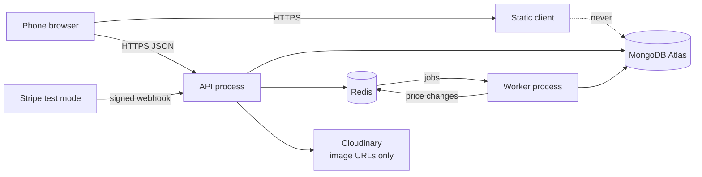
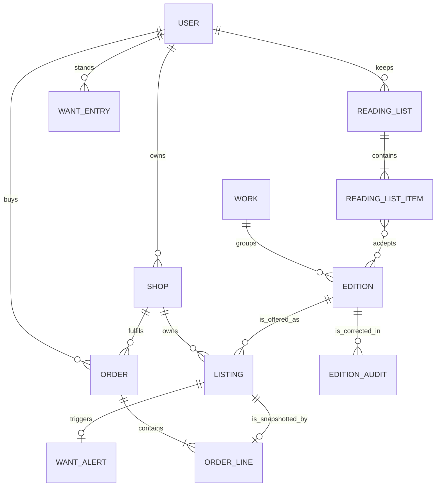

# Ship and document Hamesh

The deployed Hamesh is a running system. The repository is the argument that you understood it. A reviewer will not read twenty six modules of your work. They will open the README, look at one diagram, watch the demo, and ask two questions about numbers you wrote down. This lesson builds those artefacts while the decisions are still in your head.

Documentation here is not marketing. Each file answers a question that a mentor, an interviewer or a future you will ask: what runs where, why a copy has no count, how a want-list alert avoids firing twice, what happened when the worker was stopped. Write the answer next to the thing it explains, and cite the file or command that proves it.

## A README that answers the first minute

The top of the README has one job: let a stranger decide in sixty seconds whether to look further. Put the live client URL, the API health URL and the demo video link above everything else, because those are the three things a reader checks first. Then say what Hamesh is in two sentences, with no adjectives: small bookshops list graded copies of textbooks, students bring a course reading list and get the cheapest copy that meets their edition, grade and price limits, and the hard constraint is that one physical copy can be sold exactly once.

The skeleton below is the shape, not the finished text. Fill each heading with three to six lines, and delete any heading you cannot fill honestly.

```markdown
# Hamesh

Second hand and new textbooks from small bookshops, matched to a course reading list.

## Live demo
- Client: the deployed client URL
- API health: the deployed API URL, plus /health
- Demo video: one unlisted link, four to six minutes
- Seeded accounts: the student, two shop owners and one admin you created

## What this project demonstrates
- A shared edition per ISBN, with shop owned copies underneath it
- Condition grades as ranks, with defects stored separately
- A reading list matcher across shops, with reasons for every choice
- Standing want entries that alert once per student per copy
- One payment split into one order per shop, with grade snapshots
- A worker process for matches, alerts and markdowns
- Two processes on HTTPS, secrets only in the host environment

## Run it locally
## Deploy it
## Tests and evidence
## Docs
```

Two rules keep the README honest. Never paste a credential, including a test one, and never claim a feature you cannot show. If the markdown worker runs but its price floor has only been checked by hand, write "implemented, checked manually" rather than listing it beside the tested parts.

The local section is where most READMEs fail a reviewer on a slow connection. Give the Node version, the two services that must both run, the Redis instance, the exact seed command and the command that starts the worker. A reader who starts only the API sees an edition page that never updates after a copy is sold, and will conclude the project is broken.

## The environment file a reviewer can check

`.env.example` is a contract between the code and the person deploying it. It lists every required key, grouped by the service that needs it, and the grouping says where each value comes from. Values stay empty, because a value in this file is a value in Git.

```dotenv
# Shared by API and worker
NODE_ENV=production
TZ=UTC
MONGODB_URI=
REDIS_URL=

# API only
PORT=
CLIENT_ORIGIN=
JWT_ACCESS_SECRET=
JWT_REFRESH_SECRET=
STRIPE_SECRET_KEY=
STRIPE_WEBHOOK_SECRET=
CLOUDINARY_URL=

# Worker only
PRICE_MARKDOWN_CRON=
```

A file that drifts from the code is worse than no file, because it teaches a deployer to skip a key. Add a test that compares the keys the configuration loader requires with the keys documented here, and run it in the same suite as the rest.

```js
test('.env.example documents every required key', () => {
  const required = requiredConfigKeys();
  const documented = envExampleKeys('.env.example');
  assert.deepEqual(required.filter((key) => !documented.has(key)), []);
});
```

```text
FAIL  tests/config/env-example.test.js
  missing: STRIPE_WEBHOOK_SECRET, PRICE_MARKDOWN_CRON
```

The test also catches the reverse mistake, a key documented in the file that the loader ignores, which is how a deployer sets a value that does nothing. If your loader exposes its full key set, add that direction as a second assertion.

## The architecture diagram and the flows it explains

`docs/architecture.md` holds the diagram and the prose that makes it readable. Draw the runtime processes, not the folders. The folder map belongs in a short list underneath, because a reader wants to know where the matcher lives, not how the repository tree looks.



Three flows deserve a paragraph each underneath. The listing flow starts at the shop counter: the owner types an ISBN, the server normalises it, finds or creates the shared edition under a unique index, and creates one listing for one physical copy with its grade, defects, photos and price. The end of that flow enqueues a `listing.published` job with a stable job id, and the offer cache for that edition is cleared.

The match flow starts when a student imports a reading list. The API matches synchronously across accepted editions and available copies, returns one choice per item with a reason, and leaves unmatched items as candidates for a want entry. The standing half runs in the worker: when a new copy is published, the worker finds want entries whose accepted editions include that copy's edition and whose grade floor and price ceiling it meets, then writes at most one alert per student per copy.

The checkout flow starts in the cart. The API rechecks availability, claims each copy conditionally, writes one order per shop with a snapshot of title, ISBN, grade, defects, photo and price, then creates one PaymentIntent for the whole purchase. A verified webhook marks the orders paid. Two students who reach the same copy both get an answer, and only one of them gets the copy.

The diagram should make three absences visible as well. There is no line from the browser to MongoDB and no line from the browser to Redis, because neither secret is ever sent to a phone. The worker has no public port, so a client cannot call it. And images do not flow through the API after upload, because Cloudinary holds the pixels and MongoDB holds the URL.

## The ERD and the two chains it labels

`docs/erd.md` is the diagram from Module 5, corrected by every module since. It has to show two kinds of arrow, and a reader must be able to tell them apart without asking you. Ownership runs from user to shop to listing, and from student to cart, reading list and want entries. Reference runs from listing to edition to work. History runs from a sold listing into an order line snapshot.

Annotate three facts on the drawing, because they are the three a viva will ask about. The unique index on `isbn13` is the guarantee behind one edition per ISBN. The lock rule means a shop cannot change edition fields once any listing references that edition, and only the admin may correct them with an audit entry, which is why the audit box hangs off the edition. The order line carries copied fields, not a live pointer, so a regrade tomorrow cannot rewrite a receipt from today.

The drawing below is the version to commit. It leaves out field lists on purpose, because a diagram that names every column stops being readable on a phone and stops being a diagram.



If your ERD still shows a price or a condition grade on the edition, fix the diagram before you record the demo. A reviewer who sees the wrong box will not believe the tests.

## The evidence index

`docs/EVIDENCE.md` is the map from each outcome to the artefact that proves it. It is an index, not a second copy of every document. One row per outcome, with a link, a command or a short file path, and a status that is either proven, partial or not done.

| Outcome | Evidence | Status |
|---|---|---|
| Shared catalogue with owned copies | `docs/erd.md`, seed output in Compass | proven |
| One edition per ISBN under two concurrent creates | Module 11 race output, index list | proven |
| Cross-shop edit refused | `docs/AUTHORIZATION.md`, 403 transcript | proven |
| Snapshot survives a regrade | Module 19 test output | proven |
| Want-list alert fires once per copy | worker log, unique index output | proven |
| Markdown price floor | worker code, one manual run | partial |
| Collection code checked at pickup | manual run only | partial |

The partial rows are the most valuable lines in the file. They tell a reviewer that you know the difference between built and proven, and they protect you from answering with a guess. Under the table, list what is deliberately out of scope: delivery, student to student sales, live payments, university integrations. Naming the gaps is stronger than letting a reviewer find them.

Keep the evidence files small and dated. A JSON output with a revision, an origin and timestamps is enough. Do not commit a large log, and never commit a response that carries a token, a client secret or a card detail.

## The five-minute demo script

`docs/DEMO.md` is a script, not a description. It has five beats, each with a start time, the exact clicks and the one sentence you say while they happen. Write it before you record, and rehearse once with a timer.

The first beat is the reading list. A student copies the shop published list for a first-year biology course and sets a grade floor of Good. The matcher fills three of four titles from two shops and marks one title unmatched. Say the arithmetic out loud for one choice: exact edition, Good or better, under the ceiling, same pickup shop as another item.

The second beat is the missing title. The student saves the unmatched item as a want entry with a price ceiling. In a second window, a shop owner types that book's ten digit ISBN, Hamesh converts it to thirteen digits, finds the shared edition, and lists a Very Good copy with a photo and a suggested price.

The third beat is the alert. Within seconds the student's inbox shows one alert for that copy. Republish the copy with a small price change and show that no second alert appears, which is the beat that proves the unique key.

The fourth beat is the purchase. The student adds the copy, pays with a test card, and sees two orders with grade snapshots and one collection code each. The shop marks one order collected with the code.

The fifth beat is the race. Two browser tabs go for the last copy of another edition. One pays, the other receives a conflict with a substitute copy of the same edition.

Two browser windows are enough. Before recording, run a pre-flight: both processes healthy, the worker consuming, a future edition with copies seeded, a test card ready, and one spare want entry in case a beat fails. If the connection drops during the recording, stop the take and start again rather than narrating around a broken beat.

## Ship checks before the gate

Open the deployed client in a fresh browser profile with the network tab visible, and confirm that no request goes to localhost. Check that the API health route reports the database, that the worker log shows a consumed job after your latest deploy, and that the Stripe webhook endpoint still points at the deployed origin. Run `git log -- .env` and show it is empty.

Then test survival. Restart the API and confirm the client recovers without signing in again. Stop the worker, publish a copy, restart the worker, and confirm the alert arrives once. Those two minutes are the difference between a project that runs and a system that recovers, and the gate in the next lesson asks you to record both.

## What this lesson does not do

It does not close the variant. Other modules in this path are authored and reviewed separately, and this lesson speaks only for the deploy and documentation work in front of you. It also does not make the README a substitute for the code. If a sentence in the README disagrees with a test, the test is right and the sentence is a bug to fix before the demo.
