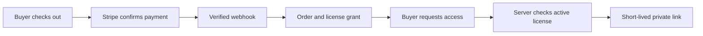

# Build Midad, a marketplace for licensed digital work

A creator publishes a typeface with a public preview and a private ZIP file. A buyer chooses a personal license, pays for it, and opens the file from their library. Another buyer purchases a commercial license with several named seats. Both have bought the same bytes, but they have not bought the same rights. Your marketplace must make that distinction visible in the product page, the order receipt, the library and the server's authorization checks.

Midad is the reference product for this variant. It connects several creators with buyers through one catalogue and one checkout. A creator opens a studio, publishes digital products and license options, and uploads public previews separately from private deliverables. A buyer can purchase from two creators in one payment; the platform makes one order per creator and grants access to each paid line. There is no parcel or delivery address. The difficult work starts when payment succeeds: the server must grant the correct license exactly once and issue a short-lived download link only to a holder whose license is still active.

## The promise to each person

| Person | What they see | What the server must enforce |
|---|---|---|
| Creator | Studio, product editor, preview gallery, private file versions and orders | Only their studio's products and orders are writable |
| Buyer | Catalogue, checkout, library, license terms and download control | Only paid, active licenses grant a new link |
| Visitor | Public product descriptions and previews | Never receives a private file identifier or delivery URL |

The product page shows license choices before payment. Each option has a name, a price in the course currency's minor units, seat rules and a version of its terms. The order line snapshots the chosen option and terms version. A creator can change a future price without changing the rights a buyer already purchased. The library shows the license and its current access state; it does not need to reveal the storage provider's asset identifier.

The private file uses an authenticated delivery type. The API first checks the buyer, license, product, refund state and rate limit. Only then does it generate a short-lived URL and record that a link was issued. A signed URL is a bearer capability until it expires: anyone who obtains it during that window may use it. The server can refuse to issue a new link after a refund, but it cannot reach back and erase bytes a buyer already downloaded. You will explain that limit in the product's refund copy and in your final defense.

The arrow from Stripe to the webhook is a trust boundary. The browser can say that a payment page closed, but only the payment provider can confirm payment. The arrow from the library to the link is another trust boundary. Owning a URL to a product page is not owning a license; the server must look up an active grant for this buyer and the requested file version. If either check is skipped, the public catalogue can become a path to private bytes.

## Payment owns fulfillment

The browser redirect after checkout is not proof of payment. The server verifies Stripe's webhook signature and checks the payment object, then writes the order and license grant using idempotent keys. A duplicate event must leave one license, not two. The success page waits and polls for the library entry; it does not create one. If a webhook is delayed, a reconciliation job finds the paid checkout that has not yet been fulfilled. If a creator requests a refund, the API blocks new link issuance immediately. When Stripe confirms the refund, the license becomes revoked. An order containing products from two creators must revoke only the refunded line.

Public previews and private deliverables have opposite access rules. When you build the upload path, test both. A public preview should load without login. An unsigned private delivery URL should fail. The catalogue response should not include the private file record at all. Those three observations are the first evidence that the separation is real.

## The four demos

Week 1 ends with both apps running, buyer and creator accounts, and a seed product with two license options and a private file record. Week 2 ends with a creator publishing a product that has a public preview and a private deliverable; a visitor cannot reach the deliverable. Week 3 ends with a two-creator checkout, verified webhook fulfillment, library entries and expiring links. Week 4 ends on a live HTTPS URL: a refund revokes one license, leaves the other active, and concurrent download requests obey the server's limit.

Your final evidence includes an authorization matrix, a diagram of public and private media paths, a webhook replay test, a refund test, a rate-limit test, worker logs and a live demonstration. In your learning log, write down what a license means in this product. Then write down the difference between receiving a link and finishing a download. The two events are not interchangeable, and the system can measure the first one reliably without proxying every file byte through the API.

## Walk one purchase through the data

A buyer puts a font from Studio A and a template from Studio B into one cart. The font has a personal license; the template has a commercial license with three named seats. The server reads the current license options and calculates the total. It creates one checkout intent and one PaymentIntent for that amount. The browser may display the amount and collect payment details, but it does not supply the authoritative cents value. If either creator changes a future listing price during this checkout, the checkout snapshot is the price the buyer reviewed, subject to the course's expiry rule.

The verified webhook records the payment event once. The fulfillment worker creates one order per studio, each with its own line snapshot. It creates a license grant for each paid line using a stable uniqueness key. A repeated webhook can re-enter the worker, but the unique grant key makes the second pass harmless. The buyer now sees two library entries. The library serializer includes product name, creator, accepted terms version, license state and a download action. It does not include the private Cloudinary public ID. That ID lives in the server-side product-file record.

Suppose the buyer clicks “Download font.” The API reads the grant, confirms that it belongs to this buyer and is active, checks the product file version, enforces its request limit and creates a signed five-minute download URL. Record the fact that a URL was issued. It would be dishonest to label that event “download completed” because the browser could close before using it. If the buyer asks again after the limit, return a clear response that names when the limit resets. A creator should be able to see useful aggregate counts without receiving a list of the buyer's unrelated library items.

Now suppose Studio A refunds its line. New font links must stop immediately once the refund request is recorded. On provider confirmation, the font grant becomes revoked. The template grant from Studio B remains active because it belongs to another order line. A link already issued for the font may work until its expiration; the app cannot undo a copy already saved to disk. Your refund screen and support text should make that limit plain. Do not promise that revocation removes files a buyer has already received.

## What stays shared, and what changes

Authentication, studio ownership, per-creator orders, server-priced checkout, verified webhooks, cache invalidation and deployment come from the same marketplace spine as the reference marketplace. Inventory reservations, delivery addresses, vendor packing and shipping status do not belong in this product. Their lessons need digital-goods-specific work: license-option validation, private media separation, idempotent grant creation, download permissions and refund revocation. A polished download button does not prove those rules. Tests must exercise an unauthorized buyer, a duplicate event, a revoked grant and an expired link.

Before building, draw two columns in the learning log. Put every public field in the first column and every server-only field in the second. Check product preview URLs, creator name, terms text, storage IDs, license key, grant state and the signed download URL. Revisit your split after Module 13, when the upload route and catalogue serializer exist. If a server-only field appears in a public response, fix the boundary before the first test payment.
