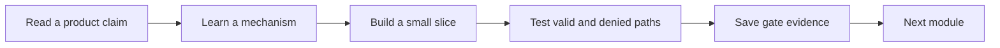

# How to use this course

Midad is one project built in small, testable steps. Read a chapter in order, try its task in your own repository, and save the result before continuing. The course uses Read chapters for product decisions, Learn chapters for mechanisms, Build chapters for code, Check chapters for a prediction or diagnostic, and Gate chapters for evidence that an entire module works. A green screen after one happy path is not a gate. A gate asks you to show a failure case, a raw response or a database record that proves the rule.

In Midad, keep two stories beside your editor. A creator wants a public product page with an attractive preview but a private original file. A buyer wants to know what they paid for and open it from their library without exposing a reusable URL. Each chapter should move one of these stories forward. After reading, write a one-sentence claim in your learning log: what boundary or behavior did the chapter add? After building, record the command or request that checked it. This habit makes a long course easier to resume after a power cut.

The loop is not a license to skip an assessment. If you can make the creator page look correct but the public API still returns the private storage ID, the module is not done. If the buyer sees a success redirect but no verified payment event, do not create a license by hand and call it working. Write the exact mismatch in the learning log and fix the responsible layer. Later modules build on these boundaries, so a missing denial test now becomes a confusing payment problem later.

## Use the learning log as a recovery tool

Create `docs/learning-log.md` in your project. At the end of each lesson, note the decision, the evidence, the failure you saw and the next action. Keep entries short but specific. For a ProductFile lesson, a useful entry says that public GET omitted storageId, names the test account used, and records the test command. "Files are secure" is not useful evidence. For a checkout lesson, record the server total and the rejected client-supplied amount. A later reviewer can reproduce those claims without relying on a screenshot.

When you pause, leave a two-line checkpoint in the log: last passing test and next file to open. Commit after a coherent build step, not only at the end of a week. If connectivity is weak, local commits still preserve your work; pushing can wait until the network returns. Keep secrets in local environment variables and an example file with placeholder names. Never paste a private asset credential, Stripe key or buyer email into the learning log for a screenshot.

## Understand the gates

Each module gate names the pass condition before you start. The Module 5 gate asks you to inspect two chains: creator ownership and buyer entitlement. A correct diagram alone is not enough; you also need one wrong-studio or wrong-buyer request that the server denies. The Module 20 gate asks for one verified fulfillment per paid line and no duplicate license under replay. The Module 21 gate asks for denied access after revocation or exhausted limits. These are examples of observable evidence, not a requirement to build later features early.

Use a disposable development database for destructive or race tests. A test that needs to delete an index or reset all rows must never point at production. Save text output and a short explanation; avoid large videos when a raw HTTP transcript suffices. If a gate fails, keep the failure in the log and repair it before moving on. Do not edit the evidence to make a broken attempt look successful. The failure is often the best clue to a missing relationship or state transition.

## Learn actively, then build independently

Worked examples show a method, not a complete capstone solution. Pause before reading a code block and predict what a second account or stale request would do. Then run the example, vary one condition, and explain the difference. In a digital marketplace, the second actor matters: one creator cannot edit another creator's file, and one buyer cannot download another buyer's purchase. A course completed with only one account has not exercised its central access boundary.

Ask for help with a concrete artifact: a route, a failing test, a database row and the behavior you expected. An instructor can respond faster to "Buyer B gets License A's storageId from GET /library" than to "downloads do not work." Keep that format even when working alone; it disciplines your own debugging. At the end of each week, use the demo target in the roadmap to decide whether the product can explain its own behavior to a new user.

The next chapter names the people and systems involved. Keep this chapter's loop in mind as you read it: every actor will need at least one valid action and one denied action later. Your learning log will collect those examples until the capstone defense can be delivered without notes.

## Revisit a chapter after a failure

Suppose the Module 13 preview page appears correct, but a classmate opens developer tools and sees the private ProductFile storage ID in a public JSON response. Return to the chapter's claim: a preview is public and the original remains private. Write the raw response field that violates it, the serializer that returned it, and one test that will fail until the field is removed. Then rerun the public GET and the creator's private management GET. The repair must close the public leak without hiding the file from its rightful owner.

This is how a gate helps you debug. It describes the behavior to observe, so you can work backward to the responsible layer. A screenshot of the page could not reveal the raw field. A unit test of the React card could also pass while the API leaks. The learning log should connect the claim to a raw request and a database relationship. Keep that trace when the issue is fixed; it shows why the code change was needed.

## Use examples without copying a finished product

A worked example might show how to validate a Product option price or create a scoped Mongoose query. Read the reasoning first, then apply it to a different actor or failure. If the example checks Studio A, test Studio B. If it handles an active License, test a revoked one. This variation matters because Midad's hard part is not storing a row; it is refusing access when a related row has changed or belongs to someone else. Copying the example without changing the case can leave the central rule untested.

A module checkpoint may ask for an oral explanation or learning-log entry. Give the concrete ID path rather than a slogan. For instance, "the API finds License by buyerId from the session, then checks status and remaining count" is reviewable. "the app is secure" is not. Even if a mentor does not run your code immediately, they can challenge the claimed predicate and ask for the denied raw request. That is the standard the course uses before declaring a chapter complete.

## Keep the portfolio evidence small

At the end of a module, save one concise artifact that a reviewer can inspect: an ERD with labelled relationships, a test transcript with valid and denied cases, or a short demo of a state transition. Long screen recordings are harder to upload and often hide details such as a webhook signature check. A text log with event ID redacted, Checkout ID, action taken and resulting License count may prove replay safety more clearly. Choose evidence to match the claim and remove secrets before sharing it.

The next chapter applies these habits to real Midad actors. As you read about Nour, Amina and the payment provider, write one valid request and one denied request for each application-facing role. This turns the actor story into a test plan rather than leaving it as introductory fiction.
