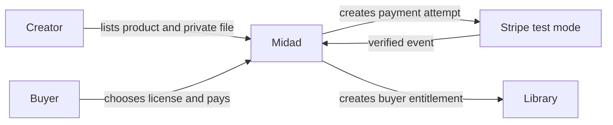

# The product and its people

Nour is a creator who sells a font through Midad. She needs a studio page, an honest preview, a choice of personal or commercial license, and a way to upload a new file without exposing the original to anyone who browses the catalogue. Amina is a buyer who needs to compare terms, pay once, find the purchase in a library and receive a working download under the agreed limit. Stripe in test mode is the payment provider. It tells Midad that a payment happened through an authenticated event; it is not a seller, a buyer or a substitute for Midad's own entitlement database.

Notice the return arrow from Stripe to Midad. A browser may land on a success page after a payment attempt, but the browser can refresh, disappear or be manipulated. The server verifies the provider event and then grants access once. A successful redirect can show "preparing your library" while the event is still being processed. It must not become the place that writes a License. This distinction is a product promise to Amina: she pays once and gets the right access even if her phone loses connection during the redirect.

## Creator decisions

Nour can edit her own Studio and Products. She can choose which public preview appears, publish a released file and set current license options. She cannot read another creator's private file just because both use the same storage provider. Nor can she change the amount on an OrderLine after Amina paid, even though Nour controls the current Product price. The later ownership chain will use User to Studio to Product to ProductFile. An account labelled creator is not enough for an edit; the route checks which Studio that account owns.

The creator also needs honest controls for incomplete work. A draft Product may lack a final preview or file, but it should not appear as purchasable. An uploaded file may wait for review before release. Publishing a Product should verify that the chosen options and deliverable are ready. This is why Midad has more states than a simple "upload file and sell" page. A buyer should never pay for a Product whose only file is an unfinished upload.

## Buyer decisions

Amina chooses a Product and a license type. Personal and commercial options may differ in price, seats, downloads and terms version. Her Cart records the choice, but the server recalculates the current price at checkout. Once she accepts a frozen offer, the paid OrderLine preserves that price and terms. A License then records her current right to request a file. A DownloadGrant records one time-limited delivery attempt. These records answer different questions, and a refund may change the License without deleting the historical OrderLine.

A buyer should see enough information before paying: what file type is delivered, what the preview represents, which usage rights are included, any seat or download limits, and how refunds affect access. Do not promise that a downloaded file can be recalled from a device. Midad can stop issuing new links after a verified refund and let existing brief links expire; it cannot erase bytes already saved. Plain terms build trust better than a hidden technical limit that appears only after checkout.

## Payment provider as an external system

Stripe test mode lets learners rehearse card payments without real charges. The provider reports payment events to Midad's server through webhooks, which must be signature verified. Events can be delivered more than once or out of order relative to a browser redirect. Midad must compare provider amount and currency with its server-held Checkout and make fulfillment idempotent. A provider event is evidence of payment state, not permission for a random client to name another buyer or file.

This boundary also shapes support. If Amina says "I paid but my library is empty," the support path checks Checkout, provider event and License creation. It does not tell her to pay again immediately. If Nour says "my product preview is public but the original is private," the support path checks the raw catalogue response and ProductFile storage policy. Each actor has a different problem and a different authoritative record. Write the names of those records beside the people in your learning log.

## Practice an actor matrix

Make three rows: edit Product, read Library, and request a download. Fill the allowed actor for each and one disallowed actor. Creator Nour may edit her own Product, but another creator may not. Buyer Amina may read her own Library, but Kareem may not read hers. An active license holder may request a download, but a public visitor with a Product ID may not. This small matrix becomes the authorization test plan in later modules.

The next chapter puts these actions in one product flow and names what Midad deliberately leaves outside the course. Keep the actor matrix; scope decisions become clearer when you can point to the person affected by them.

## Add the second creator and buyer

A course demo with only Nour and Amina can accidentally pass while every user sees the same data. Add Salma Studio with a template Product and Kareem as a second Buyer. Now ask Nour to edit Salma's Product, Amina to read Kareem's library and Kareem to request a DownloadGrant for Amina's License. Each must be denied at the server. The accounts should be simple fictional fixtures, but their separate IDs are essential evidence of isolation.

The public catalogue is different. Amina and Kareem may both see Nour's published font preview and Salma's published template preview. Neither may receive the original storage IDs. A creator may see their own private upload metadata in an authenticated dashboard. The same Product thus has different field projections for a visitor, owner and licensed buyer. Write those projections as lists of allowed fields, not a blacklist of secrets that a future field addition might bypass.

## Follow a payment that arrives late

Amina pays and closes her phone before the success page loads. The verified webhook still reaches the server and creates the License. When she signs in later, her library shows the purchase. Now reverse the timing: her browser reaches the success page before the webhook. The page shows a pending state and polls or refreshes read-only; it does not create a License. These two timelines should end with the same durable entitlement. If they do not, the app has tied payment truth to a fragile browser event.

The provider can repeat an event. The server should identify the Checkout and paid OrderLines, verify amount and currency, and create at most one License per line. This is not something the buyer or creator should have to understand during normal use, but it shapes the user experience after a slow network or retry. Amina should not see two library copies of the same purchase or receive a second charge because a provider notification was repeated.

## Keep support questions tied to an actor

If Nour reports that Salma can edit her product, start with the Studio ownership query. If Amina reports a missing download, start with her Checkout, verified payment and License state. If a public visitor reports that a preview is not loading, start with the public asset state, not private entitlement. Different actors expose different failures. A single generic "product not found" handler can hide the distinction; useful support logs record the route, actor class and decision without exposing private file keys.

Practice a one-minute explanation to a peer: creator owns a Studio and its catalogue, buyer owns a paid entitlement, and Stripe reports payment to the server. Ask them which system decides whether Amina may download after a refund. The answer is Midad's current License state after a verified event, not the mere existence of an old provider receipt or copied URL.
